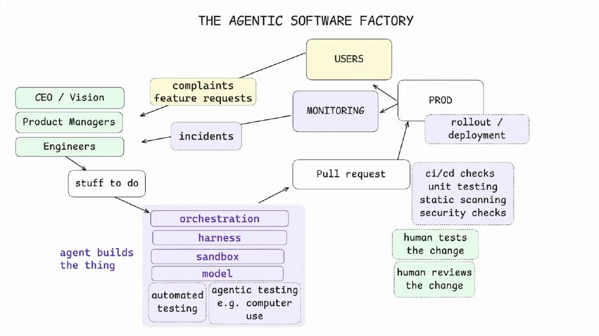
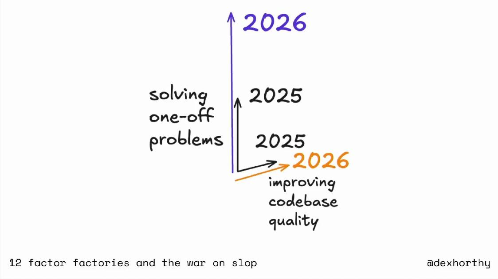
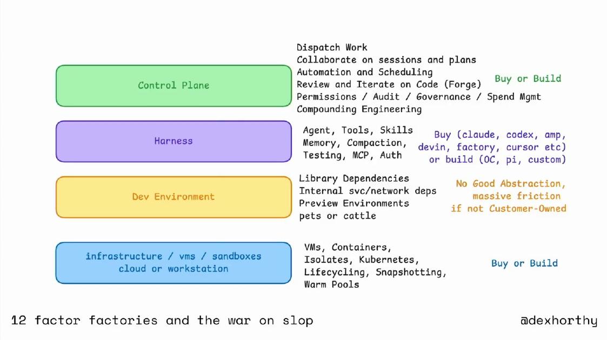

# 12 Factor Factories (Dex Horthy)

> **Status:** Research note, draft for review
> **Format:** Readable summary of the talk, with references for going deeper

## Overview

At AI Engineer Code Summit, Dex Horthy gave a talk titled "12 Rules for a Software Factory That Doesn't Ship Slop" ([YouTube](https://youtu.be/-NFMsM2y0Vk), ~20 min, uploaded November 2026). The title started as a joke on the classic [12-Factor App](https://12factor.net/), but it stuck — and like the original, it is a distillation attempt: which practices of building with coding agents are timeless, and which are hype?

This note summarizes the talk in blog form. A note on sourcing: I worked from an automatically generated transcript of the recording, checked against the talk's extracted slide deck, so everything below is paraphrased, not quoted. The rule numbering now follows the official slides (an earlier version of this note reconstructed it from the talk's flow), and the slide screenshots included below come from that deck. Each section links the primary sources where they exist.

## The frame: a factory is a loop, not a robot

The talk opens with a claim that defuses most of the hype: the software factory is not new. The pre-AI factory already looks like this — people decide what to build, work goes into a tracker, someone builds it, tests and linters run, a pull request gets reviewed, changes go through canaries and feature flags, users complain, monitoring wakes someone up at 3am, and the cycle repeats. Factory's own writing makes the same point: the factory mindset is about standardizing the *process*, not just the output ([Factory 2.0](https://factory.com/news/software-factory)).

Making this "agentic" is, conceptually, one substitution: an agent builds the thing. Everything else — review, CI, deployment discipline, feedback — still matters, arguably more than before.

The useful refinement of the "loops" buzzword is a pressure pair:

- **Forward pressure** — what causes new work to start. Feature requests and incidents should trigger agent work automatically, so the pipeline is fed without a human dispatcher.
- **Back pressure** — what keeps quality up when building gets fast. If agents build in minutes but review and testing still take days, the queue explodes. So review, testing, and CI get agentic assistance too, and the goal is that whatever a human finally touches has already been hill-climbed as far as machines can take it.

## The twelve practices

The talk's second act is a list of practices, which group naturally into four themes.

### Know what you're up against

**1. Loops = forward pressure + backpressure.** The pressure pair from the frame above is the talk's first practice, not just scene-setting. Feed the factory automatically, and make sure quality keeps pace with speed: on the slides, the agentic additions circle exactly the back-pressure stages — agentic code review and agentic regression testing join the loop alongside the agent doing the building.

**2. Know your enemy.** The uncomfortable finding: left unattended, models do not maintain or improve codebase quality over time. They are excellent at solving one-off, fully-specified problems — cloning a known system from scratch — but real software is built feature by feature, and along the way humans notice bad abstractions and centralize or delete. To measure exactly this, Dex worked with a University of Wisconsin lab on [SlopCodeBench](https://www.scbench.ai/), a benchmark where models must *evolve* a codebase across checkpoints. It is very unsaturated: the strongest models score in the mid-teens. Some failure patterns are improving (models have largely learned to raise exceptions rather than return error tuples); others are regressing in strange ways (modern models writing Python 3 in Python 2 style). He covered the essay version of this argument in [Why Software Factories Fail](https://github.com/humanlayer/advanced-context-engineering-for-coding-agents/blob/main/wsff.md).

**3. Plan before you build.** Planning was standard practice when building was slow, and it still pays off now because review and testing are still slow. Time spent up front is no longer the bottleneck it used to be, and a plan gives both the agent and its reviewer something to check the work against.

### Make the work legible

**4. Don't over-plan.** The talk is honest about the trade-off: for a small task, a two-sentence prompt and a couple of follow-ups might carry a coin-flip chance of rework, while a five-hour spec only cuts that to ~10%. His heuristic is *expected pain*: how likely is this to change later, times how hard would that change be. Don't argue with the model about button colors; do get the database schema right.

**5. Align visually.** Humans are visual creatures; walls of text are a poor way to review a plan. Dex published a "Show Me" skill that gets agents to produce HTML mockups, tables, and charts instead of prose, so the human can actually see what is about to be built.

**6. Help agents test their work.** Give the agent a way to observe outcomes: screenshots, browsers, videos, curl, a build-and-run environment for whatever platform it targets. Without a feedback signal there is nothing to hill-climb against.

### Manage slop deliberately

**7. Fight slop with deterministic tools.** There are now curated anti-slop rulesets — community rule collections and, from Factory, an ESLint plugin — encoding patterns that models reliably produce and humans reliably regret. The SlopCodeBench rules can also be forked for your language. The broader point is that these checks are deterministic: rules, not vibes. This is back pressure made concrete.

**8. Slop is a tool.** Not all slop is bad. Vibe coding, prototypes, and side projects are legitimate. If something sits behind a feature flag while you find out whether anyone wants it, perfect code is wasted effort. The sin is unexamined slop, not slop itself.

**9. Let models experiment.** PostHog, Statsig, LaunchDarkly — whatever lets an agent ship an experiment, measure it, and decide. A feature-flagging system turns "try stuff" from a liability into a method.

**10. Compound over time.** Evaluate everything; learn from past sessions. A factory that doesn't accumulate what it learns re-pays the same tuition every sprint.

### Own the system

**11. Unify your forge.** Git centralized patches; but designs, decisions, and context still scatter across Slack pastes and docs. The goal is to bring code and the reasoning around it as close together as possible, so you can later understand not just *what* was built but *why*.

**12. You can't buy everything.** The closing argument: some layers of the stack are undifferentiated building blocks — VMs, harnesses, sandboxes — and buying them is fine. But verification is not one of them. Only your team knows how your code should be tested, what your quality bar is, and what "good" means for your users. A software factory, in the end, is not a product you purchase but a way of thinking about the work.

## The anti-slop manifesto

The talk ends with a launch: the [anti-slop manifesto](https://slopmanifesto.com/), co-written with other speakers and attendees. Its working definition is the sharpest part: slop is when you put less effort into producing something than you ask its consumer to spend understanding it. The cost of producing a thousand-line PR is approaching zero; the cost of reviewing it has barely moved. That asymmetry is the whole problem. And slop compounds — the more of it sits in a codebase, a knowledge base, or a chat, the more the next agent reads and reproduces it.

The manifesto's resolutions read as a statement of what human involvement is *for*: own the intent, the taste, and the consequences of what you ship; disclose when an agent wrote something you're passing on; push back, kindly, when someone sends you slop; and keep reviewing, because there is always alpha in review — the subset you review depends on the stakes, but if you bring no thinking at all, you get the same output as everyone else.

## Takeaways for a team adopting agents

- Treat the factory as a loop with two pressures: feed it automatically, and make sure quality keeps pace with speed.
- Measure before you moralize: the evidence so far says models are bad at long-horizon codebase stewardship, so keep humans on architecture and taste.
- Spend planning effort proportional to expected pain, not uniformly.
- Linters, flags, and evals are how "care about quality" becomes a mechanism instead of a value statement.
- The human job in a factory is not to type the code; it is to own the intent, the review, and the consequences.

## Sources

- Dex Horthy, "12 Rules for a Software Factory That Doesn't Ship Slop", AI Engineer Code Summit, [video](https://youtu.be/-NFMsM2y0Vk) (uploaded November 2026). Note: this summary was prepared from an automatically generated transcript and checked against the talk's extracted slide deck; wording is paraphrased, and the rule numbering and screenshots follow the slides.
- Dex Horthy, [Why Software Factories Fail](https://github.com/humanlayer/advanced-context-engineering-for-coding-agents/blob/main/wsff.md)
- Factory, [Factory 2.0 / the software factory](https://factory.com/news/software-factory)
- [SlopCodeBench](https://www.scbench.ai/) — benchmark for evolving a codebase over time
- [Anti-slop manifesto](https://slopmanifesto.com/)
- [The Twelve-Factor App](https://12factor.net/) — the original joke's namesake

> **Vault Connections**: [[A Software Factory Critic Joins a Software Factory]] • [[Will Everyone Build an AI Factory? (Saiyam Pathak)]] • [[Building a High-Performance Token Factory (Jerry Chen)]] • [[Build the AI Context Layer for Your EPD Team (Yethoven Tukimin)]] • [[AI-Generated Code == Code You Can Trust - AISG & Sonar at EDB]]
