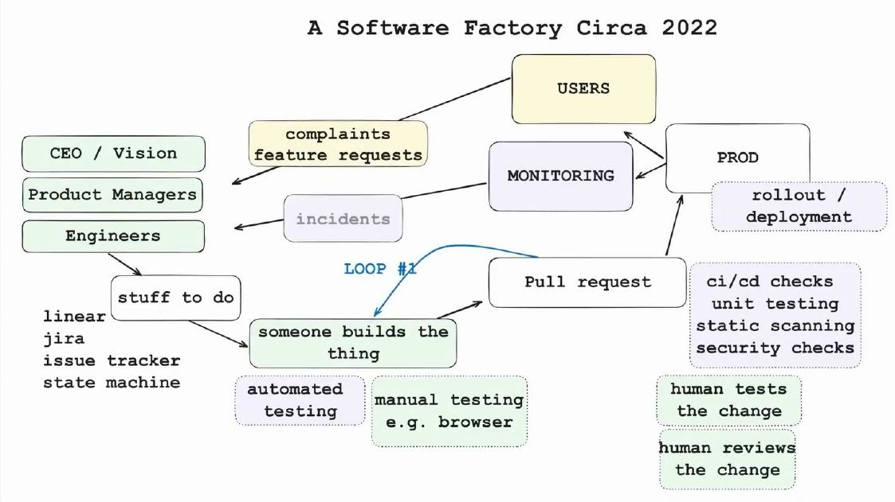
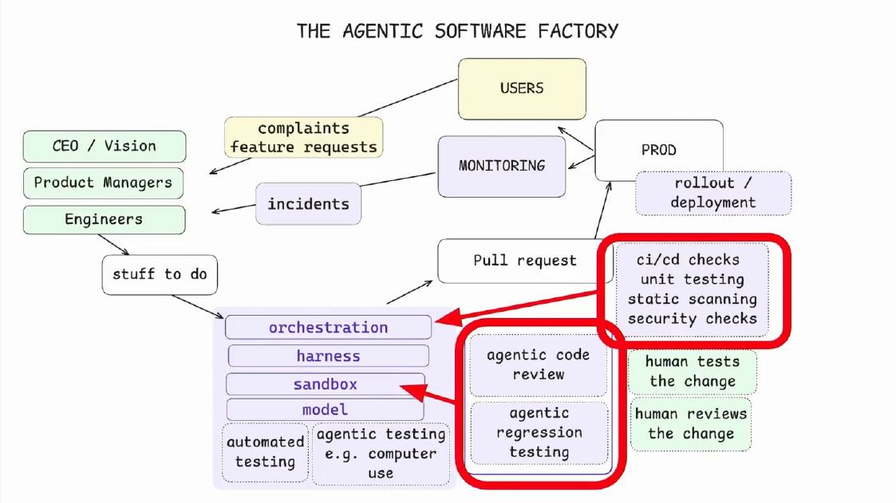
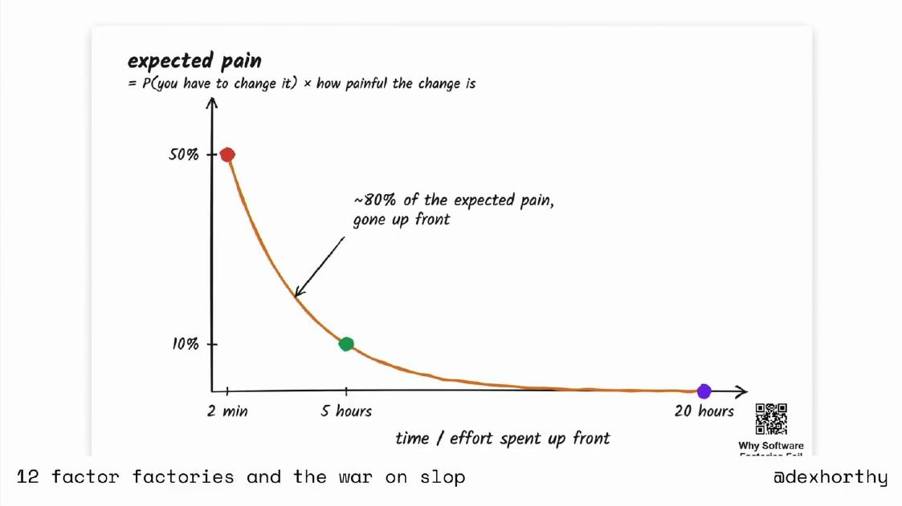
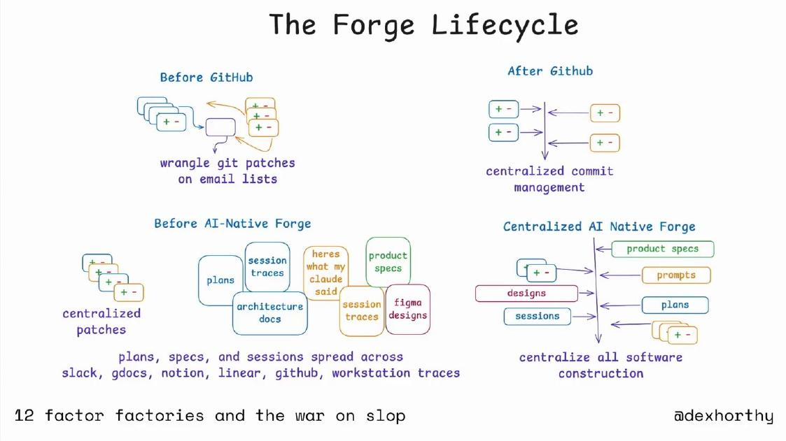

# 12 Factor Factories (Dex Horthy)

> **Status:** Research note, draft for review
> **Format:** Readable summary of the talk, with references for going deeper

## Overview

At AI Engineer Code Summit, Dex Horthy gave a talk titled "12 Rules for a Software Factory That Doesn't Ship Slop" ([YouTube](https://youtu.be/-NFMsM2y0Vk), ~20 min, uploaded November 2026). The title "started as a joke title, but then everyone started calling it that" ([0:12](https://youtu.be/-NFMsM2y0Vk?t=12)). The obvious reference is the classic [12-Factor App](https://12factor.net/) — that connection is this note's inference; he never names the original in the talk. What he does say he's after is a distillation: which practices of building with coding agents are timeless, and which are hype ([5:09](https://youtu.be/-NFMsM2y0Vk?t=309)).

A note on sourcing: this summary is paraphrased from an automatically generated transcript of the recording, checked against the talk's official slide deck. The rule numbering follows the slides, and the screenshots below come from the deck. Every claim about what the talk says carries a timestamp link back to the video. Where this note adds interpretation beyond what Dex says, it is marked as such. One caveat: the transcript is machine-generated, so product and model names in it may be approximate (for example, it renders what is almost certainly "PostHog" as "post hoc").

## The frame: a factory is a loop, not a robot

The talk opens with a claim that defuses most of the hype: the software factory is not new. The pre-AI factory already looks like this — people decide what to build, work goes into a tracker, someone builds it, tests and linters run, a pull request gets reviewed, changes go through canaries and feature flags, users complain, monitoring wakes someone up at 3am, and the cycle repeats ([2:50](https://youtu.be/-NFMsM2y0Vk?t=170)). Factory's own writing makes the same point he credits on stage: the factory mindset is about standardizing the *process*, not just the output ([2:26](https://youtu.be/-NFMsM2y0Vk?t=146), [Factory 2.0](https://factory.com/news/software-factory)).

Making this "agentic" is, conceptually, one substitution: an agent builds the thing ([3:53](https://youtu.be/-NFMsM2y0Vk?t=233)). Everything else — review, CI, deployment discipline, feedback — still matters.

The useful refinement of the "loops" buzzword is a pressure pair ([3:53](https://youtu.be/-NFMsM2y0Vk?t=233)–[4:45](https://youtu.be/-NFMsM2y0Vk?t=285)):

- **Forward pressure** — what causes new work to start. Feature requests and incidents should trigger agent work automatically: when he gets paged at 3am, he wants to be looking at a pull request that might fix it, not just a stack trace.
- **Back pressure** — what keeps quality up when building gets fast. If agents build in minutes or hours but review and testing still take hours or days, the queue explodes. So review, testing, and CI get agentic assistance too, and the goal is that whatever a human finally touches has already been hill-climbed as far as machines can take it ([4:45](https://youtu.be/-NFMsM2y0Vk?t=285)).

## The twelve practices

The talk's second act is a list of practices — he notes it has grown from nine to twelve since he first gave it ([5:35](https://youtu.be/-NFMsM2y0Vk?t=335)). The four-theme grouping below is this note's organization, not the talk's; he simply runs through them in order.

### Know what you're up against

**1. Loops = forward pressure + backpressure** ([6:01](https://youtu.be/-NFMsM2y0Vk?t=361)). The pressure pair from the frame above is the talk's first practice, not just scene-setting. Feed the factory automatically, and make sure quality keeps pace with speed: on the slides, the agentic additions circle exactly the back-pressure stages — agentic code review and regression testing join the loop alongside the agent doing the building.

**2. Know your enemy** ([6:26](https://youtu.be/-NFMsM2y0Vk?t=386)). The uncomfortable finding: left unattended, models do not maintain or improve codebase quality over time. They are excellent at solving one-off, fully-specified problems — cloning a known system like Excel or Redis from scratch — but real software is built feature by feature, and along the way humans notice bad abstractions and centralize or delete ([6:50](https://youtu.be/-NFMsM2y0Vk?t=410)). To measure exactly this, Dex worked with Gabe Orlanski's University of Wisconsin lab on [SlopCodeBench](https://www.scbench.ai/), a benchmark where models must *evolve* a codebase across checkpoints ([6:50](https://youtu.be/-NFMsM2y0Vk?t=410), [8:04](https://youtu.be/-NFMsM2y0Vk?t=484)). It is very unsaturated: the strongest models score in the mid-teens ([1:22](https://youtu.be/-NFMsM2y0Vk?t=82)). Some failure patterns are improving (models have largely learned to raise exceptions rather than return error tuples); others are regressing in strange ways (modern models writing Python 3 in Python 2 style, percent-format strings making a comeback) ([8:04](https://youtu.be/-NFMsM2y0Vk?t=484), [8:41](https://youtu.be/-NFMsM2y0Vk?t=521)). The essay form of this argument is [Why Software Factories Fail](https://github.com/humanlayer/advanced-context-engineering-for-coding-agents/blob/main/wsff.md) — he references the earlier talk of that name at [1:22](https://youtu.be/-NFMsM2y0Vk?t=82) and says he wrote a long article about the benchmark at [8:04](https://youtu.be/-NFMsM2y0Vk?t=484).

**3. Plan before you build** ([9:11](https://youtu.be/-NFMsM2y0Vk?t=551)). Planning was standard practice when building was slow — architecture review, sprint planning — and it still pays off now because review and testing are still slow even when building gets fast ([9:35](https://youtu.be/-NFMsM2y0Vk?t=575)). The point is to be rather sure you're building the right thing in the right way before spending the time and tokens, and to lower the chance of rework later.

### Make the work legible

**4. Don't over-plan** ([10:15](https://youtu.be/-NFMsM2y0Vk?t=615)). The talk is honest about the trade-off: for a small task, a two-sentence prompt and a couple of follow-ups might carry a coin-flip chance of rework, while a five-hour handwritten spec only cuts that to ~10% — and writing all the code by hand in 20 hours takes it to ~0% ([10:15](https://youtu.be/-NFMsM2y0Vk?t=615)). His heuristic is *expected pain*: how likely is this to change later, times how hard would that change be ([10:38](https://youtu.be/-NFMsM2y0Vk?t=638)). Don't argue with the model about button colors; do get the database schema right.

**5. Align visually** ([11:01](https://youtu.be/-NFMsM2y0Vk?t=661)). Humans are visual creatures; walls of text are a poor way to review a plan. Dex published a "Show Me" skill (~40,000 installs, he says) that gets agents to produce HTML mockups, tables, and charts instead of prose.

**6. Help agents test their work** ([11:01](https://youtu.be/-NFMsM2y0Vk?t=661)). Give the agent a way to observe outcomes: screenshots, browsers, videos, curl — whatever lets it hill-climb against an outcome ([11:31](https://youtu.be/-NFMsM2y0Vk?t=691)). If you're building an iOS app, make sure the agent can build, run, and test that app in whatever environment it's running.

### Manage slop deliberately

**7. Fight slop with deterministic tools** ([11:31](https://youtu.be/-NFMsM2y0Vk?t=691)). There are now curated anti-slop rulesets — he points to Dylan Moroy's Anti Slop repo (~100 rules; Moroy is a principal engineer at Cloudflare) and an ESLint plugin from Factory — encoding patterns that models reliably produce and humans reliably regret ([11:57](https://youtu.be/-NFMsM2y0Vk?t=717)). The SlopCodeBench Python rules can also be forked for your language.

**8. Slop is a tool** ([11:57](https://youtu.be/-NFMsM2y0Vk?t=717)). Not all slop is bad. Vibe coding, prototypes, and side projects are legitimate, and not every line of code has to be perfect. If something sits behind a feature flag while you find out whether anyone wants it, polishing it first is wasted effort. His closing frame: slop is bad when it undermines the outcome ([19:06](https://youtu.be/-NFMsM2y0Vk?t=1146)).

**9. Let models experiment** ([12:25](https://youtu.be/-NFMsM2y0Vk?t=745)). Give models a feature-flagging system — PostHog, Statsig, LaunchDarkly (the transcript renders the first as "post hoc") — so they can try stuff, see if it performs better, and make decisions.

**10. Compound over time** ([12:25](https://youtu.be/-NFMsM2y0Vk?t=745)). "Eval everything, learn from past sessions." The talk gives this one a single line; the slide expands it slightly. (An earlier version of this note added a justification here that went beyond the talk; it has been removed.)

### Own the system

**11. Unify your forge** ([12:25](https://youtu.be/-NFMsM2y0Vk?t=745)). GitHub centralized patches — we used to send them around mailing lists, and the Linux kernel still does — but designs, decisions, and context still scatter: people paste Claude answers back and forth in Slack, round after round ([12:51](https://youtu.be/-NFMsM2y0Vk?t=771)). The goal is to bring code and the reasoning around it as close together as possible, so you can later understand not just the code but all the decisions that went into it.

**12. You can't buy everything** ([13:25](https://youtu.be/-NFMsM2y0Vk?t=805)). Some layers of the stack are undifferentiated building blocks — you can buy VMs, bring your own dev environment, take a frontier harness off the shelf or customize a minimal one — and buying them is fine. But verification is not one of them: only your team knows how your code should be tested, because only you have those opinions. A software factory, in the end, is not a product you purchase but a way of thinking about the work ([14:11](https://youtu.be/-NFMsM2y0Vk?t=851)).

## The anti-slop manifesto

The talk ends with a launch: the [anti-slop manifesto](https://slopmanifesto.com/), built in collaboration with other speakers and attendees, with shout-outs to Swyx and Philipp ([14:43](https://youtu.be/-NFMsM2y0Vk?t=883)). Its values: outcomes over outputs, understanding over speed, your own thinking over the model's first draft, better work over easier work ([15:08](https://youtu.be/-NFMsM2y0Vk?t=908)). Its working definition is the sharpest part: slop is when you put less effort into producing something than you ask its consumer to spend understanding it ([15:42](https://youtu.be/-NFMsM2y0Vk?t=942)). The cost of producing a thousand-line PR or a ten-page doc is approaching zero; the cost of reviewing it is still fairly constant ([16:10](https://youtu.be/-NFMsM2y0Vk?t=970)). And slop compounds — the more of it sits in a codebase, a knowledge base, or a chat, the more the next agent reads and copies it ([16:42](https://youtu.be/-NFMsM2y0Vk?t=1002)).

The manifesto's resolutions read as a statement of what human involvement is *for* ([17:09](https://youtu.be/-NFMsM2y0Vk?t=1029)): own the intent, the taste, and the consequences of what you ship; disclose when an agent wrote something you're passing on, and make sure it's good first ([17:40](https://youtu.be/-NFMsM2y0Vk?t=1060)); push back, kindly, when someone sends you slop ([18:03](https://youtu.be/-NFMsM2y0Vk?t=1083)); and keep reviewing, because there is always alpha in review — agent reviewers, linters, and verifiers are useful but not sufficient, the subset you review depends on the stakes, and if you bring no thinking at all, you get the same output as everyone else ([18:03](https://youtu.be/-NFMsM2y0Vk?t=1083), [18:34](https://youtu.be/-NFMsM2y0Vk?t=1114)).

## Takeaways for a team adopting agents

*This section is the note author's synthesis, not the talk's content; each line links the parts of the talk it draws on.*

- Treat the factory as a loop with two pressures: feed it automatically, and make sure quality keeps pace with speed ([3:53](https://youtu.be/-NFMsM2y0Vk?t=233), [6:01](https://youtu.be/-NFMsM2y0Vk?t=361)).
- The benchmark evidence says models are bad at long-horizon codebase stewardship, so keep humans on architecture and taste ([6:26](https://youtu.be/-NFMsM2y0Vk?t=386), [17:40](https://youtu.be/-NFMsM2y0Vk?t=1060)).
- Spend planning effort proportional to expected pain, not uniformly ([10:38](https://youtu.be/-NFMsM2y0Vk?t=638)).
- Linters, flags, and evals are how "care about quality" becomes a mechanism instead of a value statement ([11:31](https://youtu.be/-NFMsM2y0Vk?t=691), [12:25](https://youtu.be/-NFMsM2y0Vk?t=745)).
- The human job in a factory is not to type the code; it is to own the intent, the review, and the consequences ([17:09](https://youtu.be/-NFMsM2y0Vk?t=1029), [18:34](https://youtu.be/-NFMsM2y0Vk?t=1114)).

## Sources

- Dex Horthy, "12 Rules for a Software Factory That Doesn't Ship Slop", AI Engineer Code Summit, [video](https://youtu.be/-NFMsM2y0Vk) (uploaded November 2026). This summary was prepared from an automatically generated transcript and checked against the talk's official slide deck; wording is paraphrased, the rule numbering and screenshots follow the slides, and every talk claim carries a timestamp link. Interpretation added by this note is marked inline.
- Dex Horthy, [Why Software Factories Fail](https://github.com/humanlayer/advanced-context-engineering-for-coding-agents/blob/main/wsff.md)
- Factory, [Factory 2.0 / the software factory](https://factory.com/news/software-factory)
- [SlopCodeBench](https://www.scbench.ai/) — benchmark for evolving a codebase over time
- [Anti-slop manifesto](https://slopmanifesto.com/)
- [The Twelve-Factor App](https://12factor.net/) — the title's likely namesake (not named in the talk)

> **Vault Connections**: [[A Software Factory Critic Joins a Software Factory]] • [[Will Everyone Build an AI Factory? (Saiyam Pathak)]] • [[Building a High-Performance Token Factory (Jerry Chen)]] • [[Build the AI Context Layer for Your EPD Team (Yethoven Tukimin)]] • [[AI-Generated Code == Code You Can Trust - AISG & Sonar at EDB]]
