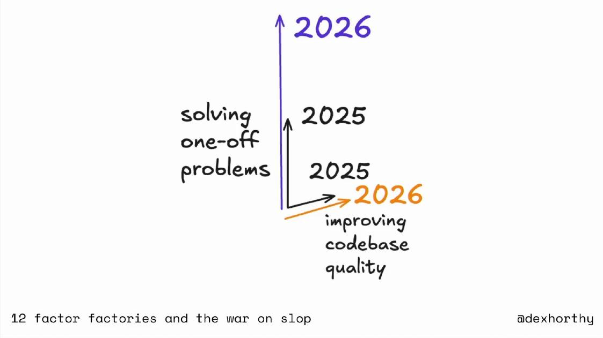

# A Software Factory Critic Joins a Software Factory

*Image: Factory, from [Factory 2.0](https://factory.com/news/software-factory).*

## The news

On November 4, 2026, HumanLayer announced it is joining Factory ([the announcement](https://www.humanlayer.dev/blog/humanlayer-joins-factory)). HumanLayer is Dex Horthy's company, known for practical writing and talks on working with coding agents. Factory builds autonomous "droids" for the software development lifecycle, and describes its end goal as the software factory ([Factory 2.0](https://factory.com/news/software-factory)).

This caught my attention because I had read Dex's essay "Why Software Factories Fail" ([the essay](https://github.com/humanlayer/advanced-context-engineering-for-coding-agents/blob/main/wsff.md)) and watch a number of his talks. He has been one of the sharper critics of where this space is heading. So what is he doing joining one?

## His own answer

His recent talk, "12 Rules for a Software Factory That Doesn't Ship Slop" ([the recording](https://youtu.be/-NFMsM2y0Vk)), comes close to answering that. He opens by saying he is now part of Factory, then takes on the reaction to his earlier talk and essay head-on. After he titled that work "Why Software Factories Fail," he says, people decided he was the anti-software-factory guy. His reply ([1:22](https://youtu.be/-NFMsM2y0Vk?t=82)): he actually loves software factories and is a huge fan.

## What the essay actually said

The essay's target is the lights-off factory, where no human reads or writes the code. Its core argument is about how models are trained and benchmarked. If the tests pass, the model wins, and nothing in that loop penalizes eroding a codebase's maintainability. His conclusion is that no amount of harness engineering fixes what is fundamentally a model-training issue. The essay is also explicit that you can still move fast without setting your codebase on fire.

*Slide from Dex Horthy's talk ([6:26](https://youtu.be/-NFMsM2y0Vk?t=386)): models keep getting better at one-off problems, not at improving codebase quality.*

## What the talk moves forward

He presents data from SlopCodeBench ([scbench.ai](https://www.scbench.ai/)), a benchmark from a University of Wisconsin lab that tests whether coding agents hold up as a codebase evolves. It is still very unsaturated: the best models score in the mid-teens ([1:22](https://youtu.be/-NFMsM2y0Vk?t=82)). It is an early attempt at the maintainability measurement the essay said was missing.

He also argues that a software factory is a way of thinking about the work, not a black box you can buy ([14:11](https://youtu.be/-NFMsM2y0Vk?t=851)). Some layers are undifferentiated building blocks you can buy. Verification is not one of them: only your team knows how your code should be tested ([13:25](https://youtu.be/-NFMsM2y0Vk?t=805)). To me that lines up with Factory's own writing about standardizing the process rather than just the output.

## The thread, and the open question

At the same talk he launched an anti-slop manifesto ([slopmanifesto.com](https://slopmanifesto.com/)), built on the idea that AI should make our work better, not just easier, and that humans stay accountable for what ships ([14:43](https://youtu.be/-NFMsM2y0Vk?t=883)). The principles in the joining announcement are composable tools over black boxes, multiplayer planning and collaboration, and lab-neutral orchestration. To me they sit comfortably with that philosophy. This is my reading, not his stated reason for joining.

One tension remains. Factory 2.0 describes a software factory as a continuous loop that it wants to be fully AI-driven, while also saying autonomy should grow gradually and that engineers stay responsible for governance and outcomes. How far toward lights-off that goes is the question I'd watch.

The entertaining headline is that a critic joined the thing he criticized. His own framing is simpler: he was never against factories, only against slop. My reading is that this move lets him help build the kind he argued for.

---

## Sources

- [HumanLayer is joining Factory](https://www.humanlayer.dev/blog/humanlayer-joins-factory) (Nov 4, 2026)
- [Why Software Factories Fail](https://github.com/humanlayer/advanced-context-engineering-for-coding-agents/blob/main/wsff.md) (Dex Horthy)
- [12 Rules for a Software Factory That Doesn't Ship Slop](https://youtu.be/-NFMsM2y0Vk) (Dex Horthy, AI Engineer)
- [Factory 2.0: From coding agents to software factories](https://factory.com/news/software-factory)
- [SlopCodeBench](https://www.scbench.ai/)
- [Anti-slop manifesto](https://slopmanifesto.com/)

**Source method:** my summary of the talk is paraphrased from an automated transcript of the recording, checked against its slides, so wording is not quoted and product names may be slightly off. The reading of why he joined Factory is mine, not his.

For a point-by-point summary of the talk, see [12 Factor Factories (Dex Horthy)](./12%20Factor%20Factories%20(Dex%20Horthy).md).
