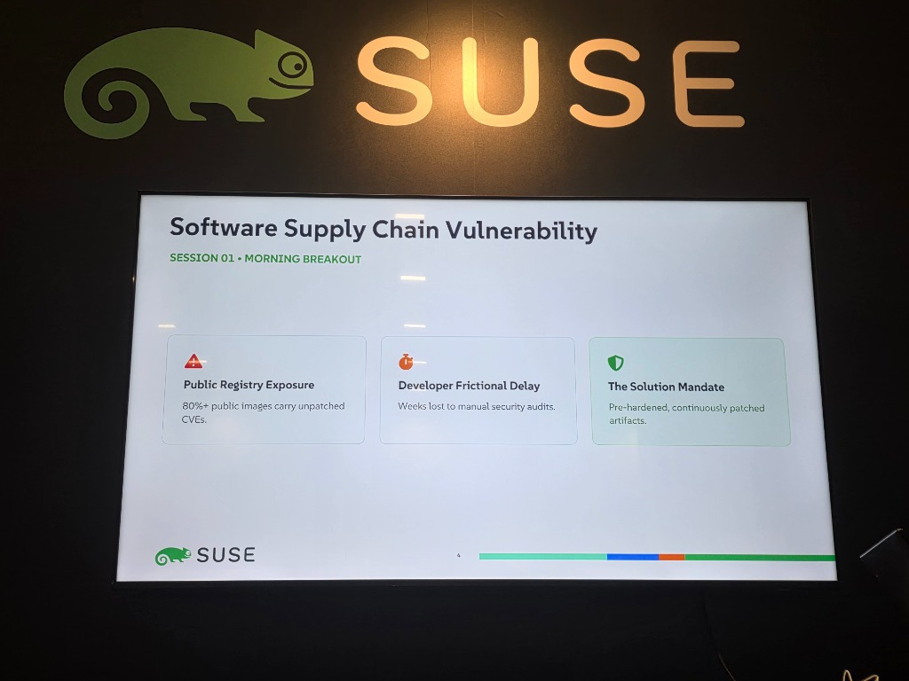
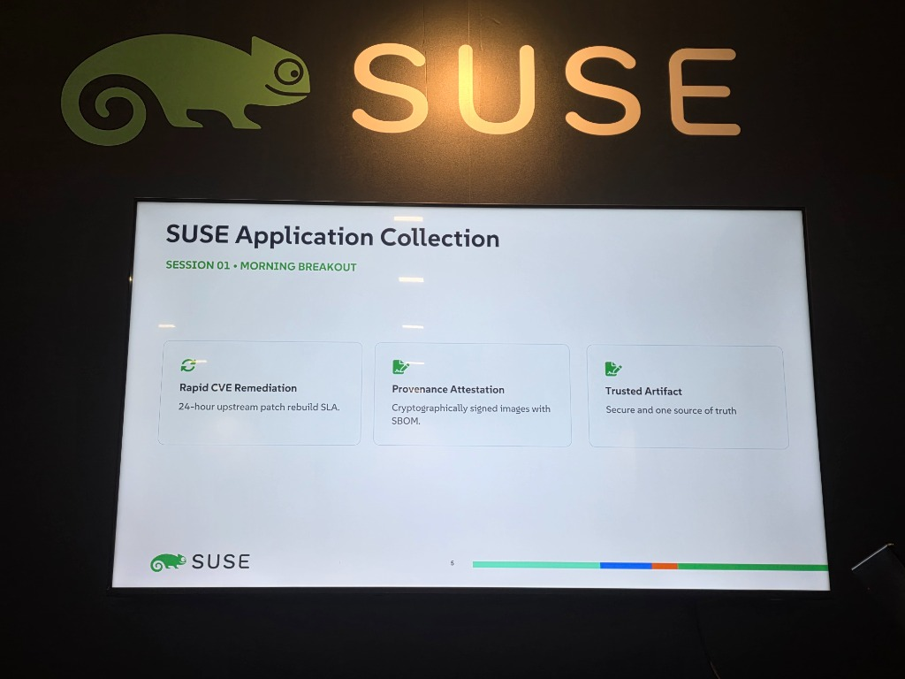
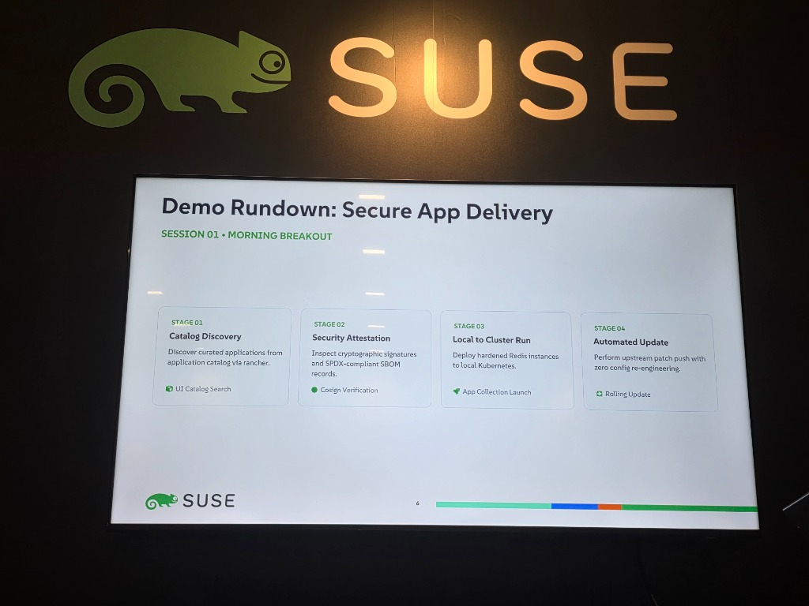
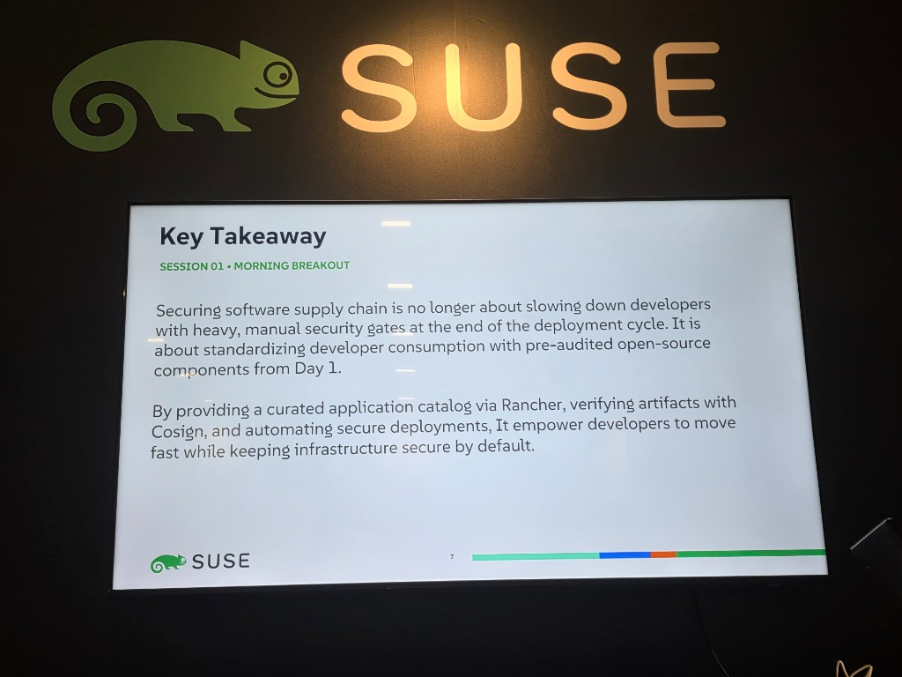
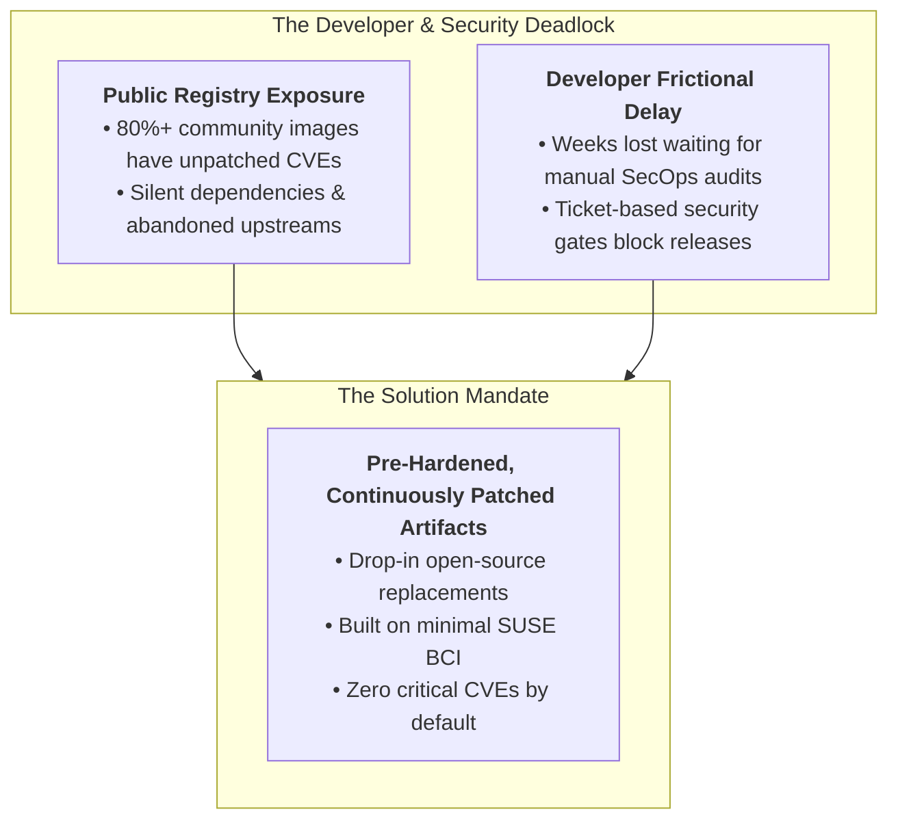
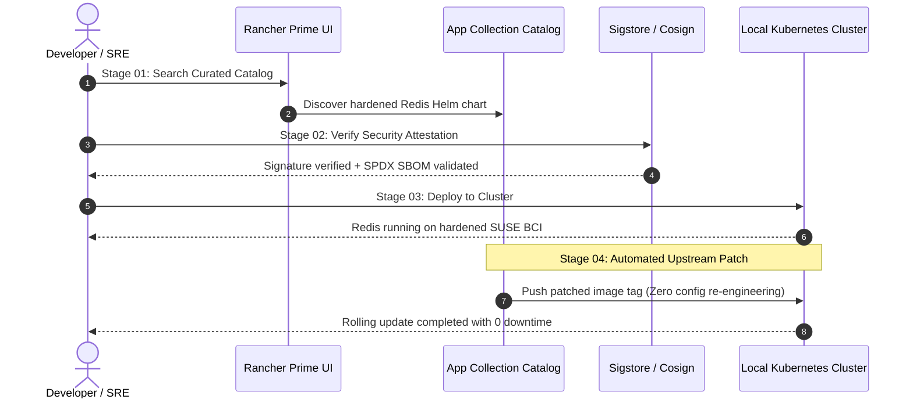

# Accelerating Cloud-Native Delivery with SUSE Application Collection

> **Event**: [ContainerDays Singapore 2026](./ContainerDays%20Singapore%202026.md) (Day 2 · Expo Showcase / Booth Sessions)  
> **Date & Time**: Wednesday, October 28, 2026 · Morning (~11:00 SGT)  
> **Presenter / Host**: **SUSE**  
> **Location**: **SUSE Booth (Exhibition / Sponsor Showcase)**  
> **Talk Title**: *"Accelerating Cloud-Native Delivery with SUSE Application Collection"*  
> **Core Themes**: Secure Software Supply Chain · Curated Application Catalog · SUSE Base Container Images (BCI) · SBOM & SLSA Provenance · Zero-CVE Hardening · Rancher App Catalog Integration  
> **Vault Connections**:
> - [ContainerDays Singapore 2026](./ContainerDays%20Singapore%202026.md) — Master conference schedule and session index
> - [Enterprise Sovereign AI - Building with SUSE AI Factory](./Enterprise%20Sovereign%20AI%20-%20Building%20with%20SUSE%20AI%20Factory.md) — Day 1 SUSE AI Factory sovereign stack & Rancher Prime demo
> - [Will Everyone Build an AI Factory? (Saiyam Pathak)](./Will%20Everyone%20Build%20an%20AI%20Factory%3F%20%28Saiyam%20Pathak%29.md) — Multi-tenancy and enterprise container packaging
> - [Securing AI Coding Agents with Kubernetes Sandboxes (Ryan Djurovich)](./Securing%20AI%20Coding%20Agents%20with%20Kubernetes%20Sandboxes%20%28Ryan%20Djurovich%29.md) — Supply chain security and untrusted runtime isolation
> - [Governing the Agentic Stack on Kubernetes - MCP, A2A, and LLM Traffic (Robin Cher)](./Governing%20the%20Agentic%20Stack%20on%20Kubernetes%20-%20MCP%2C%20A2A%2C%20and%20LLM%20Traffic%20%28Robin%20Cher%29.md) — Infrastructure governance on Kubernetes

---

## ⚡ TL;DR (Key Takeaways in 60 Seconds)

- **The Open-Source Security Gap**: Over 80% of unvetted community container images contain unpatched critical CVEs; manual enterprise audits introduce weeks of frictional onboarding delay.
- **SUSE Application Collection**: Enterprise-hardened, continuously patched container images built upon secure SUSE Base Container Images (BCI).
- **24-Hour Upstream Patch SLA**: Automated rebuilding and CVE remediation within 24 hours of upstream security disclosures.
- **Cryptographic Provenance**: Sigstore/Cosign digital signatures, SLSA provenance attestations, and machine-readable SPDX/CycloneDX SBOM records accompanying every image.
- **Rancher Prime Integration**: 4-stage delivery (Catalog Discovery $	o$ Cosign Verification $	o$ Local Kubernetes Run $	o$ Automated Rolling Updates) enabling seamless deployment without refactoring.

---

## 📸 Booth & Session Slides

### Slide 01 · Presentation Title

> **Title Display**: *"Accelerating Cloud-Native Delivery with SUSE Application Collection"* presented at the SUSE Booth during Day 2 of ContainerDays & AI Context Singapore 2026.

### Slide 04 · Software Supply Chain Vulnerability

> **The Problem**: Public registry exposure (**80%+ public images carry unpatched CVEs**), developer frictional delay (weeks lost to manual security audits), and the mandate for pre-hardened, continuously patched artifacts.

### Slide 05 · SUSE Application Collection Core Pillars

> **The Architecture**: **Rapid CVE Remediation** (**24-hour upstream patch rebuild SLA**), **Provenance Attestation** (cryptographically signed images with SBOM), and **Trusted Artifact** (secure, unified source of truth).

### Slide 06 · Demo Rundown: Secure App Delivery (4 Stages)

> **Live Demo Pipeline**: 4-stage workflow spanning Catalog Discovery $\to$ Security Attestation $\to$ Local to Cluster Run $\to$ Automated Update.

### Slide 07 · Key Takeaway

> **The Paradigm Shift**: Securing the software supply chain by standardizing developer consumption with pre-audited open-source components from Day 1, rather than slowing down releases with manual end-of-cycle gates.

---

## 📌 The Software Supply Chain Dilemma (Slide 04)

Enterprise engineering organizations are caught in a direct conflict between velocity and security:

1. **Public Registry Exposure**: Over **80% of open-source container images** on public registries contain known, exploitable vulnerabilities or outdated dependencies.
2. **Developer Frictional Delay**: Security teams intervene late in the release cycle, stalling sprint delivery for weeks of manual vulnerability assessments, exception filings, and emergency refactoring.
3. **The Solution Mandate**: Developers need pre-vetted, hardened open-source building blocks (databases, ingress, caches, runtimes) readily available from Day 1.

---

## ⚙️ SUSE Application Collection Architecture (Slide 05)

SUSE Application Collection transforms open-source consumption through three enterprise guarantees:

1. **Rapid CVE Remediation (24-Hour SLA)**:
   - When an upstream CVE is published in components like Redis, PostgreSQL, Nginx, or Node.js, SUSE's automated build and test pipeline rebuilds, verifies, and publishes patched images within **24 hours**.
2. **Provenance Attestation & Cryptographic Integrity**:
   - Every artifact is cryptographically signed using **Sigstore / Cosign**.
   - Accompanied by machine-readable **SPDX / CycloneDX SBOMs** verifying provenance across every compiled dependency layer.
3. **Trusted Artifact (One Source of Truth)**:
   - Built on enterprise **SUSE Base Container Images (BCI)**.
   - Guaranteed compatibility, binary predictability, and multi-architecture support (x86_64, ARM64/aarch64).

---

## 🧪 Live Demo Rundown: 4-Stage Secure App Delivery (Slide 06)

The booth session demonstrated a complete end-to-end lifecycle deploying a hardened **Redis** instance from scratch:

- **Stage 01 · Catalog Discovery (`UI Catalog Search`)**:
  - Developers browse curated enterprise applications directly within the **Rancher Prime** application catalog interface, eliminating random Docker Hub searches.
- **Stage 02 · Security Attestation (`Cosign Verification`)**:
  - Admission controllers and developers inspect cryptographic signatures and query the SPDX-compliant SBOM to confirm image origin and zero-CVE status before scheduling.
- **Stage 03 · Local to Cluster Run (`App Collection Launch`)**:
  - One-click launch deploys the hardened Redis instance to the local Kubernetes cluster with enterprise-ready defaults, resource limits, and non-root user permissions.
- **Stage 04 · Automated Update (`Rolling Update`)**:
  - When an upstream patch is pushed, Rancher triggers a zero-re-engineering rolling update, updating container tags seamlessly without breaking application state or configuration.

---

## 💡 Key Takeaway (Slide 07)

> *"Securing software supply chain is no longer about slowing down developers with heavy, manual security gates at the end of the deployment cycle. It is about standardizing developer consumption with pre-audited open-source components from Day 1.*  
> 
> *By providing a curated application catalog via Rancher, verifying artifacts with Cosign, and automating secure deployments, it empowers developers to move fast while keeping infrastructure secure by default."*

---

## 🔗 Related Notes & Cross-References

- 🌟 [ContainerDays Singapore 2026](./ContainerDays%20Singapore%202026.md) — Conference schedule, keynote summaries, and session tracking
- 🦎 [Enterprise Sovereign AI - Building with SUSE AI Factory](./Enterprise%20Sovereign%20AI%20-%20Building%20with%20SUSE%20AI%20Factory.md) — Day 1 SUSE showcase featuring Rancher Prime, NeuVector Prime, and SLES for NVIDIA
- 🛡️ [Governing the Agentic Stack on Kubernetes - MCP, A2A, and LLM Traffic (Robin Cher)](./Governing%20the%20Agentic%20Stack%20on%20Kubernetes%20-%20MCP%2C%20A2A%2C%20and%20LLM%20Traffic%20%28Robin%20Cher%29.md) — Kubernetes governance and security
