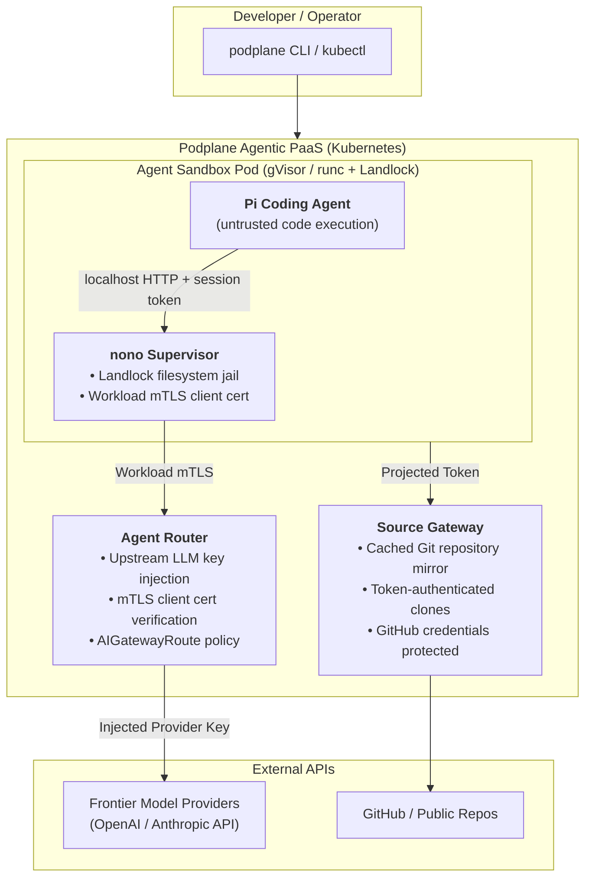

# Build Your Own AI Coding Agent Platform on Kubernetes (Ryan Djurovich)

> **Speaker**: **Ryan Djurovich** (Maintainer of **Podplane** · Founder of [Nadrama.com](https://nadrama.com) · Maintainer of upstream `agent-sandbox`)  
> **Event**: [ContainerDays Singapore 2026](ContainerDays%20Singapore%202026.md) (Day 2 · Hands-On Workshop Track)  
> **Date & Time**: Wednesday, October 28, 2026 · Morning/Midday Workshop (~11:45 AM – 1:00 PM SGT)  
> **Stage / Room**: **Workshop Room**  
> **Title**: *"Build Your Own AI Coding Agent Platform on Kubernetes"*  
> **Workshop Repo**: [github.com/ryan0x44/workshop-2026-containerdays-singapore-kubernetes-agents](https://github.com/ryan0x44/workshop-2026-containerdays-singapore-kubernetes-agents)  
> **Slide Portal**: [ryan0x44.com/singapore2026](https://ryan0x44.com/singapore2026)  
> **Core Themes**: Local Agentic PaaS · Podplane · Upstream Kubernetes `Sandbox` CRD · Pi Coding Agent · Agent Router · Source Gateway · In-Sandbox Process Supervision with `nono` (Landlock LSM + Workload mTLS)  
> **Vault Connections**:
> - [ContainerDays Singapore 2026](ContainerDays%20Singapore%202026.md) — Master conference schedule and session index
> - [Securing AI Coding Agents with Kubernetes Sandboxes (Ryan Djurovich)](Securing%20AI%20Coding%20Agents%20with%20Kubernetes%20Sandboxes%20(Ryan%20Djurovich).md) — Ryan's Day 1 theoretical foundations and sandbox taxonomy
> - [When Tokens Stop Being the Bottleneck - Operating Agentic Software Factories (Carl Ross)](When%20Tokens%20Stop%20Being%20the%20Bottleneck%20-%20Operating%20Agentic%20Software%20Factories%20(Carl%20Ross).md) — Autonomous agent fleets on Kubernetes
> - [Governing the Agentic Stack on Kubernetes - MCP, A2A, and LLM Traffic (Robin Cher)](Governing%20the%20Agentic%20Stack%20on%20Kubernetes%20-%20MCP,%20A2A,%20and%20LLM%20Traffic%20(Robin%20Cher).md) — Infrastructure-level gateway governance
> - [Stop Shipping Features with AI. Start Shipping AI Operable Products (Khang Toh)](Stop%20Shipping%20Features%20with%20AI.%20Start%20Shipping%20AI%20Operable%20Products%20(Khang%20Toh).md) — Operational guardrails and sandbox containment

---

## ⚡ TL;DR (Key Takeaways in 60 Seconds)

- **Workshop Mission**: Hands-on lab building a self-hosted agentic PaaS on Kubernetes to run autonomous coding agents (like [Pi](https://pi.dev)) within secure, isolated sandboxes.
- **Podplane Architecture**: Lightweight QEMU microVM runtime with daemonless `ocimage` container builds, replacing bulky container engines with fast sandbox startup.
- **The Kubernetes `Sandbox` CRD**: Manages ephemeral agent environments with explicit suspension states and hard shutdown deadlines, avoiding StatefulSet management overhead.
- **Inference & Git Gateways**: Provider API keys (Anthropic, OpenAI) and Git credentials never touch the untrusted sandbox; requests are securely routed, authenticated, and signed by external gateways.
- **In-Sandbox Supervision with `nono`**: Uses Linux Landlock LSM to lock down filesystem access and issues SPIFFE workload mTLS certificates to authenticate outbound requests via an Envoy sidecar.

---

## 📸 Stage & Workshop Slides


> **Workshop Resources Portal**: Accessing hands-on workshop materials, slides, and manifests via [ryan0x44.com/singapore2026](https://ryan0x44.com/singapore2026).


> **Slide 9 of 15 (Context from Day 1 Session)**: *Kubernetes Agent Sandbox for Agent Harness Pods* (`agents.x-k8s.io/v1beta1`). Contrasting why StatefulSets fail for AI agent harnesses, and why a dedicated `Sandbox` resource is required.

---

## 📌 Context & Workshop Objectives

Running AI coding agents (such as Claude Code, Codex, OpenCode, or [Pi](https://github.com/earendil-works/pi)) on developer laptops or inside naive shared Kubernetes pods creates critical security and operational risks:
1. **Arbitrary Code Execution**: Agents generate and execute arbitrary bash commands, install unvetted dependencies, and manipulate filesystems.
2. **Credential Theft & SSRF**: If upstream provider API keys (OpenAI / Anthropic) or GitHub App tokens reside inside the agent pod, compromised or prompt-injected agents can exfiltrate them.
3. **Cluster Tenancy & Resource Starvation**: Unbounded agent execution can exhaust host resources or pivot laterally across the Kubernetes cluster network.

The objective of this hands-on workshop is to **build a complete local agentic PaaS on Kubernetes** using **Podplane**, deploying the [Pi](https://pi.dev) coding agent into a sandboxed environment where credentials never touch the agent pod.



---

## 🧩 Architectural Foundations: Sandbox CRD vs StatefulSet

In Slide 9/15, Ryan explains why standard Kubernetes primitives fail for coding agent workspaces:

```yaml
apiVersion: agents.x-k8s.io/v1beta1
kind: Sandbox
metadata:
  name: coding-task
spec:
  podTemplate:
    spec:
      runtimeClassName: gvisor
      containers:
        - name: agent
          image: your-agent-image:version
```

| Dimension | Kubernetes `StatefulSet` | Upstream Kubernetes `Sandbox` CRD |
| :--- | :--- | :--- |
| **Model Intent** | Runs numbered replica Pods (`pod-0`, `pod-1`) from a shared specification. | Represents an **individual, discrete workspace**; schedules **only ever one Pod**. |
| **Lifecycle Controls** | Automated rolling restarts and replica management. | Explicit **suspension**, **shutdown deadlines**, and warm-pool management. |
| **Storage Binding** | Bound to permanent PVC templates with complex cleanup. | Correct, atomic PV/PVC allocation and ephemeral workspace cleanup. |
| **Kernel Isolation** | Relies on default host runtime (`runc`). | Enforces strict **`RuntimeClass: gvisor`** (`runsc`) or container isolation. |

---

## 🛠️ The 5-Part Hands-On Workshop Walkthrough

### Part 1: Cluster Setup with Podplane
- **Podplane**: A developer-focused local agentic PaaS runtime managing a lightweight QEMU virtual machine (2 CPUs, 5 GiB RAM).
- **Daemonless OCI Image Builds (`ocimage`)**: Podplane packages prebuilt binaries directly into OCI container images without requiring a local Docker daemon or root privileges.
- Pre-checks verify `kubectl`, `helm`, `qemu-img`, `mkcert`, and `git-lfs`.

### Part 2: Deploying the Agent Sandbox
- Build the agent harness container image:
  ```sh
  podplane build --docker=false -t workshop-pi:v1 ./image
  ```
- The image bundles **Pi**, Go, Git, `curl`, `ripgrep` (`rg`), `fd`, and `nono` (v0.80.0).
- Apply network isolation and deploy the sandbox:
  ```sh
  kubectl apply -f network-policy.yaml
  kubectl apply -f sandbox.yaml
  ```
- **Security Properties**:
  - Scheduled on **`runtimeClassName: gvisor`** (syscall interception via userspace kernel).
  - Enforced UID 1000 (non-root).
  - Root filesystem is mounted strictly **read-only**.
  - A 2 GiB PVC holds `/workspace`.
  - Writable volumes are isolated to temporary directories and Pi settings.
  - **Zero Provider Keys**: No OpenAI or Anthropic API keys exist in the pod environment or filesystem!

### Part 3: The Agent Router (Decoupled Inference Gateway)
- Connect Pi to LLM inference through the **Agent Router** gateway.
- The upstream provider API key is stored exclusively in the cluster's Helm release secrets and managed by the Agent Router control plane.
- The agent inside the sandbox makes standard OpenAI-compatible requests to `https://platform-agent-router-gateway.platform-agent-router.svc/v1/chat/completions`.
- Requests route through declarative `AIGatewayRoute` CRD policies.

### Part 4: The Source Gateway (Cached, Authenticated Git Access)
- Prevents untrusted agents from making arbitrary outbound internet connections to GitHub.
- Caches public and private repositories locally to eliminate the "thundering herd" problem when spawning hundreds of ephemeral agent pods.
- Employs a projected Kubernetes ServiceAccount token for clone authentication, ensuring GitHub App private keys remain securely upstream.

### Part 5: In-Sandbox Process Supervision with `nono` (Landlock LSM + Workload mTLS)
The pinnacle of the workshop combines kernel-level sandbox containment with mutual TLS authentication:

```text
Pi + tools ── localhost HTTP + session token ──> nono
                                                 │
                                  workload mTLS  │
                                                 ▼
                                            Agent Router ──> LLM Provider
```

1. **Switching to `runc` for Landlock**:
   - Because `nono` relies on Linux **Landlock LSM** (which gVisor does not emulate), the sandbox runtime is switched to `runc`:
     ```sh
     kubectl label namespace workshop runtime.podplane.dev/runc=allowed --overwrite
     kubectl -n workshop patch sandbox pi --type=merge \
       -p '{"spec":{"podTemplate":{"spec":{"runtimeClassName":"runc"}}}}'
     ```
2. **Workload Identity & Key Isolation**:
   - The sandbox receives a SPIFFE workload certificate at `/var/run/podplane/identity/tls.crt` with SAN `spiffe://.../ns/workshop/sa/pi`.
   - **Critical Security Guarantee**: The private key is readable **only by `nono`**; it is completely unreadable by Pi and any arbitrary bash commands executed by the agent!
3. **Preventing Identity Spoofing**:
   - If an attacker inside the sandbox sends an unauthenticated `curl` request, Agent Router returns **HTTP 404/403**.
   - If an attacker attempts to spoof identity by forging the `-H 'x-forwarded-client-cert: ...'` header, Envoy strips and overwrites the header with verified mTLS cryptographic evidence.
4. **Running Pi Under `nono`**:
   - Pi is launched through the nono wrapper:
     ```sh
     nono run --proxy-port 18080 -- pi
     ```
   - Pi communicates with `nono` over localhost using an ephemeral session token. `nono` terminates the session and forwards the request to Agent Router over workload mTLS.

---

## 💡 Key Architectural Takeaways

1. **Never Put Upstream Secrets in Agent Pods**:
   - Both inference keys (OpenAI / Anthropic) and source control keys (GitHub SSH/PATs) must be abstracted behind gateway perimeters (**Agent Router** and **Source Gateway**).
2. **Defense in Depth (Userspace to Kernel LSM)**:
   - Layering container boundaries, `RuntimeClass` userspace virtualization (gVisor), Linux Landlock filesystem path locks, and network egress policies ensures that even if an agent runs malicious code or suffers prompt injection, the blast radius is physically contained.
3. **The `Sandbox` CRD is the Right Abstraction for Coding Agents**:
   - Treating ephemeral agent sessions as discrete Sandboxes rather than long-running Deployments or StatefulSets allows Kubernetes to correctly manage workspace lifecycles, warm-pool pre-warming, and storage reclamation.

---

## 🔗 Related Notes & Cross-References

- 🌟 [ContainerDays Singapore 2026](ContainerDays%20Singapore%202026.md) — Conference schedule and session tracking
- 🛡️ [Securing AI Coding Agents with Kubernetes Sandboxes (Ryan Djurovich)](Securing%20AI%20Coding%20Agents%20with%20Kubernetes%20Sandboxes%20(Ryan%20Djurovich).md) — Ryan's Day 1 session detailing sandbox isolation layers and gVisor internals
- 🏭 [When Tokens Stop Being the Bottleneck - Operating Agentic Software Factories (Carl Ross)](When%20Tokens%20Stop%20Being%20the%20Bottleneck%20-%20Operating%20Agentic%20Software%20Factories%20(Carl%20Ross).md) — OpenAI's perspective on hermetic agent sandboxes and autonomous factories
- 🚦 [Governing the Agentic Stack on Kubernetes - MCP, A2A, and LLM Traffic (Robin Cher)](Governing%20the%20Agentic%20Stack%20on%20Kubernetes%20-%20MCP,%20A2A,%20and%20LLM%20Traffic%20(Robin%20Cher).md) — Gateway patterns for managing AI traffic and MCP tools on Kubernetes
- 🚀 [Stop Shipping Features with AI. Start Shipping AI Operable Products (Khang Toh)](Stop%20Shipping%20Features%20with%20AI.%20Start%20Shipping%20AI%20Operable%20Products%20(Khang%20Toh).md) — Enforcing runtime policy boundaries and safe action sandboxes
