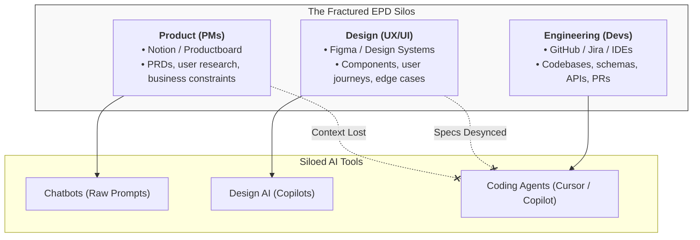
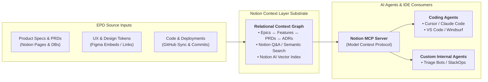
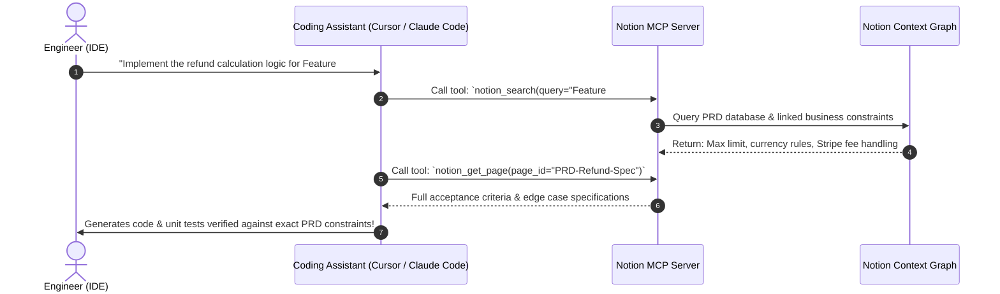

# Build the AI Context Layer for Your EPD Team (Yethoven Tukimin)

> **Speaker**: **Yethoven Tukimin** (Solutions Engineering / Technical Architect, **Notion**)  
> **Event**: [ContainerDays Singapore 2026](./ContainerDays%20Singapore%202026.md) (Day 2 · AI Context Track)  
> **Date & Time**: Wednesday, October 28, 2026 · Morning Workshop (~11:00 – 12:00 SGT)  
> **Stage / Room**: **Workshop Room**  
> **Title**: *"Build the AI Context Layer for Your EPD Team"*  
> **Platform / Engine**: **Notion** as the Centralized EPD AI Context Substrate  
> **Core Themes**: EPD Alignment (Engineering, Product, Design) · AI Context Middleware · Notion as a Knowledge Graph · Model Context Protocol (MCP) · Living Documentation · PRD-to-Code Traceability · Eliminating Hallucinated Requirements  
> **Vault Connections**:
> - [ContainerDays Singapore 2026](./ContainerDays%20Singapore%202026.md) — Master conference schedule and session index
> - [Stop Shipping Features with AI. Start Shipping AI Operable Products (Khang Toh)](./Stop%20Shipping%20Features%20with%20AI.%20Start%20Shipping%20AI%20Operable%20Products%20%28Khang%20Toh%29.md) — Connecting product intent to runtime operability
> - [When Tokens Stop Being the Bottleneck - Operating Agentic Software Factories (Carl Ross)](./When%20Tokens%20Stop%20Being%20the%20Bottleneck%20-%20Operating%20Agentic%20Software%20Factories%20%28Carl%20Ross%29.md) — Grounding coding agents with domain specifications
> - [Governing the Agentic Stack on Kubernetes - MCP, A2A, and LLM Traffic (Robin Cher)](./Governing%20the%20Agentic%20Stack%20on%20Kubernetes%20-%20MCP%2C%20A2A%2C%20and%20LLM%20Traffic%20%28Robin%20Cher%29.md) — MCP protocol integration & agent governance
> - *Communication Is Key - Agent Protocols (MCP & A2A)* — Standardized protocol interfaces for agent tooling

---

## ⚡ TL;DR (Key Takeaways in 60 Seconds)

- **The Context Gap**: Product (PRDs), Design (Figma), and Engineering (GitHub/IDEs) work in isolated silos. Coding agents (Cursor, Claude Code, Copilot) hallucinate because they lack cross-functional business context.
- **Notion as a Living Knowledge Graph**: Centralizes Epics $\leftrightarrow$ PRDs $\leftrightarrow$ Design Tokens $\leftrightarrow$ Architecture Decision Records (ADRs) within structured relational database schemas.
- **MCP Server for Notion**: Exposes workspace knowledge to IDE coding agents via `@modelcontextprotocol/server-notion`, allowing agents to query acceptance criteria, edge cases, and user journeys dynamically during development.
- **Continuous Lifecycle Sync**: Bidirectional webhooks (GitHub Actions + Notion API) synchronize code implementation status and requirements in real time.
- **Best Practice**: Treat organizational context as an executable infrastructure layer rather than static wiki text.

---

## 📌 Context & Problem Statement: The EPD Context Gap

Modern software organizations operate across three distinct functional disciplines: **Engineering, Product, and Design (EPD)**. While generative AI and coding assistants have been widely adopted across teams, context remains heavily siloed:



### The "Siloed AI" Failure Modes
1. **Coding Blind**: When an engineer prompts Cursor, Claude Code, or Copilot in their IDE, the assistant only sees the immediate code repository. It lacks visibility into *why* the code was built, what business rules apply, or what UI states were defined in Figma.
2. **Hallucinated Requirements**: AI coding models confidently invent edge-case behavior, error handling, or validation rules that conflict with product specs.
3. **Stale Documentation Rot**: Static markdown files or Confluence wikis quickly diverge from real code. Developers stop reading docs, and AI tools generate code against deprecated logic.
4. **Context Copy-Paste Tax**: Developers spend hours copy-pasting acceptance criteria from PRDs and ticket threads into AI chat windows.

---

## 🏛️ Architecture: Notion as the EPD AI Context Layer

Instead of treating AI as isolated tools in separate browser tabs, **Notion functions as a real-time, queryable AI Context Layer** connecting strategy, experience, and delivery.



### The 4 Relational Data Graph Primitives
Notion's relational database engine enables an interconnected knowledge graph across EPD:
1. **`Feature / Epic Database`**: The overarching capability being delivered.
2. **`PRD & Requirements Database`**: User personas, acceptance criteria, edge cases, and business rules.
3. **`Design Specs & Component Library`**: Live Figma embeds, design system token definitions, and interaction guidelines.
4. **`Architectural Decision Records (ADRs)`**: Technical rationale, database schemas, and API contracts agreed upon by engineering.

---

## 🔌 Connecting Notion to Coding Agents via MCP

The critical breakthrough is making Notion **machine-readable for AI agents** through the **Model Context Protocol (MCP)**:



### Operational Benefits of the MCP-Linked Context Layer
- **Zero Hallucination of Business Rules**: The agent pulls exact parameter bounds, tax calculation methods, and validation rules directly from the PRD.
- **Automated Test Generation**: The coding assistant reads user acceptance criteria from Notion and automatically writes deterministic unit and integration tests.
- **Traceability**: Every generated code change and pull request links back to the specific Notion PRD block that mandated it.

---

## 🛠️ Step-by-Step Implementation Blueprint for EPD Teams

### Step 1: Standardize the Relational PRD Template
Every product specification in Notion should use a consistent schema with structured properties:
- `Status`: Draft $\to$ In Review $\to$ Ready for Dev $\to$ In Production
- `Engineers Assigned`: Relation to Team database
- `Figma Prototype`: Live URL embed
- `Acceptance Criteria`: Checklist blocks (`- [ ]`) formatted for easy LLM token parsing
- `ADR Reference`: Relation to Engineering Architecture database

### Step 2: Deploy the Notion MCP Integration
Configure your team's development environments (e.g. `~/.cursor/mcp.json` or Claude Code settings) to connect to the Notion API:
```json
{
  "mcpServers": {
    "notion-context": {
      "command": "npx",
      "args": ["-y", "@modelcontextprotocol/server-notion"],
      "env": {
        "NOTION_API_KEY": "secret_..."
      }
    }
  }
}
```

### Step 3: Close the Loop with Event-Driven Sync
- **GitHub Sync**: When a PR merges, a GitHub Action updates the Notion Feature card status to `Shipped` and attaches the commit hash.
- **Slack & Notion Q&A**: Team members query organizational status directly in Slack (*"What are the edge cases for international checkout?"*), powered by Notion AI grounded on verified EPD pages.

---

## 💡 Key Takeaways & Cultural Impact

1. **AI is Only as Good as Its Context**: Frontier models (Claude 3.7 / GPT-4o) do not fail because they don't know syntax; they fail because they lack organization-specific domain context.
2. **Documentation as a Living Substrate**: When documentation directly fuels coding agents via MCP, writing clean PRDs and ADRs immediately accelerates development velocity.
3. **Unifying EPD**: By anchoring Engineering, Product, and Design into a shared, queryable context graph, teams eliminate the friction of misaligned handoffs.

---

## 🔗 Related Notes & Cross-References

- 🌟 [ContainerDays Singapore 2026](./ContainerDays%20Singapore%202026.md) — Conference schedule and session tracking
- 🏭 [When Tokens Stop Being the Bottleneck - Operating Agentic Software Factories (Carl Ross)](./When%20Tokens%20Stop%20Being%20the%20Bottleneck%20-%20Operating%20Agentic%20Software%20Factories%20%28Carl%20Ross%29.md) — Using domain specifications to guide autonomous software factories
- 🚀 [Stop Shipping Features with AI. Start Shipping AI Operable Products (Khang Toh)](./Stop%20Shipping%20Features%20with%20AI.%20Start%20Shipping%20AI%20Operable%20Products%20%28Khang%20Toh%29.md) — Connecting PRD requirements to runtime operational surfaces
- 🛡️ [Governing the Agentic Stack on Kubernetes - MCP, A2A, and LLM Traffic (Robin Cher)](./Governing%20the%20Agentic%20Stack%20on%20Kubernetes%20-%20MCP%2C%20A2A%2C%20and%20LLM%20Traffic%20%28Robin%20Cher%29.md) — Infrastructure governance for MCP traffic
- 🔗 *Communication Is Key - Agent Protocols (MCP & A2A)* — Protocol architecture for AI tool interoperability
