# Building a High-Performance Token Factory: Turning Kubernetes GPU Clusters into Production-Grade, SLA-Backed Token Generation Services (Jerry Chen)

> **Speaker**: **Jerry Chen** (Regional CTO, **DaoCloud** / **d.run**)  
> **Event**: [ContainerDays Singapore 2026](ContainerDays%20Singapore%202026.md) (Day 2 · Afternoon Session)  
> **Date & Time**: Wednesday, October 28, 2026 · ~15:25 – 16:00 SGT  
> **Stage / Room**: **ContainerDays & AI Context Main Track**  
> **Title**: *"Building a High-Performance Token Factory: with cloud-native AI technologies — turning Kubernetes GPU clusters into production-grade, SLA-backed token generation services"*  
> **Affiliations**: **DaoCloud** · **d.run**  
> **Core Themes**: Cloud-Native AI · Kubernetes GPU Cluster Orchestration · Token Factory Architecture · Production-Grade Inference Serving · SLA-Backed LLM Traffic · GPU Sharing & Virtualization (HAMi/vCUDA) · Dynamic Resource Allocation (DRA)  
> **Vault Connections**:
> - [ContainerDays Singapore 2026](ContainerDays%20Singapore%202026.md) — Master conference schedule and session index
> - [Serve Your First LLM, Then Watch It Break at Scale (Mumshad Mannambeth)](Serve%20Your%20First%20LLM,%20Then%20Watch%20It%20Break%20at%20Scale%20(Mumshad%20Mannambeth).md) — vLLM bottlenecks, safetensors loading, KV cache management, llm-d routing
> - [Will Everyone Build an AI Factory? (Saiyam Pathak)](Will%20Everyone%20Build%20an%20AI%20Factory?%20(Saiyam%20Pathak).md) — Day 1 keynote on AI Factories and cloud-native infrastructure
> - [Enterprise Sovereign AI - Building with SUSE AI Factory](Enterprise%20Sovereign%20AI%20-%20Building%20with%20SUSE%20AI%20Factory.md) — Sovereign AI factories, validated stacks, vLLM on Kubernetes
> - [When Tokens Stop Being the Bottleneck - Operating Agentic Software Factories (Carl Ross)](When%20Tokens%20Stop%20Being%20the%20Bottleneck%20-%20Operating%20Agentic%20Software%20Factories%20(Carl%20Ross).md) — Token consumption economics and agent factory loops
> - [Governing the Agentic Stack on Kubernetes - MCP, A2A, and LLM Traffic (Robin Cher)](Governing%20the%20Agentic%20Stack%20on%20Kubernetes%20-%20MCP,%20A2A,%20and%20LLM%20Traffic%20(Robin%20Cher).md) — Infrastructure-level LLM gateway routing and latency budgets

---

## ⚡ TL;DR (Key Takeaways in 60 Seconds)

- **Keynote Thesis**: *"You don't deploy a model. You operate a factory."* Accounting flips from requests per GPU to **blended cost per million tokens (\$/Mtok)** under strict latency SLOs.
- **Workload Scale (229B to 2.8T MoE)**: Open enterprise models span up to 2.8T parameters (Kimi-K3). Models $\ge 1T$ require multi-node clusters with zero single-node KV headroom.
- **Heterogeneous Compute Pooling**: GPU slicing with HAMi, declarative DRA device claims, Kueue TAS placement, and LeaderWorkerSet (LWS) boost GPU utilization from **30% to 80%+** across 10+ accelerator families (~70,000 GPUs managed on `d.run`).
- **Disaggregated Serving (PD Disaggregation)**: Prefill pool ($O(N^2)$ GEMM) drives TTFT; Decode pool ($O(1)$ autoregressive) drives TPOT. Multi-node replicas scale atomically via LWS.
- **The 4-Tier KV Cache Pyramid (ContextStore)**: Offloads KV blocks (GPU HBM $	o$ Host DRAM $	o$ Local NVMe $	o$ Shared Pool), delivering **up to 24x token output** in long context and **80%+ cache utilization**.
- **MatrixHub**: "Harbor for models" hydrates 1.6TB model weights across 100+ GPU nodes in parallel at **25.8 GB/s** intranet wire-speed.
- **Knoway AI Gateway**: 5-stage pipeline (`AuthN` $	o$ `Route` $	o$ `Limit` $	o$ `Protect` $	o$ `Meter`) measuring every SLO in tokens, not HTTP requests.

---

## 📸 Stage & Session Slides

### Slide 01 · Presentation Title

> **Opening Title**: *"Building a High-Performance Token Factory with cloud-native AI technologies — turning Kubernetes GPU clusters into production-grade, SLA-backed token generation services"* presented by Jerry Chen (Regional CTO, DaoCloud / d.run) at ContainerDays & AI Context Singapore 2026.

### Slide 03 · What We Will Cover (The 4 Chapters)
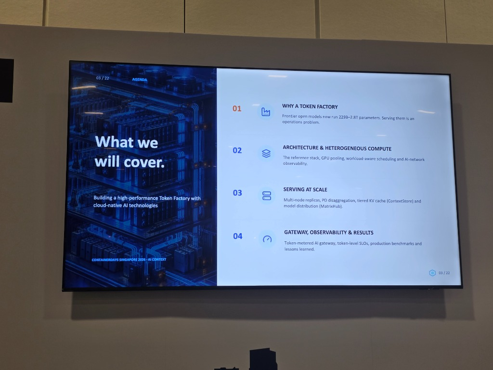
> **Agenda**: 1) Why a Token Factory (229B–2.8T parameters), 2) Architecture & Heterogeneous Compute (GPU pooling, HAMi, AI networking), 3) Serving at Scale (Multi-node, PD disaggregation, ContextStore, MatrixHub), 4) Gateway, Observability & Results (Token metering, token SLOs, benchmarks).

### Slide 05 · The Shift: PoC Asks for Demos, Production Asks for Tokens Per Second
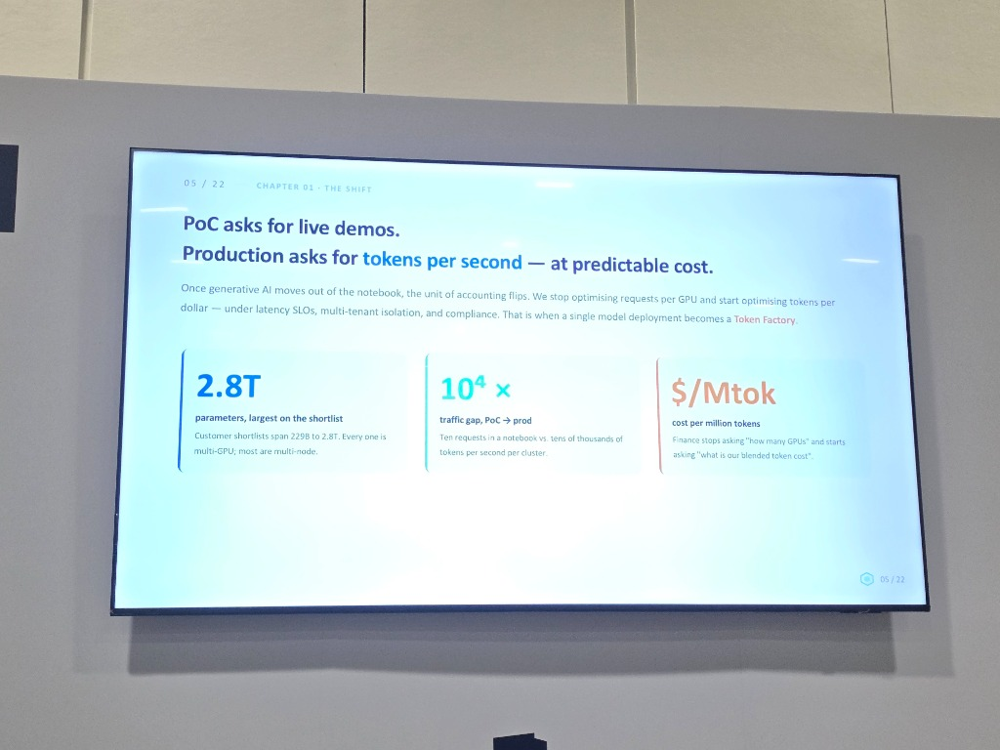
> **The Unit of Accounting Flips**: Moving from requests per GPU to tokens per dollar under latency SLOs. Frontier parameters reach **2.8T**, traffic scales **10,000x** from PoC to prod, and economics shift to **\$/Mtok**.

### Slide 06 · The Workload: Serving 229B to 2.8T Parameter Models
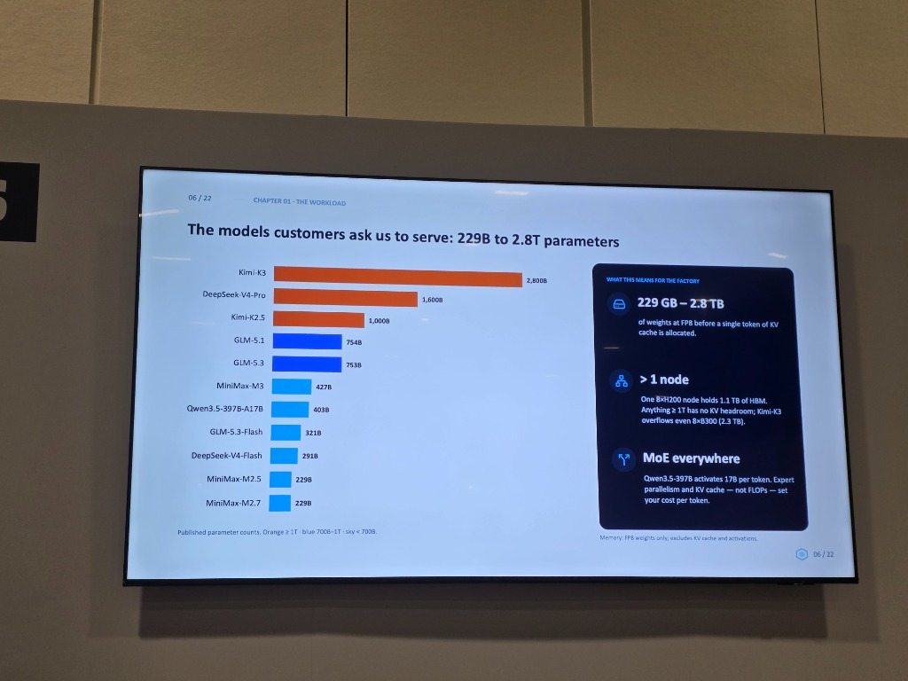
> **Workload Landscape**: Open model weights range from 229 GB to 2.8 TB (FP8). Models $\ge 1T$ require multi-node clusters with zero single-node KV headroom. MoE architectures (e.g. Qwen3.5-397B activating 17B) make expert parallelism and KV cache the real cost drivers.

### Slide 08 · Reference Architecture: An Open Token Factory on Kubernetes
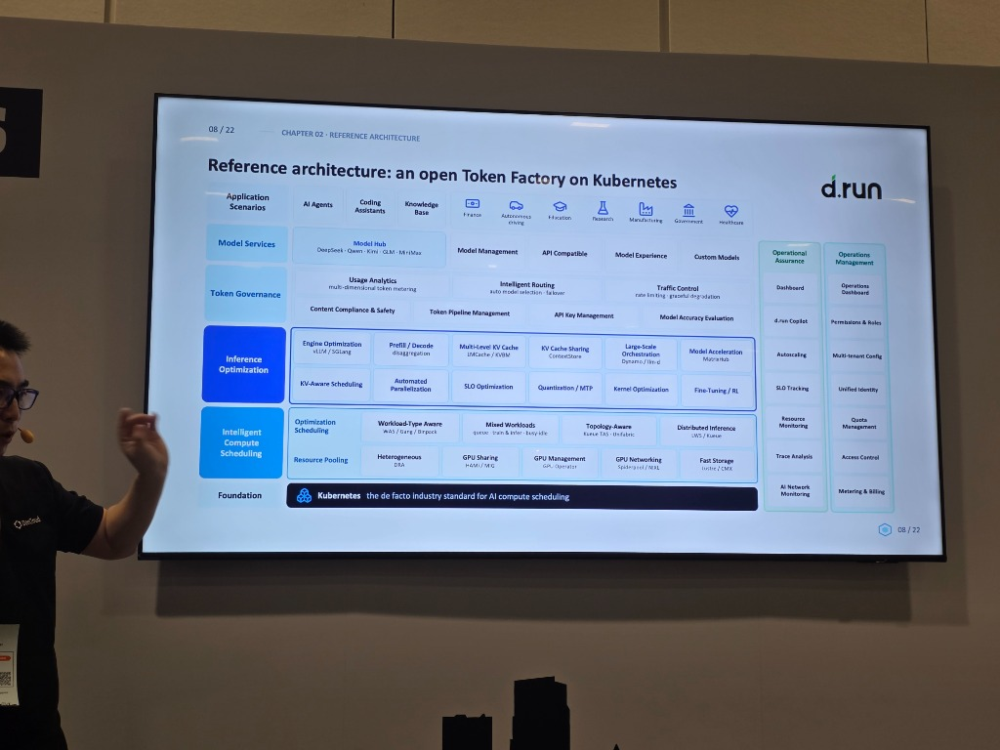
> **The d.run / DaoCloud Blueprint**: 6-layer architecture spanning Kubernetes Foundation, Intelligent Compute Scheduling (HAMi, Kueue, Spiderpool), Inference Optimization (vLLM, PD Disaggregation, ContextStore, MatrixHub), Token Governance, and Model Services.

### Slide 08B · DaoCloud's Open-Source Contributions: Two Eras, One Open Stack
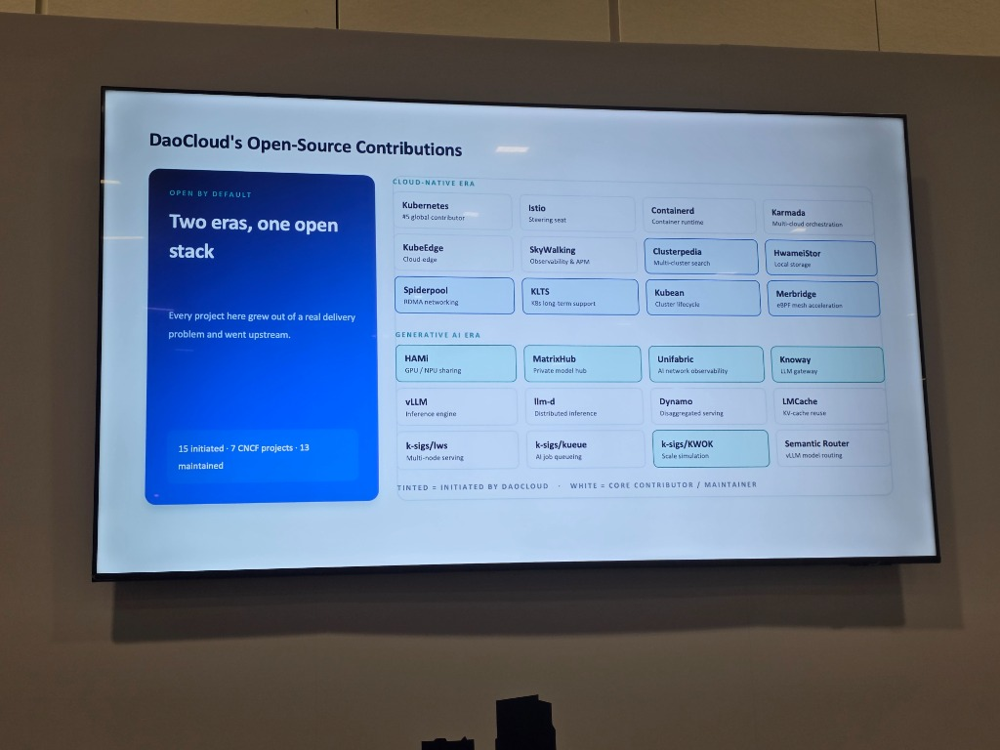
> **Open Source Lineage**: 15 initiated projects, 7 CNCF projects, 13 maintained across the Cloud-Native era (K8s, Spiderpool, Istio, Containerd) and Generative AI era (HAMi, MatrixHub, Unifabric, Knoway, vLLM, llm-d, LWS, Kueue).

### Slide 09 · The Token Production Line: Inference Acceleration
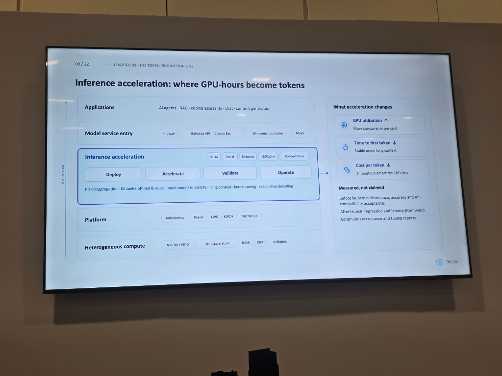
> **Inference Acceleration**: Where GPU-hours become tokens. Lifecycle spans Deploy $\to$ Accelerate $\to$ Validate $\to$ Operate. Increases GPU utilization, slashes TTFT under long context, and drives down cost per token.

### Slide 10 · Heterogeneous Compute: Pool Accelerators, Schedule by Workload Type
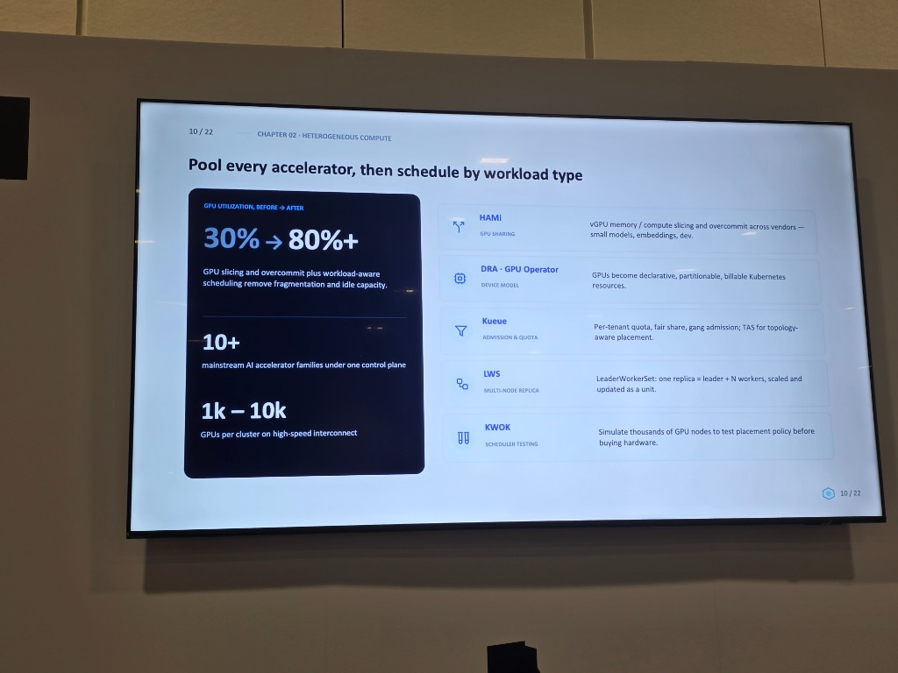
> **Compute Pooling (30% $\to$ 80%+ Utilization)**: GPU slicing with HAMi, declarative DRA device models, Kueue topology-aware placement, LeaderWorkerSet (LWS) multi-node replicas, and KWOK simulation.

### Slide 11 · Unifabric: Making the AI Network Visible to Kubernetes
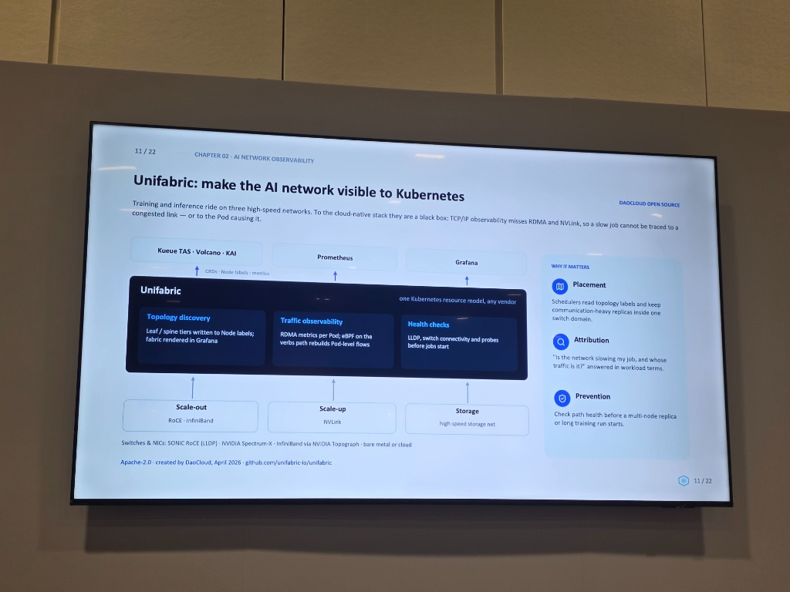
> **Unifabric Overview**: Opening the black box of high-speed AI networks (RoCE, InfiniBand, NVLink) to Kubernetes via eBPF on verbs path, topology discovery for Kueue TAS, and pre-run health checks.

### Slide 11B · Unifabric Detailed Architecture Diagram
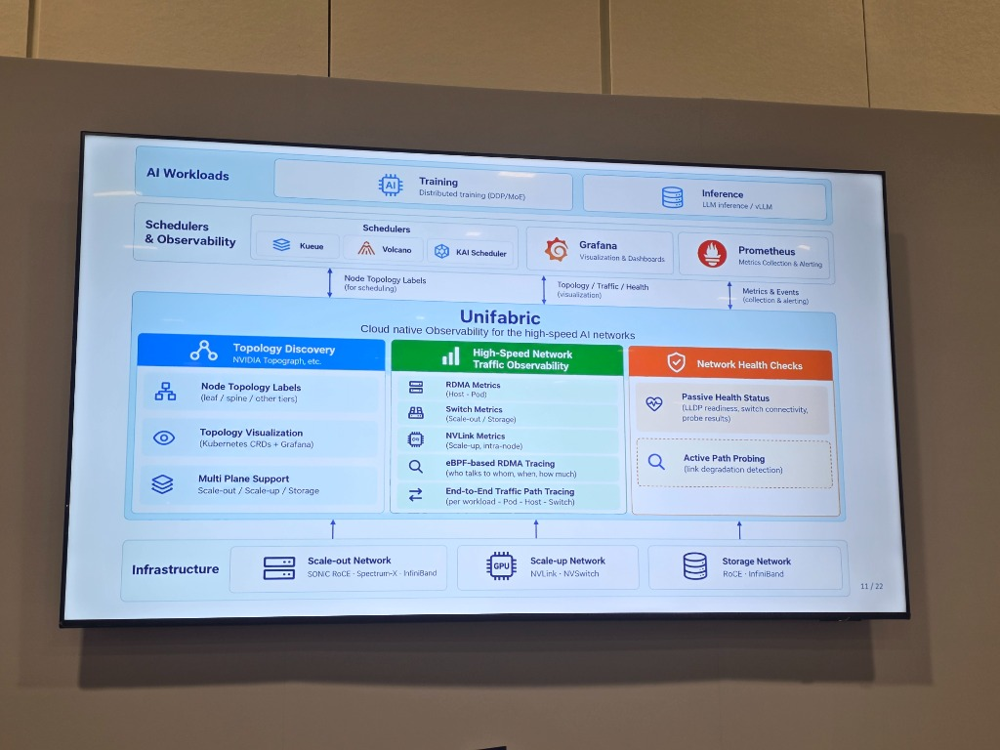
> **Unifabric Deep Architecture**: Topology discovery, RDMA/NVLink traffic metrics, eBPF tracing, and active path probing feeding directly into Kueue, Volcano, Prometheus, and Grafana.

### Slide 12 · Serving at Scale: A 2.8T Model Is Just Another Workload
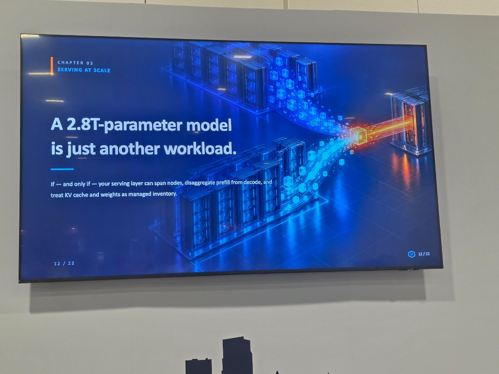
> **Chapter 3 Premise**: *"A 2.8T-parameter model is just another workload. If — and only if — your serving layer can span nodes, disaggregate prefill from decode, and treat KV cache and weights as managed inventory."*

### Slide 13 · Disaggregated Serving: One Model Replica Across Many Nodes
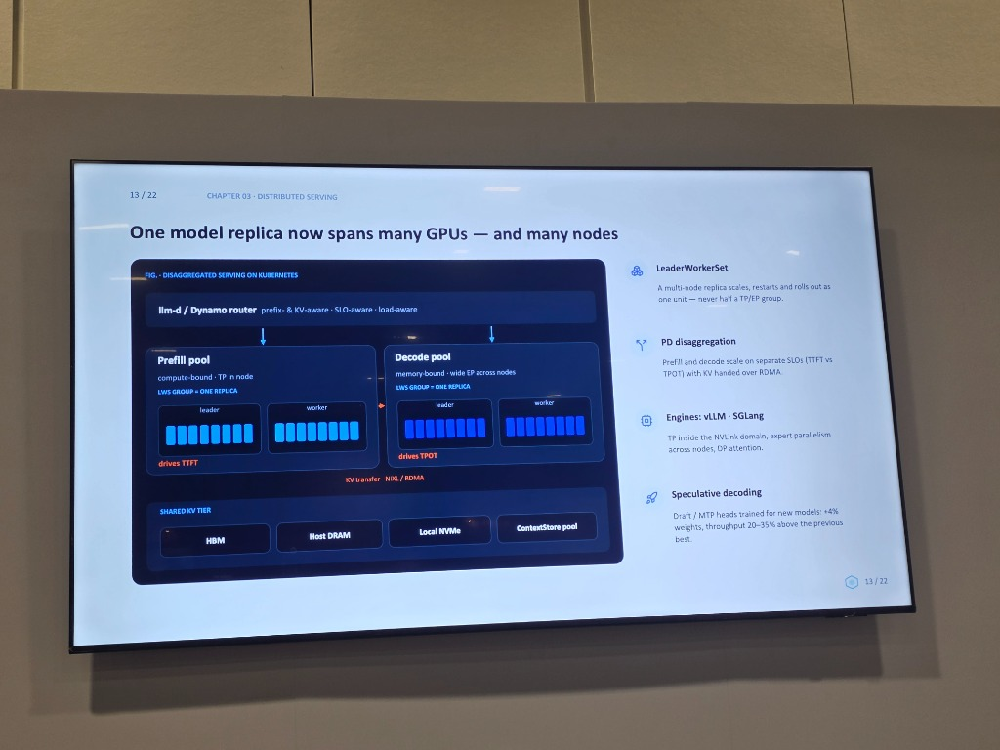
> **PD Disaggregation**: Router (`llm-d` / Dynamo) splits traffic into **Prefill Pool** (compute-bound, TP in-node, drives TTFT) and **Decode Pool** (memory-bound, wide EP across nodes, drives TPOT) with KV transferred over RDMA. Replicas managed as **LeaderWorkerSet (LWS)** units.

### Slide 14 · KV Cache Hierarchy: Factory Inventory Pyramid
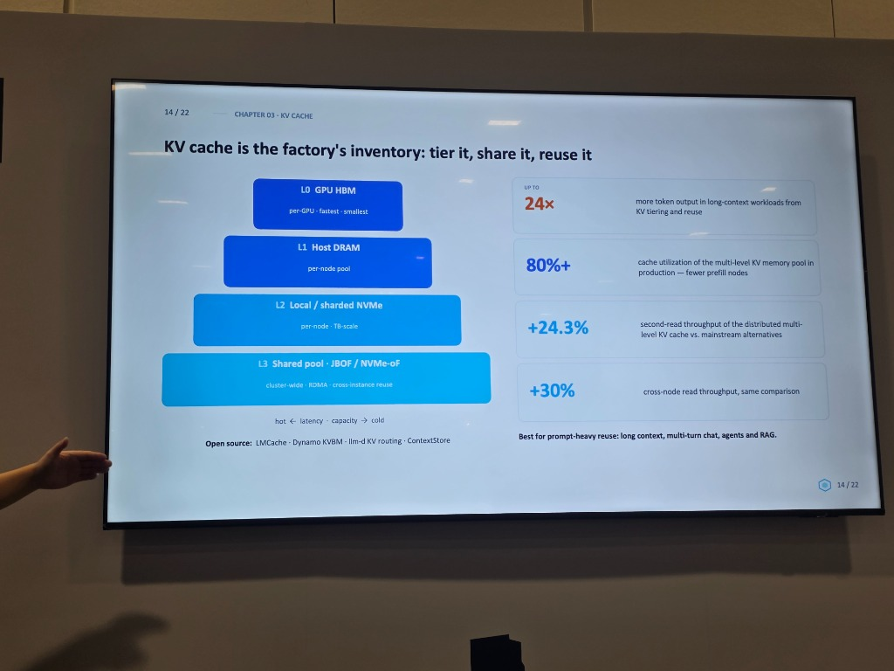
> **KV Cache Pyramid**: L0 GPU HBM $\to$ L1 Host DRAM $\to$ L2 Local NVMe $\to$ L3 Shared JBOF / NVMe-oF. Delivers **up to 24x** token output for long-context workloads, **80%+** cache utilization, and **+30%** cross-node read throughput.

### Slide 15 · ContextStore: Tiered, Shared Storage for LLM KV Caches
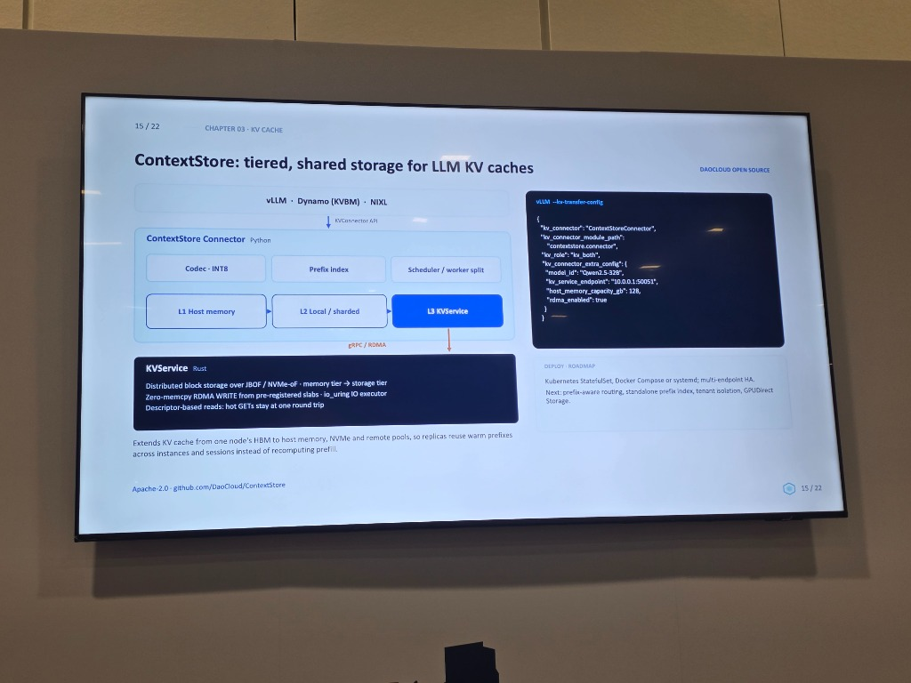
> **ContextStore Engine**: Rust `KVService` with io_uring and zero-memcpy RDMA WRITEs + Python connector with INT8 codec. Native vLLM `--kv-transfer-config` integration extends KV across instances to eliminate redundant prefill.

### Slide 16 · MatrixHub: Harbor for Models, at Intranet Speed
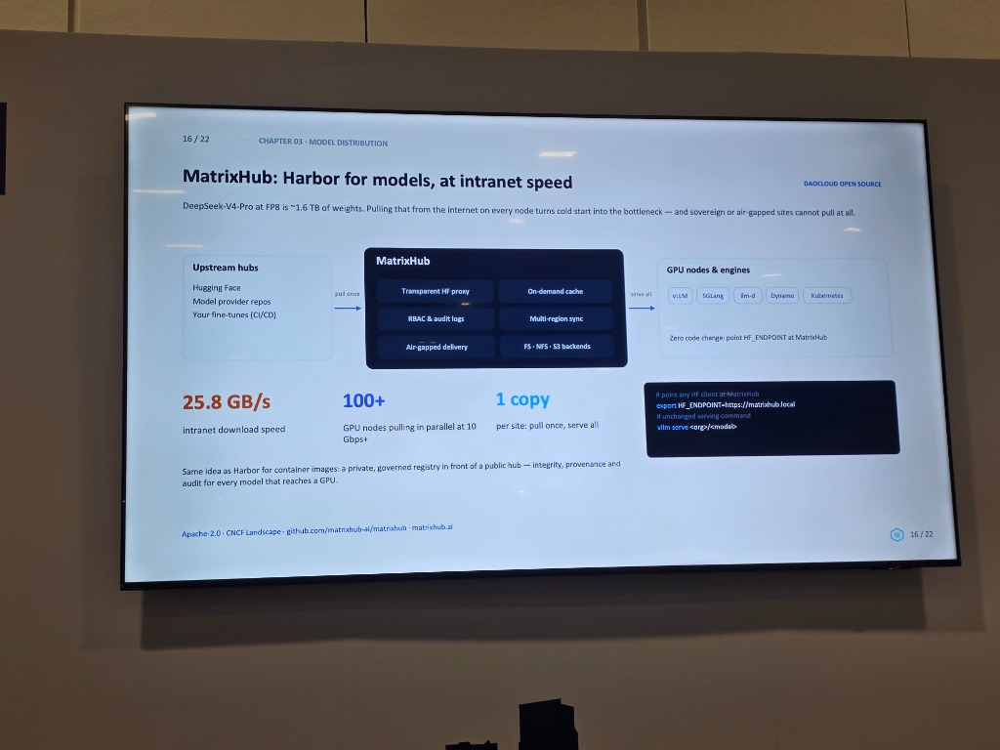
> **MatrixHub**: Transparent HF proxy, on-demand caching, RBAC, air-gapped delivery. Pull once, serve all: **25.8 GB/s** intranet download speed across 100+ GPU nodes in parallel. Zero code change (`export HF_ENDPOINT=...`).

### Slide 17 · Chapter 4 Opener: One Front Door, Every Token Measured
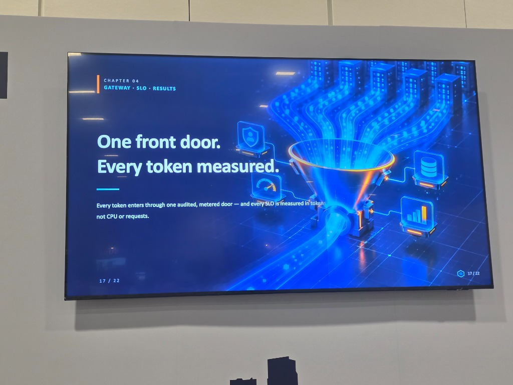
> **Chapter 4 Premise**: *"One front door. Every token measured. Every token enters through one audited, metered door — and every SLO is measured in tokens, not CPU or requests."*

### Slide 18 · The AI Gateway: Knoway, Semantic Routing & Token Metering
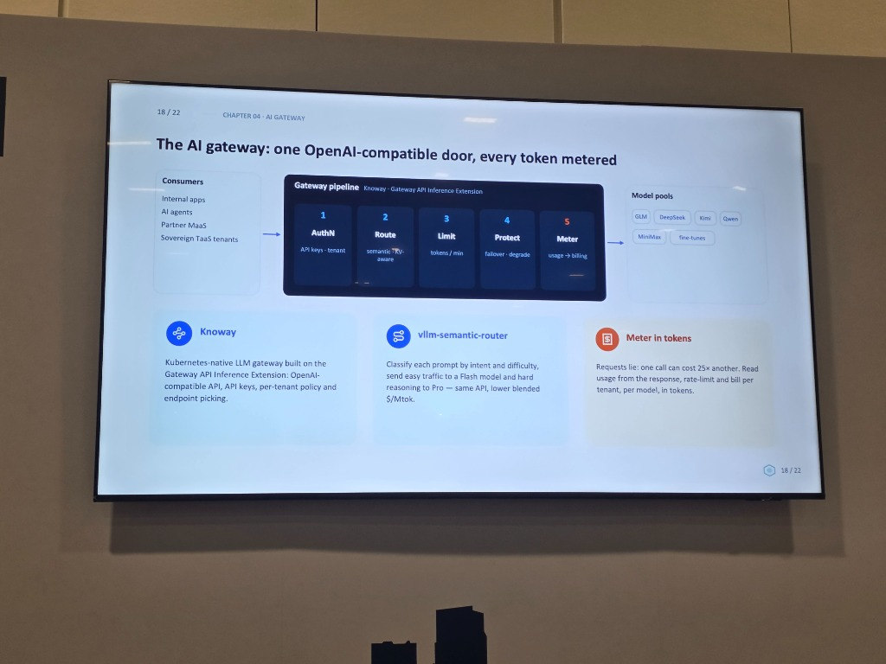
> **Gateway Pipeline**: 5-stage pipeline (`AuthN` $\to$ `Route` $\to$ `Limit` $\to$ `Protect` $\to$ `Meter`). Knoway (built on K8s Gateway API Inference Extension), vllm-semantic-router for tier routing, and billing in tokens.

### Slide 19 · Observability & SLA: Observe Tokens, Not CPUs
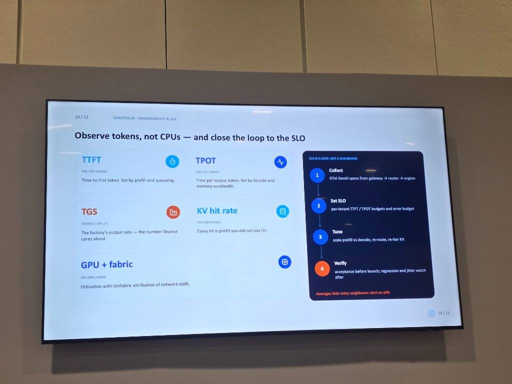
> **Token Factory Metrics**: TTFT (prefill), TPOT (decode), TGS (tokens/GPU/s), KV hit rate, GPU+fabric. *"SLA is a loop, not a dashboard: Collect $\to$ Set SLO $\to$ Tune $\to$ Verify. Alert on p99."*

### Slide 20 · Production Results: What Tuning Delivers on Current Hardware
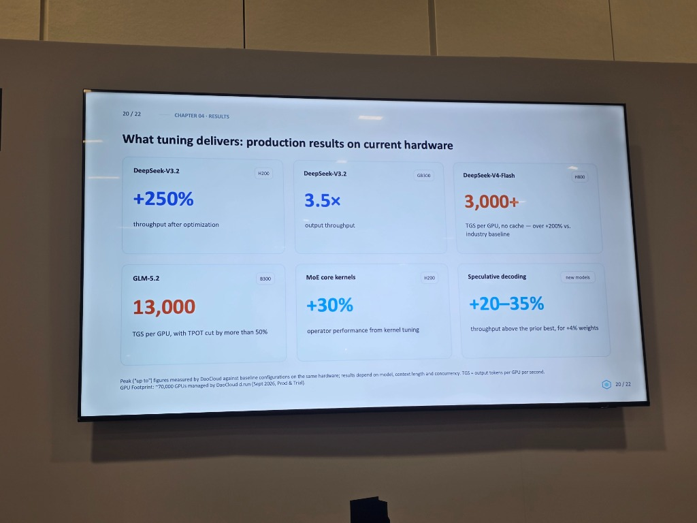
> **Hardware Benchmarks**: DeepSeek-V3.2 (+250% on H200, 3.5x on GB300), DeepSeek-V4-Flash (3,000+ TGS on H800), GLM-5.2 (13,000 TGS on B300), MoE kernels (+30%), speculative decoding (+20–35%). Managing **~70,000 GPUs** on d.run.

### Slide 21 · Takeaways: Six Patterns from Production You Can Apply on Monday
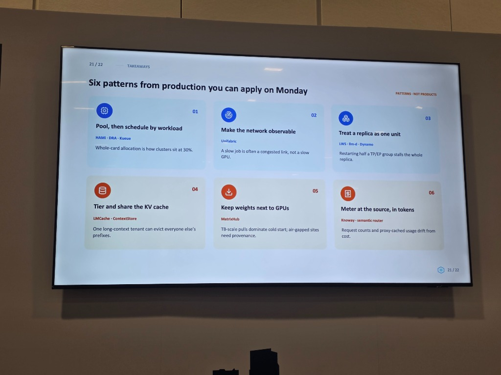
> **Six Production Patterns**: (1) Pool then schedule by workload, (2) Make network observable, (3) Treat replica as one unit, (4) Tier and share KV cache, (5) Keep weights next to GPUs, (6) Meter at source in tokens.

### Slide 22 · Closing & Open Source: "You Don't Deploy a Model. You Operate a Factory."
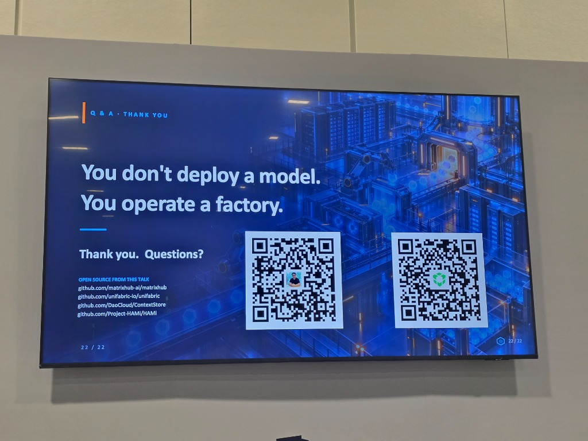
> **Closing Epigram**: *"You don't deploy a model. You operate a factory."* Open source projects presented in this talk: `matrixhub`, `unifabric`, `ContextStore`, and `HAMi`.

---

## 🔄 Chapter 1 · The Shift: From Live Demos to Tokens Per Second (Slide 5)

When generative AI transitions from experimental Jupyter notebooks into mission-critical enterprise production, **the fundamental unit of accounting flips**:
- In the PoC phase, teams optimize for **developer experience and interactive latency** (*"Can we run a live demo?"*).
- In production, teams must optimize for **tokens per second ($TPS$) and tokens per dollar ($\$/Mtok$)** under strict latency SLOs ($TTFT$, $TPOT$), multi-tenant isolation, and corporate compliance.

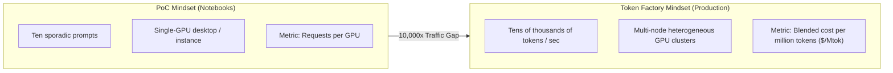

### The Three Drivers of the Token Factory:
1. **2.8T Parameters (The Largest Models)**:
   - Enterprise shortlists span from 229B (MiniMax) to 2.8T (Kimi-K3). Every single model on the list requires multi-GPU infrastructure, and the majority require multi-node clusters.
2. **$10^4 \times$ Traffic Gap (Scale Shock)**:
   - Moving from 10 requests per minute during testing to tens of thousands of continuous tokens generated per second per cluster.
3. **\$/Mtok (The New Unit of Accounting)**:
   - Enterprise finance departments stop asking *"How many GPUs did we procure?"* and start asking **"What is our blended cost per million tokens?"**.

---

## 📦 Chapter 1 · The Workload: Serving 229B to 2.8T Frontier Open Models (Slide 6)

Jerry presented a detailed breakdown of the massive frontier open-weight models that enterprise customers are deploying on Kubernetes:

| Model Family | Total Parameters | Parameter Class | Architecture Notes |
| :--- | :--- | :--- | :--- |
| **Kimi-K3** | **2,800B (2.8T)** | $\ge 1T$ (Extreme) | Massive MoE; overflows single-node 8xB300 (2.3 TB HBM). |
| **DeepSeek-V4-Pro** | **1,600B (1.6T)** | $\ge 1T$ (Extreme) | High-capacity Mixture-of-Experts; multi-node mandatory. |
| **Kimi-K2.5** | **1,000B (1.0T)** | $\ge 1T$ (Frontier) | 1 TB pure weight footprint in FP8 before KV cache allocation. |
| **GLM-5.1 / 5.3** | **754B / 753B** | 700B – 1T (Large) | Heavy memory requirement; exceeds single 8xH100 node HBM. |
| **MiniMax-M3** | **427B** | $< 700B$ | Dense/MoE hybrid architecture. |
| **Qwen3.5-397B-A17B** | **403B** | $< 700B$ | **MoE**: 403B total parameters, but activates only **17B per token**! |
| **GLM-5.3-Flash** | **321B** | $< 700B$ | Low-latency inference optimized. |
| **DeepSeek-V4-Flash** | **291B** | $< 700B$ | High-throughput distillation. |
| **MiniMax-M2.5 / M2.7** | **229B** | $< 700B$ | Base enterprise reasoning models. |

### What This Workload Demands of the Infrastructure:
- 💾 **229 GB to 2.8 TB of Weights in FP8**:
  - This is the static memory footprint **before a single token of dynamic KV cache is allocated**.
- 🔗 **Multi-Node Is Non-Negotiable**:
  - A premier 8x NVIDIA H200 node contains **1.1 TB of High Bandwidth Memory (HBM3e)**.
  - Any model $\ge 1T$ parameters leaves **zero headroom for KV cache** on an 8xH200 node!
  - 2.8T models like Kimi-K3 overflow even an 8x NVIDIA B300 node (2.3 TB HBM). Multi-node distributed inference across low-latency fabric is mandatory.
- 🔀 **MoE Is Everywhere**:
  - Sparse Mixture-of-Experts models like `Qwen3.5-397B-A17B` activate only 17B parameters per token.
  - **Key Insight**: *In MoE serving, Expert Parallelism (EP) and KV Cache memory bandwidth—not raw compute FLOPs—determine your actual serving cost per token.*

---

## 🏛️ Chapter 2 · Reference Architecture: An Open Token Factory on Kubernetes (Slide 8)

DaoCloud and `d.run` designed a production-grade, 6-layer reference architecture to operate an open Token Factory on Kubernetes:

```mermaid
flowchart TD
    subgraph AppLayer["1. Application Scenarios"]
        Apps["AI Agents · Coding Assistants · Enterprise Knowledge Bases<br/>Finance · Autonomous Driving · Manufacturing · Healthcare"]
    end

    subgraph ServiceLayer["2. Model Services & Token Governance"]
        MH["<b>Model Hub</b>: DeepSeek · Qwen · Kimi · GLM · MiniMax"]
        TG["<b>Token Governance</b>:<br/>• Usage Analytics (Multi-dimensional token metering)<br/>• Intelligent Routing (Auto model selection & failover)<br/>• Traffic Control (Token rate limiting & graceful degradation)<br/>• Content Compliance & Safety · Token Pipeline Management"]
    end

    subgraph InferOpt["3. Inference Optimization Layer"]
        Engines["<b>Engine Optimization</b>: vLLM · SGLang · TensorRT-LLM"]
        PD["<b>PD Disaggregation</b>: Prefill / Decode Separation"]
        KV["<b>Tiered KV Cache</b>: LMCache · KVBM · ContextStore Sharing"]
        Orch["<b>Large-Scale Orchestration</b>: Dynamo · llm-d · MatrixHub Acceleration"]
    end

    subgraph SchedLayer["4. Intelligent Compute Scheduling"]
        OptSched["<b>Optimization Scheduling</b>:<br/>• Workload-Type Aware (WAS / Gang / Binpack)<br/>• Mixed Workloads (Queue train & infer · busy-idle harvesting)<br/>• Topology-Aware Scheduling (Kueue TAS · UniFabric)<br/>• Distributed Inference (LeaderWorkerSet LWS · Kueue)"]
        ResPool["<b>Resource Pooling</b>:<br/>• Heterogeneous DRA (Dynamic Resource Allocation)<br/>• GPU Sharing (HAMi · vCUDA · MIG)<br/>• GPU Networking (Spiderpool CNI · RoCEv2 / NXL)<br/>• High-Speed Storage (Lustre · CMIX)"]
    end

    subgraph K8sBase["5. Foundation"]
        K8S["<b>Kubernetes</b>: The de facto industry standard for AI compute scheduling"]
    end

    AppLayer --> ServiceLayer
    ServiceLayer --> InferOpt
    InferOpt --> SchedLayer
    SchedLayer --> K8sBase
```

### The Six Architectural Layers Breakdown:

#### 1. Kubernetes Foundation & Resource Pooling
- **Heterogeneous DRA**: Dynamically claims GPUs based on interconnect topology, NVLink bandwidth, and VRAM rather than static integer counts.
- **GPU Sharing via HAMi (CNCF Landscape)**:
  - Enables fine-grained GPU memory slicing and compute core multiplexing.
  - Allows multiple lightweight workloads (or auxiliary agent components) to safely share physical GPUs without out-of-memory crashes.
- **AI Networking via Spiderpool**:
  - High-performance underlay CNI providing dual-stack IPv4/IPv6, multi-NIC RoCEv2 binding, and zero-loss InfiniBand network observability.

#### 2. Intelligent Workload Scheduling
- **Topology-Aware Scheduling (Kueue TAS)**:
  - Ensures distributed multi-node inference pods are placed within the same network leaf/spine domain to minimize cross-switch communication latency during all-reduce collective operations.
- **LeaderWorkerSet (LWS)**:
  - Native Kubernetes controller for managing multi-node model replicas as single cohesive entities (1 leader pod + $N$ worker pods).
- **Mixed-Workload Busy-Idle Harvesting**:
  - Reclaiming idle training cluster capacity during off-peak hours to scale up inference serving replicas dynamically.

#### 3. Inference Engine & Cache Optimization
- **Prefill / Decode (PD) Disaggregation**:
  - Splitting compute-bound prompt prefill nodes from memory-bandwidth-bound token decode nodes to maximize hardware utilization and slash $TTFT$.
- **Tiered KV Cache (ContextStore / LMCache)**:
  - Hierarchical caching offloading KV blocks from expensive GPU HBM to host DRAM and remote NVMe/network storage.
- **Model Distribution via MatrixHub**:
  - P2P model weight streaming and instant container hydration, slashing model startup times from minutes to seconds.

#### 4. Token Governance & Metered Gateway
- **Token-Level Metering**: Real-time multi-dimensional tracking of input prompt tokens, output completion tokens, cached tokens, and latency SLAs.
- **Intelligent Routing & Failover**: Automatic model fallback and request shedding when downstream GPU instances approach saturation thresholds.

---

## 🌐 DaoCloud's Open-Source Stack: Two Eras, One Open Stack (Slide 8B)

DaoCloud has been a foundational contributor across two successive eras of cloud-native computing. Jerry outlined their open-source footprint:

> *"Every project here grew out of a real delivery problem and went upstream. 15 initiated · 7 CNCF projects · 13 maintained."*

| Era | Projects Initiated by DaoCloud *(Tinted)* | Upstream Core Contributor / Maintainer *(White)* |
| :--- | :--- | :--- |
| **Cloud-Native Era** | **Spiderpool** (RDMA underlay CNI)<br>**HwameiStor** (Local storage for K8s)<br>**Clusterpedia** (Multi-cluster resource search)<br>**Kubean** (Cluster lifecycle automation)<br>**KLTS** (Kubernetes long-term support) | **Kubernetes** (#5 global contributor)<br>**Istio** (Steering seat)<br>**Containerd** (Container runtime)<br>**Karmada** (Multi-cloud orchestration)<br>**KubeEdge** (Cloud-edge computing)<br>**SkyWalking** (APM & observability)<br>**Merbridge** (eBPF service mesh acceleration) |
| **Generative AI Era** | **HAMi** (vGPU / NPU memory & compute sharing)<br>**MatrixHub** (Private P2P model hub)<br>**Unifabric** (AI network observability)<br>**Knoway** (LLM API gateway)<br>**KWOK** (Kubernetes Without Kubelet scale simulator) | **vLLM** (High-throughput inference engine)<br>**llm-d** (Distributed inference daemon)<br>**Dynamo** (Disaggregated serving framework)<br>**LMCache** (Multi-level KV-cache reuse)<br>**k-sigs/lws** (LeaderWorkerSet multi-node controller)<br>**k-sigs/kueue** (AI job queueing & gang scheduling)<br>**Semantic Router** (vLLM intelligent request routing) |

---

## ⚡ The Token Production Line: Where GPU-Hours Become Tokens (Slide 9)

In a high-performance token factory, model serving follows a rigorous **four-stage production line lifecycle**:

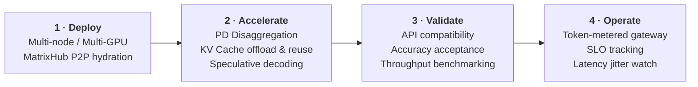

### What Acceleration Changes:
- 📈 **GPU Utilization $\uparrow$**: Pushes concurrency per physical accelerator, eliminating idle gaps.
- ⏱️ **Time to First Token ($TTFT$) $\downarrow$**: Keeps prompt latency flat even under massive long-context prompts (128k+ tokens).
- 💰 **Cost per Token $\downarrow$**: Maximum throughput directly amortizes capital expenditure on high-cost GPUs.

### "Measured, Not Claimed"
- **Before Launch**: Formal performance, numerical accuracy, and OpenAI API-compatibility acceptance gates.
- **After Launch**: Continuous regression tracking, tail-latency jitter monitoring, and automated tuning reports.

---

## 🔀 Heterogeneous Compute: Slicing, Pooling & Workload Scheduling (Slide 10)

Jerry shared concrete operational metrics from production GPU clusters:

```
GPU UTILIZATION LEAP:
Before: 30%  ─────────>  After: 80%+
(GPU slicing and overcommit + workload-aware scheduling remove fragmentation and idle capacity)
```

- **Scale**: Managing **1,000 to 10,000 GPUs** per cluster across high-speed interconnects.
- **Diversity**: Supporting **10+ mainstream AI accelerator families** (NVIDIA H100/H200/B200, AMD MI300X, Huawei Ascend, Intel Gaudi) under a single unified Kubernetes control plane.

### The 5 Scheduling & Pooling Primitives:
1. **HAMi (GPU Sharing)**:
   - Provides fine-grained **vGPU memory and compute core slicing** with safe overcommit across vendors.
   - Ideal for small embedding models, rerankers, conversational agents, and development pods that would otherwise waste dedicated H100s.
2. **DRA & GPU Operator (Device Model)**:
   - Dynamic Resource Allocation transforms physical GPUs into declarative, partitionable, billable Kubernetes resources.
3. **Kueue (Admission & Quota)**:
   - Enforces per-tenant quotas, fair-share queuing, gang admission (all pods in a distributed replica start together), and **Topology-Aware Scheduling (TAS)**.
4. **LeaderWorkerSet (LWS)**:
   - Multi-node replica management: treats `1 Leader + N Workers` as a single indivisible unit, scaling and restarting synchronously.
5. **KWOK (Scale Simulation)**:
   - Simulates thousands of synthetic GPU nodes inside test clusters to stress-test placement policies and scheduling algorithms before buying physical hardware.

---

## 📡 Unifabric: Making the AI Network Visible to Kubernetes (Slides 11 & 11B)

Distributed training and multi-node inference depend on three distinct high-speed networks:
1. **Scale-out Network**: RoCEv2 (SONiC, Spectrum-X) and InfiniBand connecting nodes across spine/leaf switches.
2. **Scale-up Network**: NVLink / NVSwitch connecting GPUs inside the node (up to 900 GB/s per GPU).
3. **Storage Network**: High-speed dedicated storage fabrics (Lustre, Ceph, CMIX).

### The Critical Problem:
> *"To the cloud-native stack, these networks are a black box: TCP/IP observability completely misses RDMA and NVLink, so a slow job cannot be traced to a congested link — or to the Pod causing it."*

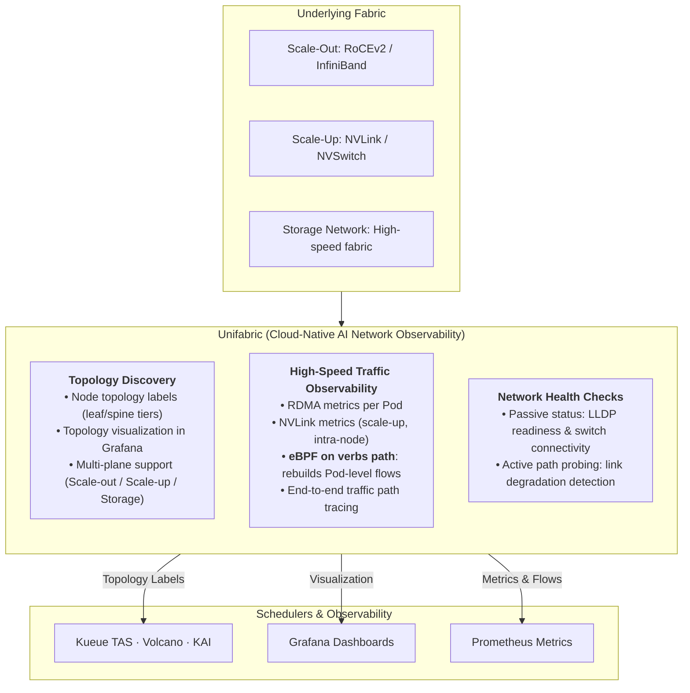

### Why Unifabric Matters:
- 🗺️ **Optimal Placement**: Schedulers (Kueue TAS) read topology labels generated by Unifabric and ensure communication-intensive multi-node replicas remain inside a **single switch domain**.
- 🔍 **Attribution**: Answers the fundamental operations question: *"Is the network slowing down my inference job, and whose traffic is causing the congestion?"* in native Kubernetes Pod terms.
- 🛡️ **Prevention**: Performs active path probing and LLDP link validation *before* launching a multi-node inference replica or multi-day training run.
- **Open Source**: Apache-2.0 license, created by DaoCloud in April 2026 (`github.com/unifabric-io/unifabric`).

---

## 🌐 Chapter 3 · Serving at Scale: A 2.8T Model Is Just Another Workload (Slide 12)

Jerry opened Chapter 3 with a provocative architectural thesis:

> *"A 2.8T-parameter model is just another workload. If — and only if — your serving layer can span nodes, disaggregate prefill from decode, and treat KV cache and weights as managed inventory."*

When an enterprise must serve models ranging from 229B to 2.8T parameters, infrastructure teams cannot simply run monolithic container replicas on single nodes. The serving layer must decompose the generation pipeline across specialized compute, memory, and storage tiers.

---

## 🧩 Disaggregated Serving: Prefill / Decode Separation & Multi-Node LWS (Slide 13)

One model replica now spans dozens of GPUs across multiple physical nodes. To prevent resource contention and latency jitter, the Token Factory implements **Prefill / Decode (PD) Disaggregation**:

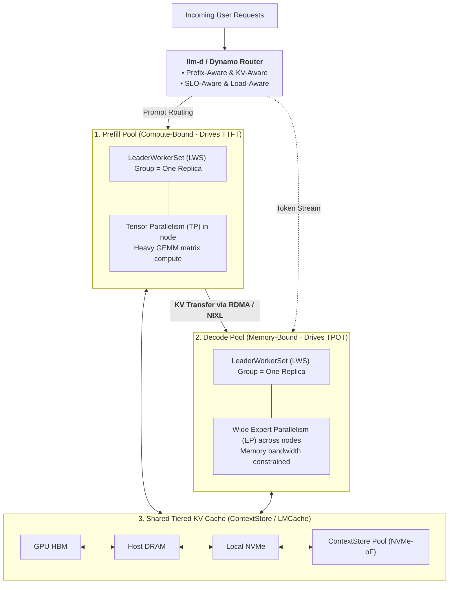

### Key Distributed Serving Mechanisms:
1. **Independent SLO Scaling**:
   - **Prefill Pool**: Scales independently to satisfy **Time to First Token ($TTFT$)** SLOs. Prefill is compute-heavy ($O(N^2)$ attention), benefiting from high Tensor Parallelism within NVLink domains.
   - **Decode Pool**: Scales independently to satisfy **Time Per Output Token ($TPOT$)** SLOs. Decode is memory-bandwidth bound ($O(1)$ autoregressive token generation), scaled horizontally using Expert Parallelism across multiple nodes.
2. **LeaderWorkerSet (LWS)**:
   - A multi-node distributed model replica must scale, restart, and roll out as a single atomic unit. LWS guarantees that Kubernetes **never runs or updates half a TP/EP group**.
3. **Engines: vLLM & SGLang**:
   - Optimized for Tensor Parallelism inside NVLink domains, Expert Parallelism across nodes, and Data Parallel attention.
4. **Speculative Decoding (Multi-Token Prediction - MTP)**:
   - Draft and MTP heads trained alongside frontier models add only **+4% model weight footprint**, while driving token throughput **20% to 35% above the previous baseline**.

---

## 🗄️ KV Cache as Factory Inventory: The 4-Tier Pyramid (Slide 14)

Jerry introduced the concept that **KV cache is the factory's primary inventory**: *tier it, share it, and reuse it*.

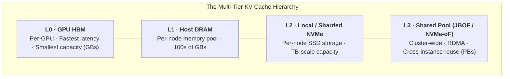

### Production Results of Multi-Level KV Tiering:
- 🚀 **Up to $24\times$ More Token Output**: Massive throughput gains in long-context enterprise workloads by avoiding prompt recomputation.
- 🎯 **$80\%+$ Cache Utilization**: High hit rates in production multi-level memory pools directly reduce the required count of prefill GPU nodes.
- ⚡ **$+24.3\%$ Second-Read Throughput**: Faster prompt loading vs mainstream cache solutions.
- 🌐 **$+30\%$ Cross-Node Read Throughput**: Seamless cache sharing across instances over high-speed RoCE/InfiniBand fabrics.
- **Workload Target**: Ideal for prompt-heavy reuse: **128k+ long contexts, multi-turn agent dialogues, coding copilots, and agentic RAG pipelines**.

---

## 🦀 ContextStore: Tiered, Shared Storage for LLM KV Caches (Slide 15)

To operationalize the KV cache inventory, DaoCloud open-sourced **ContextStore** (`Apache-2.0` · `github.com/DaoCloud/ContextStore`):

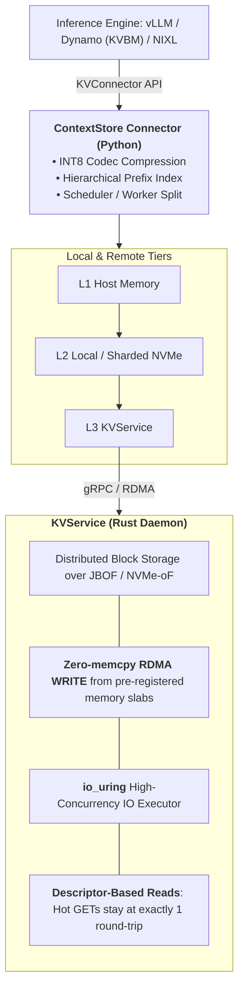

### Native vLLM Integration Configuration:
Deploying ContextStore requires zero modifications to the underlying LLM weights:

```json
// vLLM --kv-transfer-config
{
  "kv_connector": "ContextStoreConnector",
  "kv_connector_module_path": "contextstore.connector",
  "kv_role": "kv_both",
  "kv_connector_extra_config": {
    "model_id": "Qwen2.5-32B",
    "kv_service_endpoint": "10.0.0.1:50051",
    "host_memory_capacity_gb": 128,
    "rdma_enabled": true
  }
}
```

---

## 🚢 MatrixHub: Harbor for Models, at Intranet Speed (Slide 16)

Distributing multi-terabyte model weights across hundreds of GPU nodes is one of the biggest hidden bottlenecks in cloud-native AI:
- `DeepSeek-V4-Pro` at FP8 requires **~1.6 TB of weights**.
- Pulling 1.6 TB from public Hugging Face on every node turns cold-start scaling into a disaster, and is strictly prohibited in sovereign, compliant, or air-gapped environments.

### The Solution: MatrixHub (`matrixhub.ai`)
DaoCloud created **MatrixHub** (CNCF Landscape · Apache-2.0 · `github.com/matrixhub-ai/matrixhub`), applying the **Harbor container registry pattern to model weights**:

```mermaid
flowchart LR
    subgraph Upstream["Upstream Hubs"]
        HF["Hugging Face"]
        Vendors["Model Providers"]
        CI["Fine-Tuning CI/CD"]
    end

    subgraph MatrixHubCore["<b>MatrixHub (Private Model Registry)</b>"]
        Proxy["Transparent HF Proxy"]
        Cache["On-Demand P2P Cache"]
        Gov["RBAC, Provenance & Audit Logs"]
        AirGap["Air-Gapped Delivery Engine"]
        Storage["Backends: Local FS · NFS · Ceph · S3"]
    end

    subgraph GPUNodes["GPU Nodes & Engines (100+ Nodes)"]
        vLLM["vLLM Replicas"]
        SGLang["SGLang Instances"]
        K8s["Kubernetes Workloads"]
    end

    Upstream -->|Pull Once| MatrixHubCore
    MatrixHubCore -->|Serve All at 25.8 GB/s| GPUNodes
```

### Operational Highlights:
- 🚀 **$25.8\text{ GB/s}$ Intranet Download Speed**: Models hydrate at wire-speed across the local network.
- ⚡ **100+ GPU Nodes in Parallel**: Supports concurrent multi-node scaling without saturation.
- 📦 **1 Copy Per Site**: Pull once from upstream, serve all internal clusters.
- 🛠️ **Zero Code Changes**: Transparent drop-in replacement for any Hugging Face client:
  ```bash
  export HF_ENDPOINT=https://matrixhub.local
  vllm serve deepseek-ai/DeepSeek-V4-Pro
  ```

---

## 🚪 Chapter 4 · AI Gateway: One Front Door, Every Token Measured (Slides 17 & 18)

Jerry introduced the governing principle for the final stage of the Token Factory:

> *"One front door. Every token measured. Every token enters through one audited, metered door — and every SLO is measured in tokens, not CPU or requests."*

In traditional cloud-native systems, gateways route HTTP requests based on URLs and measure CPU or request counts. In a Token Factory, **requests lie**: one prompt might contain 10 tokens while another contains 128,000 tokens costing $25\times$ more compute and memory bandwidth!

```mermaid
flowchart LR
    subgraph Consumers["Consumers"]
        Apps["Internal Apps"]
        Agents["AI Agents"]
        MaaS["Partner MaaS"]
        TaaS["Sovereign TaaS Tenants"]
    end

    subgraph Pipeline["Gateway Pipeline (Knoway · Gateway API Inference Extension)"]
        direction LR
        P1["<b>1. AuthN</b><br/>API keys · Tenant"] --> P2["<b>2. Route</b><br/>Semantic · KV-Aware"]
        P2 --> P3["<b>3. Limit</b><br/>Tokens / min"]
        P3 --> P4["<b>4. Protect</b><br/>Failover · Degrade"]
        P4 --> P5["<b>5. Meter</b><br/>Usage → Billing"]
    end

    subgraph ModelPools["Backend Model Pools"]
        GLM["GLM"]
        DS["DeepSeek"]
        Kimi["Kimi"]
        Qwen["Qwen"]
        MM["MiniMax"]
        FT["Fine-Tunes"]
    end

    Consumers --> Pipeline
    Pipeline --> ModelPools
```

### The Three Gateway Pillars:

#### 1. Knoway (Kubernetes-Native AI Gateway)
- Built directly on the upstream **Kubernetes Gateway API Inference Extension**.
- Provides a unified, high-concurrency OpenAI-compatible entrypoint (`/v1/chat/completions`).
- Enforces enterprise API key authentication, per-tenant traffic isolation policies, and intelligent backend endpoint picking.

#### 2. vllm-semantic-router (Prompt Intent & Difficulty Routing)
- Classifies incoming prompts dynamically by **intent and reasoning complexity**:
  - Trivial / conversational prompts $\to$ routed to fast, cheap **Flash models** (e.g., DeepSeek-V4-Flash, GLM-5.3-Flash).
  - Multi-step reasoning / coding prompts $\to$ routed to heavy **Pro / Thinking models** (e.g., DeepSeek-V4-Pro, Kimi-K3).
- Delivers the exact same API endpoint and SLA guarantees to consumers while drastically slashing the **blended cost per million tokens ($\$/\text{Mtok}$)**.

#### 3. Meter in Tokens (Real Cost Accounting)
- Rate limiting and quota management operate strictly on **tokens per minute ($TPM$)**, never requests per minute ($RPM$).
- Reads actual prompt and generation token counts from streaming inference responses, charging and auditing per tenant and per model.

---

## 📊 Chapter 4 · Observability & SLA: Observe Tokens, Not CPUs (Slide 19)

> *"Observe tokens, not CPUs — and close the loop to the SLO."*

Monitoring CPU load, RAM usage, or network packets gives zero insight into model serving health. Token factories must track **five golden metrics**:

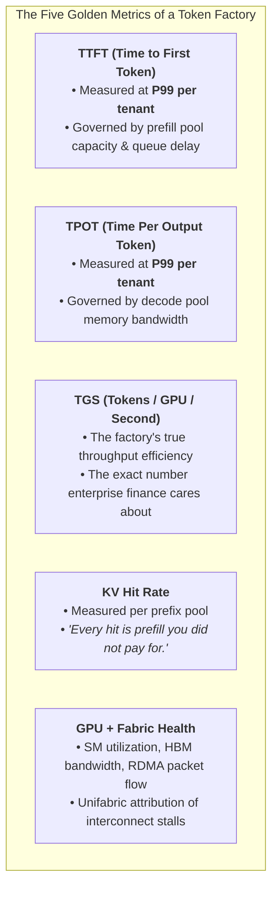

### SLA Is a Closed Loop, Not a Passive Dashboard:

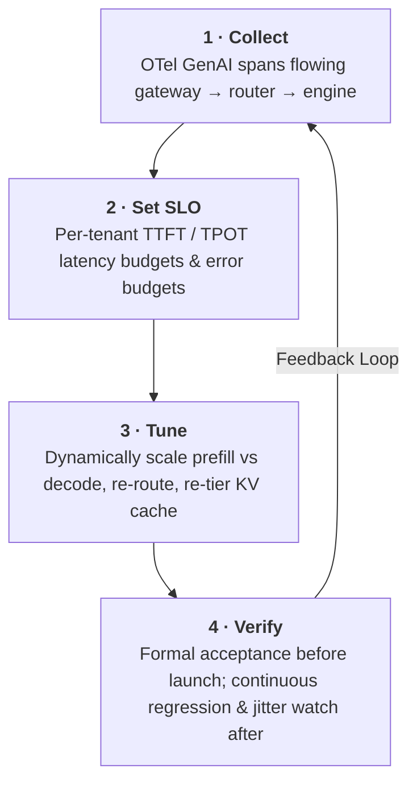

> [!WARNING]
> **Averages Hide Noisy Neighbors**: Never set alerts on average latency ($\text{p50}$). In multi-tenant GPU serving, a single long-context prompt can starve concurrent users while averages look healthy. **Always alert on $\text{p99}$ latency.**

---

## 🚀 Chapter 4 · Results: What Tuning Delivers on Current Hardware (Slide 20)

Jerry presented empirical benchmark results achieved by applying this open-stack tuning across DaoCloud's fleet:

> **Scale Footprint**: **~70,000 GPUs** managed by DaoCloud `d.run` in production and trial environments (Sept 2026).

| Workload / Model | Accelerator Hardware | Tuning Result Achieved | Operational Significance |
| :--- | :--- | :--- | :--- |
| **DeepSeek-V3.2** | NVIDIA H200 | **+250%** throughput | Slashes required physical GPU footprint by more than half for equivalent workload. |
| **DeepSeek-V3.2** | NVIDIA GB300 | **$3.5\times$** output throughput | Full utilization of next-gen Blackwell interconnect and FP4/FP8 compute. |
| **DeepSeek-V4-Flash** | NVIDIA H800 | **3,000+ TGS** per GPU | Zero-cache raw throughput — **over +200%** vs industry baseline. |
| **GLM-5.2** | NVIDIA B300 | **13,000 TGS** per GPU | **TPOT cut by more than 50%**, enabling real-time voice and streaming agent UX. |
| **MoE Core Kernels** | NVIDIA H200 | **+30%** operator performance | Custom Triton / CUDA kernel optimization for sparse routing & all-to-all dispatch. |
| **Speculative Decoding** | Multi-model | **+20% to 35%** throughput | Achieved with only **+4% weight footprint** via draft / MTP heads. |

*Note: Peak ("up to") figures measured by DaoCloud against baseline configurations on the same hardware. Results depend on model architecture, context length, and concurrency. $\text{TGS} = \text{output tokens per GPU per second}$.*

---

## 🎯 Takeaways: Six Patterns from Production You Can Apply on Monday (Slide 21)

Jerry concluded with six foundational architectural patterns distilled from managing tens of thousands of GPUs:

> *"PATTERNS · NOT PRODUCTS"*

```
┌───────────────────────────────────────────────┐
│  SIX PATTERNS FROM PRODUCTION                 │
├───────────────────────────────────────────────┤
│  01 · Pool, then schedule by workload        │
│       (HAMi · DRA · Kueue)                    │
│       "Whole-card allocation is how clusters   │
│        sit at 30%."                           │
├───────────────────────────────────────────────┤
│  02 · Make the network observable             │
│       (Unifabric)                             │
│       "A slow job is often a congested link,   │
│        not a slow GPU."                       │
├───────────────────────────────────────────────┤
│  03 · Treat a replica as one unit             │
│       (LWS · llm-d · Dynamo)                  │
│       "Restarting half a TP/EP group stalls   │
│        the whole replica."                    │
├───────────────────────────────────────────────┤
│  04 · Tier and share the KV cache             │
│       (LMCache · ContextStore)                │
│       "One long-context tenant can evict      │
│        everyone else's prefixes."             │
├───────────────────────────────────────────────┤
│  05 · Keep weights next to GPUs               │
│       (MatrixHub)                             │
│       "TB-scale pulls dominate cold start;    │
│        air-gapped sites need provenance."     │
├───────────────────────────────────────────────┤
│  06 · Meter at the source, in tokens          │
│       (Knoway · semantic router)              │
│       "Request counts and proxy-cached usage  │
│        drift from cost."                      │
└───────────────────────────────────────────────┘
```

---

## 🏁 Conclusion & Open-Source Stack: "You Don't Deploy a Model. You Operate a Factory." (Slide 22)

Jerry concluded his keynote with a defining epigram for production AI infrastructure:

> *"You don't deploy a model. You operate a factory."*

Treating modern foundation models as static software containers that can be deployed onto isolated Kubernetes pods is the root cause of GPU starvation, runaway infrastructure costs, and catastrophic tail-latency breaches. In enterprise production, token generation must be managed like an industrial manufacturing facility:

- **Raw Materials Ingestion**: P2P intranet-speed model weight hydration via **MatrixHub**.
- **Assembly Line Scheduling**: Gang-scheduled, topology-aware placement via **Kueue TAS** and atomic multi-node replicas via **LeaderWorkerSet (LWS)**.
- **Factory Floor Connectivity**: Kernel-level RDMA and NVLink observability via **Unifabric**.
- **Inventory Management**: 4-tier offloaded and shared KV cache pipelines via **ContextStore**.
- **Shipping & Metering Door**: Audited, metered ingress with token-level rate limits and semantic difficulty routing via **Knoway**.

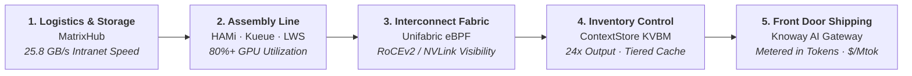

### 🛠️ Open-Source Projects Featured in This Talk:

| Project | GitHub Repository | License | Role in Token Factory |
| :--- | :--- | :--- | :--- |
| **MatrixHub** | [`github.com/matrixhub-ai/matrixhub`](https://github.com/matrixhub-ai/matrixhub) | Apache-2.0 | Private model registry ("Harbor for models") delivering 25.8 GB/s intranet model weight hydration across 100+ GPU nodes in parallel. |
| **Unifabric** | [`github.com/unifabric-io/unifabric`](https://github.com/unifabric-io/unifabric) | Apache-2.0 | eBPF-based RDMA (RoCEv2/InfiniBand) and NVLink traffic observability, leaf/spine topology discovery, and pre-run health checks. |
| **ContextStore** | [`github.com/DaoCloud/ContextStore`](https://github.com/DaoCloud/ContextStore) | Apache-2.0 | Tiered, shared KV cache storage engine written in Rust with `io_uring` and zero-memcpy RDMA WRITEs for vLLM. |
| **HAMi** | [`github.com/Project-HAMi/HAMi`](https://github.com/Project-HAMi/HAMi) | Apache-2.0 | Heterogeneous vGPU and NPU memory and compute core slicing across NVIDIA, AMD, Ascend, and Gaudi accelerators. |

---

## 💡 Live Notes & Key Takeaways

- **Tokens per Dollar (\$/Mtok) is the True Metric**: Enterprise AI infrastructure cannot be measured in raw GPU utilization; business viability depends on blended token generation cost.
- **Multi-Node Inference is the New Normal**: With frontier open models crossing 1T parameters (Kimi-K3 at 2.8T, DeepSeek-V4-Pro at 1.6T), inference clusters require distributed topology-aware Kubernetes orchestration.
- **MoE Shifts Bottlenecks from FLOPs to Bandwidth**: Because MoE architectures only activate a fraction of parameters per token (e.g. 17B out of 403B), serving throughput is constrained by Expert Parallelism communication and KV cache memory bandwidth.
- **Cloud-Native AI Reference Stack**: DaoCloud/d.run validates that Kubernetes with DRA, HAMi GPU sharing, Kueue TAS, LeaderWorkerSet, and vLLM/SGLang forms the open foundation of enterprise token factories.

---

## 🔗 Related Notes & Cross-References

- 🌟 [ContainerDays Singapore 2026](ContainerDays%20Singapore%202026.md) — Master conference schedule and session index
- 🛠️ [Serve Your First LLM, Then Watch It Break at Scale (Mumshad Mannambeth)](Serve%20Your%20First%20LLM,%20Then%20Watch%20It%20Break%20at%20Scale%20(Mumshad%20Mannambeth).md) — Scaling LLM serving on Kubernetes, safetensors, and vLLM bottlenecks
- 🏭 [Will Everyone Build an AI Factory? (Saiyam Pathak)](Will%20Everyone%20Build%20an%20AI%20Factory?%20(Saiyam%20Pathak).md) — The architectural shift toward AI factories
- 🚀 [Enterprise Sovereign AI - Building with SUSE AI Factory](Enterprise%20Sovereign%20AI%20-%20Building%20with%20SUSE%20AI%20Factory.md) — Sovereign, enterprise-grade AI clusters
- 🧭 [Your Next Platform User Isn't Human - Building an AI-Native Developer Platform (Yashod Perera)](Your%20Next%20Platform%20User%20Isn't%20Human%20-%20Building%20an%20AI-Native%20Developer%20Platform%20(Yashod%20Perera).md) — AI-native platform architecture
- 🚦 [Governing the Agentic Stack on Kubernetes - MCP, A2A, and LLM Traffic (Robin Cher)](Governing%20the%20Agentic%20Stack%20on%20Kubernetes%20-%20MCP,%20A2A,%20and%20LLM%20Traffic%20(Robin%20Cher).md) — Infrastructure-level LLM gateway routing and latency budgets
- 🏎️ [When Tokens Stop Being the Bottleneck - Operating Agentic Software Factories (Carl Ross)](When%20Tokens%20Stop%20Being%20the%20Bottleneck%20-%20Operating%20Agentic%20Software%20Factories%20(Carl%20Ross).md) — Token consumption economics and agent factory loops
