# ContainerDays & AI Context Singapore 2026 · Executive Conference Summary

> **Date**: Tuesday, October 27 – Wednesday, October 28, 2026  
> **Venue**: Suntec Singapore Convention & Exhibition Centre (1 Raffles Boulevard, Singapore 039593)  
> **Event URL**: [ContainerDays Singapore 2026](https://www.containerdays.io/containerdays-singapore-2026/) • [Full Agenda](https://www.containerdays.io/containerdays-singapore-2026/agenda/)  
> **Organizers**: Dockland Media Group, Supported by Singapore Exhibition & Convention Bureau (SECB)  
> **Keynote Speakers**: Kelsey Hightower, Saiyam Pathak (vCluster), Carl Ross (OpenAI), Jerry Chen (DaoCloud / d.run), Yashod Perera (WSO2)  
> **Public Vault Connections**: [[AI-Generated Code == Code You Can Trust - AISG & Sonar at EDB|AI-Generated Code == Code You Can Trust (AISG & Sonar)]] • [[Shipping Reliable AI Agents - Building with Langfuse and ClickHouse (Max Deichmann)|Shipping Reliable AI Agents (Langfuse & ClickHouse)]] • [[Build Agents with Google Agent CLI]]

---

## ⚡ Executive Summary: The 5 Mega-Themes of ContainerDays 2026

ContainerDays & AI Context Singapore 2026 marked a decisive turning point in cloud-native computing: **the transition from "AI as a feature" to "AI as the primary consumer and operator of infrastructure."** Across two intensive days, engineering leaders from OpenAI, Kong, DaoCloud, SUSE, WSO2, and Google converged on five architectural realities:

1. 🛡️ **From Model Capabilities to System Boundaries**:
   Autonomous coding agents (Claude Code, Pi, OpenHands) cannot be trusted with raw credentials or unfettered network access. The industry is standardizing on **ephemeral Kubernetes Sandboxes (`agents.x-k8s.io/v1beta1`)**, Linux Landlock LSM, and microVMs (gVisor, QEMU) to hermetically seal execution environments.
2. 🤖 **The Death of ClickOps & The Machine User**:
   Internal Developer Portals (IDPs) built for *"a human with a browser"* are obsolete when autonomous agents deploy code at 3 AM. Platforms must expose **Model Context Protocol (MCP)** APIs with CEL-rendered 12-line abstractions rather than raw 400-line Kubernetes manifests.
3. 🏭 **The Token Factory Paradigm**:
   Enterprise accounting has flipped from *"requests per GPU"* to **blended cost per million tokens ($\$/\text{Mtok}$)**. Operating 229B to 2.8T parameter models demands Prefill/Decode (PD) disaggregation, LeaderWorkerSet (LWS) atomic groups, and 4-tier KV cache inventory pyramids (ContextStore) that treat KV blocks as reusable factory inventory.
4. 🚦 **Infrastructure-Level Agent Governance**:
   Unmanaged multi-agent meshes collapse under runaway token bills and privilege escalation. Centralized AI Gateways (Kong AI Gateway, Loge, Knoway) enforce token-level rate limiting ($TPM$), tool-level RBAC, and prompt injection guards at the network edge.
5. 🔁 **Harness Engineering Over Vibe Coding**:
   When inference token costs approach zero, code becomes cheap and disposable. The only non-regrettable engineering investments are **hermetic test harnesses**, **trace-derived evaluation graphs**, and **radically fast CI loops**.

---

## 📸 Venue & Kickoff

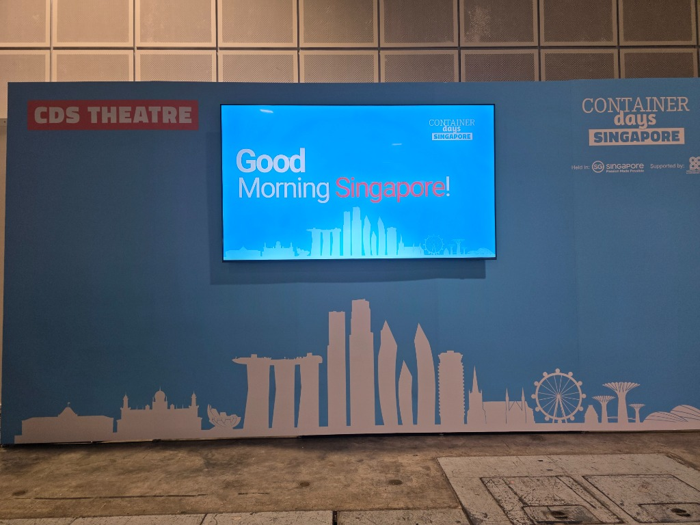

> **CDS Theatre Kickoff**: Opening keynote stage at Suntec Singapore Convention Centre.

---

## 🧭 Attended Sessions & Technical Itinerary

### Day 1: Tuesday, October 27, 2026 (10 Sessions)

| Time              | Room / Track | Session Title & Speaker                                                           | Core Technical Focus                                                                 | Dedicated Note                                                                                                                                                          |
| :---------------- | :----------- | :-------------------------------------------------------------------------------- | :----------------------------------------------------------------------------------- | :---------------------------------------------------------------------------------------------------------------------------------------------------------------------- |
| **09:30 – 10:15** | CDS Theatre  | **Confessions of a Portal Assistant** — *Yashod Perera (WSO2)*                 | Moving from portal RAG chatbots to machine-readable MCP platform APIs.               | [[Confessions of a Portal Assistant (Yashod Perera)\|Read Note]]                                                                                     |
| **10:15 – 10:50** | AIC Theatre  | **Securing AI Coding Agents with K8s Sandboxes** — *Ryan Djurovich (Podplane)* | Kubernetes `Sandbox` CRD, gVisor isolation, and Landlock LSM supervision.            | [[Securing AI Coding Agents with Kubernetes Sandboxes (Ryan Djurovich)\|Read Note]]                                                              |
| **11:20 – 12:20** | Workshop     | **Taming Agent Sprawl: Scaling Evals** — *Timothy Lin (Resaro)*                | Trace-derived topology graphs and automated synthetic edge-case generation.          | [[Taming Agent Sprawl - How We Scale Evals to Keep Up with Agents (Timothy Lin)\|Read Note]]                                         |
| **12:25 – 12:40** | Synergies    | **Operating an Internal LLM Gateway** — *Zhong Liang Ong & Yek Khan (Loge)*    | Tailscale auth, credential decoupling, and why cross-model fallback breaks agents.   | [[Lessons from Operating an Internal LLM Gateway for Production Agentic Applications (Zhong Liang Ong & Yek Khan)\|Read Note]] |
| **12:50 – 13:25** | AIC Theatre  | **Operating Agentic Software Factories** — *Carl Ross (OpenAI)*                | Asymptotic token economics, WASM actor swarms, and Single Problem Optimization.      | [[When Tokens Stop Being the Bottleneck - Operating Agentic Software Factories (Carl Ross)\|Read Note]]                                  |
| **14:25 – 14:55** | MainStage    | **Fireside Chat with Kelsey Hightower** — *Kelsey Hightower & Geet Bhanawat*   | Fundamentals over hype, 1-5-60 telecom triage, and 5G network slicing.               | [[Fireside Chat with Kelsey Hightower & Geet Bhanawat\|Read Note]]                                                                                   |
| **15:05 – 15:40** | MainStage    | **Will Everyone Build an AI Factory?** — *Saiyam Pathak (vCluster Labs)*       | Modular NVIDIA DSX PODs, HAMi GPU slicing, and vCluster multi-tenancy.               | [[Will Everyone Build an AI Factory? (Saiyam Pathak)\|Read Note]]                                                                                |
| **15:40 – 16:05** | SUSE Booth   | **Enterprise Sovereign AI with SUSE AI Factory** — *SUSE SEA Solutions Team*   | SLES for NVIDIA live patching, Rancher Prime, and OpenShell agent sandboxing.        | [[Enterprise Sovereign AI - Building with SUSE AI Factory\|Read Note]]                                                                               |
| **16:10 – 16:45** | CDS Theatre  | **Start Shipping AI Operable Products** — *Khang Toh (fdeploy)*                | Dual-user surfaces, the 7 operability primitives, and 8-minute SlackOps remediation. | [[Stop Shipping Features with AI. Start Shipping AI Operable Products (Khang Toh)\|Read Note]]                                             |
| **16:55 – 17:30** | Synergies    | **Governing the Agentic Stack on Kubernetes** — *Robin Cher (Kong)*            | 1 Gateway, 3 Profiles (LLM, MCP, A2A), token budgets, and distributed tracing.       | [[Governing the Agentic Stack on Kubernetes - MCP, A2A, and LLM Traffic (Robin Cher)\|Read Note]]                                  |

---

### Day 2: Wednesday, October 28, 2026 (6 Sessions & Workshops)

| Time | Room / Track | Session Title & Speaker | Core Technical Focus | Dedicated Note |
| :--- | :--- | :--- | :--- | :--- |
| **09:15 – 10:30** | Workshop | **Serve Your First LLM, Then Watch It Break** — *Mumshad Mannambeth (KodeKloud)* | VRAM saturation, prefill vs decode, and llm-d KV cache affinity routing. | [[Serve Your First LLM, Then Watch It Break at Scale (Mumshad Mannambeth)\|Read Note]] |
| **11:00 – 11:30** | SUSE Booth | **Accelerating Cloud Delivery with SUSE BCI** — *SUSE Showcase* | 24-hour upstream patch SLA, Sigstore provenance, and enterprise hardened images. | [[Accelerating Cloud-Native Delivery with SUSE Application Collection\|Read Note]] |
| **11:00 – 12:00** | Workshop | **Build the AI Context Layer for EPD** — *Yethoven Tukimin (Notion)* | Relational knowledge graphs and Model Context Protocol (MCP) for IDE agents. | [[Build the AI Context Layer for Your EPD Team (Yethoven Tukimin)\|Read Note]] |
| **11:45 – 13:00** | Workshop | **Build Your Own Agent Platform on K8s** — *Ryan Djurovich (Podplane)* | Hands-on agentic PaaS, Pi coding agent, Landlock LSM, and SPIFFE mTLS. | [[Build Your Own AI Coding Agent Platform on Kubernetes (Ryan Djurovich)\|Read Note]] |
| **13:55 – 14:30** | CDS Theatre | **Your Next Platform User Isn't Human** — *Yashod Perera (OpenChoreo)* | Agent-native developer platforms, CEL-rendered abstractions, and SRE agents. | [[Your Next Platform User Isn't Human - Building an AI-Native Developer Platform (Yashod Perera)\|Read Note]] |
| **15:25 – 16:00** | CDS Theatre | **Building a High-Performance Token Factory** — *Jerry Chen (DaoCloud / d.run)* | Heterogeneous compute pooling, ContextStore 4-tier KV cache, and MatrixHub. | [[Building a High-Performance Token Factory (Jerry Chen)\|Read Note]] |

---

## 📝 Day 1 Highlights & Key Takeaways

### 1. [[Confessions of a Portal Assistant (Yashod Perera)]]
- **The Problem**: Web portals built for humans fail when consumed by autonomous coding agents. Agents either scrape UI, generate invalid YAML, or bypass the portal to execute raw `kubectl apply`.
- **The Solution**: Treat MCP as the primary interface. Expose scoped domain abstractions (e.g. 12-line CEL `Component` specs) so agents cannot hallucinate unapproved cluster resources.
- **Key Artifacts**: [[Confessions of a Portal Assistant (Yashod Perera)|Full Architecture & Failure Case Studies]].

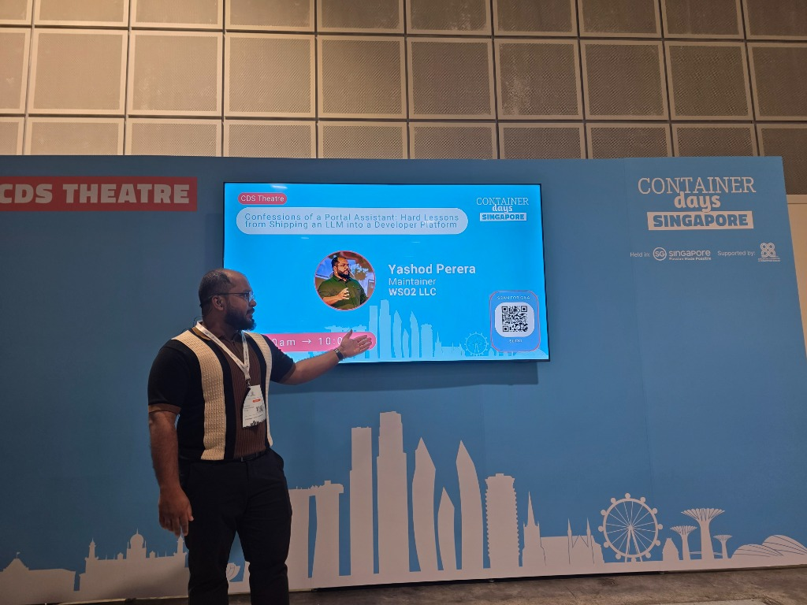

---

### 2. [[Securing AI Coding Agents with Kubernetes Sandboxes (Ryan Djurovich)]]
- **The Problem**: Traditional StatefulSets fail for ephemeral agent runs. Agents require isolated kernels, rapid teardown, and strictly segregated API credentials.
- **The Solution**: The upstream Kubernetes `Sandbox` CRD (`agents.x-k8s.io/v1beta1`) paired with `nono` (Linux Landlock LSM supervisor) and SPIFFE mTLS workload identities. Provider API keys never enter the sandbox container.
- **Key Artifacts**: [[Securing AI Coding Agents with Kubernetes Sandboxes (Ryan Djurovich)|Manifests & gVisor Sandbox Architecture]].

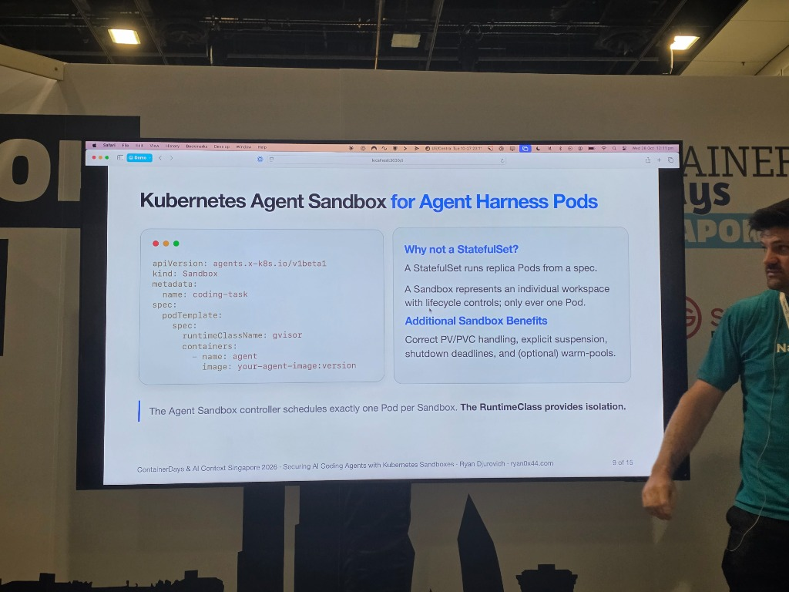

---

### 3. [[Taming Agent Sprawl - How We Scale Evals to Keep Up with Agents (Timothy Lin)|Taming Agent Sprawl: Scaling Evals (Timothy Lin)]]
- **The Problem**: Frameworks make multi-agent prototypes easy to build, but combinatorial decision branches make manual evaluation impossible.
- **The Solution**: Derive structural topology graphs directly from runtime OpenTelemetry traces. Synthesize adversarial test cases targeted at fragile graph junctions to establish automated CI/CD release gates.
- **Key Artifacts**: [[Taming Agent Sprawl - How We Scale Evals to Keep Up with Agents (Timothy Lin)|Trace Topology Graph & Quality Gate Criteria]].

---

### 4. [[Lessons from Operating an Internal LLM Gateway for Production Agentic Applications (Zhong Liang Ong & Yek Khan)|Operating an Internal LLM Gateway (Zhong Liang Ong & Yek Khan)]]
- **The Problem**: Decentralized API key distribution across engineering teams leads to credential leaks, zero cost visibility, and unmanaged model drift.
- **The Solution**: **Loge**, an internal Kubernetes LLM gateway with Tailscale ACLs, explicit vs. family-alias routing, and strict retry disciplines (same-model retry allowed; cross-model fallback blocked to avoid breaking JSON schemas).
- **Key Artifacts**: [[Lessons from Operating an Internal LLM Gateway for Production Agentic Applications (Zhong Liang Ong & Yek Khan)|Routing Tiers & Gateway Architecture]].

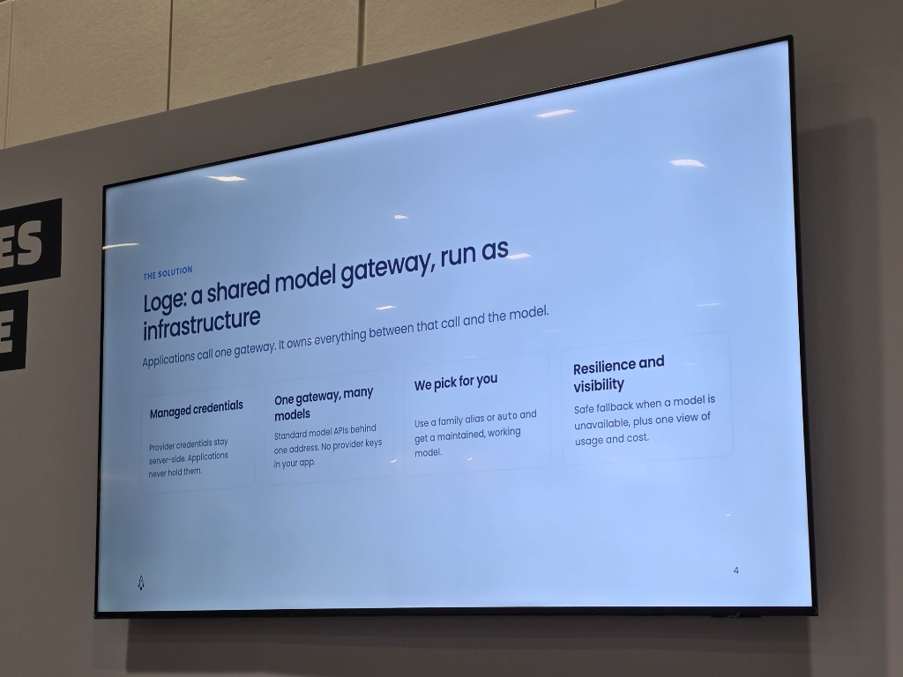

---

### 5. [[When Tokens Stop Being the Bottleneck - Operating Agentic Software Factories (Carl Ross)|Operating Agentic Software Factories (Carl Ross)]]
- **The Problem**: As inference token costs trend toward zero, writing code is no longer the bottleneck. The only durable investments are verification harnesses.
- **The Solution**: WASM actor swarms distributed via OCI registries (Zot + ORAS), asynchronous NATS mailboxes, and Single Problem Optimization (SPO) workers landing code directly on trunk via deterministic Grader actors.
- **Key Artifacts**: [[When Tokens Stop Being the Bottleneck - Operating Agentic Software Factories (Carl Ross)|Software Factory Blueprint & 14 Embedded Slides]].

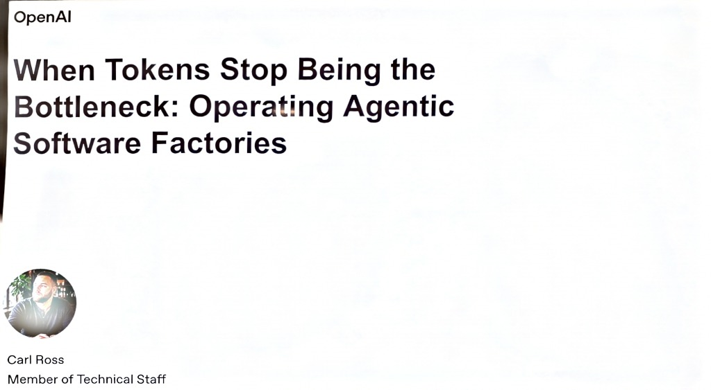

---

### 6. [[Fireside Chat with Kelsey Hightower & Geet Bhanawat]]
- **Core Insights**: *"AI is just another workload."* Technology does not fix broken team architectures or messy data; it simply accelerates what is already there. Focus on Linux and networking fundamentals.
- **Singtel 1-5-60 Benchmark**: 1 min fault detection $	o$ 5 min agentic diagnosis $	o$ 60 min service restoration across nationwide telecom networks.
- **Key Artifacts**: [[Fireside Chat with Kelsey Hightower & Geet Bhanawat|Full Discussion Notes & Onstage Photos]].

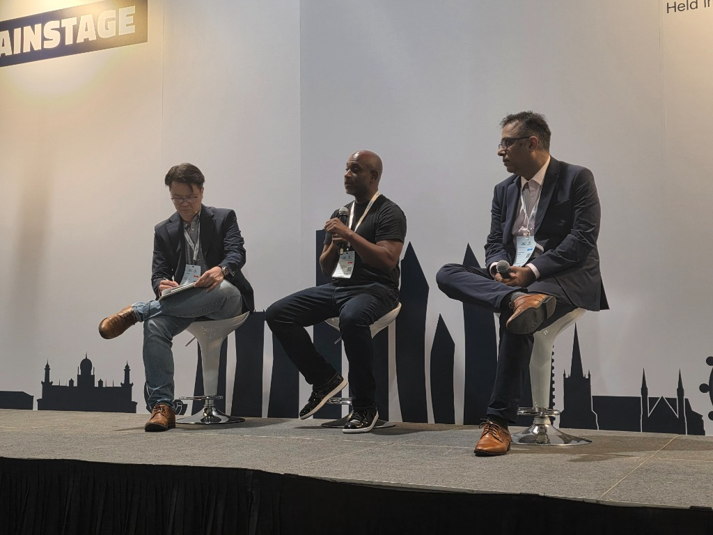

---

### 7. [[Will Everyone Build an AI Factory? (Saiyam Pathak)]]
- **The Problem**: Operating enterprise AI clusters leads to severe GPU under-utilization (5–30%) and multi-tenant permission conflicts.
- **The Solution**: Modular containerized data centers (NVIDIA DSX POD) deployed in 14 days, coupled with HAMi vGPU slicing and **vCluster** virtual control planes granting AI engineers `cluster-admin` freedom without host cluster instability.
- **Key Artifacts**: [[Will Everyone Build an AI Factory? (Saiyam Pathak)|GPU Slicing YAML Specs & vCluster Architecture]].

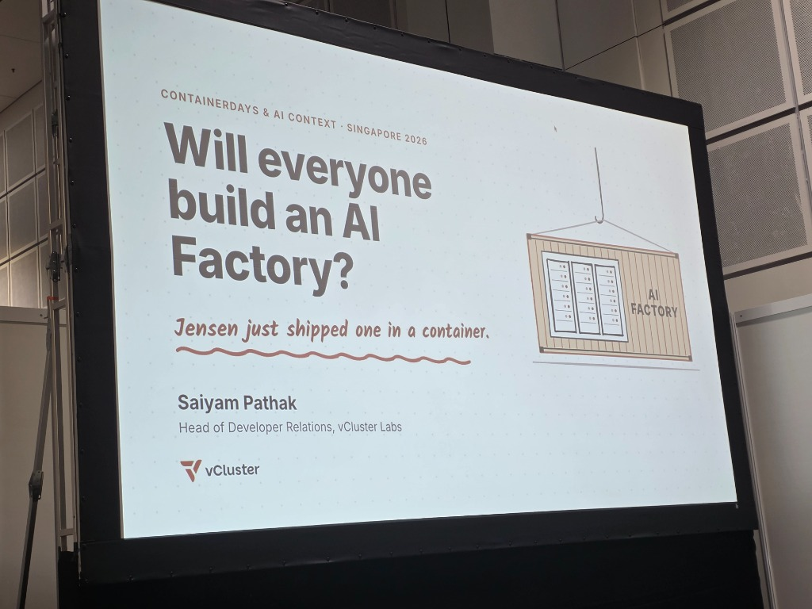

---

### 8. [[Enterprise Sovereign AI - Building with SUSE AI Factory|Enterprise Sovereign AI with SUSE AI Factory]]
- **The Problem**: National data residency and IP protection require turnkey on-prem infrastructure rather than public cloud APIs.
- **The Solution**: SLES for NVIDIA (kernel Live Patching for zero-downtime training), Rancher Prime multi-cluster management, and NVIDIA OpenShell runtime sandboxing with NeuVector L7 security.
- **Key Artifacts**: [[Enterprise Sovereign AI - Building with SUSE AI Factory|SUSE AI Factory Operator & Blueprint Architecture]].

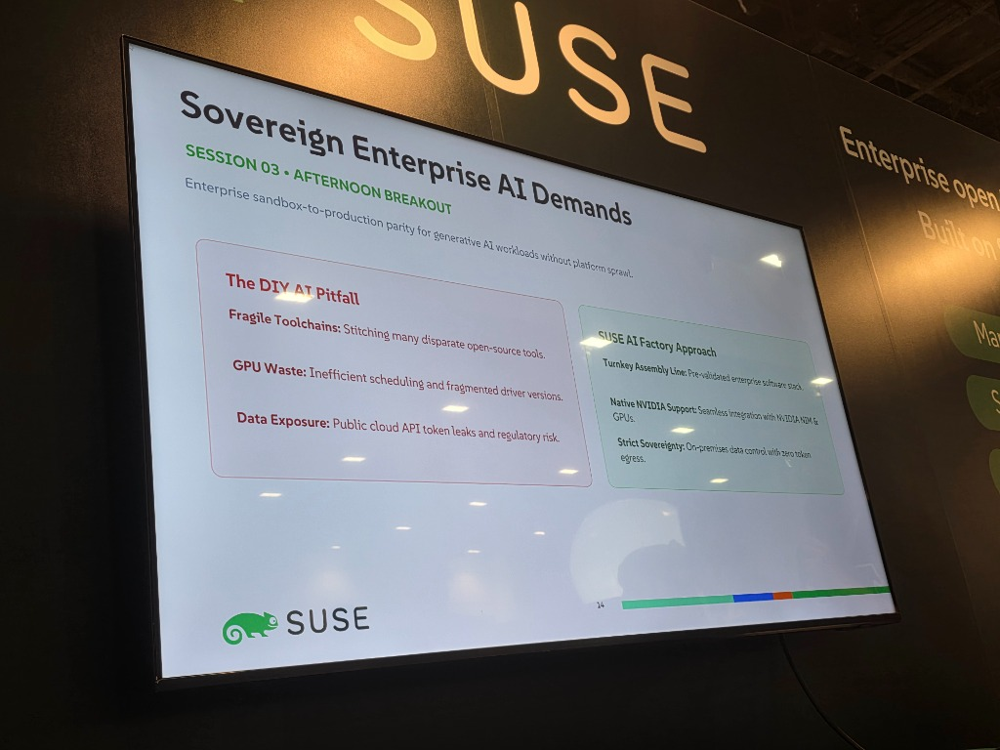

---

### 9. [[Stop Shipping Features with AI. Start Shipping AI Operable Products (Khang Toh)|Start Shipping AI Operable Products (Khang Toh)]]
- **The Problem**: AI accelerates feature synthesis, but "LGTM Engineering" (approving unread 1,000-line agent PRs) spikes production change failure rates.
- **The Solution**: Build for dual users (Human SREs + Autonomous Agents) using the 7 Primitives of Operability (Outcome Intent, Journey Context, Recovery Paths, Safe Actions).
- **Key Artifacts**: [[Stop Shipping Features with AI. Start Shipping AI Operable Products (Khang Toh)|5 Pillars Architecture & 8-Minute Autonomous Remediation Loop]].

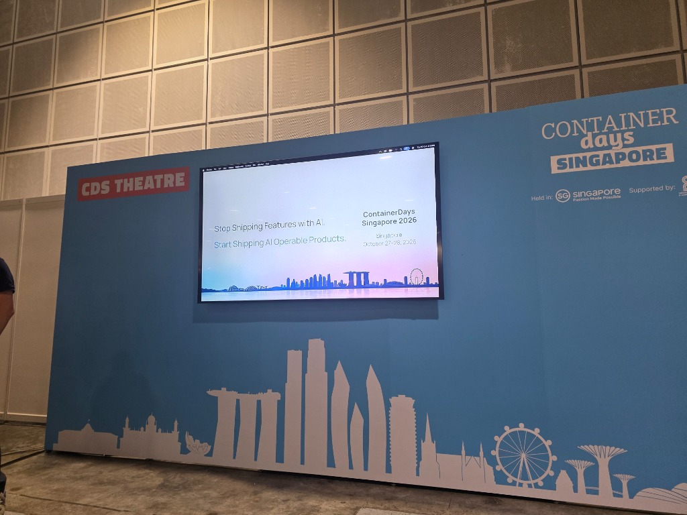

---

### 10. [[Governing the Agentic Stack on Kubernetes - MCP, A2A, and LLM Traffic (Robin Cher)|Governing the Agentic Stack on Kubernetes (Robin Cher)]]
- **The Problem**: Multi-agent point-to-point sprawl causes unmanaged token costs, prompt injections, and unauthenticated MCP tool calls.
- **The Solution**: Kong AI Gateway with 3 declarative Kubernetes CRD profiles: LLM Profile (budgets & prompt guard), MCP Profile (tool RBAC), and A2A Profile (agent identity & rate limits). Data plane traffic stays strictly local.
- **Key Artifacts**: [[Governing the Agentic Stack on Kubernetes - MCP, A2A, and LLM Traffic (Robin Cher)|Reference Architecture & Jaeger Distributed Tracing]].

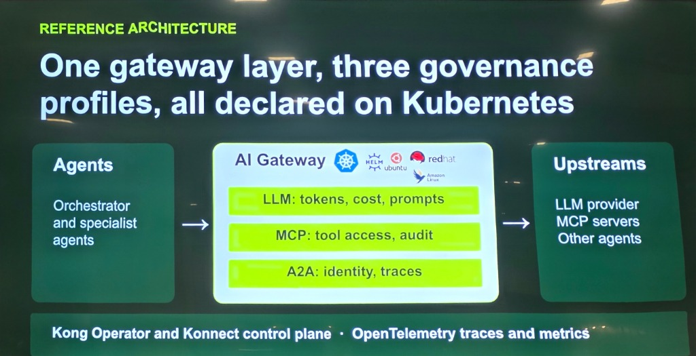

---

## 📝 Day 2 Highlights & Key Takeaways

### 11. [[Serve Your First LLM, Then Watch It Break at Scale (Mumshad Mannambeth)|Serve Your First LLM, Then Watch It Break (Mumshad Mannambeth)]]
- **The Problem**: 8B models saturate 16GB GPUs on weight loading alone. Stateless multi-turn chat resends full conversation history, while naive Kubernetes `Service` round-robin routing causes 100% KV cache misses.
- **The Solution**: Disaggregate prefill from decode and deploy intelligent KV cache affinity routers (**llm-d**) to pin sessions and reuse cached prompt prefixes.
- **Key Artifacts**: [[Serve Your First LLM, Then Watch It Break at Scale (Mumshad Mannambeth)|PagedAttention, Prefill vs Decode, & llm-d Architecture]].

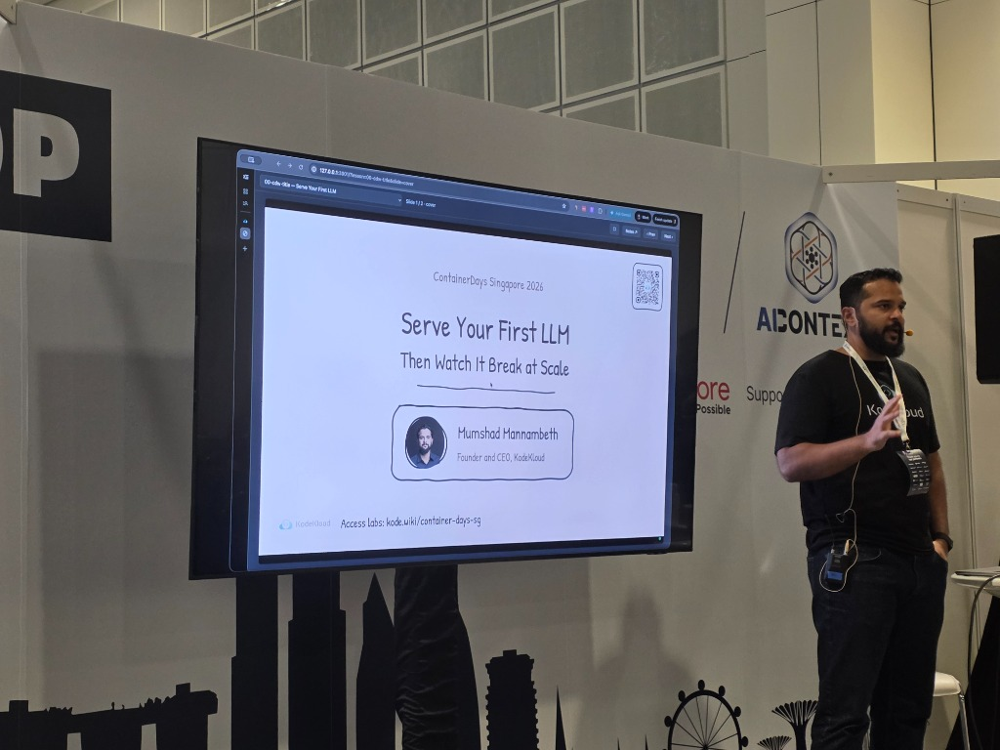

---

### 12. [[Accelerating Cloud-Native Delivery with SUSE Application Collection|Accelerating Cloud Delivery with SUSE BCI]]
- **The Problem**: Over 80% of open-source container images carry unpatched critical CVEs; manual enterprise audits stall developer velocity.
- **The Solution**: Pre-audited enterprise container images rebuilt within 24 hours of upstream CVE disclosures, signed with Sigstore/Cosign and verified via Rancher Prime.
- **Key Artifacts**: [[Accelerating Cloud-Native Delivery with SUSE Application Collection|Supply Chain Security & 4-Stage Delivery Workflow]].

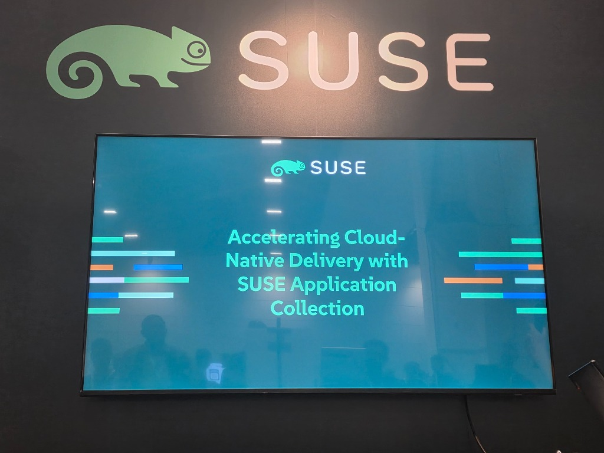

---

### 13. [[Build the AI Context Layer for Your EPD Team (Yethoven Tukimin)|Build the AI Context Layer for EPD (Yethoven Tukimin)]]
- **The Problem**: Disconnected silos across Product (PRDs), Design (Figma), and Engineering (GitHub) lead to coding agent hallucinations.
- **The Solution**: Centralize organizational context in Notion relational schemas and expose them to Cursor/Claude Code via Model Context Protocol (`@modelcontextprotocol/server-notion`).
- **Key Artifacts**: [[Build the AI Context Layer for Your EPD Team (Yethoven Tukimin)|EPD Relational Schema & MCP Integration Workflow]].

---

### 14. [[Build Your Own AI Coding Agent Platform on Kubernetes (Ryan Djurovich)|Build Your Own Agent Platform on K8s (Ryan Djurovich)]]
- **The Problem**: Coding agents require dedicated, disposable developer environments that cannot compromise production Kubernetes clusters.
- **The Solution**: Podplane lightweight QEMU microVMs running Pi coding agents inside Kubernetes `Sandbox` CRDs, supervised by Linux Landlock LSM with SPIFFE mTLS authentication.
- **Key Artifacts**: [[Build Your Own AI Coding Agent Platform on Kubernetes (Ryan Djurovich)|5-Part Hands-on Lab & Manifest Walkthrough]].

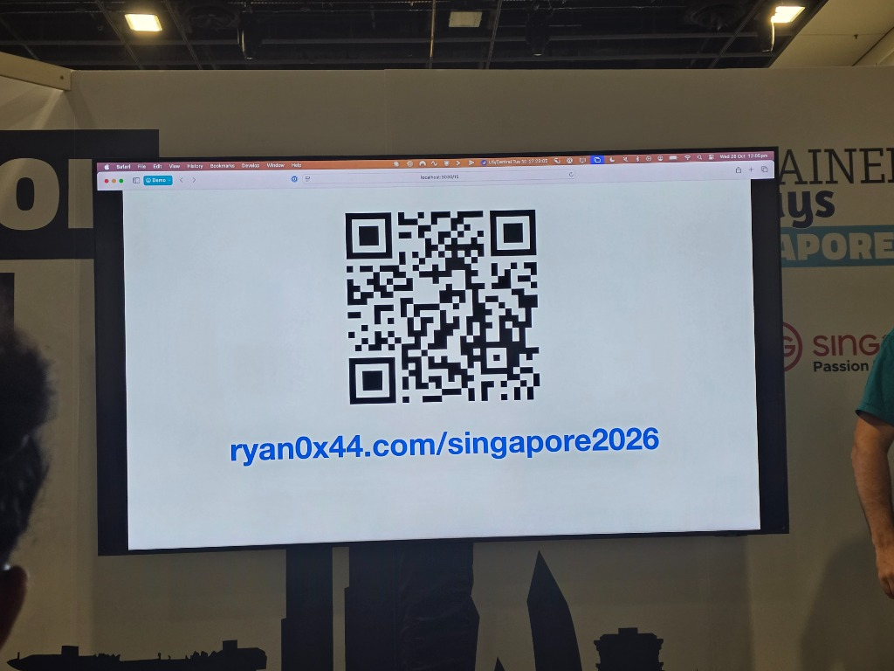

---

### 15. [[Your Next Platform User Isn't Human - Building an AI-Native Developer Platform (Yashod Perera)|Your Next Platform User Isn't Human (Yashod Perera)]]
- **The Core Inversion**: Shift from *"building an assistant for the developer portal"* to **"building a platform an autonomous agent can use."**
- **The Solution**: OpenChoreo architecture exposing Control Plane MCP (94 scoped domain tools) and Observability MCP (condition summaries) with CEL-rendered 12-line Component specs.
- **Key Rule**: *"An SRE agent is only as honest as your topology."* Governance gaps become agent hallucinations.
- **Key Artifacts**: [[Your Next Platform User Isn't Human - Building an AI-Native Developer Platform (Yashod Perera)|Platform Topology, CEL Schemas, & Autonomous RCA Loops]].

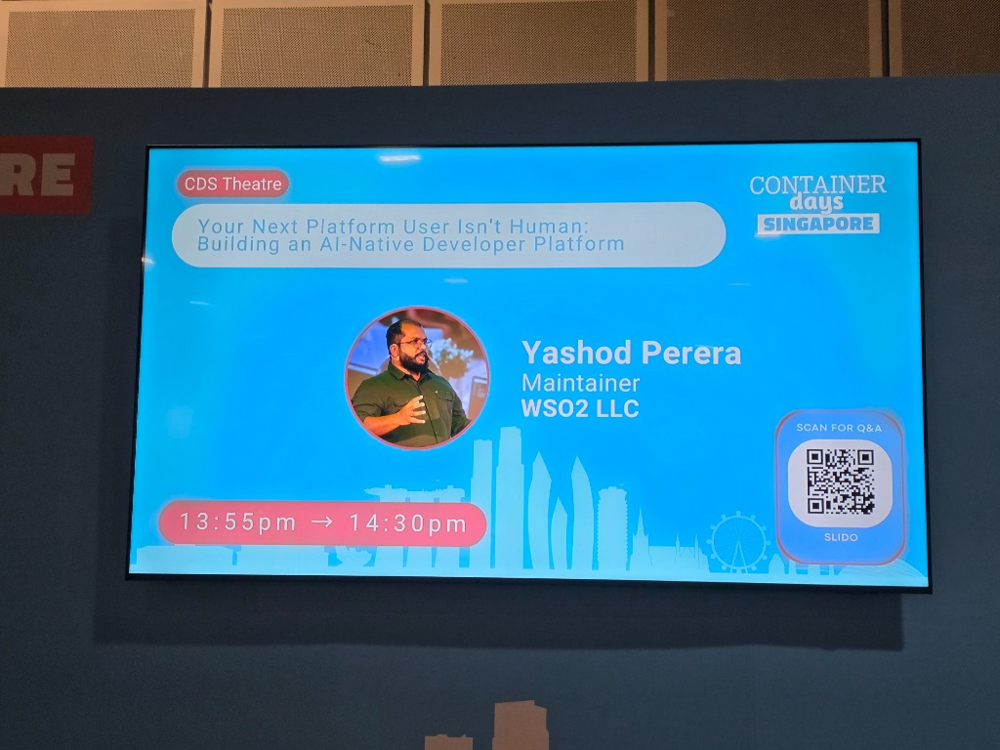

---

### 16. [[Building a High-Performance Token Factory (Jerry Chen)]]
- **The Defining Thesis**: *"You don't deploy a model. You operate a factory."* Accounting flips to **blended cost per million tokens ($\$/\text{Mtok}$)**.
- **The Architecture**: Heterogeneous compute pooling with HAMi/DRA/Kueue TAS boosts GPU utilization from **30% to 80%+** across 10+ accelerator families (~70,000 GPUs on `d.run`).
- **Distributed Serving & Storage**: PD Disaggregation managed as atomic LeaderWorkerSet (LWS) groups; 4-tier KV cache inventory via **ContextStore** delivers up to **24x token output**; **MatrixHub** hydrates 1.6TB models at **25.8 GB/s** wire-speed.
- **Key Artifacts**: [[Building a High-Performance Token Factory (Jerry Chen)|6 Architectural Layers, Benchmark Fleet Results, & Six Production Patterns]].

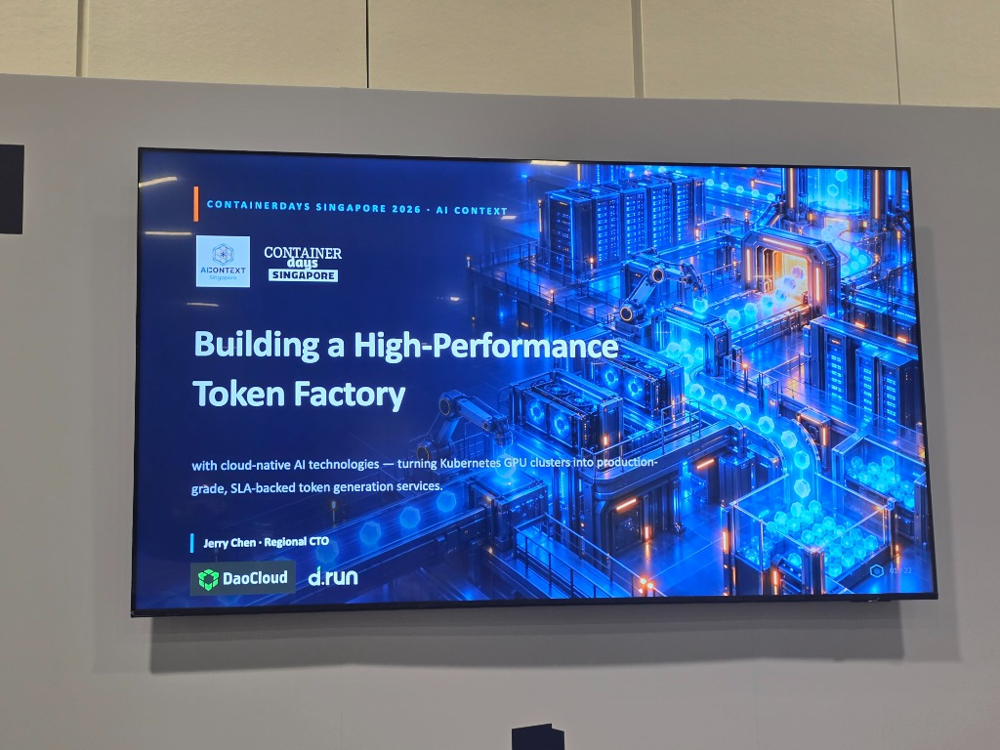

---

## 🎯 Production Patterns to Apply on Monday

1. **Stop Deploying Raw Containers for Agents**: Transition coding agents from standard pods to ephemeral Kubernetes `Sandbox` CRDs with Linux Landlock LSM filesystem isolation.
2. **Never Pass Raw Upstream API Keys to Agents**: Intercept and enrich inference and Git traffic at external gateways (Kong AI Gateway, Loge) using workload mTLS (SPIFFE).
3. **Disaggregate Prefill from Decode**: Separate compute-heavy prompt ingestion from memory-bandwidth-bound token generation to slash TTFT and scale independently.
4. **Treat KV Caches as Managed Factory Inventory**: Implement multi-tier KV cache offloading (GPU HBM $	o$ Host DRAM $	o$ Local NVMe $	o$ Shared Storage) via tools like ContextStore to avoid expensive prompt recomputation.
5. **Give Autonomous Agents Fewer Words**: Replace raw 400-line Kubernetes YAML with CEL-rendered, schema-restricted domain components exposed over MCP.
6. **Alert on P99 Latency, Never Averages**: Multi-tenant GPU serving suffers from extreme noisy-neighbor starvation under long contexts; closed-loop SLAs must trigger on tail latency.

---
