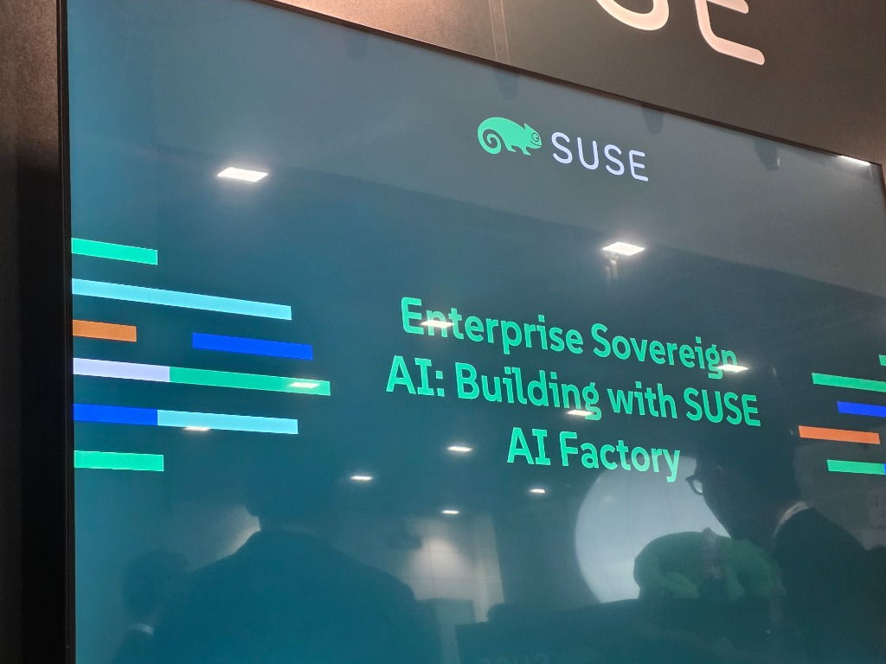
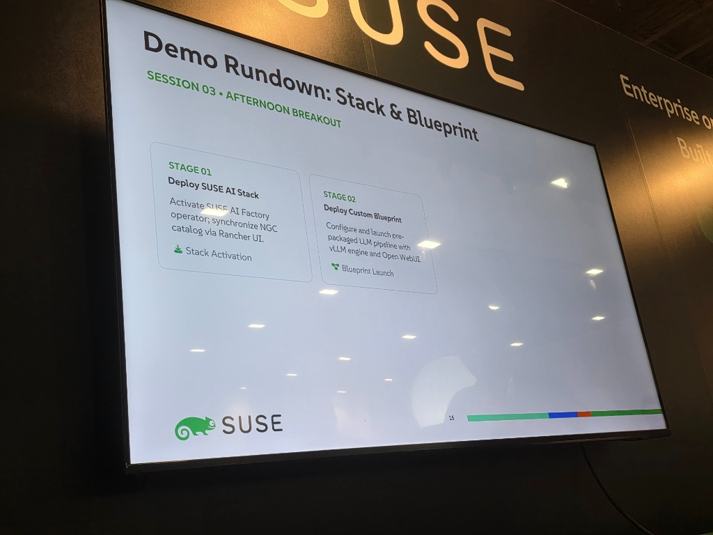
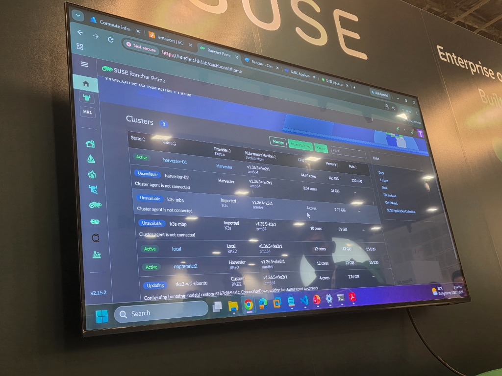
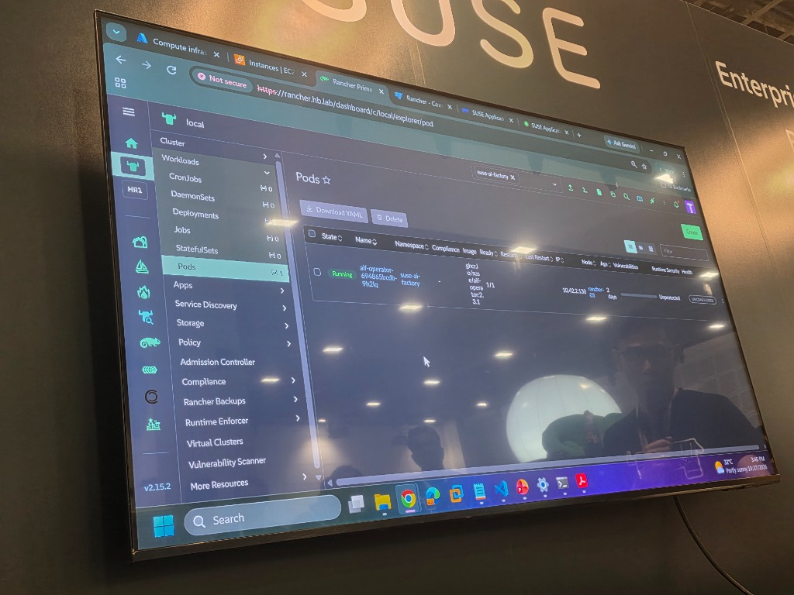
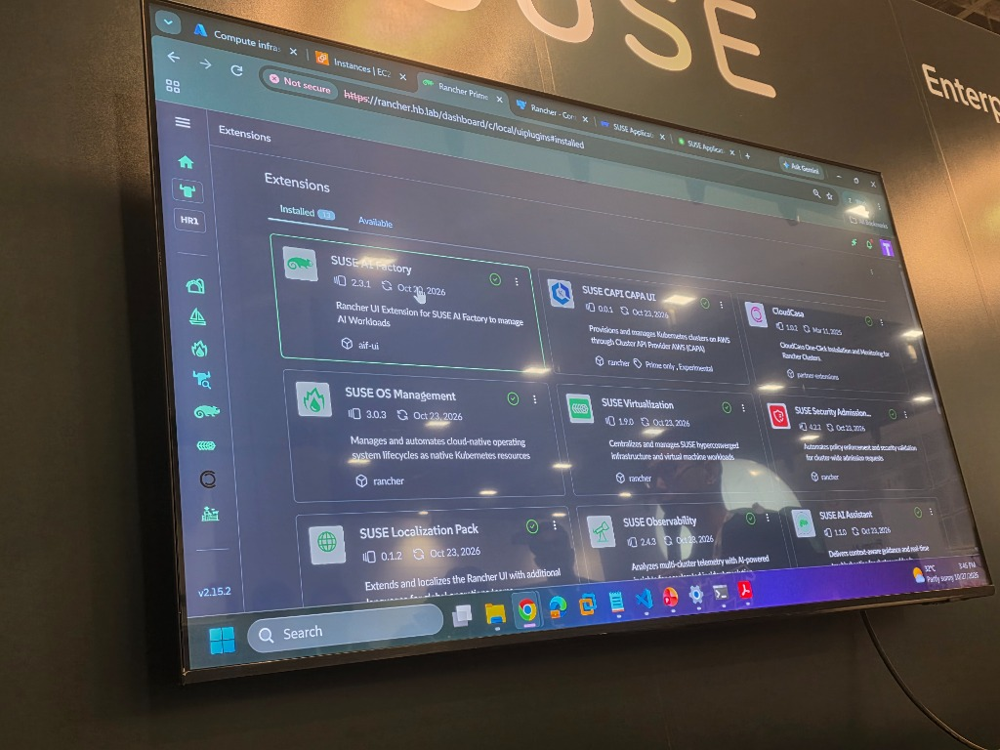
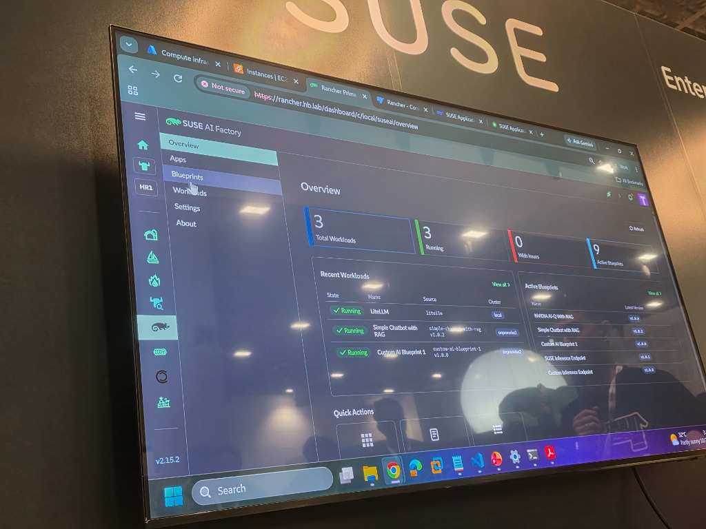
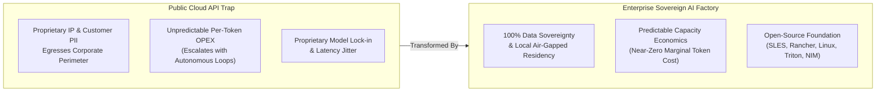
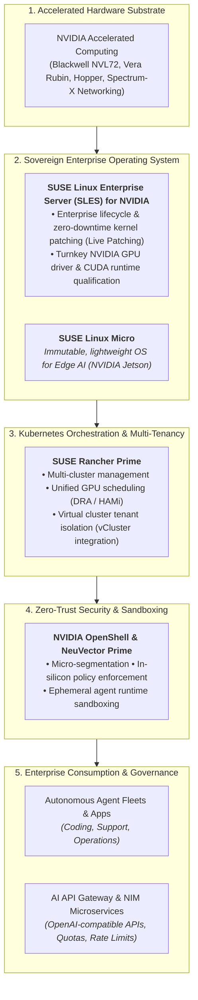
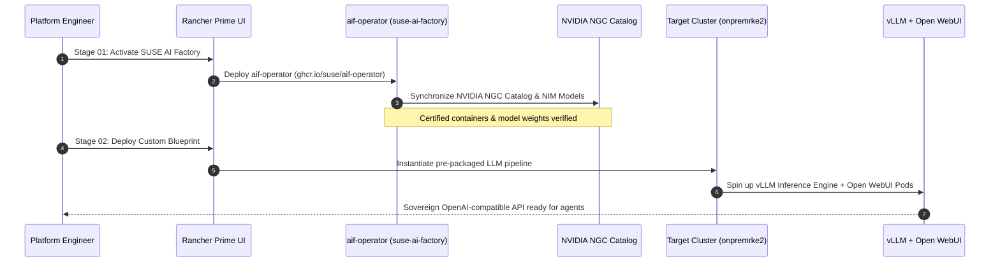

# Enterprise Sovereign AI: Building with SUSE AI Factory

> **Event**: [ContainerDays Singapore 2026](./ContainerDays%20Singapore%202026.md) (Day 1 Afternoon / Expo Hall)  
> **Date**: Tuesday, October 27, 2026  
> **Presenter / Host**: **SUSE** (Featuring Hak Beng Ng, Head of Solutions Architect, SEA & South Korea & SUSE Solutions Team)  
> **Location**: **SUSE Booth (Exhibition / Sponsor Showcase)**  
> **Talk Title**: *"Enterprise Sovereign AI: Building with SUSE AI Factory"*  
> **Vault Connections**:
> - [Will Everyone Build an AI Factory? (Saiyam Pathak)](./Will%20Everyone%20Build%20an%20AI%20Factory%3F%20%28Saiyam%20Pathak%29.md) — Modular containerized AI factories meets sovereign enterprise Linux & K8s
> - [Fireside Chat with Kelsey Hightower & Geet Bhanawat](./Fireside%20Chat%20with%20Kelsey%20Hightower%20%26%20Geet%20Bhanawat.md) — Sovereign infrastructure, operational readiness, and enterprise standardization
> - [When Tokens Stop Being the Bottleneck - Operating Agentic Software Factories (Carl Ross)](./When%20Tokens%20Stop%20Being%20the%20Bottleneck%20-%20Operating%20Agentic%20Software%20Factories%20%28Carl%20Ross%29.md) — Operating continuous agentic factories with zero-trust guardrails
> - [Securing AI Coding Agents with Kubernetes Sandboxes (Ryan Djurovich)](./Securing%20AI%20Coding%20Agents%20with%20Kubernetes%20Sandboxes%20%28Ryan%20Djurovich%29.md) — Sandboxing untrusted agent runtimes
> - [Lessons from Operating an Internal LLM Gateway for Production Agentic Applications (Zhong Liang Ong & Yek Khan)](./Lessons%20from%20Operating%20an%20Internal%20LLM%20Gateway%20for%20Production%20Agentic%20Applications%20%28Zhong%20Liang%20Ong%20%26%20Yek%20Khan%29.md) — Enterprise gateway control and policy enforcement

---

## ⚡ TL;DR (Key Takeaways in 60 Seconds)

- **The Problem**: Public cloud AI APIs risk corporate IP leaks, violate strict national data residency mandates, and incur volatile per-token costs.
- **SUSE AI Factory Architecture**: An enterprise-grade, turnkey sovereign AI platform co-engineered with NVIDIA, combining **SLES for NVIDIA** (kernel Live Patching for zero-downtime training/inference runs), **Rancher Prime** multi-cluster management, and **NeuVector Prime** container security.
- **Heterogeneous GPU Governance**: Manages GPU slicing and resource sharing via **HAMi** and **DRA** across diverse environments, from on-prem Harvester HCI clusters to edge Jetson devices (SUSE Linux Micro).
- **Agentic Runtime Sandboxing**: Integrates **NVIDIA OpenShell** for dynamic agent sandboxing with NeuVector Layer 7 Deep Packet Inspection for MCP and Agent-to-Agent (A2A) network traffic.
- **Turnkey Production Blueprints**: Delivers 9 pre-packaged enterprise blueprints (NIM with RAG, LiteLLM gateway, local conversational agents) deployed via the `aif-ui` Rancher extension.

---

## 📸 Session & Stage Slides

> **Keynote Display**: *"Enterprise Sovereign AI: Building with SUSE AI Factory"* presented by SUSE at ContainerDays & AI Context Singapore 2026.

> **Presentation Intro**: Title screen for the SUSE AI Factory breakout session, showcasing SUSE's open-source sovereign AI stack.

> **Slide 14 · Sovereign Enterprise AI Demands**: Comparing *The DIY AI Pitfall* (fragile toolchains, GPU waste, data exposure) against the *SUSE AI Factory Approach* (turnkey assembly line, native NVIDIA NIM integration, strict on-premises sovereignty).

> **Slide 15 · Demo Rundown: Stack & Blueprint**: Two-stage live deployment—**Stage 01 (Stack Activation)** activating `aif-operator` and syncing the NVIDIA NGC catalog via Rancher UI; **Stage 02 (Blueprint Launch)** configuring a pre-packaged LLM pipeline with vLLM engine and Open WebUI.

> **Live Demo Screen · Multi-Cluster Rancher Prime Fleet**: Hak Beng Ng's live environment (`rancher.hb.lab`) managing 8 heterogeneous clusters spanning bare-metal Harvester HCI (`harvester-01`, `harvester-02`), local control plane (`local`), on-prem GPU cluster (`onpremrke2`), workstation sandboxes (`rke2-wsl-ubuntu`), and ARM64 edge nodes (`k3s-mba`, `k3s-mbp`).

> **Live Demo Screen · SUSE AI Factory Operator**: Inspecting the running `aif-operator` pod (`aif-operator-694865bc0b-9h2lq`) in namespace `suse-ai-factory` under the `local` RKE2 cluster, featuring integrated NeuVector runtime enforcement and virtual cluster (vCluster) provisioning.

> **Live Demo Screen · Rancher Extensions Catalog**: `https://rancher.hb.lab/dashboard/c/local/uiplugins#installed` displaying **SUSE AI Factory** (`aif-ui` v2.3.1) installed as a certified UI plugin alongside the enterprise AI ecosystem: **SUSE AI Assistant** (v1.1.0), **SUSE Observability** (v2.4.3), **SUSE Virtualization / Harvester** (v1.9.0), and **SUSE OS Management** (v3.0.3).

> **Live Demo Screen · SUSE AI Factory Workloads & Blueprints**: `https://rancher.hb.lab/dashboard/c/local/suseai/overview` providing single-pane governance over 3 running production workloads (`LiteLLM` gateway on `local`, `Simple Chatbot with RAG` on `onpremrke2`, and `Custom AI Blueprint 1` on `onpremrke2`) across 9 active enterprise blueprints (`NVIDIA NIM With RAG`, `SUSE Inference Endpoint`, etc.).

---

## 📌 Context & Problem Statement: The Sovereign AI Imperative

As generative AI models and autonomous agentic fleets transition from isolated experimental proofs-of-concept into core enterprise business operations, organizations face a critical dilemma: **Public Cloud API Dependency vs. Enterprise Sovereignty**.

### 1. The Death of the "Do-It-Yourself" (DIY) AI Stack

In **Slide 14 ("Sovereign Enterprise AI Demands")**, SUSE laid bare the core failure modes of in-house enterprise AI experiments:

| Dimension | ⚠️ The DIY AI Pitfall | ✅ SUSE AI Factory Approach |
| :--- | :--- | :--- |
| **Toolchain Stability** | **Fragile Toolchains**: Stitching together dozens of disparate open-source tools (Ray, JupyterHub, vLLM, custom Python scripts, ad-hoc drivers) creates fragile snowflake clusters that break on updates. | **Turnkey Assembly Line**: Pre-validated, end-to-end enterprise software stack delivered as an automated digital factory. |
| **GPU Efficiency** | **GPU Waste**: Inefficient static scheduling and fragmented driver versions lead to the industry-wide **5% average GPU utilization crisis** (highlighted in [Will Everyone Build an AI Factory? (Saiyam Pathak)](./Will%20Everyone%20Build%20an%20AI%20Factory%3F%20%28Saiyam%20Pathak%29.md)). | **Native NVIDIA Support**: Seamless hardware acceleration with native **NVIDIA NIM**, dynamic GPU slicing (HAMi / DRA), and zero-downtime kernel live patching. |
| **Data Governance** | **Data Exposure**: Leaking sensitive customer PII, internal proprietary code, and enterprise knowledge via public cloud LLM API tokens, violating regional data residency mandates (e.g. MAS in Singapore, GDPR, EU AI Act). | **Strict Sovereignty**: Complete on-premises and private sovereign cloud data control with **zero token egress** outside the enterprise perimeter. |

### 2. The Operational Day-15 Crisis
Directly answering the 4 governance questions posed in [Will Everyone Build an AI Factory? (Saiyam Pathak)](./Will%20Everyone%20Build%20an%20AI%20Factory%3F%20%28Saiyam%20Pathak%29.md):
- *Who gets which GPU?* $\to$ Governed dynamically via Rancher Prime + HAMi/DRA fractional GPU slicing.
- *Who can see whose data?* $\to$ Enforced via vCluster virtual tenant clusters and NeuVector L7 network micro-segmentation.
- *Whose upgrade breaks whom?* $\to$ Isolated through independent virtual control planes; host kernel patched with SLES Live Patching without interrupting training jobs.
- *Who pays for what?* $\to$ Quantified through Rancher Prime resource quotas and centralized token metering at the AI gateway layer.

---

## ⚙️ Technical Blueprint: Inside the SUSE AI Factory

The **SUSE AI Factory** functions as an enterprise "digital assembly line"—a pre-validated, fully sovereign infrastructure stack that spans from physical silicon up through the Kubernetes control plane to production agent runtimes.

---

## 🖥️ Live Demo Breakdown: From Operator Activation to Running LLM

During the live breakout session, Hak Beng Ng demonstrated a live, working deployment of the SUSE AI Factory on his multi-cluster lab infrastructure (`rancher.hb.lab`).

### Stage 01: Deploy SUSE AI Stack (Stack Activation)
1. **Activate the SUSE AI Factory Operator**:
   - Deployed within namespace `suse-ai-factory` as a managed Kubernetes operator (`ghcr.io/suse/aif-operator`).
   - Runs on the local control plane node (demonstrated running on `rancher-03` with 1/1 containers healthy).
2. **Synchronize NVIDIA NGC Catalog via Rancher UI**:
   - The operator authenticates against NVIDIA NGC (NVIDIA GPU Cloud) and pulls enterprise-certified container images, NIM microservices, and validated Helm charts directly into the enterprise registry.
   - Eliminates manual docker pulls, untrusted third-party registries, and out-of-sync driver/CUDA dependencies.

### Stage 02: Deploy Custom Blueprint (Blueprint Launch)
1. **The Extension Layer (`aif-ui` v2.3.1)**:
   - Packaged as an official Rancher Prime UI plugin (`ghcr.io/suse/aif-ui`), enabling platform operators to configure sovereign AI workloads without writing raw YAML manifests.
   - Installed alongside the broader enterprise suite: **SUSE AI Assistant** (v1.1.0), **SUSE Observability** (v2.4.3), **SUSE OS Management** (v3.0.3), and **SUSE Virtualization / Harvester** (v1.9.0).
2. **Production Workloads Monitored in Real-Time (`dashboard/c/local/suseai/overview`)**:
   - In the live demo, the overview panel confirmed **3 active workloads (3 running, 0 with issues)**:
     - **`LiteLLM`** *(Cluster: `local`)*: Centralized enterprise AI gateway providing OpenAI-compatible routing, rate-limiting, token quotas, and policy enforcement (connecting directly to [Lessons from Operating an Internal LLM Gateway for Production Agentic Applications (Zhong Liang Ong & Yek Khan)](./Lessons%20from%20Operating%20an%20Internal%20LLM%20Gateway%20for%20Production%20Agentic%20Applications%20%28Zhong%20Liang%20Ong%20%26%20Yek%20Khan%29.md)!).
     - **`Simple Chatbot with RAG`** *(Cluster: `onpremrke2`, v1.0.2)*: Turnkey retrieval-augmented generation pipeline with vector search and vLLM acceleration.
     - **`Custom AI Blueprint 1`** *(Cluster: `onpremrke2`, v1.0.0)*: Custom fine-tuned internal agent inference endpoint running on Harvester-virtualized enterprise GPUs.
3. **The Certified Enterprise Blueprint Catalog (9 Active Blueprints)**:
   - **`NVIDIA NIM With RAG`** (`v1.0.0`): Enterprise-grade accelerated inference containerized microservice with RAG embeddings.
   - **`Simple Chatbot with RAG`** (`v1.0.2`): Rapid deployment conversational agent pipeline.
   - **`Custom AI Blueprint 1`** (`v1.0.0`): User-defined composable pipeline.
   - **`SUSE Inference Endpoint`** (`v1.0.1`): Standardized zero-egress LLM serving target.
   - **`Custom Inference Endpoint`** (`v1.0.0`): Flexible multi-model endpoint for internal teams.

---

## 🌐 The Multi-Cluster Infrastructure Fleet (`rancher.hb.lab`)

The live demonstration showcased Rancher Prime managing **8 heterogeneous clusters**, illustrating how an enterprise operates AI workloads across diverse hardware architectures:

| Cluster Name | State | Provider / Distro | Kubernetes Version & Arch | Hardware Resources | Role in AI Factory |
| :--- | :--- | :--- | :--- | :--- | :--- |
| **`harvester-01`** | **Active** | Harvester HCI | `v1.30.3+rke2r1` (amd64) | 44.94 cores · 185 GiB RAM (222/600 pods) | Primary hyperconverged bare-metal virtualization host running compute VMs and storage. |
| **`harvester-02`** | *Standby / Unconnected* | Harvester HCI | `v1.30.3+rke2r1` (amd64) | 3.04 cores · 31 GiB RAM | Secondary standby HCI node for failover and high-availability testing. |
| **`local`** | **Active** | Local RKE2 | `v1.30.5+rke2r1` (amd64) | 12 cores · 47 GiB RAM (85/330 pods) | Core Rancher management control plane hosting `aif-operator` and platform controllers. |
| **`onpremrke2`** | **Active** | Harvester RKE2 | `v1.30.5+rke2r1` (amd64) | 12 cores · 23 GiB RAM (55/330 pods) | Dedicated on-premises accelerated cluster hosting physical/virtualized GPUs for LLM inference. |
| **`rke2-wsl-ubuntu`** | *Updating* | Custom RKE2 | `v1.30.5+rke2r1` (amd64) | 4 cores · 7.76 GiB RAM | Developer local workstation sandbox on Windows Subsystem for Linux (WSL2). |
| **`k3s-mba`** | *Edge / Offsite* | Imported K3s | `v1.30.4+k3s1` (arm64) | 4 cores · 7.75 GiB RAM | Apple Silicon M-series ARM64 edge node testing lightweight model execution. |
| **`k3s-mbp`** | *Edge / Offsite* | Imported K3s | `v1.30.5+k3s1` (arm64) | 10 cores · 31 GiB RAM | Apple Silicon M-series ARM64 edge node testing distributed edge inference pipelines. |

> **Key Architectural Takeaway**: Notice the seamless mixture of **x86_64** (amd64) servers running on Harvester HCI alongside **ARM64** edge systems running K3s, all orchestrated through a single unified pane of glass in SUSE Rancher Prime.

---

## 🛡️ Deep Dive: The 4 Core Pillars of the SUSE AI Factory

### 1. The Operating System Substrate: SLES for NVIDIA
- **Engineered with NVIDIA**: SUSE Linux Enterprise Server (SLES) is co-engineered and validated with NVIDIA to provide immediate day-0 compatibility for modern accelerated architectures (Blackwell, Vera Rubin, Grace Hopper).
- **Enterprise Live Patching**: Kernel-level live patching allows applying critical security CVE fixes without restarting the host OS or terminating long-running multi-day LLM training and fine-tuning jobs.
- **Immutable Edge Deployment with SUSE Linux Micro**:
  - For remote, distributed, or air-gapped environments (telecom towers, naval ships, industrial edge, hospitals), SUSE Linux Micro provides a lightweight, immutable OS footprint supporting NVIDIA Jetson edge systems with transactional, self-healing updates.

---

### 2. Orchestration & Fleet Management: SUSE Rancher Prime
- **Single "Pane of Glass" Multi-Cluster Management**: Manages heterogeneous GPU clusters across on-premises data centers, sovereign regional clouds, and public cloud providers behind a single enterprise control plane.
- **Unified GPU Scheduling & Slicing**:
  - Integrates with Kubernetes **Dynamic Resource Allocation (DRA)** and fractional slicing plugins (**HAMi**) to eliminate the 5% utilization trap, sharing physical GPUs across disparate enterprise teams.
- **Virtual Control Planes for Team Autonomy**:
  - Leverages virtual Kubernetes clusters (vCluster) to provide data science and agent development teams with independent `cluster-admin` sandboxes, shielding the physical host cluster from CRD collisions and operator drift.

---

### 3. Zero-Trust Agent Security & Guardrails
- **NVIDIA OpenShell Integration**:
  - Directly supports Jensen Huang's security mandate highlighted in [Will Everyone Build an AI Factory? (Saiyam Pathak)](./Will%20Everyone%20Build%20an%20AI%20Factory%3F%20%28Saiyam%20Pathak%29.md): *"Every single time an agent is launched, the privileges are different."*
  - Provides dynamic, least-privilege sandboxes for agent execution with in-silicon hardware boundaries.
- **NeuVector Prime (Container Security Platform)**:
  - Performs Layer 7 deep packet inspection (DPI) on inter-agent communication (A2A traffic) and Model Context Protocol (MCP) tool traffic.
  - Automatically isolates rogue pods attempting prompt injection, reverse shell exfiltration, or unauthorized lateral movement across tenant clusters.

---

### 4. GitOps Automation: Pre-Validated Enterprise Blueprints
- **Eliminating ClickOps**: Replaces manual UI configuration with declarative GitOps workflows (Fleet / ArgoCD).
- **Curated Enterprise Blueprints**:
  - Pre-packaged, certified blueprints for **Enterprise RAG** (Milvus, Qdrant, Triton, vLLM, Langfuse), **MLOps**, and **Agentic Gateways**.
  - Provides a single "hand to shake" for enterprise support across the entire stack: from the Linux kernel and GPU drivers to the Kubernetes orchestrator and application runtimes.

---

## ⚖️ Architectural Synthesis: Jensen's Box + SUSE's Factory Stack

| Architectural Layer | NVIDIA Hardware Pod (Physical) | SUSE AI Factory (Software & Platform) |
| :--- | :--- | :--- |
| **Physical Delivery** | Modular DSX POD container (14-day turn-key deployment). | Declarative GitOps blueprints deployed via SUSE Rancher Prime. |
| **Host Operating System** | NVIDIA HGX / GB200 NVL72 baseboard management. | **SLES for NVIDIA** with enterprise Live Patching and security hardening. |
| **Cluster Management** | Bare-metal InfiniBand & Spectrum-X fabric. | **SUSE Rancher Prime** multi-cluster control plane with unified RBAC. |
| **Multi-Tenancy** | Physical node isolation or MIG partitioning. | Virtual tenant clusters (vCluster) + HAMi fractional GPU slicing. |
| **Agent Containment** | Hardware enclave & confidential computing. | **NVIDIA OpenShell** + **NeuVector Prime** zero-trust inspection. |
| **Consumption Layer** | Raw compute & tensor cores. | Unified OpenAI-compatible AI Gateways + NVIDIA NIM microservices. |

---

## 💡 Key Takeaways & Strategic Implications

1. **Sovereignty is Non-Negotiable**:
   - For mission-critical enterprise workloads in banking, government, telecom, and healthcare, true sovereignty requires complete ownership of data residency, model weights, and the underlying infrastructure software supply chain.
2. **The Turnkey Factory Prevents Architectural Rot**:
   - Building an AI factory is no longer about procuring GPUs; it is about establishing a standardized, automated digital assembly line that enables continuous model fine-tuning, evaluation, and secure agent operation.
3. **Open Standards Win the Enterprise**:
   - By combining open-source Linux, cloud-native Kubernetes, and NVIDIA accelerated computing, enterprises avoid proprietary cloud hyperscaler lock-in while maintaining maximum deployment velocity.

---

## 🔗 Related Notes & Conference Sessions

- 🌟 [ContainerDays Singapore 2026](./ContainerDays%20Singapore%202026.md) — Conference schedule, tracker, and overarching takeaways
- 🏭 [Will Everyone Build an AI Factory? (Saiyam Pathak)](./Will%20Everyone%20Build%20an%20AI%20Factory%3F%20%28Saiyam%20Pathak%29.md) — vCluster multi-tenancy, GPU slicing with HAMi, and disaggregated inference serving
- 💬 [Fireside Chat with Kelsey Hightower & Geet Bhanawat](./Fireside%20Chat%20with%20Kelsey%20Hightower%20%26%20Geet%20Bhanawat.md) — Infrastructure as a workload carrier; Singtel's enterprise AI scaling
- 🚀 [When Tokens Stop Being the Bottleneck - Operating Agentic Software Factories (Carl Ross)](./When%20Tokens%20Stop%20Being%20the%20Bottleneck%20-%20Operating%20Agentic%20Software%20Factories%20%28Carl%20Ross%29.md) — Operating continuous autonomous agent swarms
- 🛡️ [Securing AI Coding Agents with Kubernetes Sandboxes (Ryan Djurovich)](./Securing%20AI%20Coding%20Agents%20with%20Kubernetes%20Sandboxes%20%28Ryan%20Djurovich%29.md) — Kubernetes-native sandboxing CRDs
