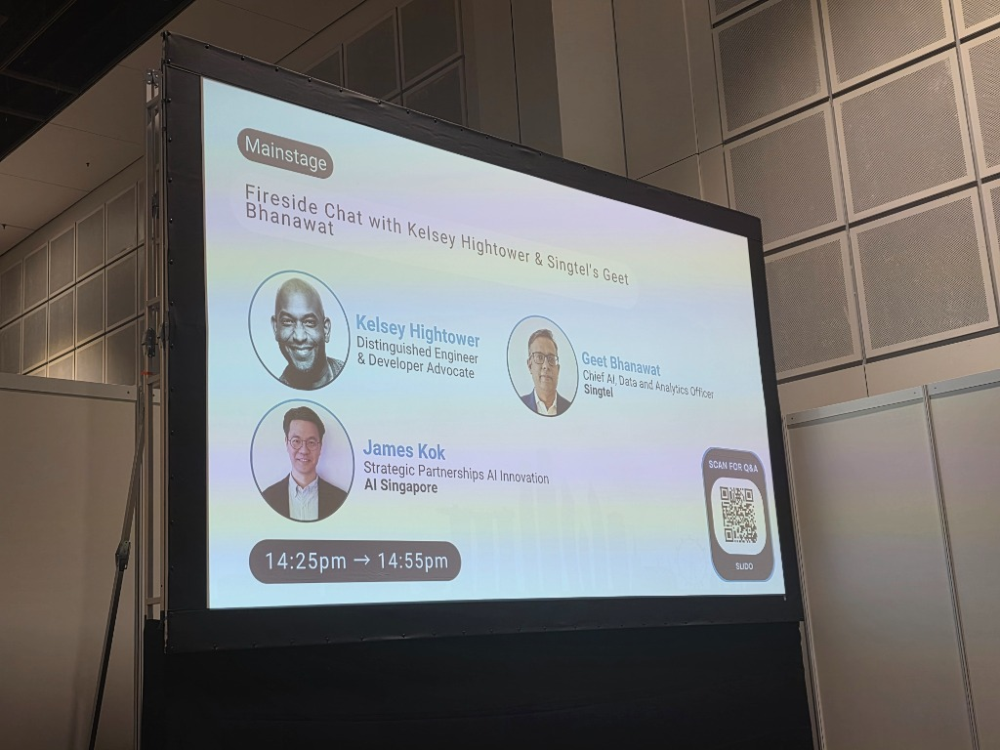
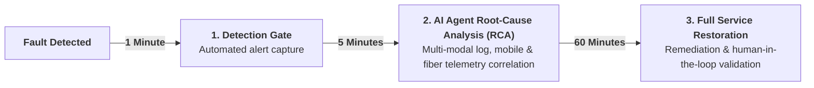
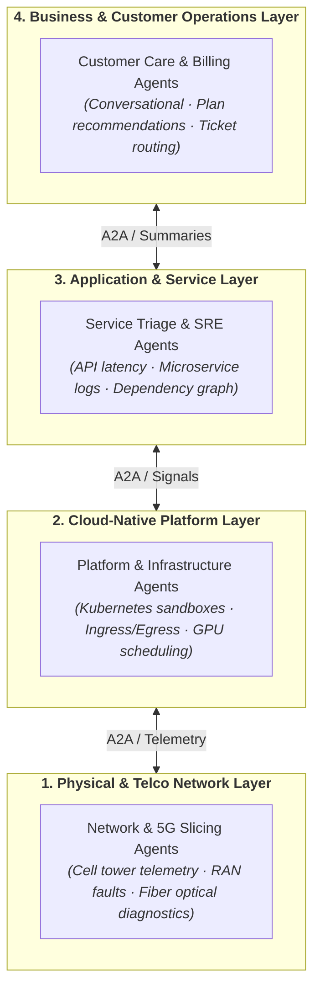
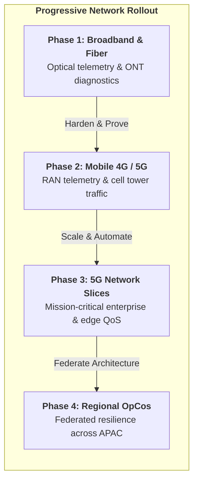
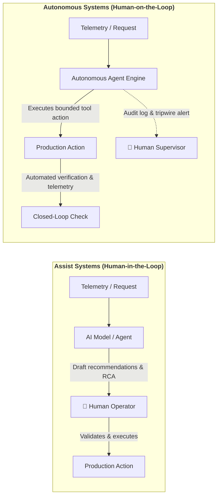
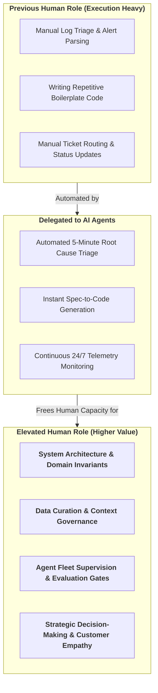

# Fireside Chat with Kelsey Hightower & Singtel's Geet Bhanawat

> **Speakers**: 
> - **Kelsey Hightower** (Distinguished Engineer & Developer Advocate)
> - **Geet Bhanawat** (Chief AI, Data and Analytics Officer, Singtel)
> **Moderator**: **James Kok** (Strategic Partnerships AI Innovation, AI Singapore)  
> **Event**: [[ContainerDays Singapore 2026]]  
> **Date & Time**: Tuesday, October 27, 2026 · 2:25 PM – 2:55 PM SGT  
> **Stage**: MainStage  
> **Core Topics**: Enterprise AI Transformation · Cloud-Native to AI-Native Evolution · Developer Experience & Pragmatism · Real-World Agent Adoption · Platform Engineering Meets AI  
> **Vault Connections**: [[ContainerDays Singapore 2026]] • *AI Agent Engineering* • *Designing Agent Fleets* • [[When Tokens Stop Being the Bottleneck - Operating Agentic Software Factories (Carl Ross)]] • [[Lessons from Operating an Internal LLM Gateway for Production Agentic Applications (Zhong Liang Ong & Yek Khan)]]

---

## ⚡ TL;DR (Key Takeaways in 60 Seconds)

- **Kelsey on Infrastructure**: *"AI is just another workload — on machine or cloud, it doesn't matter."* Compute geography (laptop NPU vs cloud data center) is an implementation detail. Build clean interfaces and anchor on distributed systems fundamentals.
- **The True Bottleneck**: *"Tech is not the rate limiter... it's data... or operational capability."* AI does not fix broken architectures or messy data; it simply accelerates what is already there. Fix the foundation first.
- **Singtel's 1-5-60 Benchmark**: 1 minute to detect an anomaly, 5 minutes for AI agents to diagnose the root cause, and 60 minutes to restore full service across mobile, broadband, and TV networks.
- **Assist vs. Autonomous Systems**: Start with human-in-the-loop copilots (assist) to collect operational telemetry and build trust; only graduate to autonomous actuators after proving reliability with deterministic circuit breakers.
- **5G Network Slicing**: Singtel uses 5G slicing to guarantee dedicated QoS bandwidth for edge AI inference and multi-agent coordination.
- **Kelsey's Charge**: *"Stay curious... build your craft on something deep."* Don't get trapped chasing superficial model leaderboards; invest in Linux primitives, networking protocols, and domain specifications.

---

## 📸 Stage & Presentation

> **MainStage Title Screen (~14:25 SGT)**: *Fireside Chat with Kelsey Hightower & Singtel's Geet Bhanawat*, moderated by James Kok (AI Singapore). Slido Q&A active.

> **MainStage Panel in Session (~14:36 SGT)**: From left to right: **James Kok** (AI Singapore), **Kelsey Hightower** speaking on the mic, and **Geet Bhanawat** (Chief AI, Data and Analytics Officer, Singtel).

---

## 🎙️ Live Discussion & Key Dialogue

### 🏛️ 1. Opening Context: AI Adoption Landscape
- **Singapore AI Adoption Benchmark**: **Singapore ranks 2nd globally in AI tool usage and adoption**.
  - Highlights the aggressive baseline adoption curve across Singapore developers, public sector, and enterprises (backed by initiatives like AI Singapore and NAIS 2.0).
  - Sets the stage for the panel: when adoption is already near the global top, the challenge shifts from *"getting people to try AI"* to *"how do we operate, govern, and scale AI sustainably in production?"*

---

### 💡 2. Enterprise Realities: Standardizing AI at Telco Scale (Geet Bhanawat / Singtel)
> **"Standardize tech on AI... focus on reusability... anchor on open standards."** — *Geet Bhanawat*

- **The Enterprise Challenge of AI Fragmentation**:
  - In a massive telecommunications conglomerate like Singtel, business units naturally start building ad-hoc, isolated AI experiments.
  - Without intentional governance, this leads to duplicate token contracts, security blind spots, shadow IT, and completely unmaintainable bespoke integrations.
- **Geet's Three Enterprise AI Mandates**:
  1. **Standardize the Technology Stack**:
     - Establish a single, paved-road enterprise platform for AI workloads rather than letting 50 teams reinvent model access.
     - Centralize gateway routing, privacy boundaries, token governance, and telemetry (aligning directly with [[Lessons from Operating an Internal LLM Gateway for Production Agentic Applications (Zhong Liang Ong & Yek Khan)]]).
  2. **Drive Aggressive Component Reusability**:
     - Treat prompt templates, fine-tuned adapters, agent tools, vector indexing pipelines, and evaluation harnesses as reusable enterprise assets.
     - Teams solve a problem once (e.g., customer churn prediction, network fault triage) and publish reusable modules for other business units.
  3. **Anchor on Open Standards**:
     - Avoid proprietary vendor traps. Closed AI platforms create severe long-term lock-in and sovereignty risks for regulated telcos.
     - Singtel prioritizes open standards: open APIs, standardized model interoperability protocols (e.g. MCP / Model Context Protocol), open-source weights, and standard containerized orchestration on Kubernetes.
- **Investing Ahead in Connectivity: From 5G Slicing to AI Substrates**:
  - **First-Mover Advantage**: Singtel's strategy has always centered on investing ahead of the curve in foundational infrastructure—being the **1st to introduce standalone 5G** and pioneering **5G Network Slicing**.
  - **5G Slicing as the AI Agent Highway**:
    - Distributed AI agents, edge inference nodes, and real-time autonomous systems cannot tolerate latency spikes or unmanaged network jitter.
    - 5G network slicing enables Singtel to provision dedicated, cryptographically isolated, and QoS-guaranteed virtual network lanes specifically for mission-critical AI workloads, agent-to-agent (A2A) traffic, and enterprise edge computing.
    - Bridges the gap between Kelsey's *"AI is just another workload"* and physical telco reality: AI workloads don't just live in the cloud; they live at the telco edge connected via deterministic 5G slices.

---

### 🛠️ 3. Kelsey's Take: "AI is Just Another Workload"
> **"AI is just another workload."** — *Kelsey Hightower*

- **Demystifying the AI Hype**:
  - Kelsey strips away the hyper-inflated marketing aura around AI: historically, platforms adapted to host stateful databases, web services, big data analytics (Hadoop/Spark), batch processing, and microservices.
  - Now, AI models, inference pipelines, and agent loops are simply the **next workload class** landing on compute infrastructure.
- **The Infrastructure Invariant**:
  - Strip away the jargon, and an AI workload still requires the exact same foundational operational primitives:
    - **Compute & Acceleration**: GPUs, TPUs, CPUs, and scheduling (DRA / Dynamic Resource Allocation).
    - **Isolation & Sandboxing**: Process boundaries, namespaces, and runtime security.
    - **Networking**: Ingress routing, egress control, and low-latency transport.
    - **Observability**: Metrics, latency, cost tracking, and error budgets.
  - Don't reinvent entire operating systems or discard sound platform engineering principles—treat AI with the same architectural discipline as any critical production workload.
- **AI on Machine vs. on Cloud: "Doesn't Matter"**:
  > **"AI on the machine or in the cloud... it doesn't matter."** — *Kelsey Hightower*
  - **The Irrelevance of Compute Geography**:
    - Developers obsess over binary debates: *"Should we run open-source models locally on developer laptops/NPUs, or run hosted models in cloud hyperscaler data centers?"*
    - Kelsey's pragmatic stance: **the physical location of the compute is purely an operational implementation detail**. What matters is the contract, the interface, latency, data privacy, and unit economics.
    - If a task needs 5ms response, zero data egress, and offline capability, run a small quantized model locally on the machine.
    - If a task needs massive multi-step frontier reasoning across petabytes of enterprise context, route it to an ephemeral cloud cluster.
  - **Decoupled Architecture**: Systems should be architected so the caller is agnostic to compute placement—invoking an API interface whether the backend is an on-device NPU or a remote Kubernetes cluster (mirroring Carl Ross's polymorphic host plane).

---

### 🧱 4. Kelsey's Reality Check: "Technology is Not Going to Save You... Fix the Underlying Thing"
> **"Technology is not going to save you... fix the underlying thing."** — *Kelsey Hightower*

- **The Illusion of the Technological Silver Bullet**:
  - Teams constantly look to new tech paradigms (cloud, containers, Kubernetes, microservices, and now AI / LLMs) as magical salvation for deeper organizational, architectural, or procedural dysfunctions.
  - Kelsey's timeless admonition: *tools do not fix broken fundamentals*.
- **Applying this to the AI Era**:
  - If your underlying data quality is poor, AI will just hallucinate with greater confidence.
  - If your business logic, domain boundaries, or API contracts are chaotic, AI coding agents will generate mountains of incoherent, unmaintainable boilerplate faster than ever.
  - If your deployment pipeline is slow and brittle, dropping an autonomous agent onto it just breaks production in seconds.
- **The Core Discipline**:
  - Step back from the shiny model wrapper.
  - Clean your data, define your system specifications, fix your testing feedback loops, and simplify your processes. When the underlying foundation is sound, technology actually amplifies your velocity instead of magnifying your technical debt.

---

### ⚖️ 5. Cognitive Division of Labor: What Agents Can Handle vs. What Humans Must Handle (Geet Bhanawat)
> **"Understand what agents can handle... versus what humans must handle."** — *Geet Bhanawat*

- **The Enterprise Boundary of Autonomy**:
  - Organizations stumble when they either over-delegate (expecting an agent to run an entire business unit autonomously) or under-delegate (treating LLMs merely as slightly smarter autocomplete).
  - Geet emphasizes drawing a clear, intentional operational line between machine capability and human responsibility.
- **What Agents Can Safely Handle**:
  - **High-volume, repetitive synthesis**: Ingesting network logs, summarizing customer service interactions, triaging Tier-1 alerts.
  - **Bounded tool execution**: Running deterministic diagnostic scripts and executing well-scoped API calls with strict parameter schemas.
  - **Drafting & first-pass engineering**: Generating initial code implementations, writing unit test cases, and producing standardized documentation.
  - **Continuous 24/7 scanning**: Constantly monitoring telemetry, looking for anomalies, and reporting edge cases.
- **What Humans Must Retain & Handle**:
  - **System Specifications & Intent**: Defining *what* needs to be solved, business invariants, and domain rules.
  - **Accountability & Judgment**: Ultimate ownership of regulatory compliance, customer privacy, safety guardrails, and production deployment risk.
  - **Navigating Ambiguity**: Making decisions in incomplete information spaces where business context and organizational trade-offs clash.
  - **Human-in-the-Loop (HITL) Critical Gates**: Final approvals for destructive operations, high-value financial actions, or mission-critical telecom network configurations.
- **The Symbiosis**: Agents handle the heavy cognitive lifting and data processing; humans provide intent, judgment, ethical oversight, and architectural boundaries.

---

### 🚦 6. The Real Bottlenecks: "Tech is Not the Rate Limiter... It's Data or Operational Capability"
> **"Tech is not the rate limiter... it's data... or operational capability."** — *Fireside Panel Insight*

- **The Technology Abundance Paradox**:
  - Frontier reasoning models, multimodal APIs, and GPU hardware are readily accessible off the shelf. Compute and raw model intelligence are no longer the bottleneck holding enterprises back.
- **The Two True Rate Limiters**:
  1. **Data Readiness & Provenance**:
     - Models can only reason accurately over clean, governed, contextualized enterprise data.
     - Most organizations struggle with fragmented databases, poor metadata, uncurated legacy documentation, and strict privacy boundaries that prevent models from accessing the context they need.
  2. **Operational Capability (Day-2 Engineering)**:
     - Building a prototype agent in a Jupyter notebook takes an afternoon; operating an autonomous agentic fleet in production takes enterprise-grade engineering.
     - True operational capability requires:
       - **Automated Evaluation Pipelines**: Tracking drift and behavioral regressions (linking to [[Taming Agent Sprawl - How We Scale Evals to Keep Up with Agents (Timothy Lin)]]).
       - **Hardened Execution Sandboxes**: Containing untrusted code execution (linking to [[Securing AI Coding Agents with Kubernetes Sandboxes (Ryan Djurovich)]]).
       - **Cost & Traffic Routing Gateways**: Centralized policy enforcement (linking to [[Lessons from Operating an Internal LLM Gateway for Production Agentic Applications (Zhong Liang Ong & Yek Khan)]]).
       - **Incident Response & Auditability**: Knowing exactly why an agent took an action and having the tooling to roll it back.

---

### 🎯 7. Kelsey on System Optimization: "Find the Bottleneck and Address That"
> **"Find the bottleneck and address that."** — *Kelsey Hightower*

- **The Theory of Constraints in the AI Era**:
  - Teams waste immense energy applying AI to parts of their system that are not actually constrained.
  - If your team takes 3 weeks to get security approval for a firewall change, speeding up code drafting with an AI copilot from 2 hours to 20 minutes changes nothing about your overall release velocity.
  - Any optimization made anywhere other than the true bottleneck is an illusion.
- **How to Identify & Attack the True Bottleneck**:
  - **Trace the full cycle time**: From customer problem statement $	o$ spec $	o$ implementation $	o$ testing $	o$ security audit $	o$ deploy $	o$ production telemetry.
  - **Ask the hard question**: Where does work sit idle waiting?
    - If it's **dirty or inaccessible data** $	o$ fix data pipelines and governance.
    - If it's **slow CI/CD test feedback** $	o$ invest in caching, hermetic environments, and faster test execution (as Carl Ross highlighted at OpenAI).
    - If it's **fear of regression** $	o$ build deterministic evaluation and sandboxing harnesses.
  - Don't adopt trendy technology just because it's new—ruthlessly diagnose your actual operational constraint and apply technology precisely there.

---

### 📏 8. Measurement Discipline: "You Must Define Success Criteria"
> **"You need to define success criteria before building and deploying."** — *Fireside Panel Insight*

- **The Trap of FOMO-Driven AI**:
  - Many organizations pilot AI agents and LLM features without a clear definition of what success looks like—deploying technology for its own sake or to satisfy executive curiosity.
  - Without predefined success metrics, projects drift aimlessly, burn token budgets, and inevitably get cancelled when financial accountability arrives.
- **What Real Success Criteria Look Like**:
  - **Avoid Vague Metrics**: Steer clear of subjective "it feels faster" or "it answered nicely."
  - **Hard Operational Metrics**:
    - *Task Completion Rate*: Did the agent actually resolve the customer or engineering inquiry end-to-end without human escalation?
    - *Resolution Time (MTTR)*: Did automated triage shave hours off incident diagnosis?
    - *Cost per Successful Outcome*: Are you spending $0.05 in token inference to save $15 in manual operations, or $20 in tokens to save $0.50?
    - *Error & Regression Budget*: What is the acceptable failure rate before an automated circuit breaker trips?
- **Enabling Deterministic Evaluation**:
  - Defining success criteria upfront is what allows engineering teams to construct automated test harnesses and evaluation suites (linking directly to [[Taming Agent Sprawl - How We Scale Evals to Keep Up with Agents (Timothy Lin)]]). If you can't state the pass condition in code, an agent cannot be safely automated.

---

### 🏗️ 9. How Singtel Builds AI Agents: The Enterprise Blueprint (Geet Bhanawat)
- **Centralized Platform over Point Solutions**:
  - Rather than letting disparate engineering and product teams spin up uncoordinated, siloed agent scripts, Singtel builds agents on top of a standardized enterprise platform.
  - Centralizes identity, model gateways, egress security, and data privacy boundaries (critical for telco-grade PDPA and regulatory compliance).
- **Grounding in Clean Enterprise Data**:
  - Recognizing that data is the primary rate limiter, Singtel's agent architecture focuses heavily on curated data pipelines—connecting agents to customer telemetry, billing systems, and network infrastructure via clean API schemas rather than raw unverified text.
- **Modular, Reusable Tool Substrates (Open Standards)**:
  - Agent tools (network diagnostics, bill inquiry, outage checkers) are packaged as modular, reusable components adhering to open standards (like MCP / Model Context Protocol).
  - A tool developed for internal network operations can be repurposed safely by customer care agents without rewrites.
- **Human-in-the-Loop (HITL) & Bounded Autonomy**:
  - Strict classification of agent actions:
    - *Autonomous Read/Analyze*: Log summarization, initial triage, drafting answers.
    - *Human-Gated Write/Execute*: Network provisioning, service resets, financial credits, or customer plan changes require authenticated operator sign-off.
- **Predefined Success Criteria as Engineering Gates**:
  - No agent goes to production without concrete benchmark criteria (first-contact resolution rate, task accuracy, MTTR reduction, and token cost per resolution).

---

### ⏱️ 10. Singtel's Concrete Success Benchmark: The "1-5-60" Operational Target
> **"Our operational benchmark: 1 minute to detect, 5 minutes to diagnose root cause, 60 minutes to restore."** — *Geet Bhanawat*

- **The Real-World Definition of Success Criteria**:
  - This is the concrete embodiment of the panel's advice to *"define success criteria before building"*.
  - For Singtel's telco operations across mobile, TV, and broadband fiber, AI agents are judged against a strict operational SLA:
    - **1 Minute**: Detect the network anomaly or fault automatically across millions of telemetry streams.
    - **5 Minutes**: AI agents synthesize logs, correlate cross-domain alerts, and **identify the precise root cause (RCA)**.
    - **60 Minutes**: Complete end-to-end service restoration and return to healthy state.
- **Targeting the True Bottleneck**:
  - Human engineers previously took hours digging through telemetry across disparate vendors and network layers to find the root cause.
  - By deploying AI agents specifically to compress the **root-cause analysis window down to 5 minutes**, Singtel directly eliminated their primary operational bottleneck.
- **From "1,000 Flowers Blooming" to Sovereign Centralized AI**:
  - Singtel deliberately moved away from fragmented, departmental AI experiments (the "1,000 flowers bloom" trap) toward a centralized, governed, and sovereign AI inferencing platform built specifically to hit these 1-5-60 targets at scale.

---

### 🍰 11. Multi-Tiered Architecture: "Building Agents at Each Layer"
> **"Build agents at each layer... instead of a single monolithic agent."** — *Fireside Panel Insight*

- **Rejecting the "God Agent" Antipattern**:
  - A common failure in enterprise AI is attempting to build one omniscient "super-agent" that tries to hold all contexts simultaneously (from radio frequency wave diagnostics up to end-user billing policy).
  - Monolithic agents suffer from prompt pollution, conflicting tool definitions, massive hallucination rates, and explosive blast radiuses.
- **Why Layered Specialization Wins**:
  1. **Strict Blast Radius Containment**: A hallucination in a customer-facing billing agent cannot inadvertently trigger a network outage or restart an optical switch.
  2. **Domain-Specific Verification Harnesses**: The network layer agent is graded on deterministic packet metrics; the customer agent is graded on policy adherence and customer satisfaction.
  3. **Decoupled Evolution**: Singtel or any large enterprise can update its network diagnostic tools (Layer 1) without touching the customer-facing care agents (Layer 4).
  4. **Contract-Driven Communication**: Agents at each layer communicate through well-defined, standardized interfaces (**Model Context Protocol / MCP** and **Agent2Agent / A2A** protocols), passing structured signals rather than messy raw context.

---

### 🔄 12. Incremental Expansion: "Incrementally Looking at Various Networks and Develop Resiliency"
> **"Incrementally looking at various networks and develop resiliency."** — *Geet Bhanawat*

- **Rejecting the "Big Bang" AI Deployment**:
  - Telco infrastructure is inherently heterogeneous, composed of multiple generations of hardware, diverse vendors (Ericsson, Nokia, Huawei), and distinct physical media (subsea cables, optical fiber, wireless towers).
  - Attempting to roll out AI agents across every network tier simultaneously is a recipe for catastrophic operational failure.
- **The Incremental Playbook for Network Resilience**:
  1. **Domain Isolation & Proving Ground**: Start with a well-bounded, high-impact network domain (e.g., broadband fiber ONT triage). Build the telemetry pipelines, establish the baseline data, and train agents to diagnose faults.
  2. **Develop Self-Healing Resilience**: Shift from reactive alarms to predictive root-cause identification (feeding into Singtel's **1-5-60** benchmark).
  3. **Progressive Cross-Domain Expansion**: Once resilience is proven in domain A, incrementally adapt the agent framework to domain B (mobile RAN), domain C (5G slices), and eventually across Singtel's regional affiliates (Optus, AIS, Telkomsel).
- **Resilience as an Emergent Property**:
  - Resilience is not a feature you turn on; it emerges when you prove reliability step-by-step, constrain the solution space, and give agents immediate, high-fidelity feedback.

---

### 🎛️ 13. Operational Evolution: Assist Systems vs. Autonomous Systems
> **"Understand the evolutionary boundary: Assist Systems vs. Autonomous Systems."** — *Fireside Panel Insight*

| Operating Dimension | 🤝 Assist Systems (Copilots) | 🤖 Autonomous Systems (Agents) |
| :--- | :--- | :--- |
| **Control Model** | **Human-in-the-Loop (HITL)**: Human remains the primary driver and executor. | **Human-on-the-Loop (HOTL)**: Agent executes closed-loop; human acts as exception supervisor. |
| **Agent Role** | Advisor, summarizer, root-cause proposer, script drafter. | Direct actuator: configures routes, rolls back pods, provisions bandwidth. |
| **Tolerance for Error** | High tolerance: human catches and corrects hallucinations before damage occurs. | **Zero tolerance**: requires deterministic verifiers, hard sandboxes, and instant rollbacks. |
| **Operational Prerequisites** | Basic context retrieval, prompt templates, read-only tools. | Paved-road platform, 100% clean data, strict blast-radius isolation, and automated circuit breakers. |
| **Adoption Strategy** | **The Starting Line**: Where enterprises build trust, gather behavioral telemetry, and calibrate models. | **The Destination**: Promoted only after assist systems prove 99.9% precision over months of human evaluation. |

- **Kelsey & Geet's Pragmatic Transition Strategy**:
  - Do not rush directly into full autonomy for high-stakes telecom or financial infrastructure.
  - Build robust **Assist Systems** first: let the AI assist human engineers in hitting the **1-5-60** targets by providing fast root-cause candidates.
  - As confidence builds and verification harnesses prove reliability, incrementally delegate low-risk, reversible remediation tasks to **Autonomous Execution**.

---

### 🌟 14. The Ultimate North Star: "Deliver Good Customer Experience"
> **"At the end of the day, the only metric that matters is: deliver a good customer experience."** — *Fireside Panel Closing Theme*

- **Cutting Through the AI Hype**:
  - Throughout the discussion on GPUs, 5G network slicing, layered agent architectures, and autonomous runtimes, Kelsey and Geet brought the conversation back to first principles: **technology is only valuable if it visibly improves human lives and customer outcomes**.
  - Customers do not care what parameters your LLM has, whether your code runs on Kubernetes or bare metal, or how clever your agent orchestrator is.
- **Customer Experience as the Ultimate Filter**:
  - *In Network Operations*: Faster root-cause analysis (1-5-60) matters because an enterprise customer's critical link doesn't go dark, or a subscriber's connection stays uninterrupted.
  - *In Customer Service*: An AI agent is only successful if the customer walks away with their issue genuinely resolved in 60 seconds without frustration—not if they are trapped in an automated doom-loop.
  - *In Developer Platforms*: An internal developer platform is only successful if software engineers can ship features safely without friction.
- **The Core Discipline**: Keep the end customer's experience at the center of every architectural decision. If a complex agentic deployment doesn't translate into speed, reliability, or delight for the human user, it is self-indulgent engineering.

---

### 🧗 15. Workforce Evolution: "Humans Taking on Higher-Value Roles"
> **"Humans are not being replaced—they are moving up into higher-value, higher-leverage roles."** — *Fireside Panel Insight*

- **Escaping Cognitive Drudgery**:
  - In telecom operations and enterprise IT, engineers historically spent 70% of their mental bandwidth on low-level mechanical tasks: sifting through hundreds of alerts, tracing network circuit routes, writing routine boilerplate, or answering repetitive tier-1 queries.
  - Offloading these tasks to layered agents elevates the engineer from a manual operator to an architectural governor.
- **The 4 Dimensions of the Elevated Human Role**:
  1. **Domain Architect & Invariant Designer**: Formulating the system specifications, security constraints, and business rules that define the agent's operating box (echoing Carl Ross's *"non-regrettable work"*).
  2. **Data Curator & Context Steward**: Cleaning data pipelines, establishing ontology schemas, and ensuring accurate ground truth (since *"data is the primary rate limiter"*).
  3. **Fleet Governor & Evaluator**: Defining success criteria, tuning evaluation suites (like Resaro / LangSmith), and holding final operational accountability.
  4. **Empathy & Complex Problem Solver**: Directing human focus toward high-ambiguity cross-functional negotiations, ethical dilemmas, and high-touch customer relationships.
- **Prime Example: Conversation Design (Conversational UX Architecture)**:
  - Instead of humans answering hundreds of repetitive chat/phone tickets, human expertise elevates into **Conversation Design** and **Interaction Architecture**.
  - **What Conversation Designers Do**:
    - **Dialogue Flow & State Machines**: Architecting multi-turn conversation paths, clarification questions, and context-retention mechanisms.
    - **Tone & Empathy Engineering**: Crafting brand voice, psychological de-escalation tactics, and empathy cues for frustrated customers.
    - **Graceful Escalation Protocols**: Defining exact trigger points for when an agent should seamlessly transfer a conversation to a human specialist with full summary context.
    - **Ethical & Safety Guardrails**: Ensuring agents do not make unverified contractual promises, leak sensitive customer PII, or hallucinate answers.
  - **The Leverage Multiplier**: Shifting from manually handling 40 customer calls a day to designing a conversational experience that resolves 40,000 customer inquiries daily with dignity and accuracy.

---

### 🧭 16. The Guiding Philosophy: "Understand... and Be Intentional"
> **"Understand deeply... and be intentional about where and why you apply technology."** — *Kelsey Hightower & Geet Bhanawat*

- **The Antidote to Industry FOMO**:
  - In a landscape flooded with daily model releases, hype cycles, and vendor pitches, the most critical engineering virtue is **intentionality**.
  - Moving fast does not mean moving thoughtlessly. The organizations that fail are those that react impulsively to every buzzword.
- **The Two Mantras**:
  1. **Understand**:
     - Understand the real business problem before picking a tool.
     - Understand your data provenance, lineage, and privacy boundaries before feeding it to an LLM.
     - Understand your operational bottlenecks before optimizing non-constraints.
     - Understand the limitations of models so you don't delegate what they cannot safely handle.
  2. **Be Intentional**:
     - Be intentional about your architecture: standardize on open standards, build clean interfaces, and layer your agent boundaries.
     - Be intentional about human elevation: actively design paths for people to step into higher-leverage roles (like conversation design and system curation).
     - Be intentional about your North Star: ensure every line of code, prompt, and container ultimately serves a better customer experience.

---

### 💡 17. Kelsey's Epigram: "Some People Have Ideas... Some Ideas Have People"
> **"Some people have ideas... some ideas have people."** — *Kelsey Hightower*

- **The Philosophy of Intellectual Ownership vs. Ideological Possession**:
  - **When a person has an idea**:
    - The engineer is in control. The idea is a tool, a hypothesis to be tested objectively against production data.
    - If the idea doesn't work, if latency degrades, or if costs explode, the engineer dispassionately discards it and pivots.
  - **When an idea has a person**:
    - The person is possessed by the dogma. They become an uncritical evangelist for a trend (whether it was *"everything must be Kubernetes"*, *"everything must be microservices"*, or now *"everything must be an autonomous agent"*).
    - When an idea possesses an engineer, they become blind to reality: they ignore operational bottlenecks, excuse massive token burn, dismiss dirty data, and force complex abstractions onto simple problems.
- **Staying Grounded in the AI Rush**:
  - Hold architectural ideas lightly. Never fall in love with the tool, the framework, or the buzzword.
  - Love the customer problem, love operational reliability, and let reality dictate whether an idea survives.

---

### 🌊 18. Kelsey's Closing Charge to Engineers: "Stay Curious... Build Your Craft on Something Deep"
> **"Stay curious... tech is moving rapidly... build your craft on something deep."** — *Kelsey Hightower*

- **The Antidote to Superficial Churn**:
  - In an era where AI frameworks, prompt tricks, and model leaderboards change every week, developers who chase only the surface layer inevitably burn out with shallow expertise.
  - Surface-level syntax and boilerplate code are being commoditized by reasoning models.
- **What Does It Mean to Build on Something Deep?**:
  - Anchor your career and your skills on the **immutable engineering fundamentals** that outlive technology waves:
    - **Operating System Primitives**: Linux kernel namespaces, cgroups, memory management, syscalls, process isolation, and eBPF.
    - **Networking Protocols**: Packet routing, TCP/IP, DNS, TLS handshakes, HTTP/2 & gRPC streaming, and low-latency serialization.
    - **Distributed Systems Invariants**: Consistency models, state reconciliation, backpressure, idempotency, and failure domains.
    - **Domain Specifications & Systems Thinking**: Defining boundaries, writing deterministic verifiers, and translating complex human requirements into resilient software architectures.
- **Curiosity Over Cynicism**:
  - Don't resist change out of fear or cynicism. Stay endlessly curious about new tools, test models aggressively, and play with new primitives (MCP, A2A, WASM).
  - But let that curiosity be grounded in deep foundational craft—because when you understand *how systems actually work underneath*, no AI technology shift can make you obsolete.

---

## 💡 Key Takeaways & Notable Quotes
- **Global Adoption Standing**: **Singapore ranks #2 in the world for AI tool usage**, reflecting unprecedented grassroots and enterprise adoption velocity.
- **Kelsey's Core Invariant**:
  > *"AI is just another workload — on machine or cloud, it doesn't matter."*
  - Compute geography (local NPU vs cloud data center) is just an implementation detail. Build contract-driven interfaces and let workloads land wherever latency, cost, and privacy dictate.
- **Kelsey's Fundamental Law**:
  > *"Technology is not going to save you... fix the underlying thing."*
  - AI will not fix bad architecture, poor domain boundaries, dirty data, or broken processes. It merely accelerates what is already there. Fix the foundation first.
- **Geet's Enterprise Strategy (Singtel)**:
  > *"Standardize tech on AI... reusability... open standards."*
  - At enterprise scale, prevent shadow AI sprawl by creating a paved road: standardize the stack, prioritize component reusability across business units, and anchor on open standards to eliminate vendor lock-in.
- **Geet's Division of Labor**:
  > *"Be clear on what agents can handle vs. what humans must handle."*
  - Agents handle high-volume data synthesis, bounded tool execution, and continuous scanning; humans retain intent, domain architecture, ethical judgment, and final accountability.
- **The True Rate Limiter**:
  > *"Tech is not the rate limiter... it's data or operational capability."*
  - Raw model capability is abundant. Real-world enterprise velocity is gated by data hygiene (clean, governed context) and Day-2 operational maturity (evals, sandboxing, routing gateways, observability).
- **Kelsey's Pragmatic Law of Optimization**:
  > *"Find the bottleneck and address that."*
  - Applying AI to an unconstrained part of your workflow produces zero business value. Trace your end-to-end system cycle time, locate where work actually stalls, and focus engineering effort exclusively on that constraint.
- **The Success Criteria Imperative**:
  > *"You need to define success criteria."*
  - Don't deploy AI on vibes or FOMO. Quantify success upfront with hard operational metrics (task completion rate, MTTR reduction, cost per resolved task, error budgets) so systems can be objectively evaluated and governed.
- **Singtel's Infrastructure Advantage**:
  > *"Invest ahead in networks... 1st to introduce 5G and 5G network slicing."*
  - Dedicated 5G network slices serve as the low-latency, QoS-guaranteed network substrate required to connect real-time distributed AI agents, robotics, and edge inference.
- **Singtel's "1-5-60" Operational Metric**:
  > *"1 minute to detect, 5 minutes for AI agents to diagnose root cause, 60 minutes to restore service."*
  - The gold standard of defining concrete success criteria: deploying AI agents specifically to compress multi-hour network triage into a 5-minute automated window.
- **Layered Agent Specialization**:
  > *"Build agents at each layer."*
  - Avoid monolithic "super-agents." Decompose systems into specialized agents across layers (physical network, platform infrastructure, microservices, and customer business) communicating via standard contracts (MCP/A2A) to isolate blast radiuses.
- **Incremental Network Resilience**:
  > *"Incrementally look at various networks and develop resiliency."*
  - Never attempt a big-bang enterprise rollout. Tackle network domains sequentially (fiber $	o$ mobile $	o$ 5G slicing), hardening data feeds and building self-healing resiliency domain by domain.
- **Assist vs. Autonomous Systems**:
  > *"Earn autonomy by mastering assist systems first."*
  - Assist systems (human-in-the-loop copilots) build the behavioral baseline and trust; autonomous systems (closed-loop agents) require deterministic verifiers, strict sandboxing, and automated circuit breakers.
- **Singtel's Agent Blueprint**:
  - Centralized paved-road platform, curated enterprise data layer, reusable open-standard tools (MCP), and strict Human-in-the-Loop (HITL) gates for operational actions.
- **The Ultimate North Star**:
  > *"Deliver a good customer experience."*
  - Infrastructure, 5G slicing, and AI agents exist for one purpose: creating reliable, seamless, and delightful experiences for end users. If it doesn't move the needle for the customer, it's just technology for technology's sake.
- **Workforce Evolution (Higher-Value Roles)**:
  > *"Humans are taking on higher-value roles (e.g. Conversation Design)."*
  - As agents absorb mechanical log parsing and boilerplate drafting, humans elevate into architects, data stewards, fleet supervisors, and **Conversation Designers**—moving from answering 40 calls a day to designing experiences that power 40,000 interactions daily.
- **The Mindset Anchor**:
  > *"Understand... and be intentional."*
  - The antidote to AI FOMO: deeply understand the real problem, your data, and your bottlenecks—then make deliberate, measured architectural choices centered on human outcomes.
- **Kelsey's Epigram on Dogma**:
  > *"Some people have ideas... some ideas have people."*
  - Don't let AI buzzwords or architectural dogmas possess you. Hold ideas as hypotheses, test them against operational reality, and discard whatever fails to deliver real value.
- **Kelsey's Closing Charge to Engineers**:
  > *"Stay curious... tech is moving rapidly... build your craft on something deep."*
  - Don't chase weekly model benchmarks or superficial prompt tricks. Stay curious about new tools, but anchor your craft on enduring fundamentals: Linux kernel primitives, networking protocols, distributed systems theory, and clear domain specifications.

---

## 🔗 Related Notes & References
- [[ContainerDays Singapore 2026]] — Conference master agenda and session tracking
- [[When Tokens Stop Being the Bottleneck - Operating Agentic Software Factories (Carl Ross)]] — OpenAI autonomous software factories
- [[Lessons from Operating an Internal LLM Gateway for Production Agentic Applications (Zhong Liang Ong & Yek Khan)]] — Production model gateways
- [[Securing AI Coding Agents with Kubernetes Sandboxes (Ryan Djurovich)]] — Sandboxing AI agents on Kubernetes
