# Governing the Agentic Stack on Kubernetes: A Reference Architecture for MCP, A2A, and LLM Traffic (Robin Cher)

> **Speaker**: **Robin Cher** (Kong Inc. / ex-VMware Tanzu by Broadcom)  
> **Contact**: `robin.cher@konghq.com` | [konghq.com](https://konghq.com)  
> **Event**: [ContainerDays Singapore 2026](ContainerDays%20Singapore%202026.md) (AI Context Track)  
> **Date & Time**: Tuesday, October 27, 2026 · 4:55 PM – 5:30 PM SGT  
> **Stage / Room**: **Synergies Theatre**  
> **Title**: *"Governing the Agentic Stack on Kubernetes: A Reference Architecture for MCP, A2A, and LLM Traffic"*  
> **Core Themes**: Kubernetes Policy Control Plane · Model Context Protocol (MCP) Governance · Agent2Agent (A2A) Routing · Model Gateway Egress · Tool-Level RBAC & Mutual TLS · Sidecar Proxies  
> **Vault Connections**:
> - [ContainerDays Singapore 2026](ContainerDays%20Singapore%202026.md)
> - *Communication Is Key - Agent Protocols (MCP & A2A)* — Protocol mechanics for MCP and A2A
> - *Agentic AI Night - Agent Gateways, A2A, & Jev* — Gateway patterns for multi-agent systems
> - [Securing AI Coding Agents with Kubernetes Sandboxes (Ryan Djurovich)](Securing%20AI%20Coding%20Agents%20with%20Kubernetes%20Sandboxes%20(Ryan%20Djurovich).md) — Sandboxing untrusted agent execution
> - [Lessons from Operating an Internal LLM Gateway for Production Agentic Applications (Zhong Liang Ong & Yek Khan)](Lessons%20from%20Operating%20an%20Internal%20LLM%20Gateway%20for%20Production%20Agentic%20Applications%20(Zhong%20Liang%20Ong%20&%20Yek%20Khan).md) — Production model routing and traffic governance
> - [Stop Shipping Features with AI. Start Shipping AI Operable Products (Khang Toh)](Stop%20Shipping%20Features%20with%20AI.%20Start%20Shipping%20AI%20Operable%20Products%20(Khang%20Toh).md) — Day-2 operational controls and policy boundaries

---

## ⚡ TL;DR (Key Takeaways in 60 Seconds)

- **The Problem**: Ungoverned multi-agent systems devolve into an unmanaged, point-to-point mesh characterized by runaway token spend, unauthenticated MCP tool execution, and blind spots across agent-to-agent interactions.
- **Reference Architecture (1 Gateway, 3 Profiles)**: Kong AI Gateway unifies the agentic stack on Kubernetes across three specialized profiles:
  1. *LLM Profile*: Central API key auth, token rate limits, prompt caching, and prompt injection guards.
  2. *MCP Profile*: Tool-level RBAC (e.g. read-only `Viewer` vs mutation `Ops`), audit logging, and latency budgeting.
  3. *A2A Profile*: Agent service identity, mutual authentication, loop detection, and egress routing.
- **Kubernetes-Native GitOps**: All governance policies declared as Kubernetes CRDs (`AIGatewayModel`, `AIGatewayPolicy`, `AIGatewayMCPServer`, `AIGatewayAgent`) managed by the Kong Operator.
- **Data Plane Isolation**: Agent and LLM traffic never leaves the local Kubernetes cluster; only declarative configuration syncs with Konnect Cloud.
- **Four Pre-Production Signals**: Monitor tokens/request (context bloat), tool calls/task (agent thrashing), denials/tool (privilege escalation), and trace depth (infinite agent-to-agent loops).

---

## 📸 Stage & Session Slides

*(Complete sequence arranged chronologically and architecturally from Problem Definition $\to$ Reference Architecture $\to$ Kong Operator & CRDs $\to$ A2A Governance $\to$ Demo Scenarios $\to$ Live Demo $\to$ Pre-Production Telemetry $\to$ Jaeger Tracing $\to$ Closing & Contact)*

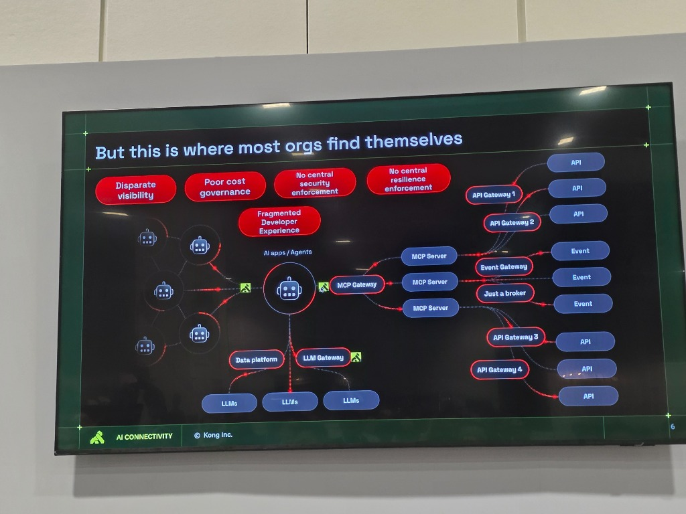

> **Slide 6 · The Sprawl Reality**: *"But this is where most orgs find themselves"* — AI agents connected directly to disparate data platforms, uncoordinated LLM gateways, and point-to-point MCP servers without centralized security, cost governance, or resilience enforcement.


> **Slide 7/8 · Reference Architecture**: *"One gateway layer, three governance profiles, all declared on Kubernetes"* — Unifying Agent traffic through a single AI Gateway layer declared on Kubernetes with three governance profiles: **LLM** (*tokens, cost, prompts*), **MCP** (*tool access, audit*), and **A2A** (*identity, traces*).

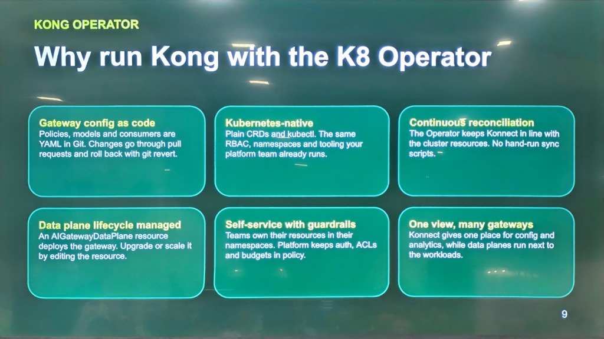

> **Slide 9 · Kong Operator**: *"Why run Kong with the K8 Operator"* — 6 foundational capabilities: (1) Gateway config as code, (2) Kubernetes-native CRDs, (3) Continuous reconciliation, (4) Data plane lifecycle managed via CRDs, (5) Self-service with platform guardrails, and (6) One view across many distributed data plane gateways.

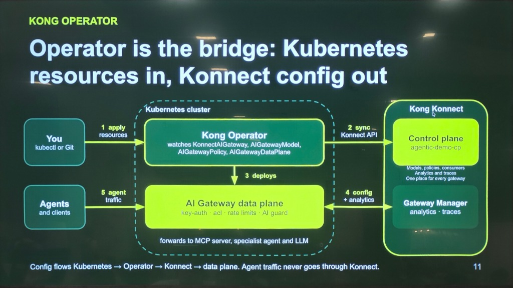

> **Slide 10 · Control Plane Bridge**: *"Operator is the bridge: Kubernetes resources in, Konnect config out"* — Declarative CRDs flow from Git/kubectl $\to$ Kong Operator $\to$ Konnect API control plane (`agentic-demo-cp`) $\to$ local AI Gateway data planes. *Agent traffic stays on the local data plane and never touches the Konnect cloud control plane.*

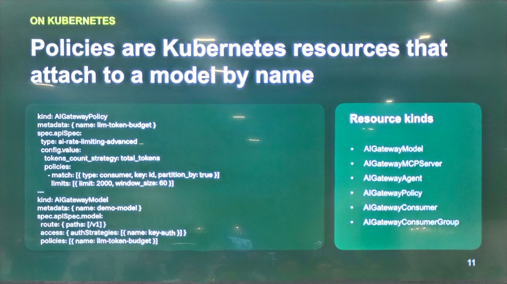

> **Slide 11 · Declarative CRDs**: *"Policies are Kubernetes resources that attach to a model by name"* — Specifying `AIGatewayPolicy` (token budgets, window limits) and `AIGatewayModel` with `key-auth` and policy attachments. Supported CRD resource kinds: `AIGatewayModel`, `AIGatewayMCPServer`, `AIGatewayAgent`, `AIGatewayPolicy`, `AIGatewayConsumer`, and `AIGatewayConsumerGroup`.

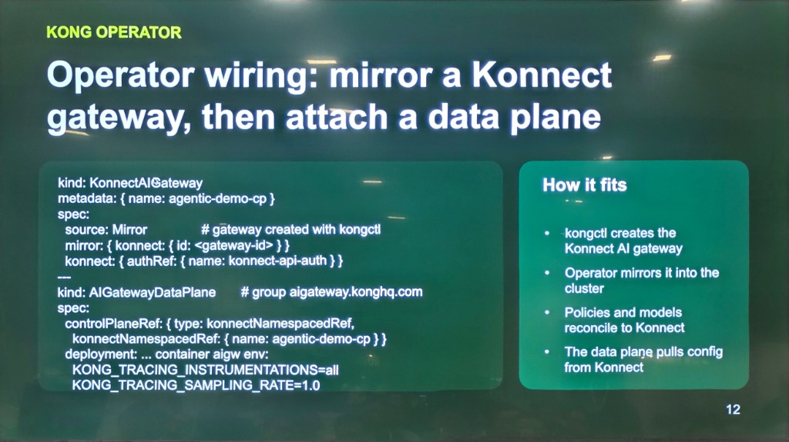

> **Slide 12 · Operator Wiring**: *"Operator wiring: mirror a Konnect gateway, then attach a data plane"* — `KonnectAIGateway` CR mirrors cloud gateway ID; `AIGatewayDataPlane` provisions container runtime with full OpenTelemetry tracing (`KONG_TRACING_INSTRUMENTATIONS=all`, `KONG_TRACING_SAMPLING_RATE=1.0`).

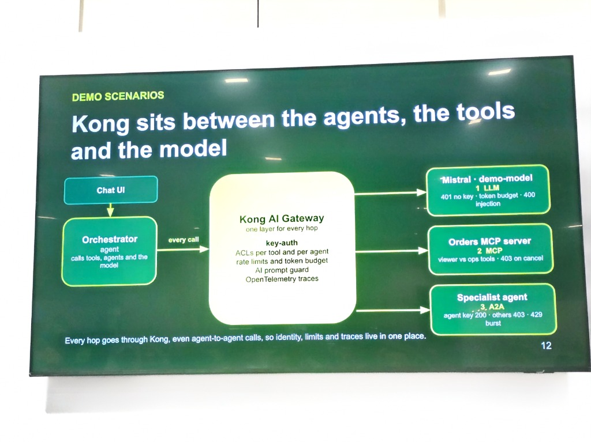

> **Slide 13 · Demo Scenarios**: *"Kong sits between the agents, the tools and the model"* — Every hop goes through Kong: (1) LLM (`Mistral demo-model`: 401 no key, token budget, 400 injection), (2) MCP (`Orders MCP server`: viewer vs ops tools, 403 on cancel), and (3) A2A (`Specialist agent`: agent key 200, others 403, 429 burst).

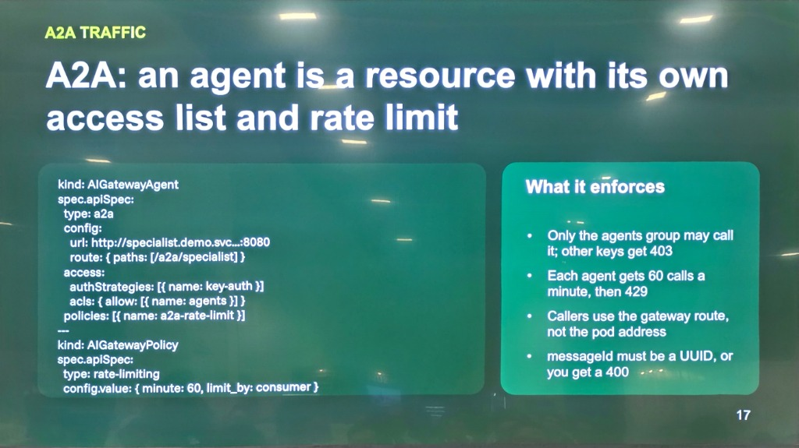

> **Slide 17 · A2A Governance**: *"A2A: an agent is a resource with its own access list and rate limit"* — Declaring `AIGatewayAgent` CRD. Enforces that only the `agents` ACL group may call it (others 403), limits callers to 60 req/min (then 429), mandates gateway routes over raw pod IPs, and validates UUID `messageId` formats.

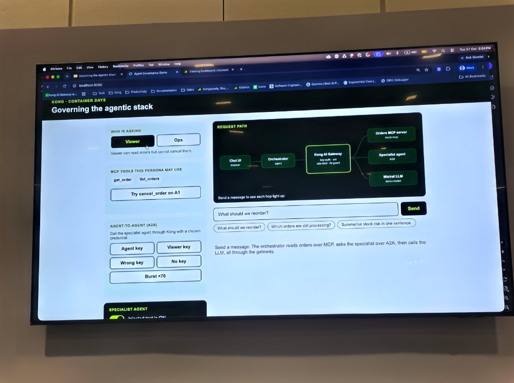

> **Live Demo · Initial State (`Viewer` Persona)**: `localhost:8080` interface showing read-only tools (`get_order`, `list_orders`), A2A credential selectors, and prompt injection toggle (`Injected text is ON`).

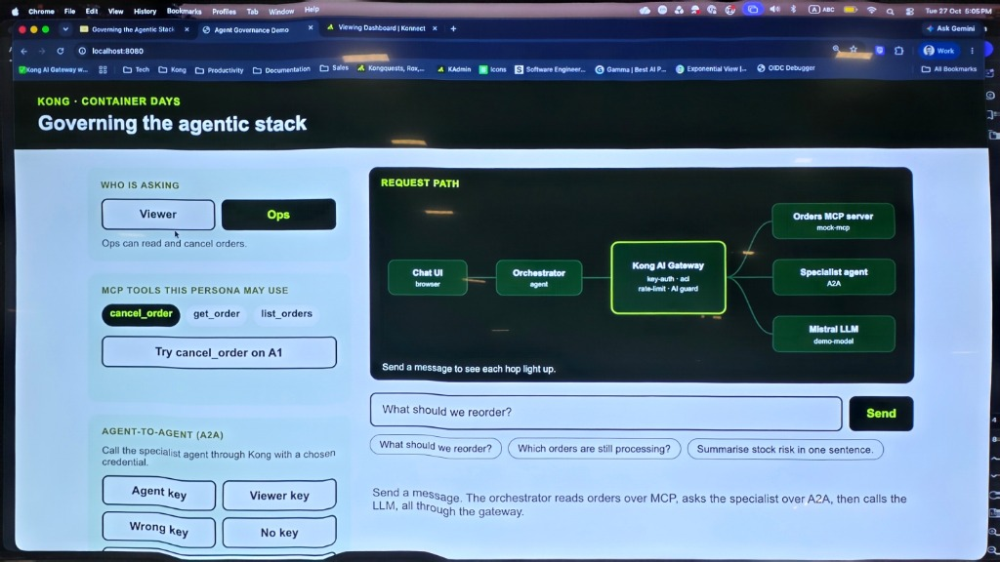

> **Live Demo · Elevated State (`Ops` Persona)**: Switching to `Ops` unlocks the `cancel_order` mutation tool on the Orders MCP server, demonstrating dynamic persona-based ACL elevation.

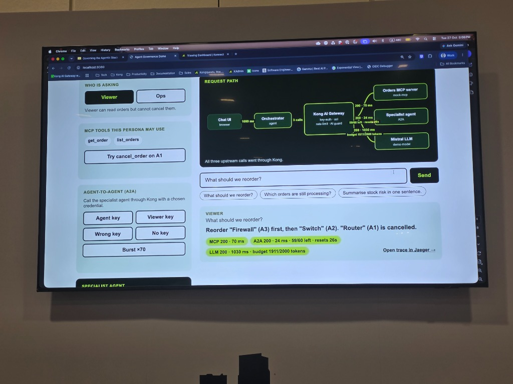

> **Live Demo · Request Path & Multi-Protocol Gateway**: Browser Chat UI $\to$ Orchestrator Agent $\to$ **Kong AI Gateway** (enforcing `key-auth`, `acl`, `rate-limit`, `ai-guard`) multiplexing across: (1) Orders MCP server (`200 · 70ms`), (2) Specialist agent via A2A (`200 · 24ms`, 59/60 quota), and (3) Mistral LLM (`200 · 1030ms`, token budget: 1911/2000).

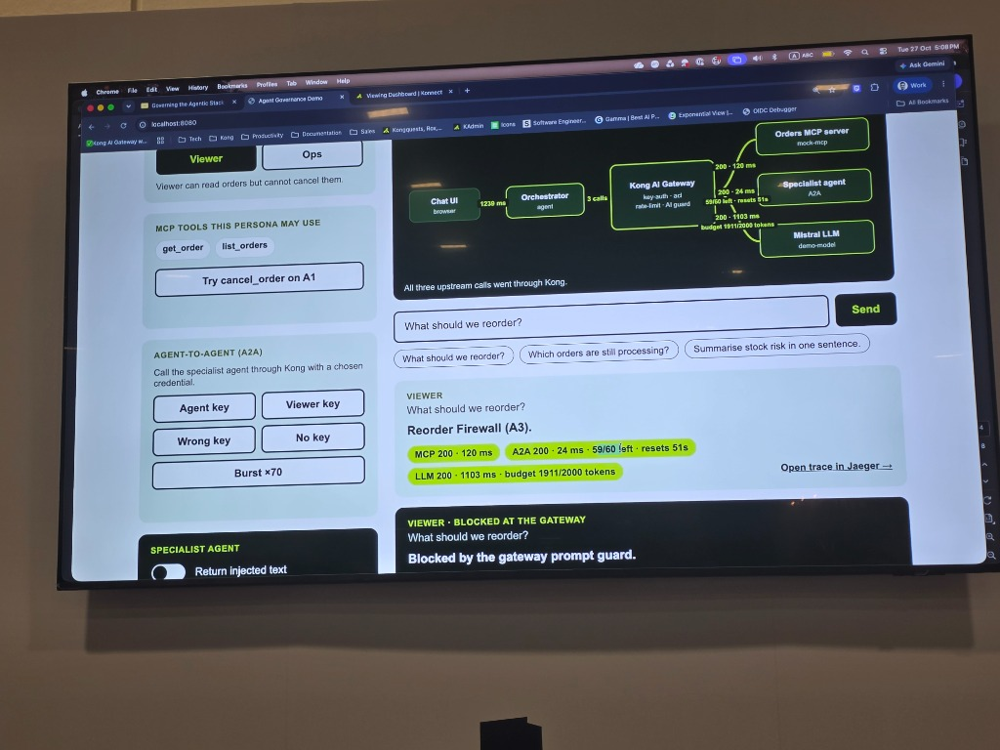

> **Live Demo · Prompt Guarding & Jailbreak Defense**: Kong's `ai-guard` plugin intercepts prompt injection attempts directly at the ingress boundary before reaching the LLM or executing tool calls: `VIEWER · BLOCKED AT THE GATEWAY` — *"Blocked by the gateway prompt guard."*

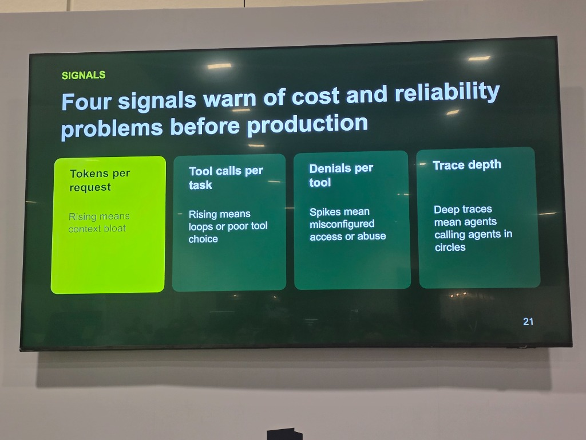

> **Slide 21 · The 4 Pre-Production Signals**: *"Four signals warn of cost and reliability problems before production"* — **Tokens per request** (context bloat), **Tool calls per task** (loops or poor tool choice), **Denials per tool** (misconfigured access or abuse), and **Trace depth** (agents calling agents in circles).

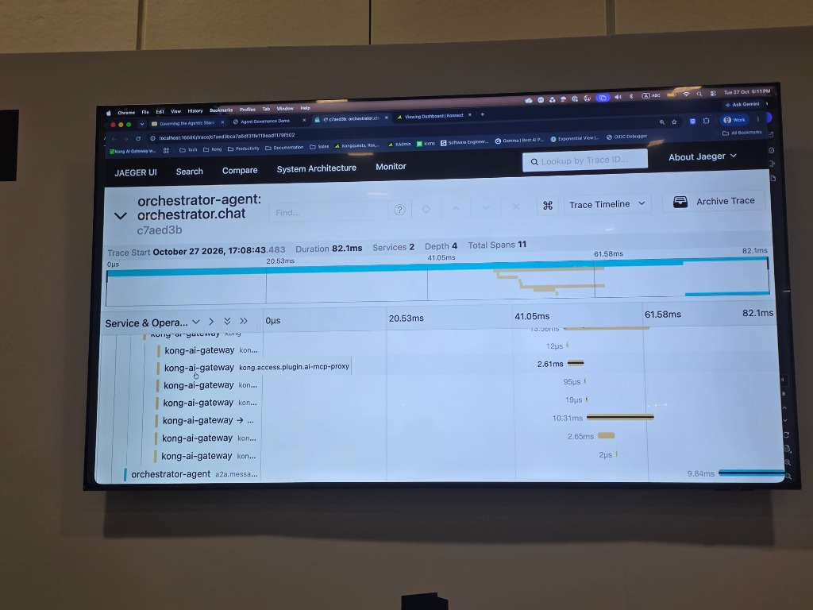

> **Live Demo · Distributed Tracing in Jaeger**: Trace `c7aed3b: orchestrator.chat` (82.1ms total duration, 11 spans across 2 services) showing granular latency for `kong.access.plugin.ai-mcp-proxy` (2.61ms) and A2A messaging (9.84ms).

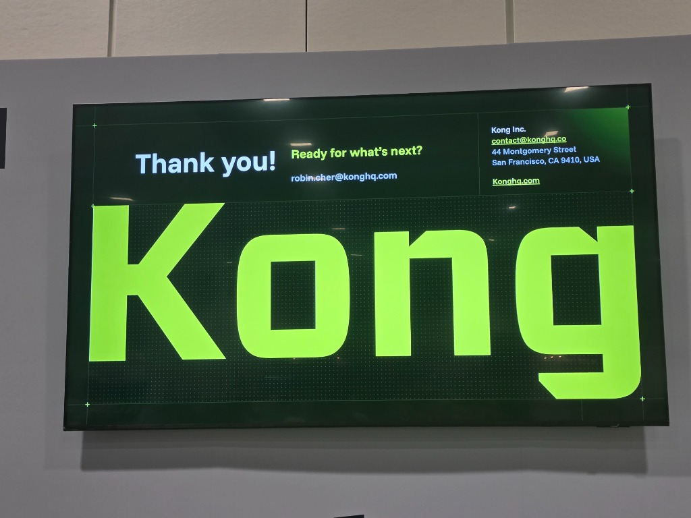

> **Slide 22 / Closing · Contact & Kong**: Robin Cher (`robin.cher@konghq.com`), Kong Inc. (`konghq.com`, 44 Montgomery Street, San Francisco, CA).

---

## 📌 Context & Problem Statement: The Agent Sprawl Trap

Robin Cher examined the rapid evolution of enterprise agentic architectures. While single-agent prototyping starts simple, production systems quickly degrade into an unmanageable, point-to-point mesh:

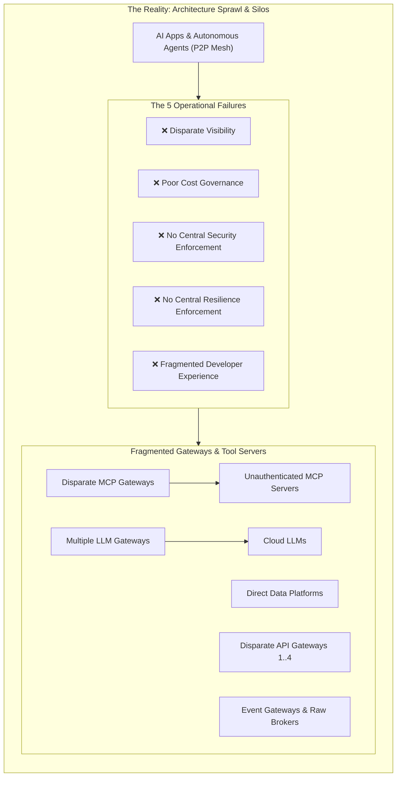

### The 5 Compounding Operational Failures (Slide 6)
1. **Disparate Visibility**: No single pane of glass to observe whether latency is coming from LLM inference, MCP tool execution, or inter-agent A2A negotiation.
2. **Poor Cost Governance**: Teams spin up autonomous agents that invoke frontier LLMs directly, causing runaway token consumption without budgets or rate limits.
3. **No Central Security Enforcement**: Agents execute raw SQL or shell commands over unauthenticated MCP sockets without tool-level RBAC or identity verification.
4. **No Central Resilience Enforcement**: Lack of circuit breaking, retries, and fallback models when inference providers or downstream tool servers degrade.
5. **Fragmented Developer Experience**: Developers have to write custom authentication, logging, and error-handling wrappers for every single agent framework.

---

## 🏛️ The Reference Architecture: One Gateway Layer, Three Governance Profiles

To eliminate the sprawling P2P agent mesh, Robin Cher presented the **Reference Architecture**: unifying all agent traffic through a single gateway layer running natively on Kubernetes, governed by three distinct operational profiles:

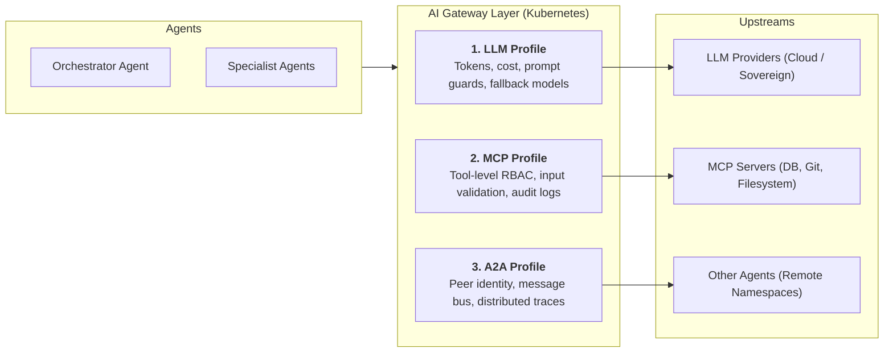

### The 3 Governance Profiles
1. **LLM Governance Profile**:
   - Manages token limits, real-time inference cost attribution, prompt safety classifiers (`ai-guard`), and semantic cache hits.
2. **MCP Governance Profile**:
   - Manages tool discovery, persona-based tool execution RBAC (e.g. read-only vs mutation tools), schema validation, and audit logging.
3. **A2A Governance Profile**:
   - Manages inter-agent mutual TLS authentication, credential delegation, hop-count / TTL limits, and distributed OpenTelemetry context propagation.
- **Platform Foundation**:
  - Managed declaratively via the **Kong Operator** on Kubernetes and synchronized with the **Kong Konnect** control plane.
  - Supports container runtimes across Red Hat OpenShift, Amazon Linux, Ubuntu, and standard Helm/Kubernetes deployments.

---

## ☸️ The Kubernetes Operator Substrate: Declarative Agent Governance

Why run the AI Gateway via a Kubernetes Operator? Robin Cher highlighted six core architectural benefits (Slide 9):

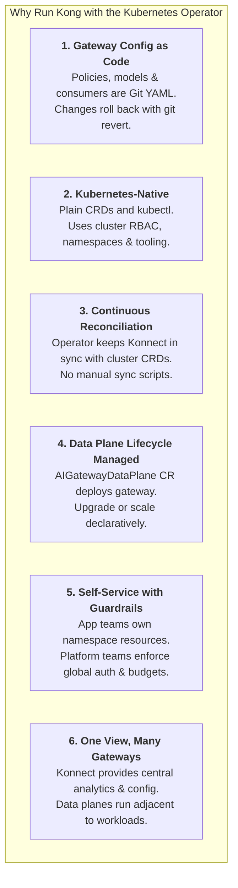

### The Bridge Topology: Kubernetes Resources In, Konnect Config Out (Slide 10)

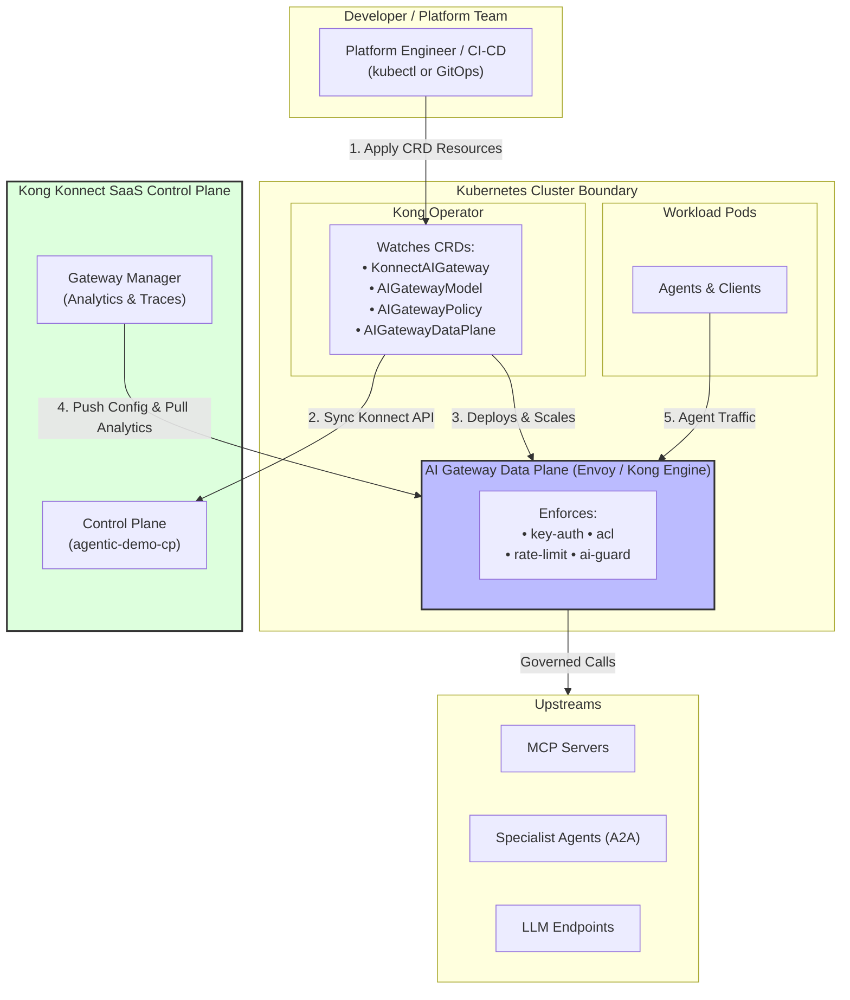

> [!IMPORTANT]
> **Data Plane Isolation Guarantee**:  
> Configuration flows unidirectionally: `Kubernetes CRD` $\to$ `Kong Operator` $\to$ `Konnect Control Plane` $\to$ `Local Data Plane`.  
> **Agent traffic NEVER goes through the Konnect cloud control plane.** All inference payloads, tool calls, and prompt queries remain strictly inside the local Kubernetes cluster.

---

## 📜 Kubernetes CRD Specifications: Modeling Models, Policies & Tool Servers

Robin Cher walked through the concrete Kubernetes Custom Resource Definitions (CRDs) used to configure agent governance (Slides 11 & 12):

### 1. The CRD Hierarchy
- **`AIGatewayModel`**: Represents an LLM endpoint or local model inference service.
- **`AIGatewayMCPServer`**: Represents an external or in-cluster Model Context Protocol tool server.
- **`AIGatewayAgent`**: Represents a specialist agent reachable via Agent2Agent protocols.
- **`AIGatewayPolicy`**: Reusable operational policies (rate limits, token budgets, prompt guards).
- **`AIGatewayConsumer` & `AIGatewayConsumerGroup`**: Defines client/agent personas and credentials.
- **`KonnectAIGateway`**: Connects the cluster to a Konnect control plane instance.
- **`AIGatewayDataPlane`**: Provisions the physical gateway pods in the namespace.

### 2. Declarative Policy Binding (Slide 11)
Policies are standalone Kubernetes resources attached to models by name:

```yaml
# Define an advanced token rate-limiting policy
apiVersion: aigateway.konghq.com/v1alpha1
kind: AIGatewayPolicy
metadata:
  name: llm-token-budget
spec:
  apiSpec:
    type: ai-rate-limiting-advanced_
    config:
      value:
        tokens_count_strategy: total_tokens
        policies:
          - match:
              - type: consumer
                key: id
                partition_by: true
            limits:
              - limit: 2000
                window_size: 60
---
# Attach the token policy and authentication to a model
apiVersion: aigateway.konghq.com/v1alpha1
kind: AIGatewayModel
metadata:
  name: demo-model
spec:
  apiSpec:
    model:
      route:
        paths:
          - /v1
      access:
        authStrategies:
          - name: key-auth
      policies:
        - name: llm-token-budget
```

### 3. Operator Wiring: Mirroring Konnect & Attaching the Data Plane (Slide 12)
Platform teams link their local Kubernetes data plane to Konnect with full OpenTelemetry tracing:

```yaml
apiVersion: aigateway.konghq.com/v1alpha1
kind: KonnectAIGateway
metadata:
  name: agentic-demo-cp
spec:
  source: Mirror                 # Gateway created via kongctl CLI
  mirror:
    konnect:
      id: <gateway-id>
  konnect:
    authRef:
      name: konnect-api-auth
---
apiVersion: aigateway.konghq.com/v1alpha1
kind: AIGatewayDataPlane
spec:
  controlPlaneRef:
    type: konnectNamespacedRef
    konnectNamespacedRef:
      name: agentic-demo-cp
  deployment:
    container:
      aigw:
        env:
          - name: KONG_TRACING_INSTRUMENTATIONS
            value: "all"
          - name: KONG_TRACING_SAMPLING_RATE
            value: "1.0"
```

### 4. A2A Governance: Agent as a Resource with ACLs and Rate Limits (Slide 17)

Robin Cher emphasized that in an agentic mesh, **specialist agents must be treated as first-class Kubernetes resources** with their own access control lists (ACLs) and consumption quotas:

```yaml
apiVersion: aigateway.konghq.com/v1alpha1
kind: AIGatewayAgent
spec:
  apiSpec:
    type: a2a
    config:
      url: http://specialist.demo.svc.cluster.local:8080
      route:
        paths:
          - /a2a/specialist
    access:
      authStrategies:
        - name: key-auth
      acls:
        allow:
          - name: agents
      policies:
        - name: a2a-rate-limit
---
apiVersion: aigateway.konghq.com/v1alpha1
kind: AIGatewayPolicy
spec:
  apiSpec:
    type: rate-limiting
    config:
      value:
        minute: 60
        limit_by: consumer
```

#### What It Enforces:
- **Group ACLs**: Only members of the `agents` credential group may call the specialist agent; any user or viewer keys receive HTTP 403 Forbidden.
- **Consumer Rate Limiting**: Each agent is restricted to **60 calls per minute**; excess traffic is choked with HTTP 429 Too Many Requests.
- **Enforced Gateway Mediation**: Agents are strictly forbidden from discovering or calling the raw Pod IP directly; all traffic must traverse `/a2a/specialist` through the gateway proxy.
- **Message Protocol Validation**: Inbound A2A messages must contain a valid UUID `messageId`, otherwise the gateway immediately rejects the frame with HTTP 400 Bad Request.

---

## 🎯 The Demo Scenarios Matrix: Testing Every Hop (Slide 13)

Before running the live demo on `localhost:8080`, Robin Cher laid out the **three distinct verification tracks** tested through Kong AI Gateway:

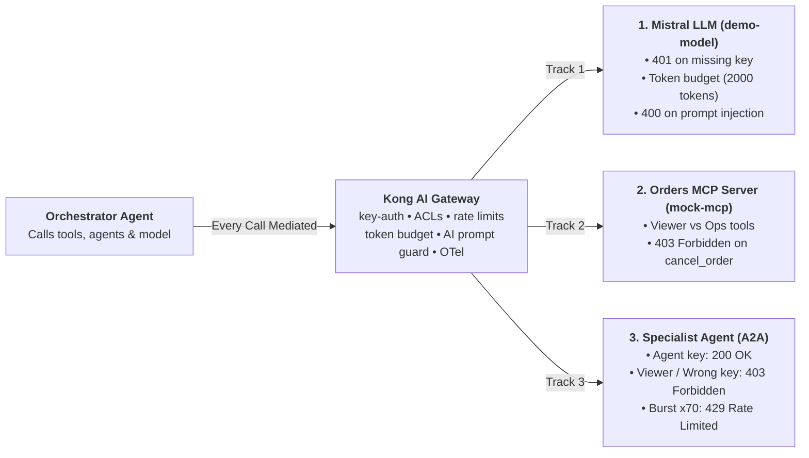

| Hop Track | Target Component | Protocol | Verified Failure & Governance Modes |
| :--- | :--- | :--- | :--- |
| **Track 1** | **Mistral LLM** (`demo-model`) | HTTP / Chat Completions | • **401 Unauthorized** when no API key provided.<br>• **Token Budget Cap** (2000 token limit tracked live; 1911 remaining).<br>• **400 Bad Request / AI Guard** when prompt injection payload is detected. |
| **Track 2** | **Orders MCP Server** (`mock-mcp`) | Model Context Protocol / JSON-RPC | • **Persona-Based RBAC**: `Viewer` can execute `get_order`, `list_orders`.<br>• **403 Forbidden** when `Viewer` attempts mutation `cancel_order`.<br>• **Elevation**: Switching to `Ops` persona authorizes `cancel_order`. |
| **Track 3** | **Specialist Agent** | Agent2Agent (A2A) | • **Credential Check**: Valid `Agent key` returns 200 OK (24ms).<br>• **Unauthorized Access**: `Viewer key`, `Wrong key`, or `No key` returns 403 Forbidden.<br>• **Runaway Loop Protection**: `Burst x70` button triggers 429 Rate Limited. |

---

## ⚙️ The Reference Architecture: Kong AI Gateway on Kubernetes

To solve the sprawl trap, Robin Cher demonstrated a unified gateway topology running on Kubernetes powered by **Kong AI Gateway** (`Konnect`):

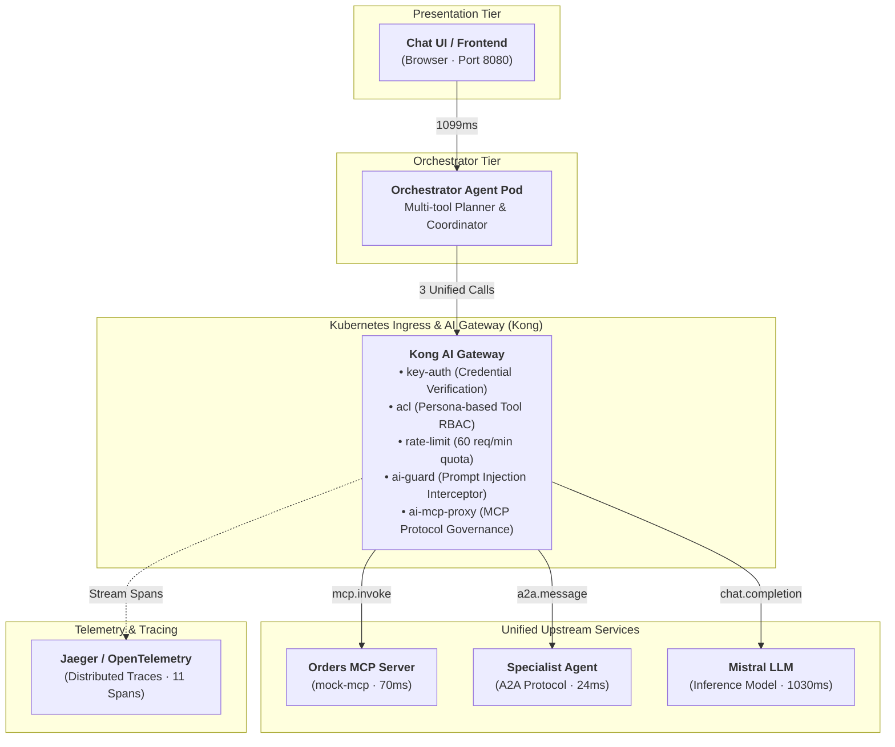

### Key Gateway Plugins Demonstrated:
- **`key-auth`**: Validates credentials across personas and autonomous agents (`Agent key`, `Viewer key`, `Wrong key`, `No key`).
- **`acl`**: Enforces strict persona permissions (`Viewer` can run `get_order` and `list_orders`; mutation `cancel_order` is rejected).
- **`rate-limit`**: Prevents agent runaway loops and denial-of-service bursts (demonstrated with `Burst x70` testing against a 60 req/min threshold).
- **`ai-guard`**: Real-time semantic inspection filtering out prompt injections and jailbreaks before model invocation.
- **`ai-mcp-proxy`**: Specialized Kong plugin bridging standard HTTP/JSON-RPC into Model Context Protocol (MCP) server endpoints with telemetry injection.

---

## 🛑 Live Demo Breakdown: Persona RBAC & AI Guard

During the live demonstration on `localhost:8080`, Robin Cher executed live request paths to test runtime policy enforcement:

### 1. Persona-Based Tool Authorization (`Viewer` vs `Ops`)
- **The Setup**:
  - The `Viewer` persona is granted read-only MCP tools: `get_order`, `list_orders`.
  - The `cancel_order` tool is restricted to `Ops`.
- **The Execution**:
  - Query: *"What should we reorder?"*
  - The Orchestrator issues 3 calls through Kong AI Gateway:
    1. Calls `Orders MCP server` (`200 · 70 ms`) to read order state.
    2. Calls `Specialist agent` over A2A (`200 · 24 ms`, rate limit `59/60 left`, resets in 26s).
    3. Calls `Mistral LLM` (`200 · 1030 ms`, consuming 89 tokens; budget `1911/2000 tokens` remaining).
  - Response: *"Reorder 'Firewall' (A3) first, then 'Switch' (A2). 'Router' (A1) is cancelled."*
- **The Enforcement**:
  - Clicking `Try cancel_order on A1` under the `Viewer` persona immediately returns an HTTP 403 ACL denial at the gateway—the tool invocation is rejected before touching the MCP server!

### 2. Prompt Injection Defense via `ai-guard`
- **The Attack Vector**:
  - Toggling `Return injected text` simulates an adversarial user or an untrusted external document attempting a prompt injection payload.
- **The Gateway Interception**:
  - The request hits Kong AI Gateway.
  - The `ai-guard` plugin inspects the prompt semantics against safety classifiers.
  - The request is immediately terminated at the edge:
    ```
    VIEWER · BLOCKED AT THE GATEWAY
    Prompt: "What should we reorder?"
    Response: "Blocked by the gateway prompt guard."
    ```
  - **Zero LLM tokens are consumed**, and zero downstream tool servers are invoked.

---

## 📊 Pre-Production Telemetry: The 4 Critical Signals (Slide 21)

Robin Cher shared an operational framework for diagnosing cost, performance, and stability problems **before** agentic workloads hit production:

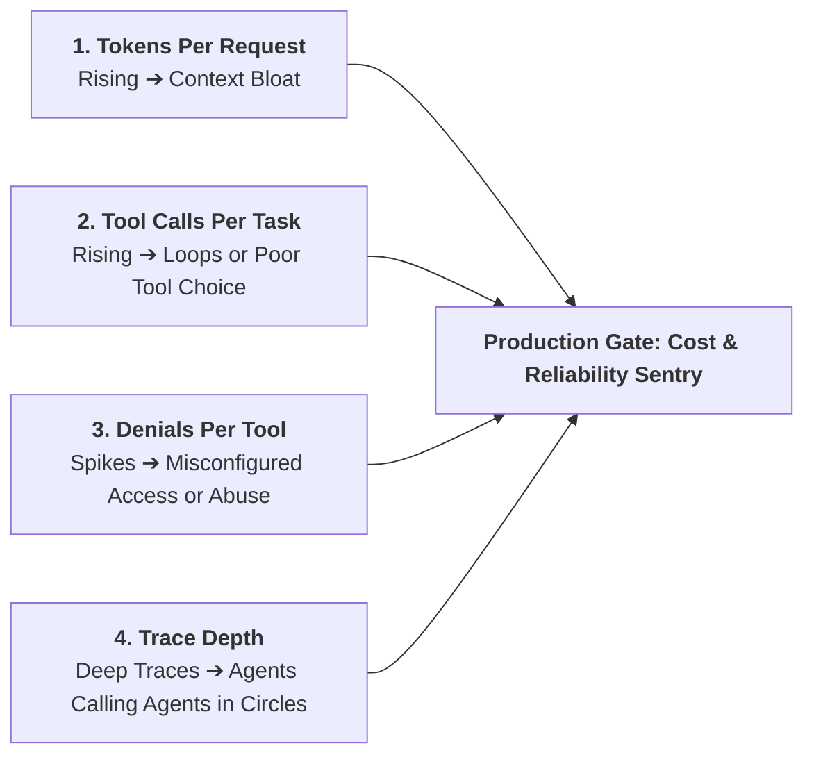

| Signal | Warning Indicator | Root Cause Analysis | Engineering Remediation |
| :--- | :--- | :--- | :--- |
| **Tokens per request** | **Rising trend** 📈 | **Context Bloat**: Accumulating full chat history, uncompressed schema dumps, or excessive RAG chunks. | Implement rolling message windows, summary checkpoints, and semantic vector pruning. |
| **Tool calls per task** | **Rising count** 🔄 | **Agent Loops / Floundering**: Agent lacks clear instructions, receives ambiguous tool return values, or picks inappropriate tools. | Refine tool descriptions (docstrings), improve validation error schemas, and add loop-break tripwires. |
| **Denials per tool** | **Sudden spikes** ⚡ | **Misconfigured Access or Malicious Abuse**: Agent attempting unauthorized actions or attacking internal boundaries. | Review IAM/RBAC policy mappings; inspect gateway `ai-guard` logs for jailbreak attempts. |
| **Trace depth** | **Deep span hierarchies** 🪜 | **Circular A2A Delegation**: Agent A delegates to Agent B, which delegates back to Agent A in an infinite recursion. | Enforce maximum hop limits (TTL) in A2A headers; implement cycle-detection middleware at the gateway. |

---

## 🔍 Deep Observability: Distributed Tracing with Jaeger

Robin Cher displayed a live Jaeger trace (`c7aed3b: orchestrator.chat`) captured at `17:08:43 SGT`:

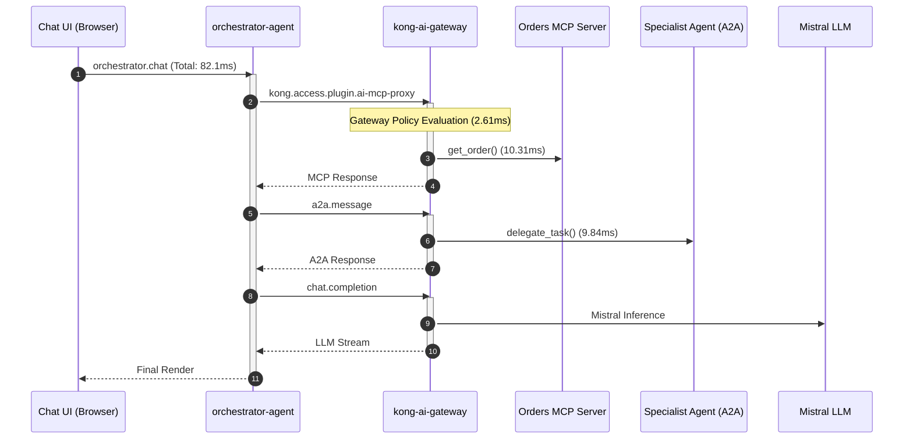

### Trace Metrics & Span Hierarchy:
- **Total Duration**: `82.1ms` across **2 distinct services** and **11 total spans** with a maximum depth of **4**.
- **`kong.access.plugin.ai-mcp-proxy`**:
  - Evaluated key auth, tool ACL, and rate limiting in **2.61ms** of gateway overhead.
  - Proxy execution to the mock MCP server completed in **10.31ms**.
- **A2A Messaging (`a2a.message`)**:
  - Inter-agent message handoff and credential verification completed in **9.84ms**.
- **Architectural Value**:
  - By instrumenting the gateway with OpenTelemetry, platform teams gain deterministic proof of whether latency bottlenecks originate in the gateway, the tool execution, the peer agent, or the foundational LLM.

---

## 💡 Live Notes & Key Takeaways

- *"Most organizations find themselves with disparate visibility, poor cost governance, and no central security enforcement across their agent fleet."*
- *"All three upstream calls must go through the gateway: MCP tools, A2A peer agents, and LLM inference."*
- *"Don't let prompt injections waste inference tokens or hit your tools. Block them at the gateway with AI Guard before anything runs."*
- *"The four pre-production signals to watch: Tokens per request (context bloat), Tool calls per task (loops), Denials per tool (abuse/misconfig), and Trace depth (agents calling agents in circles)."*
- *"Kong AI Gateway bridges standard HTTP/JSON-RPC directly into Model Context Protocol servers via the `ai-mcp-proxy` plugin."*

---

## 👤 Speaker Profile & Reference Links

- **Speaker**: **Robin Cher**
- **Company**: [Kong Inc.](https://konghq.com) (44 Montgomery Street, San Francisco, CA)
- **Contact**: `robin.cher@konghq.com`
- **Core Platform Components**:
  - [Kong AI Gateway](https://konghq.com/products/kong-ai-gateway) — Multi-protocol traffic governance for LLMs, MCP, and A2A
  - [Kong Kubernetes Operator](https://docs.konghq.com/operator/) — GitOps management for declarative gateway CRDs
  - [Kong Konnect](https://konghq.com/products/kong-konnect) — Cloud control plane & analytics fabric
  - [AI MCP Proxy Plugin](https://docs.konghq.com/hub/kong-inc/ai-mcp-proxy/) — Native Model Context Protocol mediation
  - [AI Prompt Guard Plugin](https://docs.konghq.com/hub/kong-inc/ai-prompt-guard/) — Ingress perimeter prompt injection defense

---

## 🔗 Related Notes & Cross-References

- 🌟 [ContainerDays Singapore 2026](ContainerDays%20Singapore%202026.md) — Conference schedule and session index
- 🌐 *Communication Is Key - Agent Protocols (MCP & A2A)* — Deep dive into MCP and A2A protocol specifications
- 🚦 [Lessons from Operating an Internal LLM Gateway for Production Agentic Applications (Zhong Liang Ong & Yek Khan)](Lessons%20from%20Operating%20an%20Internal%20LLM%20Gateway%20for%20Production%20Agentic%20Applications%20(Zhong%20Liang%20Ong%20&%20Yek%20Khan).md) — Gateway token budgets and resilience
- 🛡️ [Securing AI Coding Agents with Kubernetes Sandboxes (Ryan Djurovich)](Securing%20AI%20Coding%20Agents%20with%20Kubernetes%20Sandboxes%20(Ryan%20Djurovich).md) — Sandboxing tool execution on Kubernetes
- 🏭 [Stop Shipping Features with AI. Start Shipping AI Operable Products (Khang Toh)](Stop%20Shipping%20Features%20with%20AI.%20Start%20Shipping%20AI%20Operable%20Products%20(Khang%20Toh).md) — Product operability and policy boundaries
- 💬 *Agentic AI Night - Agent Gateways, A2A, & Jev* — Agent gateway patterns and A2A communication

