# Lessons from Operating an Internal LLM Gateway for Production Agentic Applications

> **Speakers**: Yek Khan Siang & Zhong Liang Ong (Production Engineering @ [Liftoff Mobile](https://liftoff.io))  
> **Event**: [ContainerDays Singapore 2026](./ContainerDays%20Singapore%202026.md)  
> **Date & Time**: Tuesday, October 27, 2026 · 12:25 PM – 12:40 PM SGT  
> **Room**: Synergies Theatre  
> **Gateway Platform**: **Loge** (Liftoff Mobile's Internal LLM Gateway)  
> **Core Topics**: LLM Gateways · Credential Isolation · Kubernetes DNS · Tailscale ACL Auth · Safe Retries vs Cross-Model Fallback · Privacy-Conscious Metadata Tracing  
> **Vault Connections**: [Confessions of a Portal Assistant (Yashod Perera)](./Confessions%20of%20a%20Portal%20Assistant%20%28Yashod%20Perera%29.md) • [Securing AI Coding Agents with Kubernetes Sandboxes (Ryan Djurovich)](./Securing%20AI%20Coding%20Agents%20with%20Kubernetes%20Sandboxes%20%28Ryan%20Djurovich%29.md) • [Taming Agent Sprawl - How We Scale Evals to Keep Up with Agents (Timothy Lin)](./Taming%20Agent%20Sprawl%20-%20How%20We%20Scale%20Evals%20to%20Keep%20Up%20with%20Agents%20%28Timothy%20Lin%29.md) • *Trace It, Store It, Ship It - LLM Observability at GovTech SG*

---

## ⚡ TL;DR (Key Takeaways in 60 Seconds)

- **The Mission**: Operating **Loge**, an internal Kubernetes-native LLM gateway (`loge.default.svc.cluster.local`) powering production agentic applications across enterprise teams.
- **Network & Auth Architecture**: Discovered via cluster-local DNS and secured via Tailscale identity-based ACLs, abstracting provider SDKs and rotating secrets away from developer workstations and CI pods.
- **Three Routing Disciplines**:
  - `explicit`: Immutable model version pinning (e.g., `claude-3-5-sonnet-20241022`).
  - `family alias`: Operator-managed aliases (e.g., `opus`, `reasoning`) qualified before promotion.
  - `auto`: High-availability dynamic routing with pre-request availability checks.
- **Retry vs. Fallback Rule**: Same-model retries are safe; **cross-model fallback breaks agentic systems** because prompt styles, structured JSON schemas, and tool calling conventions shift unpredictably.
- **Privacy-Preserving Telemetry**: Logs token consumption, latency budgets, and error rates via Prometheus and Langfuse without recording sensitive customer prompt payloads.

---

## 📸 Presentation & Slides

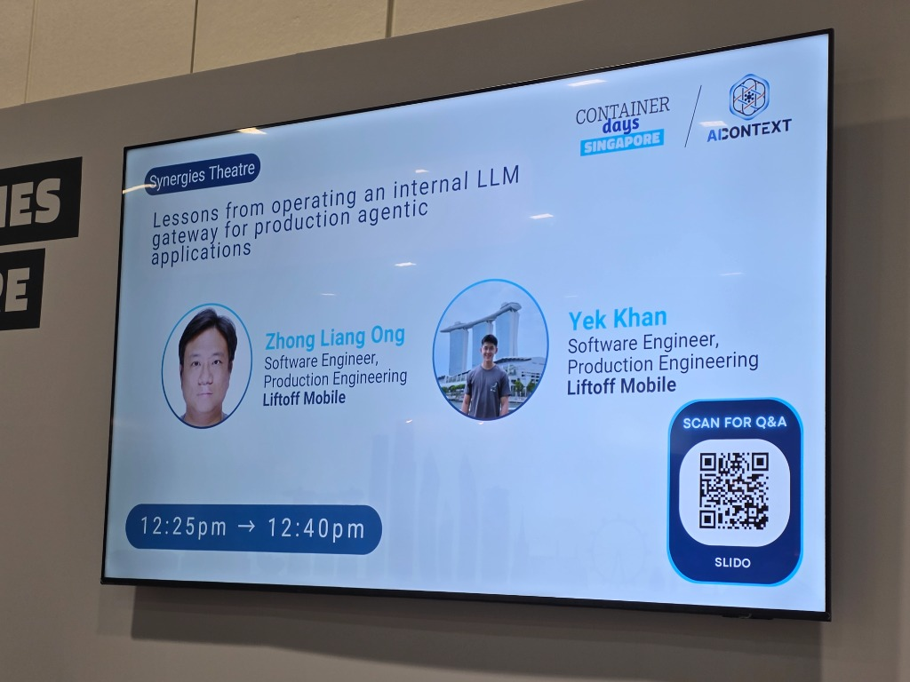

> **Stage Display (~12:20 SGT)**: *Lessons from operating an internal LLM gateway for production agentic applications* presented by Zhong Liang Ong and Yek Khan (Liftoff Mobile) at Synergies Theatre.

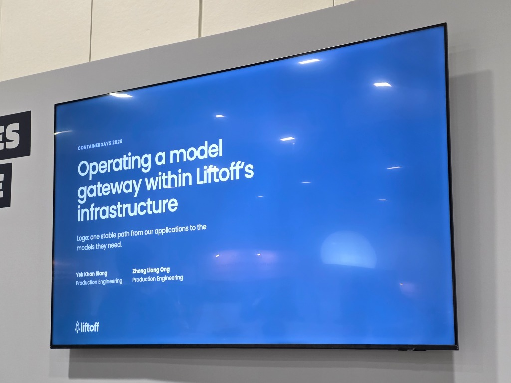

> **Speaker Deck Title Slide (~12:23 SGT)**: *Operating a model gateway within Liftoff's infrastructure* — *"Loge: one stable path from our applications to the models they need"* presented by Yek Khan Siang and Zhong Liang Ong (Production Engineering @ Liftoff).

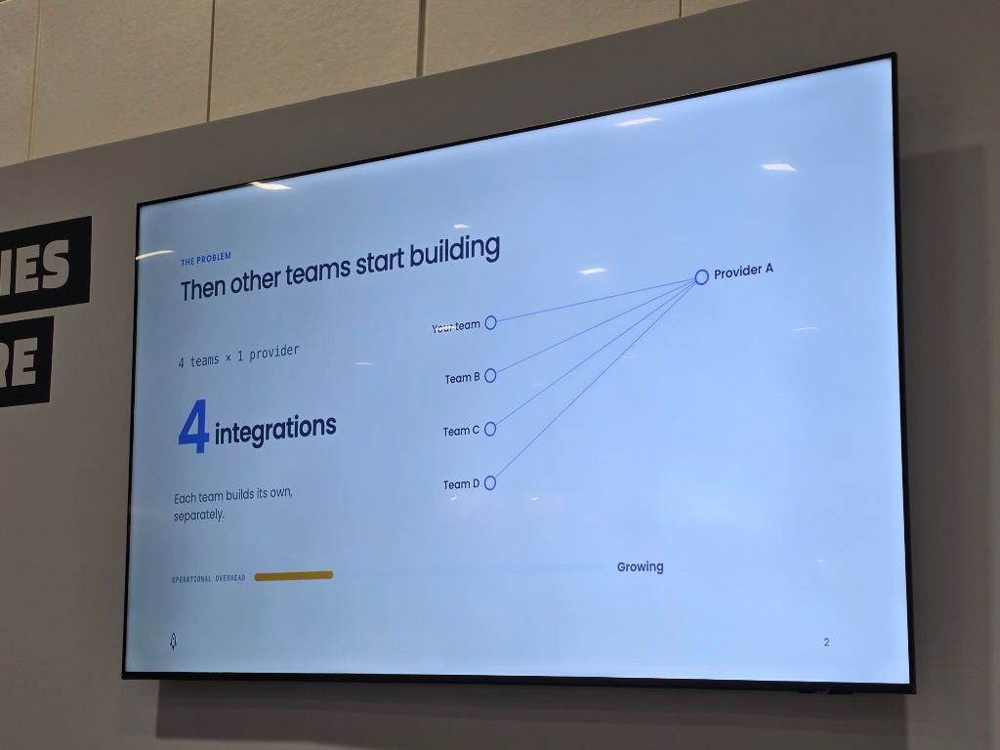

> **The Sprawl Begins (~12:23 SGT)**: *The Problem: Then other teams start building* — 4 teams $\times$ 1 provider = 4 redundant integrations. Each team builds its own client code, error handling, credentials, and billing tracking separately, causing operational overhead to balloon.

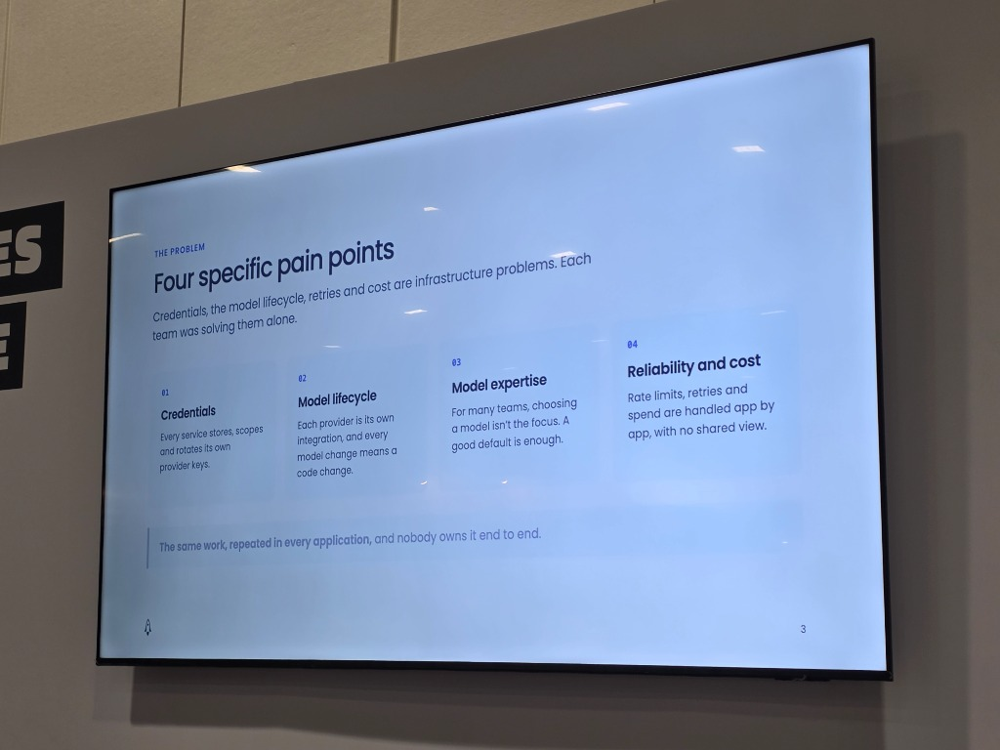

> **Four Specific Pain Points (~12:23 SGT)**: Credentials, model lifecycle, model expertise, and reliability/cost are fundamental infrastructure problems. *"The same work, repeated in every application, and nobody owns it end to end."*

> **The Solution: Run as Infrastructure (~12:24 SGT)**: *Loge: a shared model gateway, run as infrastructure* — Applications call one internal gateway. It owns everything between that call and the upstream model across four pillars: Managed credentials, One gateway / many models, "We pick for you" (`auto`/family aliases), and Resilience/visibility.

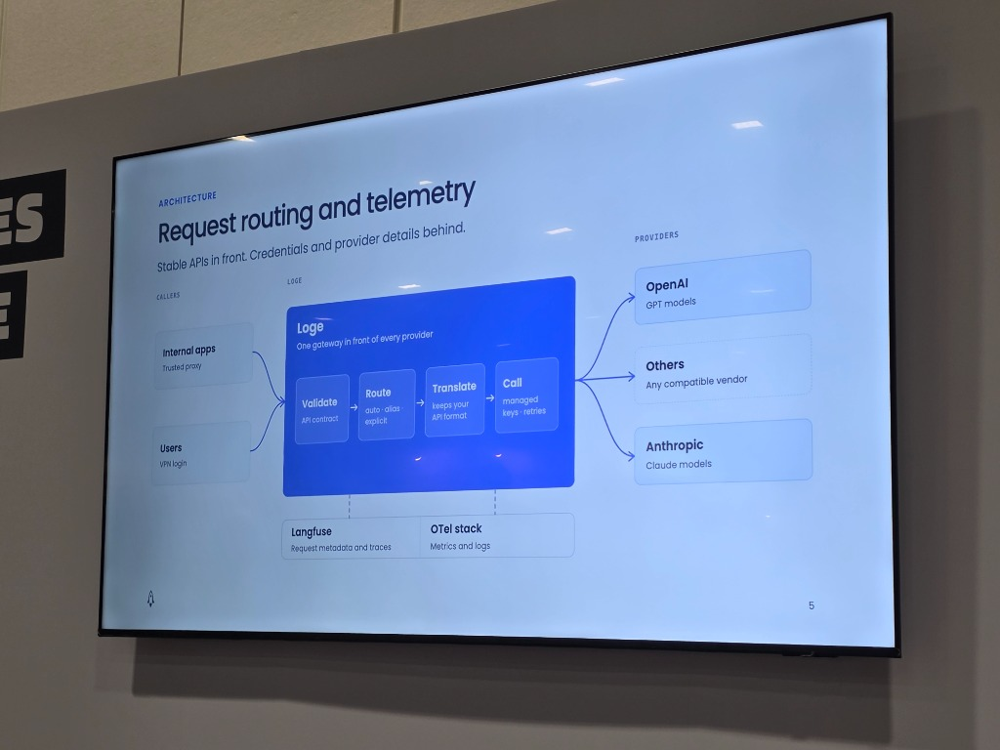

> **Architecture Overview: Routing & Telemetry (~12:26 SGT)**: *Request routing and telemetry: Stable APIs in front. Credentials and provider details behind.* Callers (Internal apps via trusted proxy, Users via VPN login) submit requests through a 4-step pipeline: **Validate** (API contract) $\to$ **Route** (`auto` · alias · explicit) $\to$ **Translate** (keeps caller's API format) $\to$ **Call** (managed keys · retries) out to OpenAI, Anthropic, or compatible vendors. Underneath, telemetry is split between **Langfuse** (metadata/traces) and **OTel stack** (Prometheus metrics & logs).

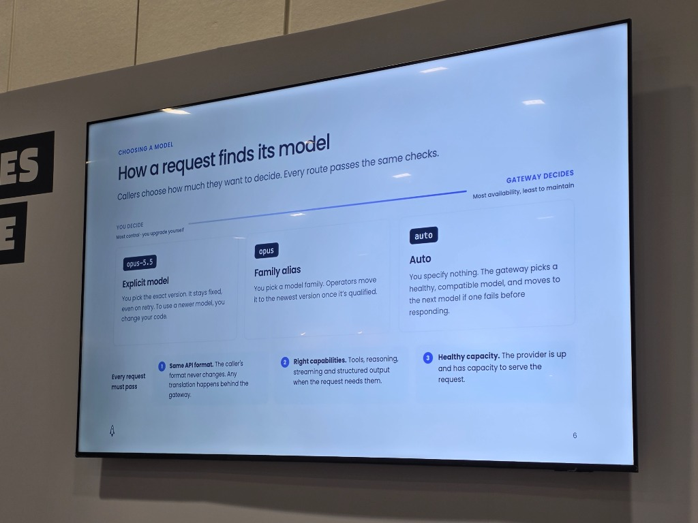

> **Choosing a Model: Three Decision Tiers (~12:27 SGT)**: *How a request finds its model: Callers choose how much they want to decide. Every route passes the same checks.* Tier 1: **Explicit model** (`opus-5.5` — exact version, fixed on retry, caller-controlled upgrades). Tier 2: **Family alias** (`opus` — operators bump qualified versions). Tier 3: **Auto** (`auto` — gateway picks healthy, compatible model and moves to next on pre-response failure). Every route validates API format compatibility, capabilities (tools, reasoning, streaming), and provider health.

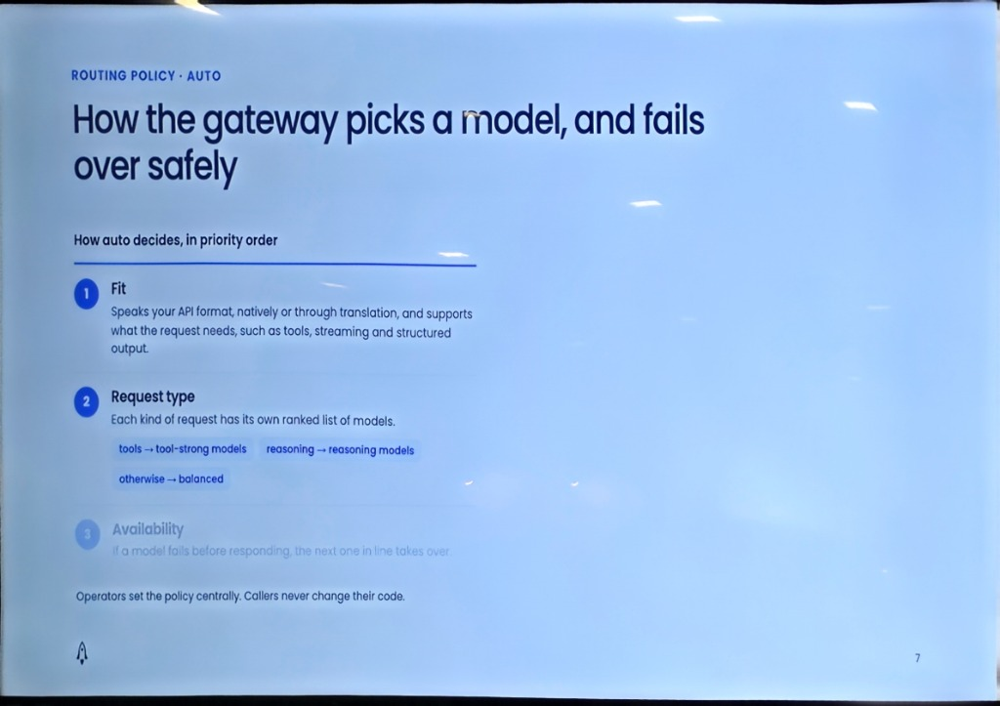

> **Routing Policy for Auto (~12:29 SGT)**: *How auto decides in priority order: 1. Fit (API format & capability support), 2. Request type (ranked lists: `tools` $\to$ tool-strong, `reasoning` $\to$ reasoning models, otherwise $\to$ balanced), 3. Availability (next in line takes over if provider fails before responding).* Centralized operator policy without requiring caller code updates.

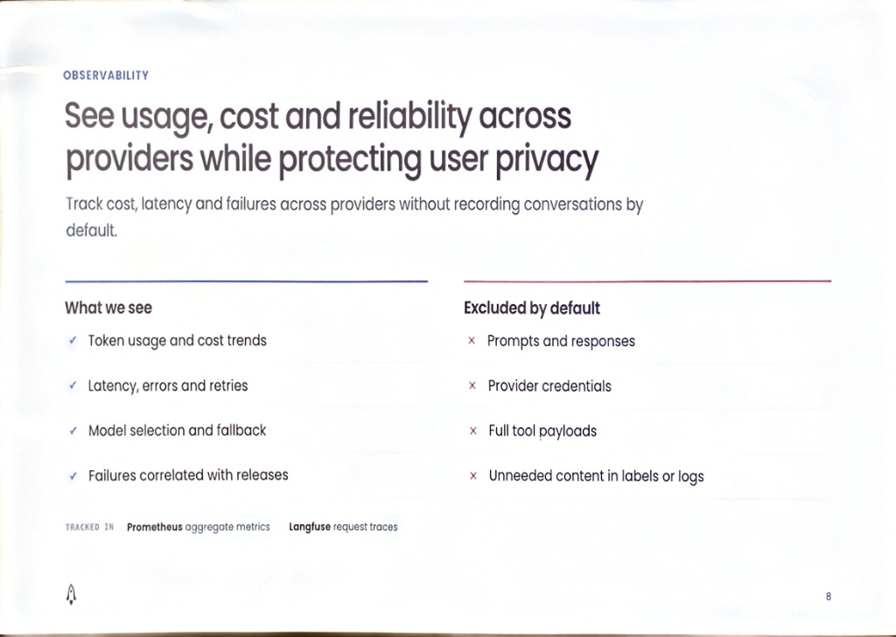

> **Privacy-Preserving Observability (~12:31 SGT)**: *See usage, cost and reliability across providers while protecting user privacy.* Track cost, latency, errors, retries, and release correlations in **Prometheus aggregate metrics** and **Langfuse request traces**. By default, prompts, responses, credentials, and full tool payloads are strictly **excluded**.

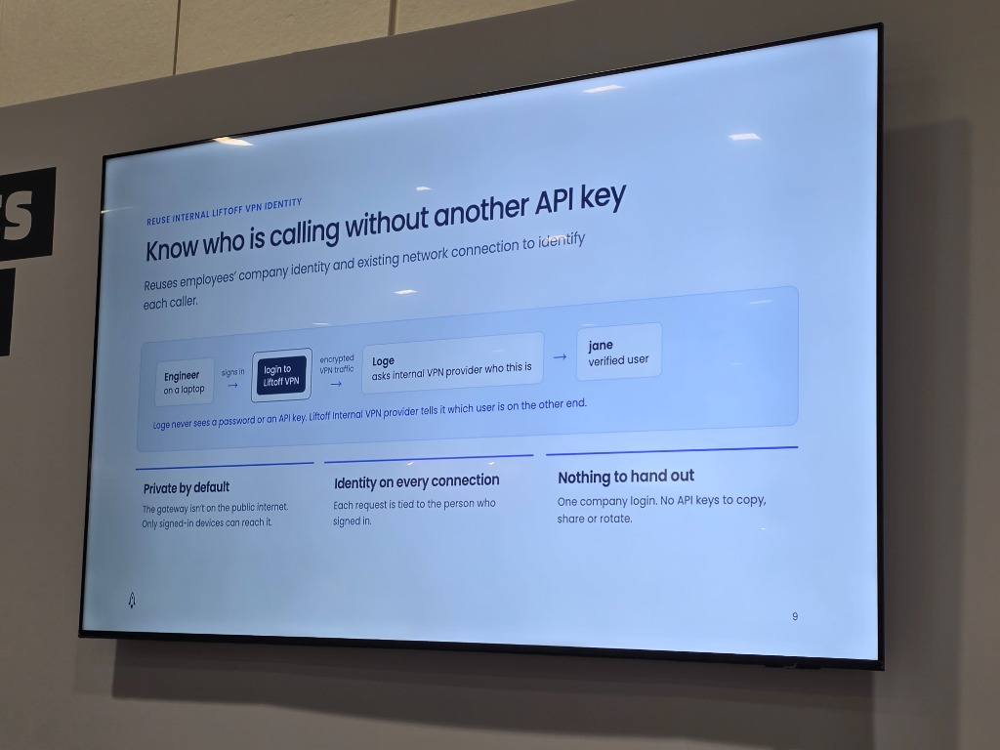

> **Zero-Key Authentication via VPN Identity (~12:32 SGT)**: *Reuse Internal Liftoff VPN Identity: Know who is calling without another API key.* Reuses employees' existing company login and encrypted VPN tunnel. When an engineer connects, Loge queries the VPN provider to identify the caller (`jane`) without ever seeing a password or issuing a secret API key. Private by default, identity on every connection, and nothing to distribute or rotate.

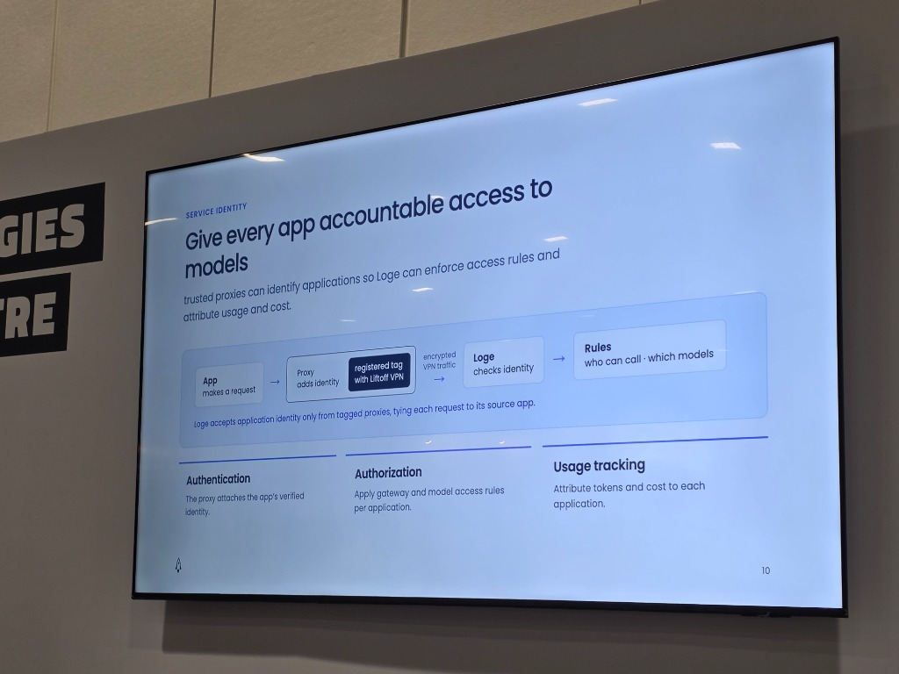

> **Service Identity: Accountable Access for Apps (~12:33 SGT)**: *Service Identity: Give every app accountable access to models.* Trusted proxies identify internal microservices so Loge can enforce granular access rules and attribute token usage and cost. An application submits its call to an in-cluster proxy with a registered tag in the Liftoff VPN mesh $\to$ encrypted VPN traffic $\to$ Loge checks the verified identity $\to$ evaluates access rules on who can call which models. Provides **Authentication** (verified app identity), **Authorization** (gateway/model policy), and **Usage Tracking** (token & cost attribution).

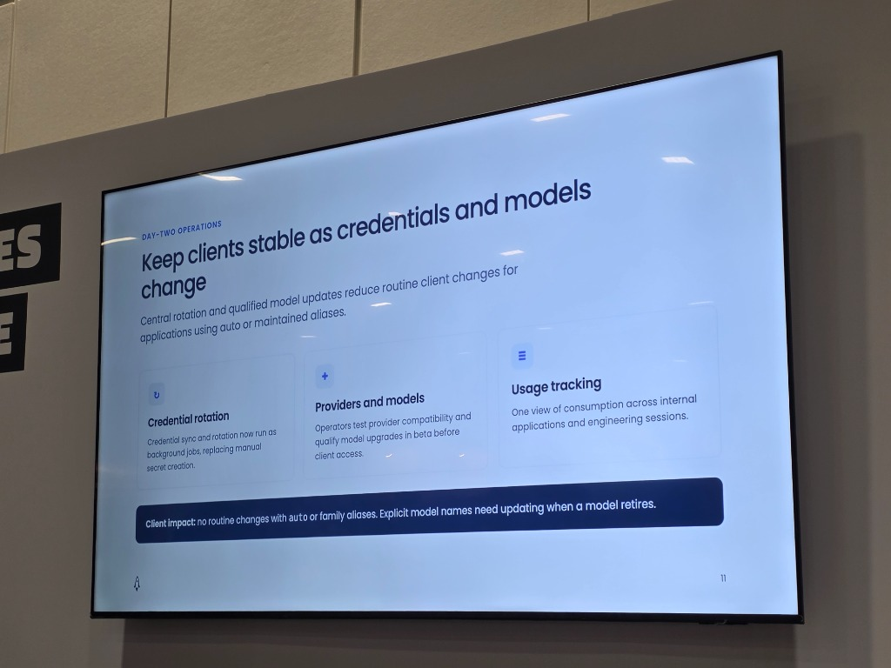

> **Day-Two Operations: Client Stability (~12:34 SGT)**: *Keep clients stable as credentials and models change.* Central rotation and qualified model updates reduce routine client changes for applications using `auto` or maintained aliases. **Credential rotation** runs as automated background sync jobs; **Providers and models** are beta-qualified by platform operators before client exposure; **Usage tracking** provides unified visibility across apps and engineering sessions. Bottom impact: zero routine changes for `auto` or family aliases, while explicit model targets only require updates when a pinned version is deprecated/retired.

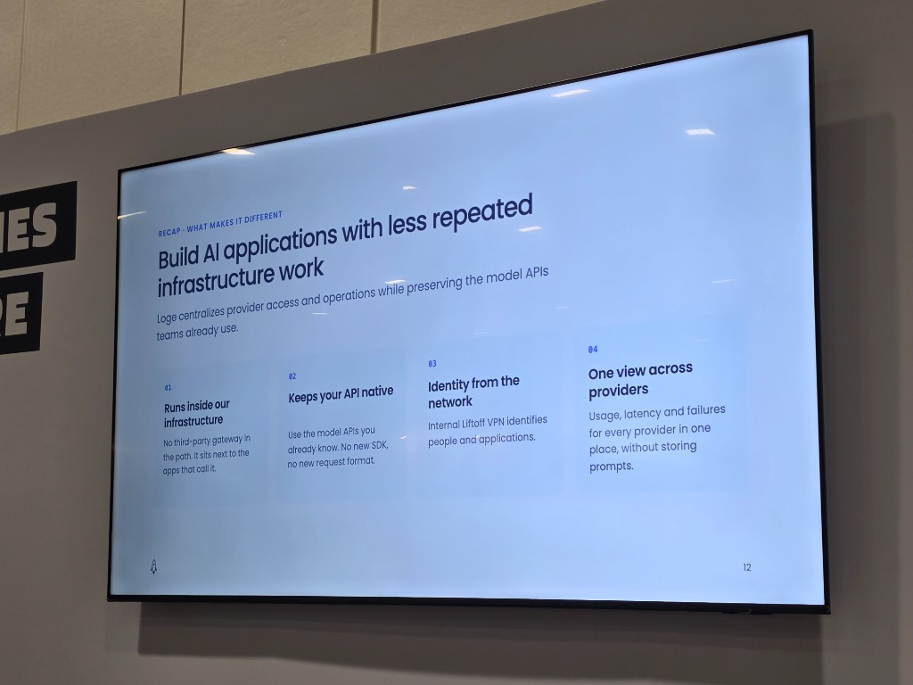

> **Recap: What Makes It Different (~12:36 SGT)**: *Build AI applications with less repeated infrastructure work.* Loge centralizes provider access and operations while preserving the model APIs teams already use:
> 1. **Runs inside our infrastructure**: No third-party gateway in the path; it sits directly next to calling applications.
> 2. **Keeps your API native**: Uses standard model APIs teams already know; no proprietary SDK, no bespoke request formats.
> 3. **Identity from the network**: Internal Liftoff VPN mesh transparently identifies people and applications.
> 4. **One view across providers**: Usage, latency, and failures across every provider in one place, without storing prompts.

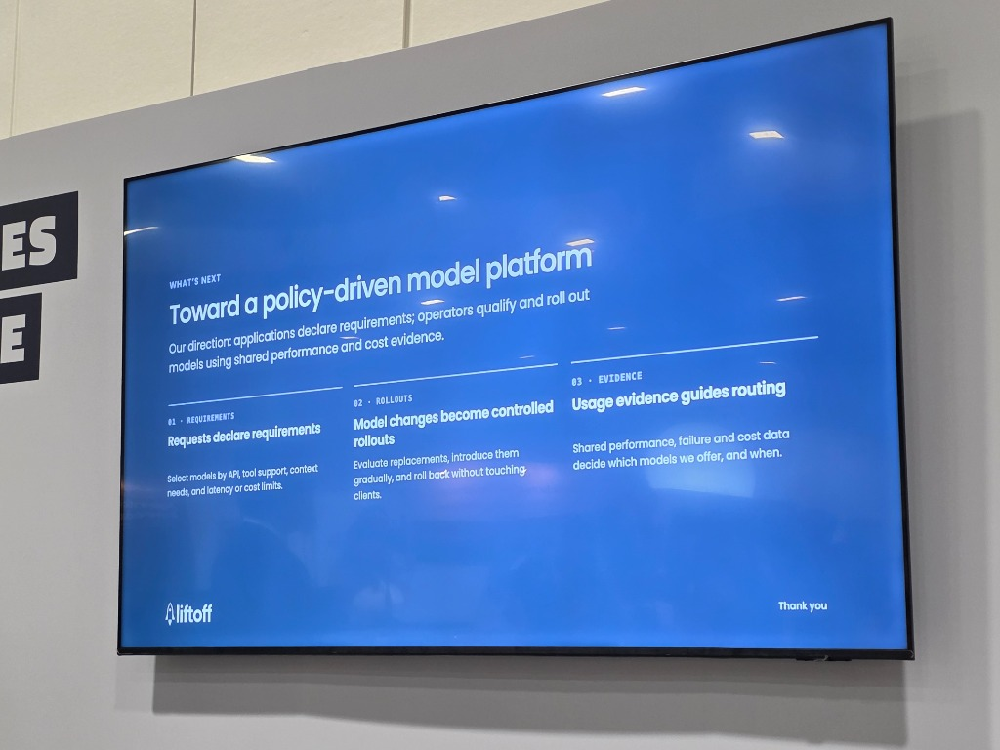

> **What's Next: Policy-Driven Model Platform (~12:37 SGT)**: *Toward a policy-driven model platform: Applications declare requirements; operators qualify and roll out models using shared performance and cost evidence.*
> 1. **Requests declare requirements**: Models selected by required API contract, tool capabilities, context length needs, and latency/cost limits.
> 2. **Model changes become controlled rollouts**: Evaluate replacements in beta, roll them out progressively across teams, and roll back instantly without touching application code.
> 3. **Usage evidence guides routing**: Empirical performance, failure rates, and real-time cost telemetry centrally dictate which models are routed, and when.

---

## 📝 Live Notes & Core Architecture

### 🚀 The Operational Challenge: Moving from Laptops to Production
> *"Getting an agentic application running on a laptop takes minutes. Keeping that momentum while preparing it for production is much harder."*

#### Phase 1: The Fragmentation Trap (4 Teams $\times$ 1 Provider)
When an enterprise begins adopting AI, team sprawl immediately creates redundant, brittle infrastructure:
- **Redundant Integrations**: Team A, Team B, Team C, and Team D all independently integrate with Provider A (e.g. OpenAI).
- **Duplicated Operational Overhead**: Every team writes their own bespoke retry wrappers, client connection pools, and error parsers.

#### ⚠️ The Four Infrastructure Pain Points
Credentials, model lifecycle, retries, and costs are platform problems, yet organizations force individual product teams to solve them in silos:

| # | Pain Point | What Breaks in Production | Why It Must Be Centralized |
| :-: | :--- | :--- | :--- |
| **01** | **Credentials** | Every service stores, scopes, and rotates its own provider keys. Keys leak in Git, container layers, and dev laptops with zero auditability. | Centralized server-side secret management with zero key exposure to client code. |
| **02** | **Model Lifecycle** | Each provider requires a custom SDK and integration. Every new model version or deprecation requires application code changes and redeployments. | Protocol-standardized gateway endpoints (OpenAI/Anthropic compatible) that map virtual aliases (`production-default`) to underlying models. |
| **03** | **Model Expertise** | For many product teams, choosing and evaluating models is a distracting chore. They waste engineering cycles debating models when a solid default is sufficient. | Platform engineers curate vetted default models per task tier (e.g. fast vs reasoning). |
| **04** | **Reliability & Cost** | Upstream rate limits (429s), jittered retries, and token spend are handled app-by-app with zero global view, leading to noisy neighbor outages. | Shared token rate limiters, coordinated backoff, and centralized spend attribution. |

> *"The same work, repeated in every application, and nobody owns it end to end."*

---

### 🏛️ The Loge Gateway Architecture
Liftoff Mobile built and operates **Loge**, an internal LLM gateway specifically optimized for production agentic workloads: *"Applications call one gateway. It owns everything between that call and the model."*

#### The Four Solution Pillars
1. **Managed Credentials**: Provider credentials stay securely server-side inside Loge. Applications never touch, store, or rotate API keys.
2. **One Gateway, Many Models**: Standardized OpenAI and Anthropic API compatibility exposed behind a single cluster-local address. Zero provider SDK lock-in.
3. **"We Pick For You" (Model Routing & Aliases)**: Product teams use a family alias (e.g. `fast`, `reasoning`) or `auto` to route to a platform-maintained, verified working model without hardcoding specific model revisions.
4. **Resilience & Centralized Visibility**: Coordinated rate limiting, safe same-model retries, controlled fallbacks, and a unified telemetry view of usage, latency, and cost.

#### 🔄 The Loge Request Lifecycle
Behind the stable ingress, every incoming prompt passes through a 4-stage pipeline:

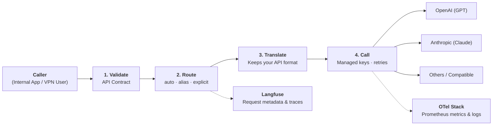

1. **Validate**: Checks the API contract, request schema, and caller authentication (Tailscale identity or Kubernetes ServiceAccount).
2. **Route**: Evaluates the requested target against the three decision tiers (`auto`, family alias, or explicit version).
3. **Translate**: Seamlessly maps format parameters so that client code written for OpenAI can run against Anthropic (or vice versa) without client SDK changes.
4. **Call**: Injects server-side managed credentials, executes upstream HTTP calls, and manages jittered backoff retries.

---

### 🎛️ Model Selection: Three Operational Tiers
Callers choose the exact balance between autonomy and platform management:

| Tier | Example Target | Operational Model | Behavior on Failure | Who Maintains Upgrades |
| :--- | :--- | :--- | :--- | :--- |
| **Tier 1: Explicit Model** | `opus-5.5` | **Most Control**: Caller locks to an immutable model version. | Stays fixed; retries only against exact version. | **Caller / Product Team**: Code changes required to adopt new releases. |
| **Tier 2: Family Alias** | `opus`, `reasoning`, `fast` | **Shared Ownership**: Caller targets a capability family. | Retries on same family. | **Platform Operators**: Silently qualifies and promotes newer versions behind the alias. |
| **Tier 3: Auto** | `auto` | **Gateway Decides**: Most availability, least maintenance. Caller specifies zero model details. | Automatic failover to next qualified model in line if failure occurs *before* responding. | **Loge Gateway**: Completely automated and dynamically re-routed. |

#### 📋 Universal Invariant Checks (Every Request Must Pass)
Regardless of which tier is selected, Loge enforces three mandatory checks:
1. **Same API Format**: The caller's interface contract is preserved; translation occurs dynamically behind the proxy.
2. **Right Capabilities**: Validates that candidate models strictly support the tools, reasoning, streaming, and structured JSON schemas demanded by the request.
3. **Healthy Capacity**: Real-time provider health checks verify the upstream has quota and responsiveness before routing traffic.

---

### 🔀 The `auto` Routing & Failover Policy
When applications route to `auto`, Loge executes a strict 3-step prioritized evaluation:

1. **Step 1: Fit**:
   - Evaluates whether the candidate model speaks the caller's API format (natively or via transparent translation).
   - Validates feature support: tool calling, SSE streaming, and structured output schemas.
2. **Step 2: Request Type Classification**:
   - Each request type maintains an operator-curated ranked list of models:
     - `tools` $\to$ routed to tool-calling optimized models.
     - `reasoning` $\to$ routed to reasoning-heavy models (e.g. o1/o3/Claude reasoning).
     - `otherwise` $\to$ routed to balanced models (fast, cost-effective).
3. **Step 3: Availability & Pre-Response Failover**:
   - If the top-ranked model fails or throws a 5xx/429 *before* it begins streaming/responding, Loge automatically promotes the next model in the ranked list.
   - *Key Rule*: Operators maintain and adjust the ranked lists centrally; application code never changes.

---

### 🛡️ Credential & Failure Isolation

#### 🔑 Zero-Key Authentication: Reusing Corporate VPN Identity
Rather than generating, distributing, rotating, and revoking custom API keys for hundreds of engineers, Liftoff Mobile reuses existing corporate VPN infrastructure:

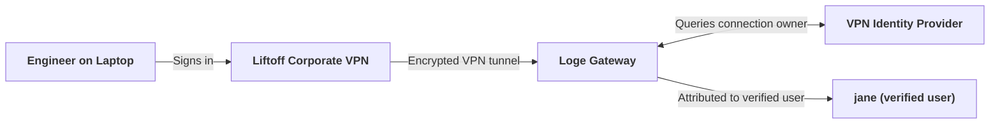

> *"Loge never sees a password or an API key. Liftoff Internal VPN provider tells it which user is on the other end."*

- **Private by Default**: Loge has no public IP and does not exist on the public internet. Only authenticated devices on the VPN mesh network can reach the service.
- **Identity on Every Connection**: Every TCP connection is cryptographically bound to the engineer who signed into the VPN (e.g. `jane`), automatically attributing token usage and budget tracking without HTTP Authorization headers.
- **Nothing to Hand Out**: Eliminates API keys entirely. No keys to copy into `.env` files, no secrets leaked into Git repositories, and zero credential rotation toil.

#### 🏷️ Service Identity: Trusted Proxies & Tagged Accountable Access
For production applications running inside Kubernetes clusters, human VPN logins do not apply. Liftoff solves this using **trusted tagged proxies**:

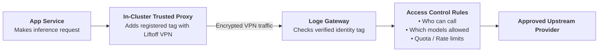

> *"Loge accepts application identity only from tagged proxies, tying each request to its source app."*

| Dimension | Mechanism | Operational Benefit |
| :--- | :--- | :--- |
| **Authentication** | The trusted proxy injects the microservice's cryptographically verified identity tag over the VPN mesh. | Microservices do not store shared secrets or static bearer tokens. |
| **Authorization** | Loge evaluates granular policy rules matching the app tag to allowable model tiers. | Prevents non-essential services from calling expensive reasoning models (e.g. o1/o3/Opus). |
| **Usage Tracking** | Every token consumed and dollar spent is automatically attributed to the originating service tag. | Enables automated team chargebacks and identifies runaway agent loops immediately. |

#### 📦 Blast Radius & Provider Secret Containment
1. **Zero Secret Sprawl**:
   - Upstream provider API keys (OpenAI, Anthropic) reside strictly inside Loge's server-side secrets store.
   - Production applications and developer laptops have **zero knowledge** of raw provider credentials.
2. **Blast Radius Containment**:
   - Upstream rate limits (429s) or provider quota freezes are intercepted at Loge, allowing it to queue, rate-limit, or alert before client pods crash.
   - Deployment smoke tests isolate model-compatibility breaking changes before production traffic hits them.

---

### ⚠️ Safe Retries vs. Dangerous Cross-Model Fallbacks
> *"Fallback can improve availability, but it may also change output quality, tool behavior, latency, and cost. It must be an explicit policy, not an accidental default."*

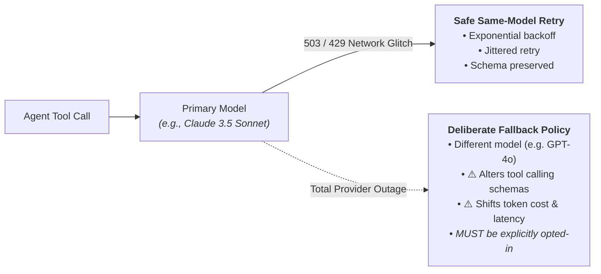

- **Same-Model Retries (Safe)**: Retrying temporary HTTP 5xx or rate-limit hiccups against the exact same model endpoint preserves prompt adherence, temperature behavior, and tool-call schema formatting.
- **Cross-Model Fallback (Dangerous)**:
   - Falling back from Claude 3.5 Sonnet to GPT-4o or Grok might keep the HTTP connection alive, but **different models format tool calls, XML tags, and reasoning traces differently**.
   - Can cause immediate downstream crashes in agentic loops expecting specific JSON schema shapes.
   - **The Policy Rule**: Cross-model fallback must be an **explicit opt-in configuration** per application, never a silent gateway fallback.

---

### 🔒 Privacy-Preserving Observability: Telemetry vs. Content
Liftoff Mobile solves the enterprise compliance dilemma by enforcing strict data partitioning between aggregate metrics, trace metadata, and raw content:

| Tracked by Default | Excluded by Default (Strict Privacy) |
| :--- | :--- |
| **Token Usage & Cost Trends** | ❌ **Prompts & Completions** (never stored) |
| **Latency, HTTP Errors & Retries** | ❌ **Provider Credentials & Keys** |
| **Model Selection & Failover Events** | ❌ **Full Tool Execution Payloads** |
| **Failures Correlated with Releases** | ❌ **Unneeded Content in Labels or Logs** |

- **Telemetry Tooling**:
  - **Prometheus**: Aggregates time-series metrics (RPS, error rate, p95/p99 latency, active upstream health).
  - **Langfuse**: Captures granular request traces, caller team attribution, token tallies, and routing decisions without retaining prompt payloads.

---

### 🛠️ Day-Two Operations: Lifecycle Management & Automated Rotation
Operating an internal LLM gateway long-term requires automating mundane lifecycle tasks so product engineers experience zero churn as upstream providers change:

| Operational Domain | Mechanism | Developer Experience Impact |
| :--- | :--- | :--- |
| **Credential Rotation** | Credential synchronization and provider key rotation run as autonomous background cron jobs, eliminating manual secret generation. | **Zero Downtime / Zero Leaks**: Engineers never update secrets in CI/CD pipelines or config maps when keys rotate. |
| **Provider & Model Qualification** | Platform operators continuously test upstream provider compatibility and qualify newly released models in internal beta before exposing them. | **Vetted Upgrades**: Product teams avoid breaking API changes, unexpected tokenizer drift, or silent degradation. |
| **Central Usage Tracking** | Unified dashboard aggregating token usage and costs across both automated microservice applications and interactive developer sessions. | **Actionable FinOps**: Total visibility into team-level expenditures, identifying runaway agent retry loops instantly. |

> **Client Impact Rule**:
> - **Zero routine changes** for applications consuming `auto` or maintained family aliases (`fast`, `reasoning`).
> - Applications pinned to explicit model versions (`opus-5.5`) only require manual code updates when the pinned model is officially retired by the provider.

---

### 🔮 What's Next: Toward a Policy-Driven Model Platform
Liftoff Mobile's roadmap moves beyond basic model routing toward a fully declarative model orchestration platform:

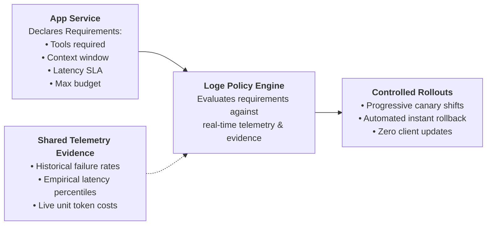

1. **Requests Declare Requirements (Not Models)**:
   - Instead of choosing a specific model name, applications specify their constraints: required API contract, tool capabilities, context length threshold, latency ceiling, and maximum token cost.
2. **Model Changes as Controlled Rollouts**:
   - Model upgrades shift from high-risk big-bang migrations to continuous, progressive delivery (canary testing, traffic weighting, automated rollbacks if eval scores degrade).
3. **Usage Evidence Guides Routing**:
   - Empirical operational metrics (actual p95 latency, provider error rates, dollar costs) automatically adjust gateway routing tables without operator intervention.

---

## 💡 Key Takeaways
1. **Treat the LLM Gateway as Core Infrastructure**: Moving from prototype to production fails if individual teams manage API keys, SDKs, and error wrappers. Centralizing this into a Kubernetes-native gateway (`Loge`) restores operational sanity.
2. **Decouple Identity from Provider Keys**: Using Tailscale ACLs and Kubernetes ServiceAccounts allows the gateway to authenticate internal callers, attribute token costs, and manage quotas without ever distributing upstream provider API keys.
3. **Offer Three Tiers of Model Autonomy**: Product teams have varying needs; offering `explicit` (max control), `family aliases` (shared balance), and `auto` (max availability) prevents developer friction while enabling platform-wide optimizations.
4. **Beware Silent Cross-Model Failover**: Same-model retries are safe, but switching model providers during an active tool-calling loop can corrupt schema parsing. Cross-model fallback must remain an explicit opt-in policy.
5. **Observability Does Not Require Snooping**: Full visibility into token spend, latency anomalies, and upstream outages can be achieved via Prometheus and Langfuse without ever logging user prompts or model responses.

---

## 🔗 Related Notes & References
- [ContainerDays Singapore 2026](./ContainerDays%20Singapore%202026.md) — Conference master agenda and session tracking
- [Confessions of a Portal Assistant (Yashod Perera)](./Confessions%20of%20a%20Portal%20Assistant%20%28Yashod%20Perera%29.md) — Managing agent token spend via AI Gateways
- [Securing AI Coding Agents with Kubernetes Sandboxes (Ryan Djurovich)](./Securing%20AI%20Coding%20Agents%20with%20Kubernetes%20Sandboxes%20%28Ryan%20Djurovich%29.md) — The Agent Router & Source Gateway primitives
- [Taming Agent Sprawl - How We Scale Evals to Keep Up with Agents (Timothy Lin)](./Taming%20Agent%20Sprawl%20-%20How%20We%20Scale%20Evals%20to%20Keep%20Up%20with%20Agents%20%28Timothy%20Lin%29.md) — Scaling agent quality and managing token budgets
