# Securing AI Coding Agents with Kubernetes Sandboxes

> **Speaker**: Ryan Djurovich (Founder & Engineer @ [Nadrama.com](https://nadrama.com) · Maintainer of upstream `agent-sandbox`)  
> **Event**: [ContainerDays Singapore 2026](./ContainerDays%20Singapore%202026.md) (AI Context Track)  
> **Date & Time**: Tuesday, October 27, 2026 · 10:15 AM – 10:50 AM SGT  
> **Stage**: AIC Theatre  
> **Core Topics**: Upstream Kubernetes `Sandbox` CRD · Ephemeral Agent Isolation · Claude Code & Codex in K8s · Credential Injection  
> **Vault Connections**: [Confessions of a Portal Assistant (Yashod Perera)](./Confessions%20of%20a%20Portal%20Assistant%20%28Yashod%20Perera%29.md) • *AI Agent Engineering* • *Designing Agent Fleets* • *OpenClaw, Cowork and Claude Code Compared* • *The Road Under the Harness (Ng Shangru)*

---

## ⚡ TL;DR (Key Takeaways in 60 Seconds)

- **The Problem**: Traditional Kubernetes workloads (`Deployments`, `StatefulSets`) are ill-suited for AI coding agents (Claude Code, Pi, OpenHands). Agents execute untrusted arbitrary code, require rapid ephemeral boot/teardown, and cannot be trusted with upstream API keys.
- **Kubernetes Sandbox CRD (`agents.x-k8s.io/v1beta1`)**: Upstream sub-project defining single-pod execution environments with explicit suspension states, hard shutdown deadlines, and gVisor/runc isolation boundaries.
- **In-Sandbox Supervision with `nono`**: Combines Linux **Landlock LSM** to restrict filesystem access to the project directory with ephemeral **SPIFFE workload identities** (`spiffe://.../ns/workshop/sa/pi`).
- **Secret Decoupling via Sidecar Egress**: Neither upstream LLM provider keys (Anthropic, OpenAI) nor GitHub tokens ever enter the sandbox container. All egress traffic passes through a local Envoy sidecar to external AI & Git gateways.
- **Production Pattern**: The agent has full autonomy within its Landlock-bounded workspace, while network and filesystem exfiltration paths remain cryptographically sealed.

---

## 📸 Stage & Slides

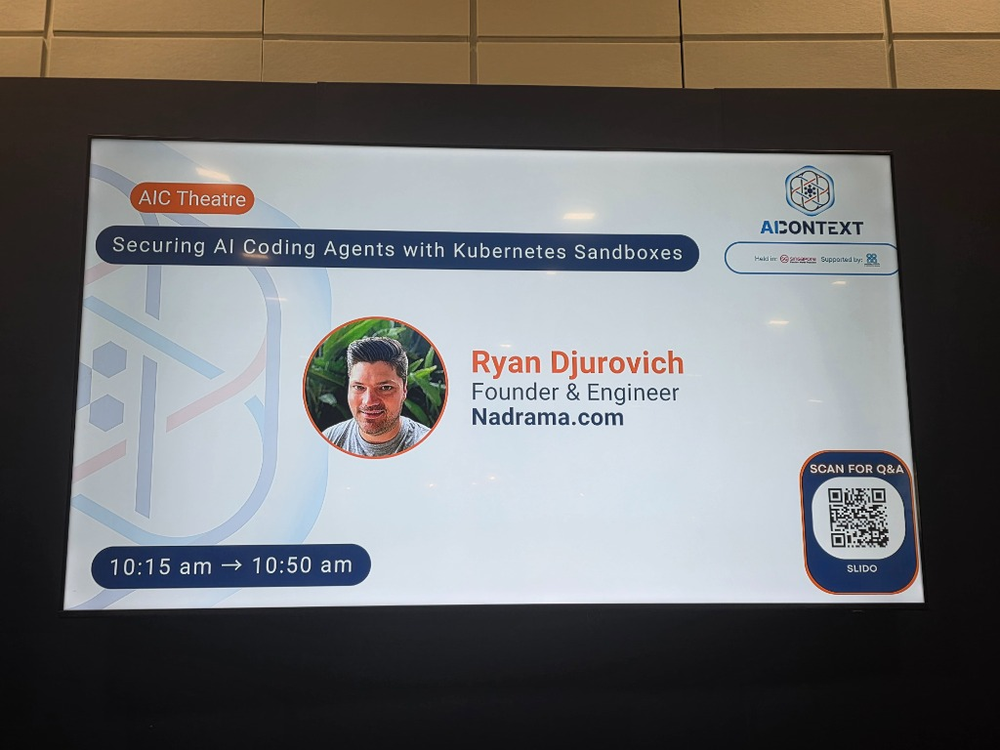

> **Kickoff Slide (~10:11 SGT)**: *Securing AI Coding Agents with Kubernetes Sandboxes* presented by Ryan Djurovich (Founder & Engineer @ Nadrama.com) at AIC Theatre. Includes Slido Q&A QR code.

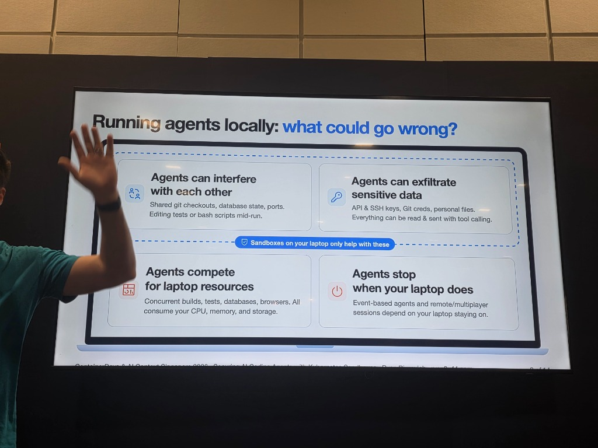

> **Failure Modes (~10:15 SGT)**: *Running agents locally: what could go wrong?* — The 4 core failure vectors of running coding agents on developer laptops, and the limits of local sandboxing.

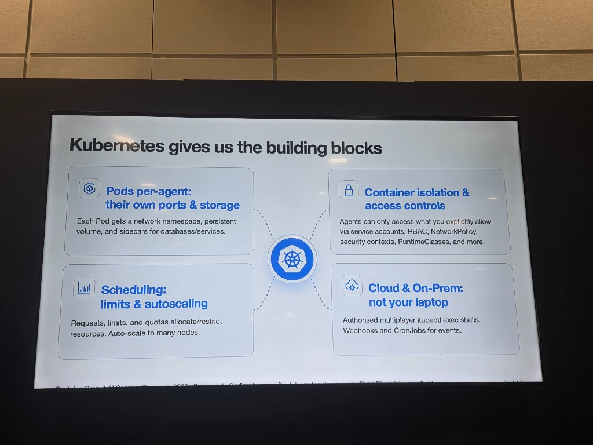

> **Kubernetes Primitives (~10:18 SGT)**: *Kubernetes gives us the building blocks* — Pod-per-agent network namespaces, container isolation & RBAC, node autoscaling quotas, and cloud/on-prem remote execution.

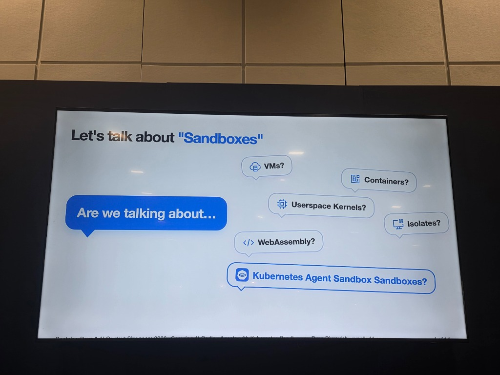

> **Taxonomy (~10:20 SGT)**: *Let's talk about "Sandboxes"* — Mapping what the industry means by sandbox: VMs, Containers, Userspace Kernels, V8 Isolates, Wasm, vs upstream *Kubernetes Agent Sandbox Sandboxes*.

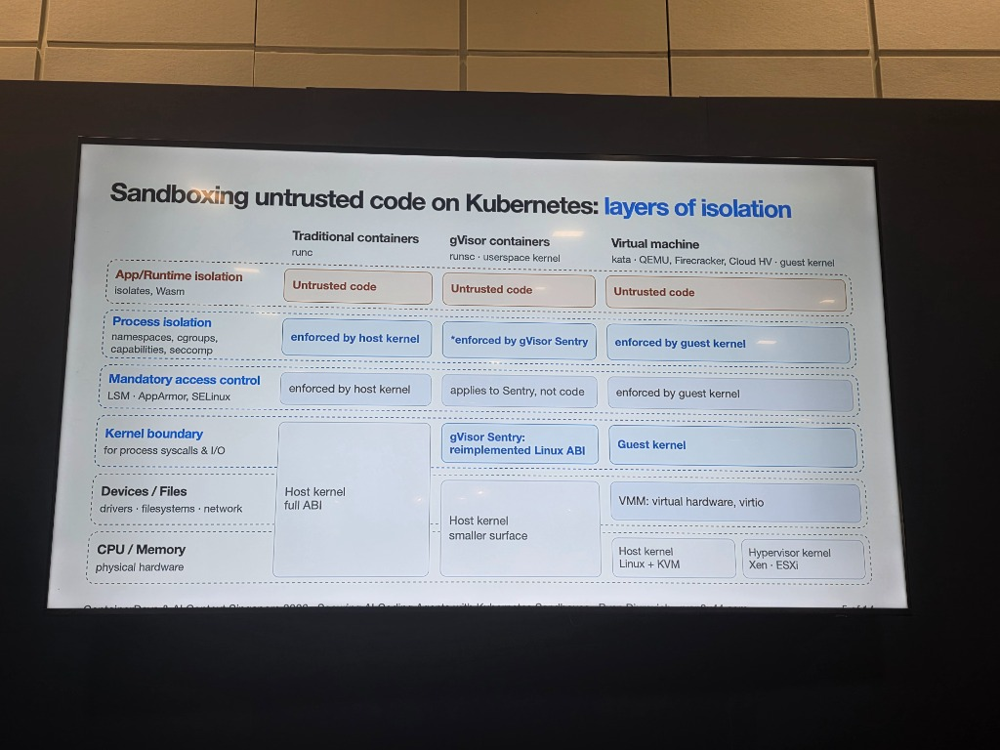

> **Architecture Matrix (~10:21 SGT)**: *Sandboxing untrusted code on Kubernetes: layers of isolation* — Deep stack comparison between Traditional Containers (`runc`), gVisor Containers (`runsc` userspace kernel), and Virtual Machines (`kata` / QEMU / Firecracker / Cloud Hypervisor).

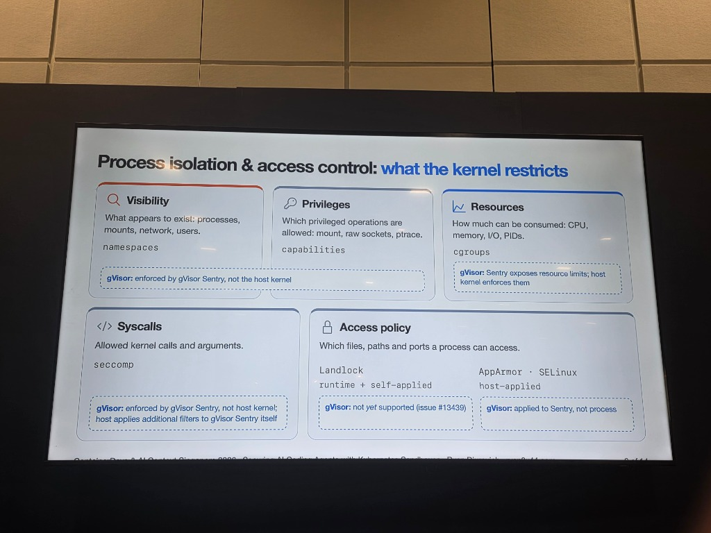

> **Kernel Primitives (~10:24 SGT)**: *Process isolation & access control: what the kernel restricts* — Breakdown of the 5 Linux kernel primitives (Namespaces, Capabilities, cgroups, Seccomp, Landlock/AppArmor) and how gVisor intercepts or enforces each.

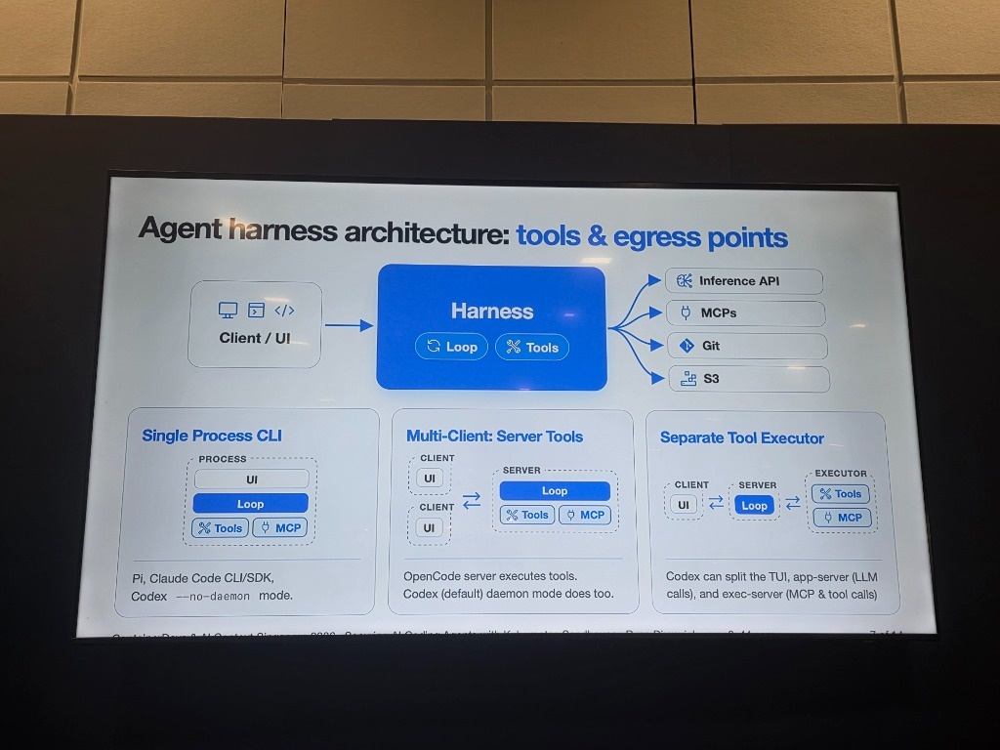

> **Harness Topologies (~10:27 SGT)**: *Agent harness architecture: tools & egress points* — Comparing Single Process CLI (Claude Code/Pi), Multi-Client Server Tools (OpenCode), and Separate Tool Executor (Codex split architecture).

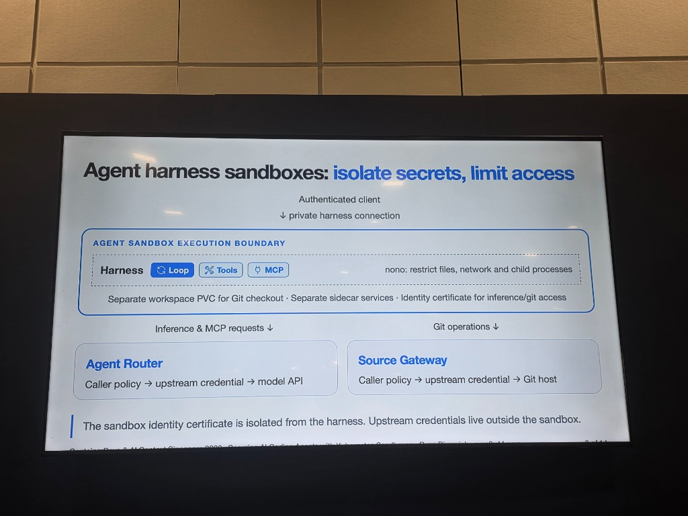

> **Secret Isolation Architecture (~10:33 SGT)**: *Agent harness sandboxes: isolate secrets, limit access* — The sandbox execution boundary (`nono`), isolated identity certificates, and externalizing credentials to the **Agent Router** (LLM gateway) and **Source Gateway** (Git gateway).

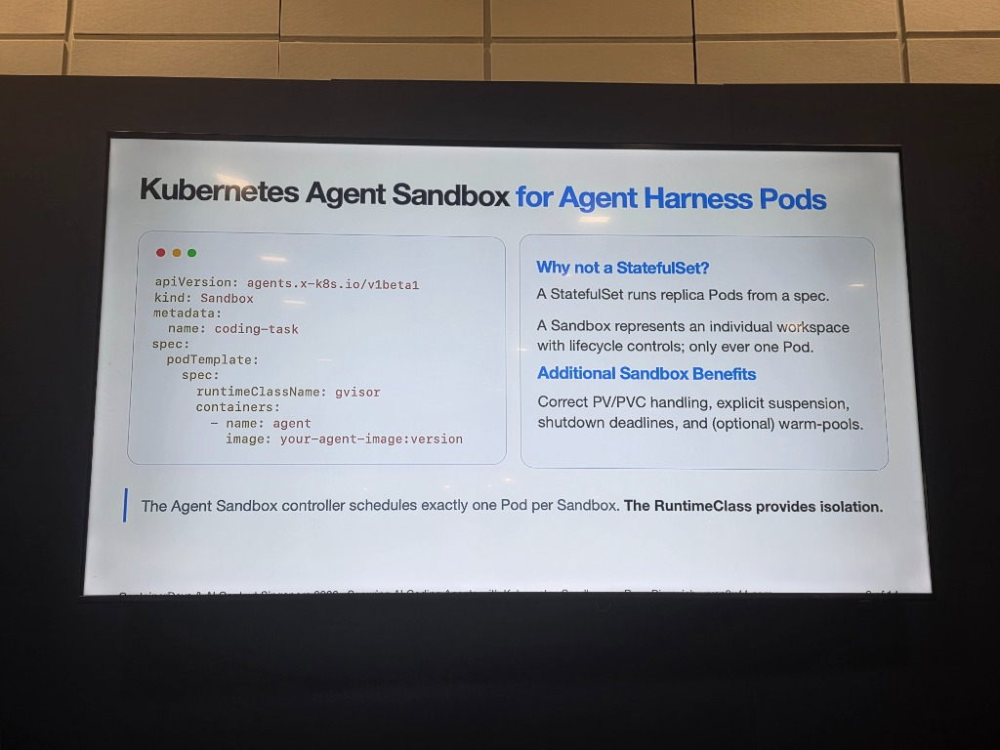

> **Kubernetes Sandbox CRD (~10:35 SGT)**: *Kubernetes Agent Sandbox for Agent Harness Pods* — The upstream `agents.x-k8s.io/v1beta1` Sandbox manifest with `runtimeClassName: gvisor`, lifecycle controls, and why StatefulSets fail.

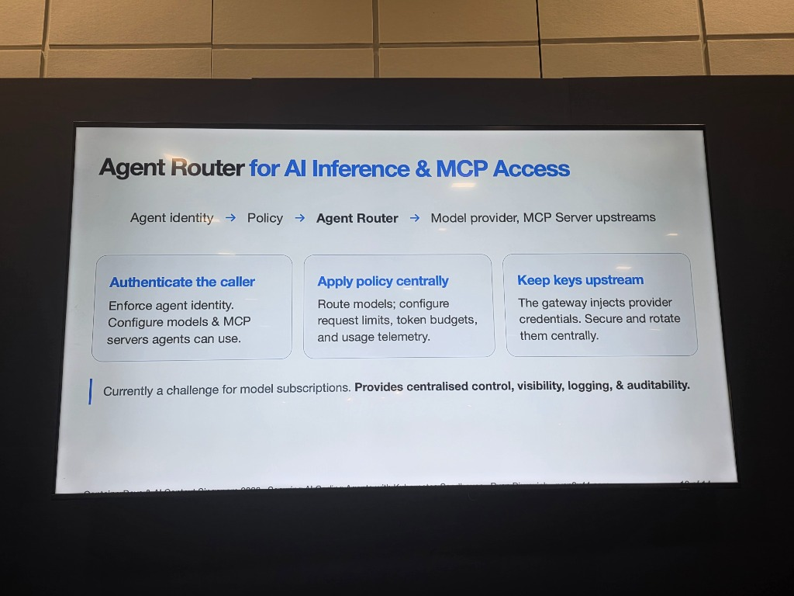

> **AI Gateway & MCP Routing (~10:37 SGT)**: *Agent Router for AI Inference & MCP Access* — Centralizing caller authentication, dynamic model routing, token budgets, and upstream credential injection.

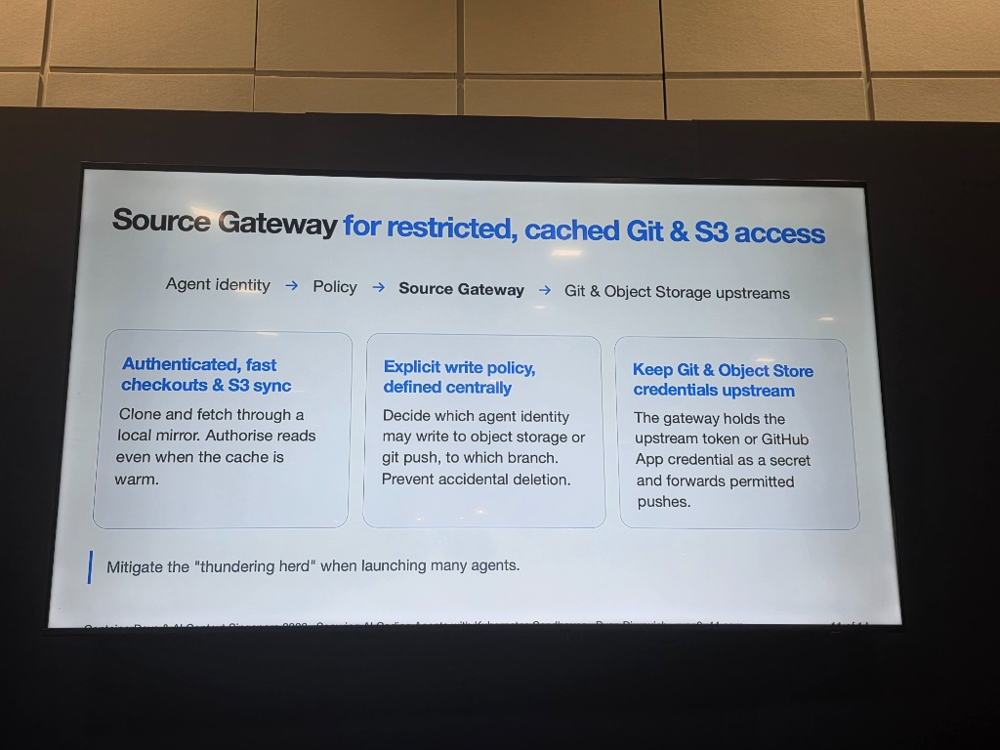

> **Git & Storage Gateway (~10:40 SGT)**: *Source Gateway for restricted, cached Git & S3 access* — Local git mirror cache to eliminate the thundering herd, branch-level write policies, and keeping GitHub App credentials upstream.

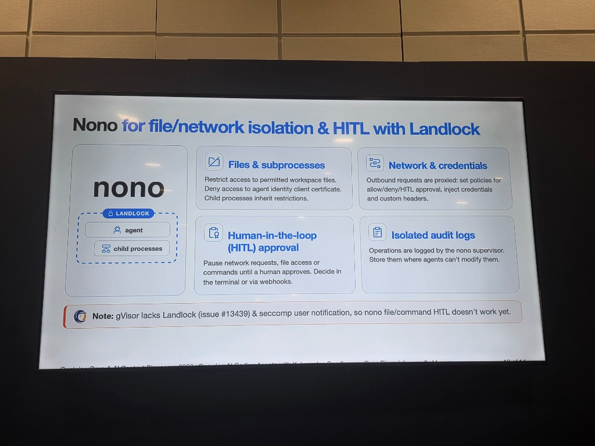

> **In-Sandbox Supervisor (~10:41 SGT)**: *Nono for file/network isolation & HITL with Landlock* — Using Linux Landlock to confine agent filesystem paths, proxy outbound requests, enforce human-in-the-loop approvals, and capture tamper-proof audit logs.

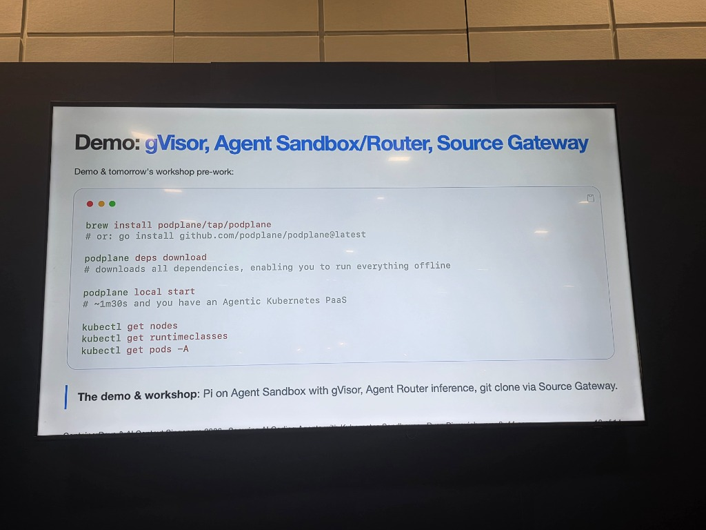

> **Live Demo & CLI (~10:43 SGT)**: *Demo: gVisor, Agent Sandbox/Router, Source Gateway* — Launching an Agentic Kubernetes PaaS in ~90 seconds with `podplane`, running the Pi coding agent with gVisor and gateway proxies.

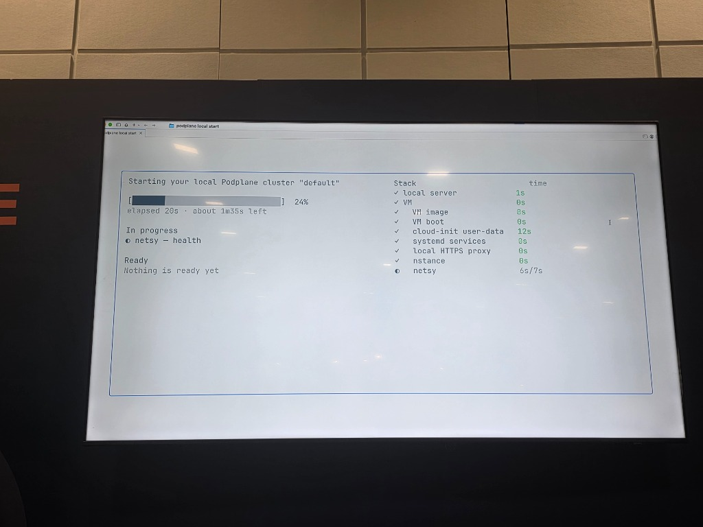

> **Live Terminal Execution (~10:44 SGT)**: *Starting your local Podplane cluster "default"* — Live terminal screencast showing VM provisioning, cloud-init user-data injection, local HTTPS proxy setup, and `netsy` network verification.

---

## 📝 Live Notes & Raw Thoughts

### 💻 Running Agents Locally: What Could Go Wrong?
> *"Sandboxes on your laptop only solve half the problem."*

Ryan breaks down the risks of developer workstation agent execution into two tiers:

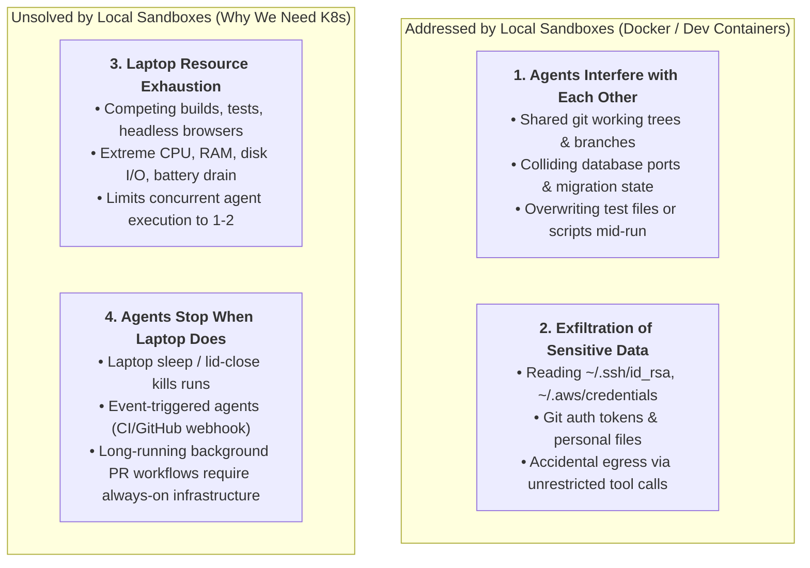

| Failure Mode | Problem Details | Can Local Sandboxes Fix It? |
| :--- | :--- | :--- |
| **Interference & Port Collisions** | Port binding conflicts (`EADDRINUSE`) when 2+ agents attempt to bind `:3000`, `:8080`, or `:5432`; dirty git trees; DB migration locks. | **Yes** (if containerized with network namespaces) |
| **Data Exfiltration** | Prompt injection / malicious tools reading local SSH keys, AWS credentials, personal files. | **Yes** (mount-point restrictions) |
| **Resource Contention** | Competing npm builds, docker-in-docker, unit tests consuming laptop CPU/RAM. | ❌ **No** (laptop hardware bottleneck) |
| **Execution Termination** | Agents die when laptop sleeps or disconnects; cannot run 24/7 background webhooks. | ❌ **No** (requires remote cluster) |

> 📌 **Audience Observation (Port Binding)**:  
> *Port binding becomes an immediate blocker the moment you run 2 or more agents on the same machine.* Both agents attempt to launch local dev servers, run integration tests against a mock API, or spin up PostgreSQL containers on default ports (`3000`, `8080`, `5432`). Without per-agent network namespace isolation (provided by Kubernetes Pods or dedicated network sandboxes), one agent's test suite inevitably crashes the other with `bind: address already in use`.

### 🧱 Kubernetes as the Primitive Layer: The 4 Core Building Blocks
Kubernetes provides four fundamental architectural primitives that solve the local agent bottleneck:

1. **Pods Per-Agent (Isolated Ports & Storage)**:
   - Each Pod allocates its own distinct **network namespace (`netns`)**, loopback interface, and IP address. Two agents can simultaneously bind `:3000` or `:5432` with zero conflict.
   - Dedicated Persistent Volumes (PVs) or ephemeral volumes per agent.
   - Sidecar containers can host dedicated per-agent databases (PostgreSQL, Redis) and test services.
2. **Container Isolation & Access Controls**:
   - Least privilege by default: **RBAC**, `NetworkPolicy` (restricting egress to LLM proxies and git remotes only), and fine-grained `SecurityContexts`.
   - **`RuntimeClasses`**: Sandboxed runtimes (gVisor / Kata / microVMs) to prevent container breakout when executing untrusted AI-generated code.
3. **Scheduling, Limits & Autoscaling**:
   - Explicit resource `requests` and `limits` (CPU, memory, storage quotas) per sandbox.
   - Cluster Autoscaler scales worker nodes up when developers spin up agent swarms, and down to zero when idle.
4. **Cloud & On-Prem (Off the Laptop)**:
   - Authorized multiplayer access via `kubectl exec` shells for human-in-the-loop debugging.
   - Webhooks, CI events, and CronJobs trigger agents asynchronously—persisting across laptop sleep and network disconnects.

---

### 📦 The "Sandbox" Taxonomy: What Are We Actually Talking About?
The term *"Sandbox"* is heavily overloaded across the AI industry. Ryan maps out the six common isolation models:

| Isolation Technology | Mechanism | Cold Start | Isolation Boundary | Tradeoff for Coding Agents |
| :--- | :--- | :--- | :--- | :--- |
| **VMs (microVMs)** | Hypervisor (KVM, Firecracker, Cloud Hypervisor) | ~100–500ms | Hardware virtualization / separate guest kernel | High isolation, but heavier resource overhead per agent. |
| **Containers** | Linux cgroups, namespaces, seccomp | ~1–2s | Shared host kernel | Fast, native Docker tooling, but risk of kernel privilege escalation. |
| **Userspace Kernels** | gVisor (`runsc`), Sentry intercepting syscalls | ~50–150ms | Emulated kernel in userspace | Strong security boundary with container-like density; small syscall overhead. |
| **Isolates** | V8 engine memory heaps (Cloudflare Workers) | <5ms | JavaScript runtime memory boundary | Sub-millisecond startup, but cannot run arbitrary CLI binaries or bash. |
| **WebAssembly** | Wasm bytecode + WASI capability model | <1ms | WASI runtime sandbox | Default-deny, portable, but requires compiling tools to Wasm target. |
| **Kubernetes Agent Sandbox** | Upstream `agent-sandbox` CRD & Controller | Fast (WarmPool) | Pod + RuntimeClass (gVisor/Kata) + NetworkPolicy | **The sweet spot**: Native K8s orchestrator + pluggable runtime security + developer tool compatibility. |

### 🛡️ Deep Dive: Layers of Isolation on Kubernetes
> *"Where does the isolation boundary physically sit when an agent executes untrusted code?"*

Ryan compares the entire vertical execution stack across three Kubernetes runtime architectures:

```mermaid
flowchart TD
    subgraph Traditional["1. Traditional Containers (runc)"]
        T_Code["Untrusted Agent Code"]
        T_Proc["Process Isolation (Host Kernel)"]
        T_MAC["AppArmor / SELinux (Host Kernel)"]
        T_Kern["<b>Full Host Kernel ABI</b><br/><i>(Direct attack surface to 300+ syscalls)</i>"]
        T_HW["Host Hardware & Drivers"]
        T_Code --> T_Proc --> T_MAC --> T_Kern --> T_HW
    end

    subgraph gVisor["2. Userspace Kernel (gVisor / runsc)"]
        G_Code["Untrusted Agent Code"]
        G_Proc["Process Isolation (gVisor Sentry)"]
        G_MAC["MAC applies to Sentry, not code"]
        G_Kern["<b>gVisor Sentry (Userspace Linux ABI)</b><br/><i>(Intercepts & handles syscalls in Go)</i>"]
        G_Host["Host Kernel (Dramatically smaller attack surface)"]
        G_HW["Host Hardware"]
        G_Code --> G_Proc --> G_MAC --> G_Kern --> G_Host --> G_HW
    end

    subgraph VM["3. Virtual Machine (Kata / Firecracker)"]
        V_Code["Untrusted Agent Code"]
        V_Proc["Process Isolation (Guest Kernel)"]
        V_MAC["MAC (Guest Kernel)"]
        V_Kern["<b>Dedicated Guest Kernel</b>"]
        V_VMM["VMM: Virtual Hardware & virtio"]
        V_KVM["Host KVM / Hypervisor"]
        V_HW["Physical Hardware"]
        V_Code --> V_Proc --> V_MAC --> V_Kern --> V_VMM --> V_KVM --> V_HW
    end
```

| Layer | Traditional Containers (`runc`) | gVisor Containers (`runsc`) | Virtual Machines (`kata` / Firecracker) |
| :--- | :--- | :--- | :--- |
| **Untrusted Code** | Coding agent shell / test runs | Coding agent shell / test runs | Coding agent shell / test runs |
| **Process Isolation** | Enforced by **Host Kernel** | Enforced by **gVisor Sentry** | Enforced by **Guest Kernel** |
| **Mandatory Access Control (LSM)** | Enforced by Host Kernel | Applies to Sentry itself, not code | Enforced by Guest Kernel |
| **Kernel Boundary (Syscalls)** | ⚠️ **Host kernel full ABI** (direct exposure) | 🛡️ **Reimplemented Linux ABI** in userspace | 🛡️ **Isolated Guest Kernel** |
| **Devices & Files** | Host kernel full ABI | Host kernel smaller surface (Gofer) | VMM: virtual hardware (`virtio`) |
| **CPU & Memory** | Host physical hardware | Host kernel smaller surface | Host kernel Linux + KVM / Hypervisor |

---

### ⚙️ Process Isolation & Access Control: What the Kernel Restricts
Ryan details the 5 foundational Linux kernel primitives used to constrain untrusted code, and how gVisor handles each:

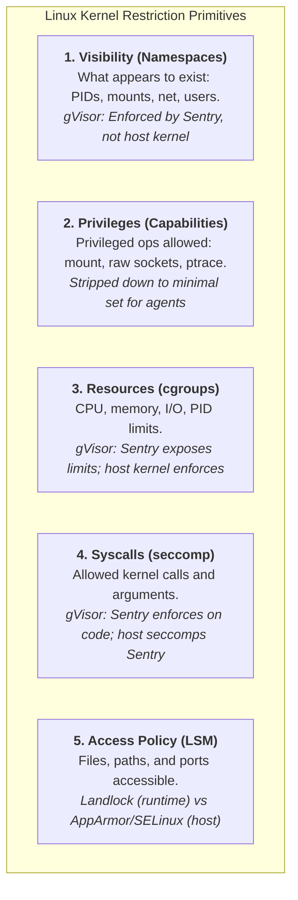

| Security Dimension | Kernel Mechanism | What It Restricts | How gVisor (`runsc`) Enforces It |
| :--- | :--- | :--- | :--- |
| **Visibility** | `namespaces` | Processes, mount points, network interfaces, users | **Enforced by gVisor Sentry** in userspace; host namespaces are isolated from untrusted code. |
| **Privileges** | `capabilities` | Dangerous ops: `mount`, raw sockets, `ptrace`, `CAP_SYS_ADMIN` | Agent runs with unprivileged capabilities; Sentry denies dangerous capability calls. |
| **Resources** | `cgroups` | Maximum CPU, memory, disk I/O, and max PIDs | Sentry exposes resource limits to guest processes; **Host kernel enforces physical limits**. |
| **Syscalls** | `seccomp` | Restricts allowed system calls and arguments | **Two-Tier Filter**: Sentry filters syscalls from agent code in userspace; Host kernel applies strict seccomp filters to the Sentry process itself! |
| **Access Policy** | `Landlock` & `AppArmor` / `SELinux` | Path, file, and port access controls | • **Landlock**: Runtime + self-applied (*gVisor: not yet supported, issue #13439*)<br>• **AppArmor / SELinux**: Host-applied LSM (*gVisor: applied to Sentry process, not inner code*) |

---

### 🏗️ Agent Harness Architecture: Tools & Egress Topologies
> *"How an agent harness is structured dictates where you can physically draw the sandbox boundary."*

Coding agent harnesses require outbound communication across four distinct egress vectors:
1. **Inference APIs**: Calling LLM providers (Anthropic, OpenAI, Google) with API tokens.
2. **MCP Servers**: Communicating with Model Context Protocol servers (filesystems, databases, observability).
3. **Git Remotes**: Cloning repositories, fetching branches, pushing commits and opening pull requests.
4. **S3 / Blob Storage**: Uploading build artifacts, trace logs, and diff bundles.

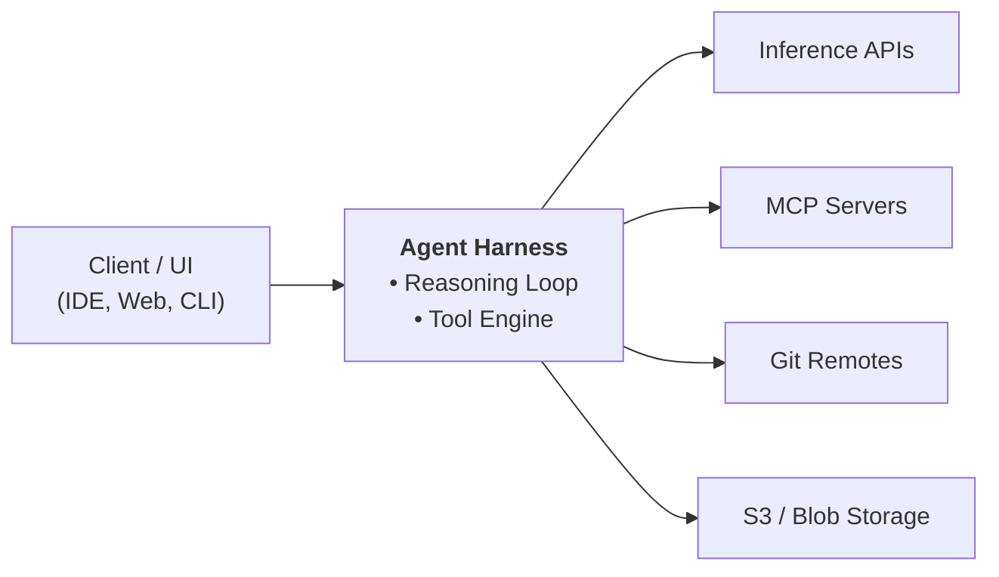

#### The 3 Harness Process Patterns & Their Sandboxing Implications

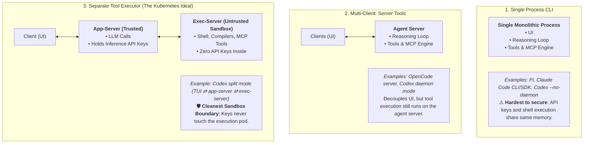

| Harness Topology | Process Layout | Real-World Examples | Security & Sandboxing Impact |
| :--- | :--- | :--- | :--- |
| **1. Single Process CLI** | `[UI + Loop + Tools + MCP]` in 1 binary | `Pi`, `Claude Code CLI/SDK`, `Codex --no-daemon` | **Monolithic**: Entire sandbox must be trusted, or credential proxying must intercept network calls from outside. |
| **2. Multi-Client: Server Tools** | `Client (UI)` ⇄ `Server [Loop + Tools + MCP]` | `OpenCode server`, `Codex daemon mode` | Offloads compute from developer laptop, but server pod still holds secrets while executing arbitrary agent code. |
| **3. Separate Tool Executor** | `Client (UI)` ⇄ `Server [Loop]` ⇄ `Executor [Tools]` | `Codex split mode` (TUI ⇄ app-server ⇄ exec-server) | **The Gold Standard**: The `app-server` holds LLM credentials in a secure zone, while the `exec-server` runs inside an ephemeral, disposable gVisor/Kata sandbox with zero credentials to exfiltrate! |

---

### 🔐 Secret Isolation Architecture: Agent Router & Source Gateway
> 💡 **The Core Maxim**:  
> *"The sandbox identity certificate is isolated from the harness. Upstream credentials live outside the sandbox."*

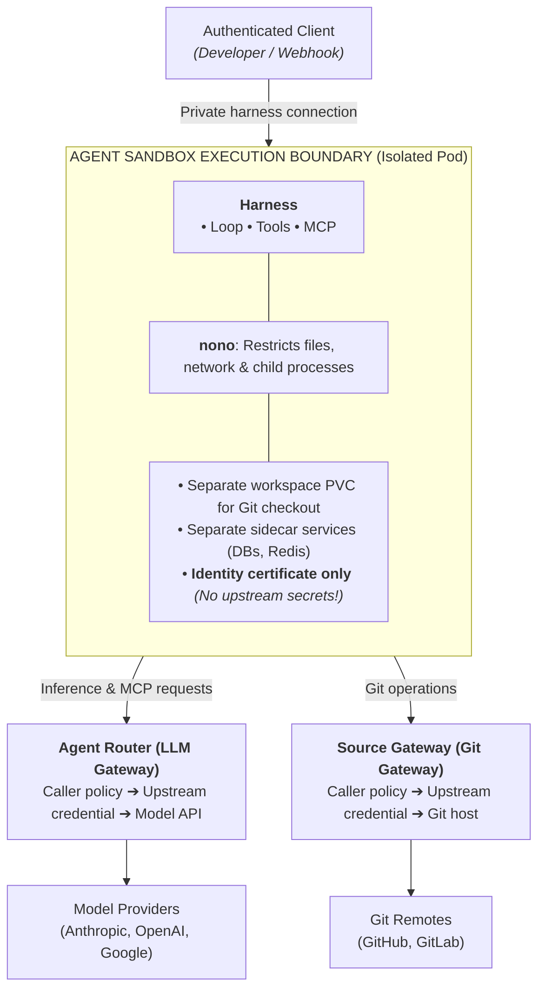

#### The Two Upstream Gateways

| Component | Responsibility | Why It Keeps the Sandbox Safe |
| :--- | :--- | :--- |
| **Agent Router** *(LLM & MCP Gateway)* | Evaluates caller identity certificate ➔ verifies token budget & policy ➔ injects upstream provider API key ➔ invokes LLM API. | The agent never sees or stores raw `ANTHROPIC_API_KEY` or `OPENAI_API_KEY`. Malicious dependencies or prompt injections have zero secrets to exfiltrate. |
| **Source Gateway** *(Git Gateway)* | Evaluates caller policy ➔ injects short-lived repository credentials ➔ communicates with GitHub/GitLab. | Raw Personal Access Tokens (PATs) and SSH private keys are never mounted into the workspace volume. |
| **`nono` Restriction Layer** | Restricts local filesystem access, network interfaces, and unauthorized child process spawns inside the harness. | Defense-in-depth: prevents compromised tools from scanning internal pod memory or mounting sensitive root paths. |

---

### 🎯 The Core Problem: Why StatefulSets & Deployments Fail for Coding Agents
- **Long-Running vs Ephemeral**: Standard Kubernetes workloads assume long-running, stable replicas. Coding agents (Claude Code, Codex, Open Code) are bursting, highly stateful during a turn, but entirely disposable once a PR is opened or an issue is closed.
- **The Blast Radius Threat**: Coding agents run arbitrary `eval`, execute shell commands, clone repos, install npm/pip packages, and run local test suites.
- **The Leaked Secret Trap**: If agents run directly on developer workstations or long-lived shared pods, SSH keys, cloud provider tokens, and LLM API keys can be exfiltrated via prompt injection or malicious dependencies.

### 🧩 Upstream Kubernetes `Sandbox` CRD (`agents.x-k8s.io/v1beta1`)
> *"The Agent Sandbox controller schedules exactly one Pod per Sandbox. The RuntimeClass provides isolation."*

#### The Custom Resource Definition (CRD) Manifest

```yaml
apiVersion: agents.x-k8s.io/v1beta1
kind: Sandbox
metadata:
  name: coding-task
spec:
  podTemplate:
    spec:
      runtimeClassName: gvisor
      containers:
        - name: agent
          image: your-agent-image:version
```

#### Why Not a StatefulSet?

| Architecture Concern | `StatefulSet` | Upstream `Sandbox` CRD (`agent-sandbox`) |
| :--- | :--- | :--- |
| **Workload Concept** | Runs identical, numbered replica Pods (`pod-0`, `pod-1`) from a shared template. | Represents an **individual, distinct workspace** for a single agent session; **only ever schedules exactly one Pod**. |
| **Volume Lifecycle** | Volume Claim Templates create sticky PVs that linger after scaling down. | **Correct PV/PVC lifecycle**: Ephemeral or persistent volumes tied specifically to the lifetime of the coding task. |
| **Lifecycle Controls** | Only scale replicas up/down; cannot pause without killing. | **Explicit Suspension**: Can freeze/hibernate an agent workspace mid-run while waiting for user approval or async webhooks. |
| **Runaway Protection** | No built-in shutdown timeout; pods run indefinitely. | **Shutdown Deadlines**: Hard time-to-live (TTL) deadlines to prevent runaway loops from burning cloud compute. |
| **Cold Start Mitigation** | Requires keeping expensive replicas running idle. | **Optional Warm-Pools (`SandboxWarmPool`)**: Pre-warms isolated pods with pre-pulled images and initialized runtimes for instant startup. |
| **Kernel Isolation** | Defaults to `runc` (shared host kernel). | Declarative **`runtimeClassName: gvisor`** (or Kata) provides strong kernel isolation by default. |

---

### 🌐 Deep Dive: Agent Router for AI Inference & MCP Access
> *"Agent identity ➔ Policy ➔ Agent Router ➔ Model provider & MCP Server upstreams"*

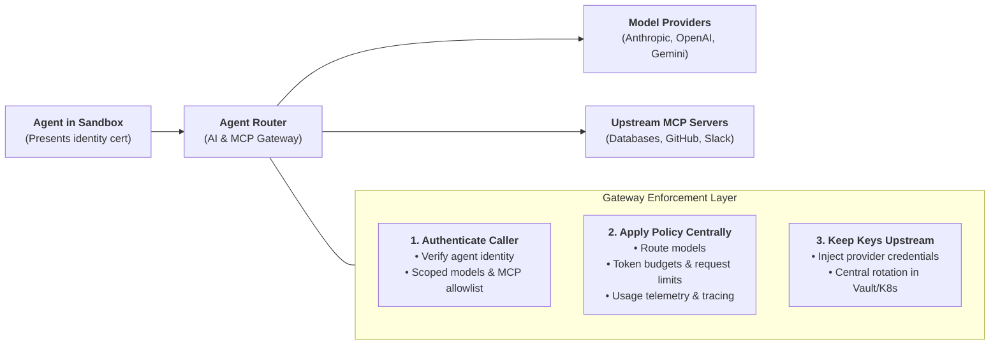

#### The Three Architectural Pillars

1. **Authenticate the Caller**:
   - Enforces cryptographic agent identity (mTLS x509 cert issued by SPIRE or Kubernetes ServiceAccount).
   - Strict capability scoping: declares exactly which LLM models and which MCP tool servers this specific agent identity is authorized to invoke.
2. **Apply Policy Centrally**:
   - **Dynamic Model Routing**: Intelligently routes tasks between models based on task tier, cost, or availability.
   - **Token Budgets & Circuit Breakers**: Caps max tokens per task/session to prevent financial drain from runaway retry loops.
   - **Full Audit Telemetry**: Captures prompt tokens, completion tokens, latency, and tool calls in a central observability store.
3. **Keep Keys Upstream**:
   - Upstream API keys (`ANTHROPIC_API_KEY`, `OPENAI_API_KEY`) live exclusively in the gateway.
   - Credentials can be rotated instantly across all running agents with zero pod restarts.
4. **⚠️ The Current Industry Frontier (Model Subscriptions)**:
   - Ryan notes: *"Currently a challenge for model subscriptions."*
   - Enterprise gateways excel at proxying token-based API usage, but integrating with per-user seat subscriptions (Claude Team, ChatGPT Enterprise accounts) remains an active industry challenge for automated agent fleets.

---

### 📦 Deep Dive: Source Gateway for Restricted, Cached Git & S3 Access
> *"Agent identity ➔ Policy ➔ Source Gateway ➔ Git & Object Storage upstreams"*

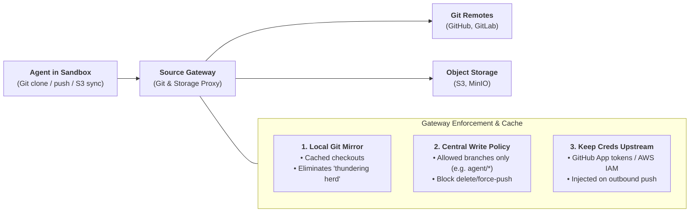

#### The Three Core Pillars

1. **Authenticated, Fast Checkouts & S3 Sync (Solving the "Thundering Herd")**:
   - When an orchestrator kicks off 20–50 parallel coding agents, simultaneous full `git clone` operations saturate cluster egress bandwidth and trigger GitHub secondary rate limits.
   - **Local In-Cluster Mirror**: The Source Gateway maintains an active, warm repository mirror on local NVMe/PVC. Agents clone locally in milliseconds.
   - Authorizes read permissions against the cache based on agent identity.
2. **Explicit Write Policy Defined Centrally (Branch Guardrails)**:
   - Evaluates agent identity before allowing any `git push` or S3 write:
     - Permitted to push only to dedicated feature/patch branches (e.g. `refs/heads/agent/<task-id>`).
     - Hard blocks against pushes to protected branches (`main`, `staging`) or branch deletions (`git push origin --delete`).
3. **Keep Git & Object Store Credentials Upstream**:
   - Raw GitHub App private keys, OAuth tokens, and AWS S3 secret keys reside **exclusively in the Source Gateway**.
   - Permitted pushes have credentials injected at the gateway boundary. If an agent is compromised, the attacker cannot steal long-lived repository write keys.

---

### 🛡️ In-Sandbox Supervisor: "nono" with Linux Landlock & HITL
> *"Inside the pod, 'nono' acts as the local supervisor, using Linux Landlock to jail the agent and its subprocesses."*

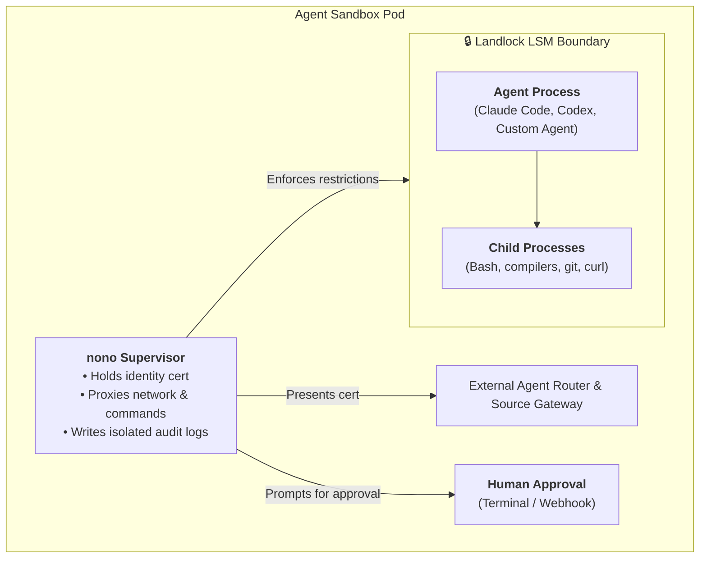

#### The Four Pillars of `nono`

1. **Files & Subprocesses (Landlock Confinement)**:
   - Restricts file access strictly to permitted workspace paths (e.g. `/workspace`).
   - **Hides the Agent Identity Certificate**: The mTLS client cert is mounted in the pod for `nono` to authenticate outbound requests, but Landlock strictly denies the agent process and its children read permissions to the cert file!
   - Child processes recursively inherit Landlock restrictions.
2. **Network & Credentials**:
   - Outbound network requests are intercepted and proxied.
   - Enforces allow/deny policies, and dynamically injects custom authentication headers before sending traffic to the Agent Router.
3. **Human-in-the-Loop (HITL) Approval**:
   - Can freeze network requests, file access, or shell commands mid-flight until a human explicitly grants permission.
   - Approvals can be resolved interactively in the terminal shell or routed via webhooks to an approval UI / Slack.
4. **Isolated, Tamper-Proof Audit Logs**:
   - All operations are captured by the `nono` supervisor process and written to an out-of-band log stream that the agent process cannot modify or wipe.

> ⚠️ **Runtime Compatibility Note**:  
> *gVisor currently lacks Linux Landlock support (tracked in upstream issue [#13439](https://github.com/google/gvisor/issues/13439)) and lacks seccomp user notifications.* Therefore, file and command-level HITL via `nono` currently runs on standard Linux kernels or VM-based runtimes (Kata Containers / Firecracker), while gVisor is used when kernel-level syscall mediation is the primary isolation requirement.

---

### 🚀 Hands-On & Demo: "podplane" Agentic Kubernetes PaaS
> *"In ~90 seconds, you have a complete Agentic Kubernetes PaaS ready on your machine."*

Ryan introduced **`podplane`** ([github.com/podplane/podplane](https://github.com/podplane/podplane)), a developer CLI designed to bootstrap an upstream Agent Sandbox environment locally or in cluster:

```bash
# 1. Install podplane CLI
brew install podplane/tap/podplane
# or via Go:
go install github.com/podplane/podplane@latest

# 2. Pre-fetch offline dependencies
podplane deps download
# Downloads all images, CRDs, and controllers to allow 100% offline runs

# 3. Spin up the local Agentic Kubernetes cluster (~1m30s)
podplane local start

# 4. Verify the agent cluster primitives
kubectl get nodes
kubectl get runtimeclasses
kubectl get pods -A
```

#### The Live Demo Stack & Terminal Execution
```text
Starting your local Podplane cluster "default"
[████████░░░░░░░░░░░░░░░░░░] 24%
elapsed 20s · about 1m35s left

In progress: ◐ netsy - health

Stack                        time
✓ local server               1s
✓ VM                         0s
  ✓ VM image                 0s
  ✓ VM boot                  0s
  ✓ cloud-init user-data     12s
  ✓ systemd services         0s
  ✓ local HTTPS proxy        0s
  ✓ instance                 0s
◐ netsy                      6s/7s
```

- **Stack Initialization Breakdown**:
  - `local server`: Local CLI daemon managing agent lifecycle.
  - `cloud-init user-data`: Boots local microVM/node and registers Kubernetes runtime classes (`gvisor`).
  - `local HTTPS proxy`: In-cluster proxy acting as the **Agent Router** and **Source Gateway** endpoint.
  - `netsy`: Network subsystem verifying pod network namespaces and egress policies (`netsy - health`).
- **Agent Harness**: Running **Pi** (coding agent).
- **Isolation Engine**: Running inside an upstream Kubernetes `Sandbox` backed by **gVisor** (`runtimeClassName: gvisor`).
- **Inference Egress**: Inference API calls route through the **Agent Router** (zero Anthropic/OpenAI keys stored inside the agent pod).
- **Git Operations**: Repo cloning routed through the **Source Gateway** local cache.
- **Workshop Connection**: This CLI and local setup serves as the pre-work for Ryan's hands-on session on **Day 2 (Wed 12:00 PM)**: **Build Your Own AI Coding Agent Platform on Kubernetes**.

---

## 💡 Key Takeaways & Architecture Summary

1. **Local Sandboxes Only Solve Half the Equation**:
   - Workstation-level sandboxing (Docker Desktop, Dev Containers) stops local file contamination and port conflicts, but cannot solve **resource exhaustion** (builds/compilers melting laptops) or **execution persistence** (agents dying when laptops sleep).
2. **The Upstream Kubernetes `Sandbox` CRD (`agents.x-k8s.io/v1beta1`)**:
   - **Why Not StatefulSets**: StatefulSets run replica pools from a shared spec. A `Sandbox` represents an individual, single-pod workspace with first-class lifecycle hooks: **explicit suspension** (pause mid-run for human input), **shutdown deadlines** (hard TTLs to stop runaway loops), and **`SandboxWarmPool`** for sub-second startup.
3. **Pluggable Kernel Defense via `RuntimeClass`**:
   - Untrusted agent code running in standard `runc` containers exposes the full ~300+ syscall host kernel ABI.
   - Declarative **`runtimeClassName: gvisor`** (or Kata/microVMs) places a memory-safe userspace kernel (Sentry) between the agent and host hardware, neutralizing container escapes.
4. **Dual Upstream Gateways: Zero Secrets Inside the Pod**:
   - *The Golden Maxim*: *"The sandbox identity certificate is isolated from the harness. Upstream credentials live outside the sandbox."*
   - **Agent Router (AI & MCP Gateway)**: Validates caller identity, manages token budgets/rate limits, routes models, and injects upstream LLM API keys on the fly.
   - **Source Gateway (Git & Storage Gateway)**: In-cluster Git mirror that solves the **"thundering herd"** (preventing 50 parallel agents from exhausting GitHub clone bandwidth) and enforces branch-level write policies (`refs/heads/agent/*` only).
5. **In-Pod Defense with `nono` (Linux Landlock)**:
   - Uses Landlock LSM inside the pod to confine agent filesystems and **hide the agent's own identity certificate** so it cannot be exfiltrated.
6. **Turnkey Developer Bootstrapping (`podplane`)**:
   - Running `podplane local start` provisions an entire local Agentic Kubernetes PaaS in ~90 seconds with gVisor and gateway proxies ready out-of-the-box.

---

## 🔗 Related Notes & References
- [ContainerDays Singapore 2026](./ContainerDays%20Singapore%202026.md) — Conference master agenda and session index
- [Confessions of a Portal Assistant (Yashod Perera)](./Confessions%20of%20a%20Portal%20Assistant%20%28Yashod%20Perera%29.md) — Prior session covering agent blast radius and Claude Code handoff
- *OpenClaw, Cowork and Claude Code Compared* — Comparing agent harness environments
