# Serve Your First LLM, Then Watch It Break at Scale (Mumshad Mannambeth)

> **Speaker**: **Mumshad Mannambeth** (Founder and CEO, **KodeKloud**)  
> **Event**: [ContainerDays Singapore 2026](ContainerDays%20Singapore%202026.md) (Day 2 · Workshop Track)  
> **Date & Time**: Wednesday, October 28, 2026 · Morning Workshop (~09:00 – 10:30 SGT)  
> **Stage / Room**: **Workshop Room**  
> **Title**: *"Serve Your First LLM, Then Watch It Break at Scale"*  
> **Lab Access**: [kode.wiki/container-days-sg](https://kode.wiki/container-days-sg)  
> **Core Themes**: LLM Serving Infrastructure · vLLM & Ollama vs Production Engines · GPU Memory Walls · KV Cache Exhaustion · Concurrency & PagedAttention · Continuous Batching Failures · Scaling LLMs on Kubernetes  
> **Vault Connections**:
> - [ContainerDays Singapore 2026](ContainerDays%20Singapore%202026.md)
> - [When Tokens Stop Being the Bottleneck - Operating Agentic Software Factories (Carl Ross)](When%20Tokens%20Stop%20Being%20the%20Bottleneck%20-%20Operating%20Agentic%20Software%20Factories%20(Carl%20Ross).md)
> - [Lessons from Operating an Internal LLM Gateway for Production Agentic Applications (Zhong Liang Ong & Yek Khan)](Lessons%20from%20Operating%20an%20Internal%20LLM%20Gateway%20for%20Production%20Agentic%20Applications%20(Zhong%20Liang%20Ong%20&%20Yek%20Khan).md)
> - [Enterprise Sovereign AI - Building with SUSE AI Factory](Enterprise%20Sovereign%20AI%20-%20Building%20with%20SUSE%20AI%20Factory.md)
> - [Governing the Agentic Stack on Kubernetes - MCP, A2A, and LLM Traffic (Robin Cher)](Governing%20the%20Agentic%20Stack%20on%20Kubernetes%20-%20MCP,%20A2A,%20and%20LLM%20Traffic%20(Robin%20Cher).md)

---

## ⚡ TL;DR (Key Takeaways in 60 Seconds)

- **The VRAM Reality Check**: A standard 8B parameter model (`Llama-3.1-8B.safetensors`) consumes ~16.1 GB VRAM just to load weights in FP16, completely filling a 16GB GPU (T4/V100) before a single token of KV cache is allocated.
- **The Computational Dichotomy**:
  - *Prefill ("The Pause")*: Compute-bound ($O(N^2)$ GEMM) processing all prompt tokens in parallel; generates KV cache.
  - *Decode*: Memory-bandwidth bound ($O(1)$ GEMV) generating 1 token at a time; repeatedly streams all weights from HBM.
- **The Stateless API Trap**: Conversational clients resend full message arrays every turn, causing quadratic compute waste and linear KV cache expansion.
- **Single-Node Collapse**: Under concurrency, single vLLM pods fail simultaneously from HTTP queue exhaustion, CUDA OOM crashes, and hardware memory bus saturation.
- **The KV Cache Routing Problem**: Standard Kubernetes round-robin `Service` load balancing routes multi-turn chat to random pods, causing 100% cache misses.
- **llm-d Solution**: Intelligent prefix-aware and session-sticky routing (`Sam -> pod-1`) preserves KV cache hits, slashing TTFT and hardware costs.

---

## 📸 Stage & Session Slides

### Workshop Kickoff & Setup
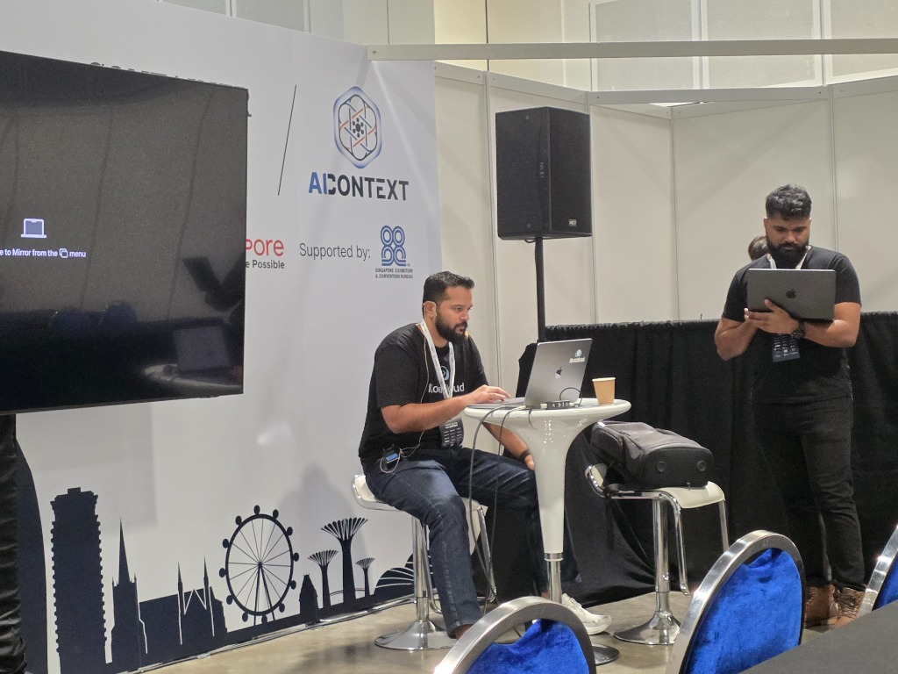
> **Workshop Environment Setup**: Pre-session prep in the AI Context Workshop Room at Suntec Singapore. Mumshad Mannambeth and KodeKloud team configuring the lab runner environments.


> **Opening Title Slide (00-cdw-title Slide 1/2)**: Mumshad Mannambeth introducing *"Serve Your First LLM, Then Watch It Break at Scale"* at ContainerDays Singapore 2026. Interactive lab environment accessed via `kode.wiki/container-days-sg`.

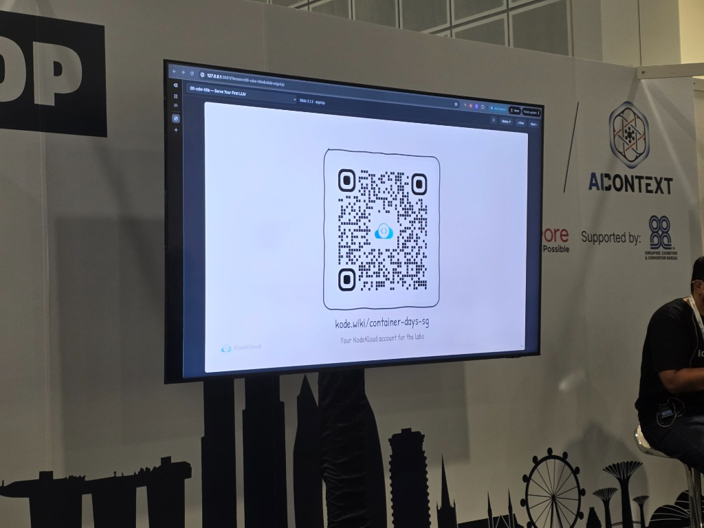
> **Lab Sign-Up QR Code (00-cdw-title Slide 2/2)**: Attendees scan the QR code linking to [kode.wiki/container-days-sg](https://kode.wiki/container-days-sg) to provision free KodeKloud hands-on GPU sandbox environments.

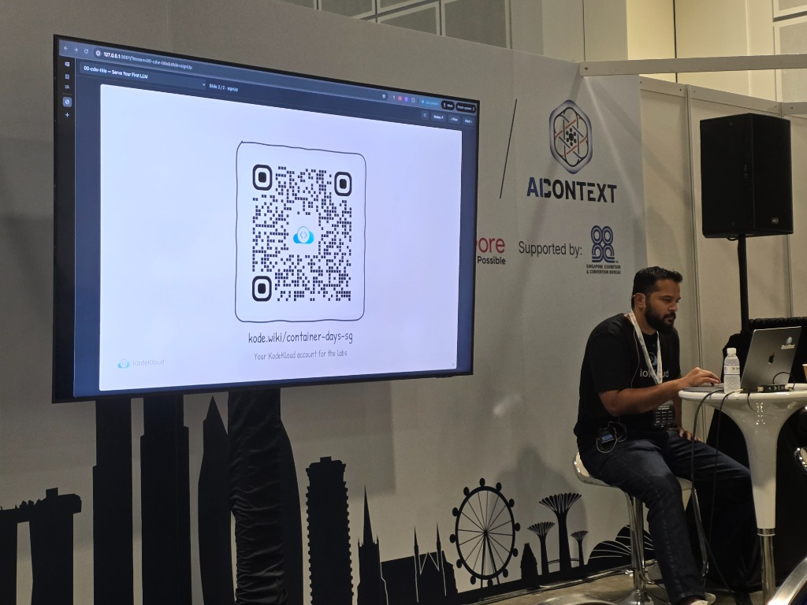
> **Lab Onboarding**: Mumshad guiding attendees through their cloud lab sign-up and initial container pod orchestration.

---

## 🧠 Model Weights Anatomy: The 16.1 GB Baseline

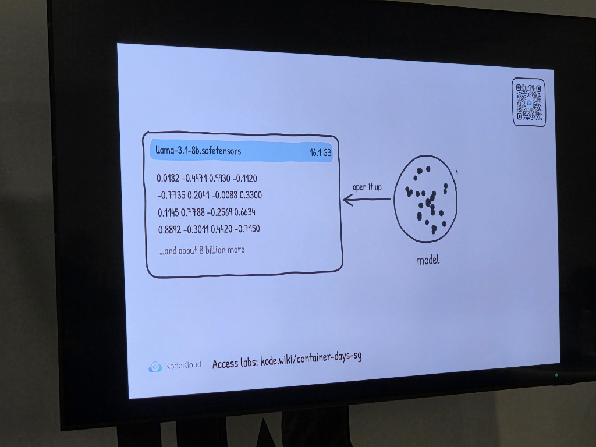

> **Slide Analysis**: Opening up `Llama-3.1-8b.safetensors` (16.1 GB). A model is fundamentally a giant dictionary of 8 billion floating-point weight tensors (`0.0182, -0.4471, 0.9930, -0.1120...` and about 8 billion more) stored on disk and loaded into GPU memory.

### The Storage & VRAM Math
To understand why LLMs break at scale, we must first calculate the baseline physical memory footprint of model weights alone:

$$
\text{Weight Footprint} = \text{Parameters} \times \text{Bytes per Parameter}
$$

For `Llama-3.1-8B`:
- **Parameter count**: $\approx 8.03 \times 10^9$ parameters.
- **Precision**: 16-bit floating point (`float16` or `bfloat16`), requiring **2 bytes** per parameter.
- **Baseline Weight Memory**:
  $$8.03 \times 10^9 \times 2\text{ bytes} \approx 16.06\text{ GB} \approx 16.1\text{ GB}$$

> [!WARNING]
> **The 16GB GPU Cliff**: A standard commodity cloud GPU with 16 GB VRAM (such as an NVIDIA T4 or V100-16GB) is completely saturated just by loading `Llama-3.1-8B` into memory. It leaves **0 GB** for:
> 1. CUDA runtime & context overhead (~1 to 2 GB).
> 2. Activation memory during forward passes.
> 3. The **Key-Value (KV) Cache** required for token generation!

---

## 📏 The Parameter & Memory Spectrum: From 1B to 671B

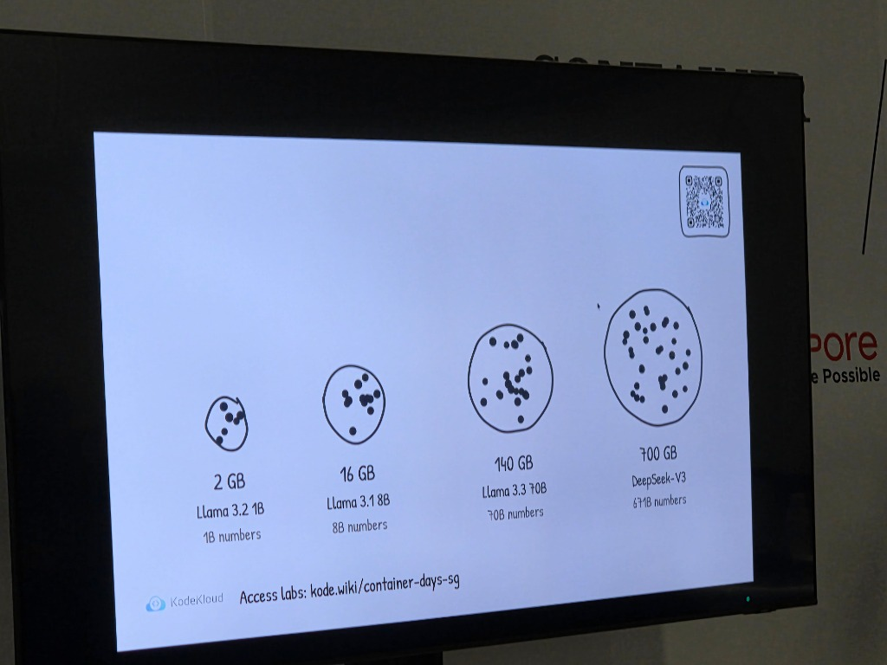

> **Model Size Comparison**: Visualizing memory requirements across parameter tiers. At FP16 precision, memory scales linearly with parameter count at $\sim 2\text{ GB}$ per billion parameters.

| Model | Parameter Count | Weight Footprint (FP16/BF16) | Minimum GPU Hardware Target |
| :--- | :--- | :--- | :--- |
| **Llama 3.2 1B** | 1 Billion numbers | **2 GB** | Edge / Consumer GPU (RTX 3060, Apple Silicon) |
| **Llama 3.1 8B** | 8 Billion numbers | **16 GB** | Mid-tier GPU (RTX 4090, A10G 24GB, L4 24GB) |
| **Llama 3.3 70B** | 70 Billion numbers | **140 GB** | Multi-GPU Node (2x A100/H100 80GB via Tensor Parallelism) |
| **DeepSeek-V3** | 671 Billion numbers | **700 GB** | High-density Cluster (8x H100/H200 80GB/141GB with MoE routing) |

---

## ⚙️ The Model Server Runtime Ecosystem

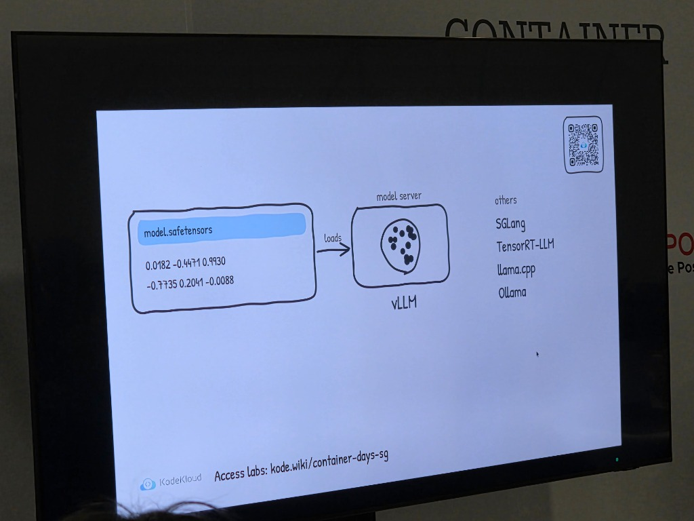

> **Model Server Architecture**: A model server loads raw `model.safetensors` files from disk, allocates GPU memory, compiles execution kernels, and exposes a network inference API.

### The Modern Serving Engine Spectrum
- **`vLLM`**: The standard open-source production engine featuring **PagedAttention** (virtual memory paging for the KV Cache) and continuous batching.
- **`SGLang`**: High-performance runtime featuring **RadixAttention** (automatic KV cache prefix sharing across multi-turn conversations and agent loops).
- **`TensorRT-LLM`**: NVIDIA's enterprise engine compiled directly to optimized CUDA kernels and Tensor Cores for maximum throughput.
- **`llama.cpp`**: Highly portable C/C++ inference runtime optimized for 4-bit/8-bit GGUF quantization on CPU, Metal, and consumer hardware.
- **`Ollama`**: Developer-friendly local packaging engine bundling `llama.cpp` with a Docker-like CLI and model registry.

---

## 🚀 Serving Your First LLM: vLLM & The OpenAI API

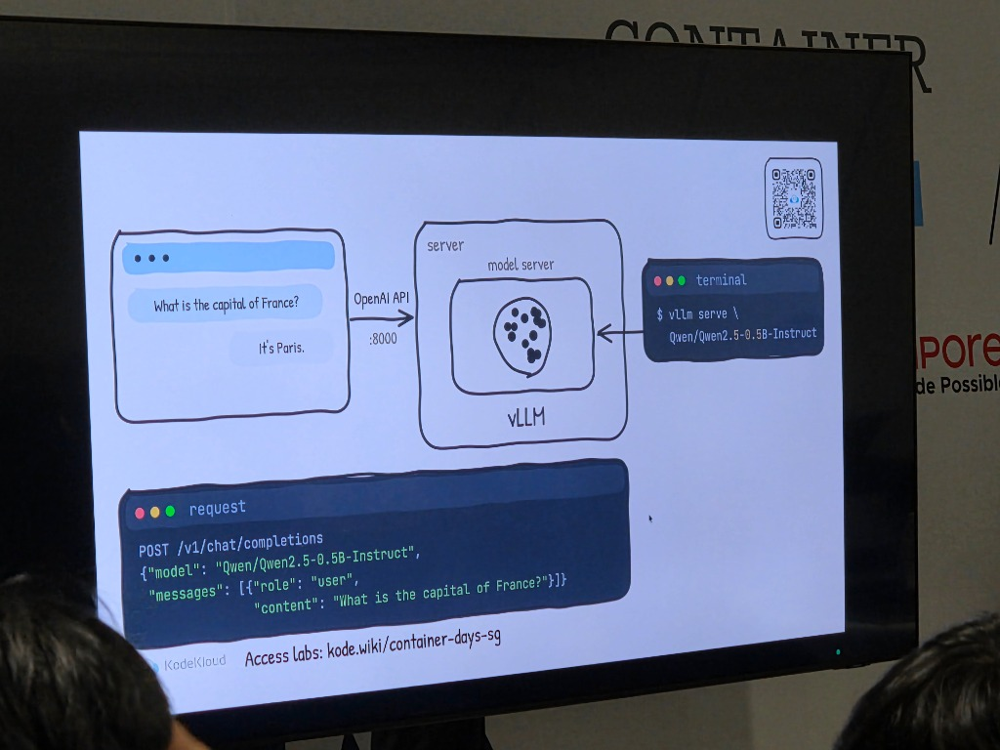

> **Initial Single-Node Serving Flow**: Launching vLLM in the terminal to expose an OpenAI-compatible REST API on port `:8000`.

### Running the Server
```bash
# Launch vLLM server serving a lightweight Qwen 2.5 instruct model
$ vllm serve Qwen/Qwen2.5-0.5B-Instruct --port 8000
```

### Client Request Execution
Clients interact with the server via standard OpenAI-compatible endpoints:
```bash
curl http://localhost:8000/v1/chat/completions \
  -H "Content-Type: application/json" \
  -d '{
    "model": "Qwen/Qwen2.5-0.5B-Instruct",
    "messages": [
      {"role": "user", "content": "What is the capital of France?"}
    ]
  }'
```

```json
{
  "choices": [
    {
      "message": {
        "role": "assistant",
        "content": "It's Paris."
      }
    }
  ]
}
```

While this single-turn query returns in milliseconds on a dev workstation, real applications involve stateful conversational agents and concurrent user traffic.

---

## 💬 The Execution Cycle & Stateless Trap: Lesson 02 Deep Dive

Lesson 02 (`02-every-message-resends-the-chat`) uncovers the two distinct computational phases of LLM inference and why chat interfaces create catastrophic memory bloat.

### Phase 1: Prefill — "The Pause" (Slide 3/5)

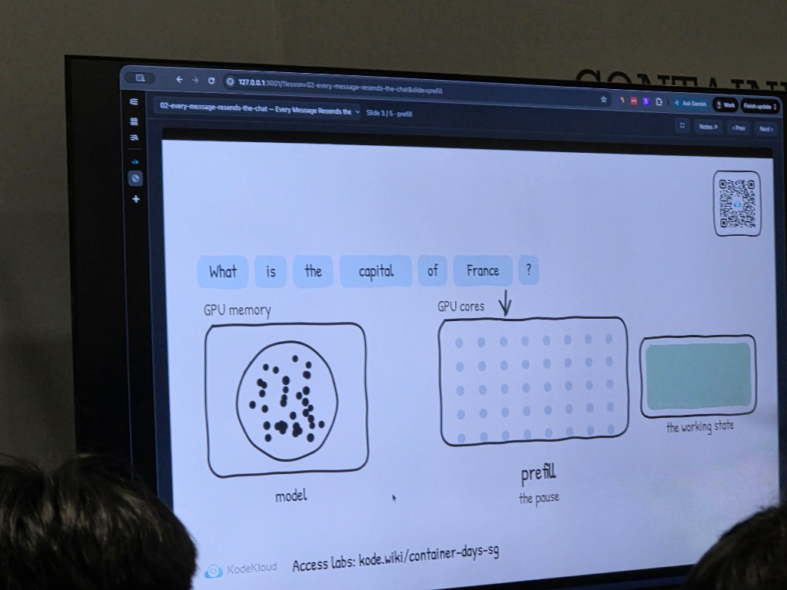

> **Prefill Mechanics**: Ingesting prompt tokens (`What`, `is`, `the`, `capital`, `of`, `France`, `?`). The model processes all input tokens in parallel across GPU tensor cores, creating **"the working state"** (the Key-Value cache vectors). This phase is compute-bound.

- **Computational Nature**: Compute-bound / Matrix multiplication ($\text{GEMM}$).
- **Time to First Token (TTFT)**: The user experiences this as "the pause" before generation begins.
- **Working State Creation**: Computes attention keys and values for all prompt tokens and stores them in GPU VRAM as the initial KV Cache.

### Phase 2: Decode — Sequential Token Generation (Slide 4/5)

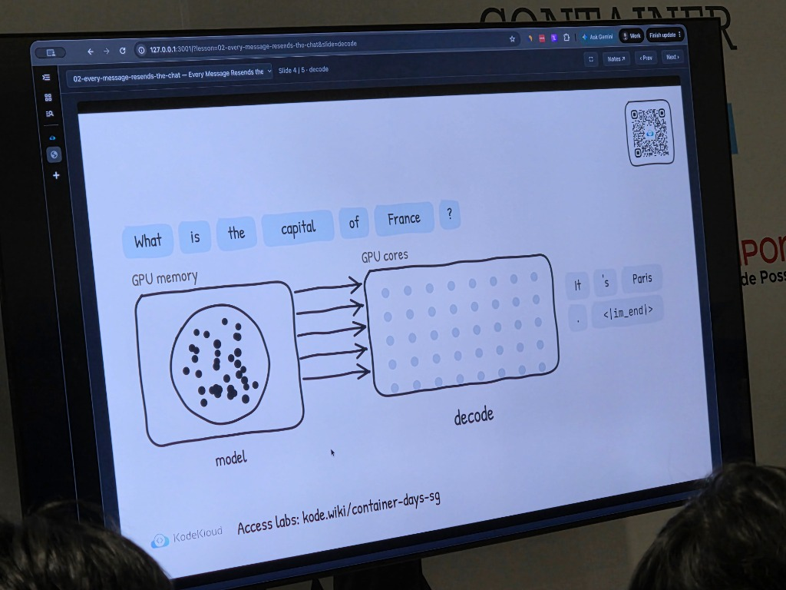

> **Decode Mechanics**: Autoregressive generation. Each new token (`It`, `'s`, `Paris`, `.`, `<|im_end|>`) is produced sequentially one token at a time. Every single token requires streaming the entire model weights through GPU memory into cores.

- **Computational Nature**: **Memory-bandwidth-bound / Vector-matrix multiplication ($\text{GEMV}$)**.
- **Inter-Token Latency (ITL)**: The generation speed (tokens per second) seen by the user.
- **Memory Bandwidth Wall**: To generate just one single token, the GPU memory bus must read all 16 GB of model weights from High Bandwidth Memory (HBM) into SRAM/registers.

### Phase 3: Context Accumulation Across Conversational Turns (Slide 5/5)

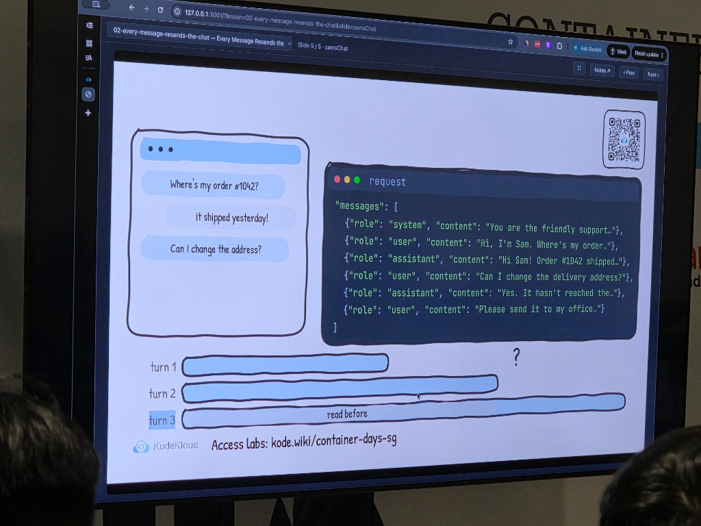

> **Context Growth**: In multi-turn chat (Sam asking about Order #1042), the client resends the full serialized `messages: [...]` history on every request. The `"read before"` bar grows on every turn, forcing longer prefill pauses and linear KV cache expansion.

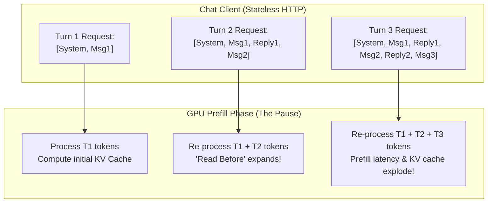

---

## 💥 The Breakdown: Server Overloaded, vLLM Crashed, GPU Starvation

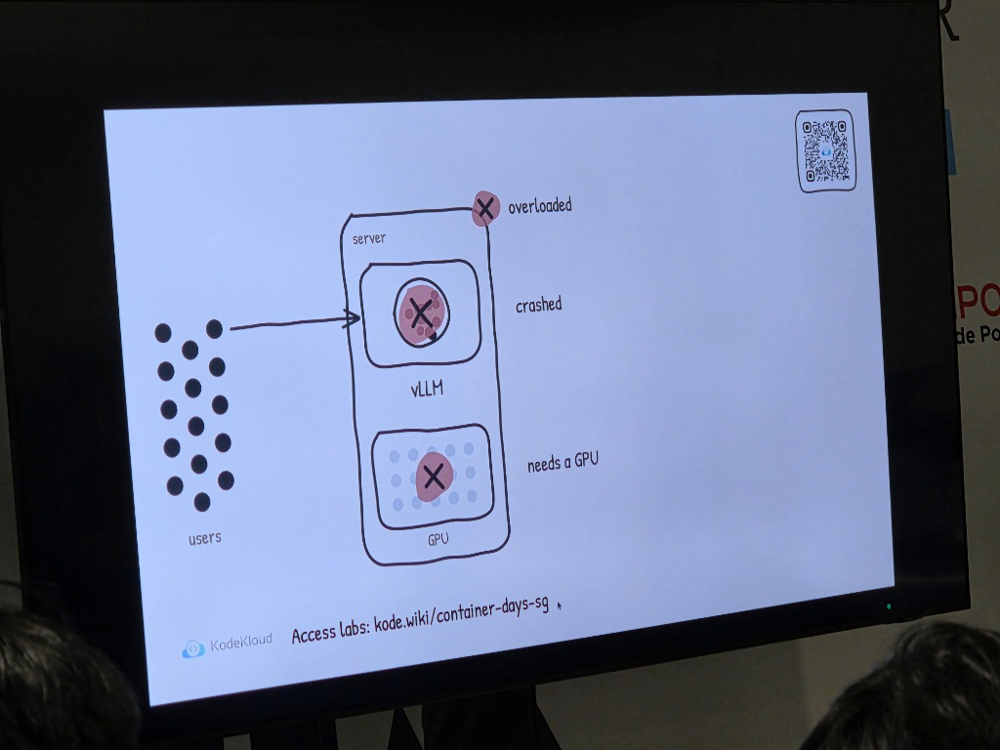

> **The Single-Node Bottleneck Breakdown**: When multiple users send concurrent requests to a single server running vLLM and a GPU, the system hits three simultaneous breaking points: **Server Overloaded**, **vLLM Process Crashed**, and **Hardware Starvation (Needs a GPU)**.

### The 3 Points of Failure Under Concurrency
1. **Server Overloaded (HTTP / Host Level)**:
   - Traditional web servers scale by spawning threads or lightweight coroutines. In LLM serving, incoming HTTP connections queue up because the GPU execution queue is serialized or batch-bound.
   - Request queues fill to capacity, triggering HTTP 504 Gateway Timeouts and dropped client connections.
2. **vLLM Crashed (Runtime / Process Level)**:
   - When multiple concurrent requests generate output tokens simultaneously, each token generation step requires allocating additional memory in the KV Cache.
   - If pre-allocated memory pools are exhausted and dynamic allocation fails, the CUDA driver throws an unrecoverable `torch.cuda.OutOfMemoryError` (CUDA OOM), killing the entire vLLM container process.
3. **Needs a GPU (Hardware / Resource Wall)**:
   - GPU memory is non-fungible: unlike CPU RAM, VRAM cannot be swapped to disk or paged without dropping inference throughput by orders of magnitude (PCIe transfer bottleneck).
   - Horizontal scaling requires physical GPU scheduling, fast weight loading, and intelligent request routing.

---

## ☸️ Scaling Out on Kubernetes: Multi-Replica vLLM Deployment

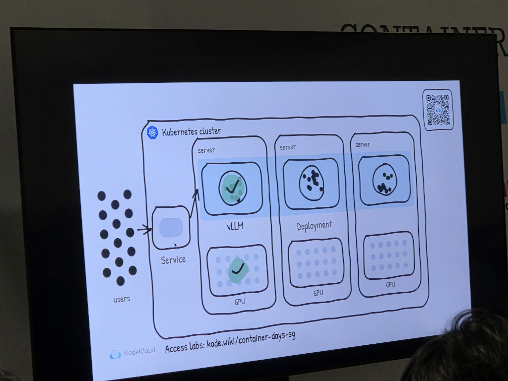

> **Kubernetes Serving Architecture**: Scaling beyond the single-node bottleneck. Traffic from concurrent users is received by a Kubernetes `Service` and load-balanced across a multi-replica `Deployment` of dedicated GPU worker nodes running vLLM pods.

### Architectural Components
- **Kubernetes `Service`**: Acts as the single entrypoint and cluster load balancer, routing incoming OpenAI-compatible HTTP requests across ready endpoints.
- **Kubernetes `Deployment`**: Manages replica lifecycle, pod scheduling, and health probes for multiple worker nodes.
- **Dedicated GPU per Pod**: Each vLLM container pod is scheduled on a dedicated GPU node with guaranteed PCIe/NVLink resources, isolating memory failure domains.

---

## 📊 The Operational Profile & Cold-Start Reality of vLLM

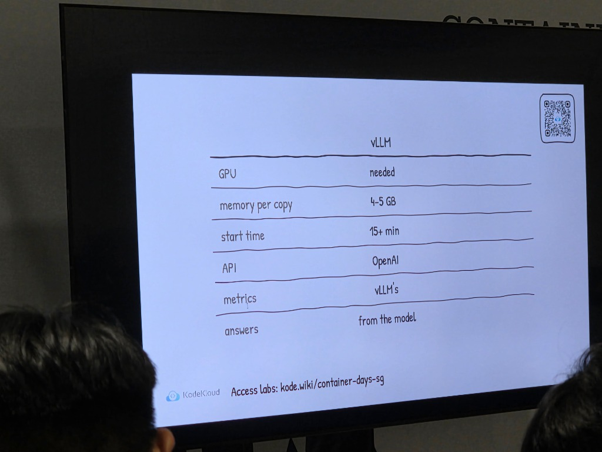

> **vLLM Operational Characteristics**: Evaluating the production profile of vLLM on Kubernetes.

| Metric / Dimension | vLLM Operational Behavior | Production Implications & Caveats |
| :--- | :--- | :--- |
| **GPU** | **Needed** | CPU inference is orders of magnitude too slow for real-time interactivity. |
| **Memory per Copy** | **4–5 GB** (small) to **24–160+ GB** | High memory density per pod; cannot be easily overcommitted. |
| **Start Time** | **15+ minutes** | **The Cold-Start Dilemma**: Image pulling, weights downloading, and CUDA kernel compilation prevent reactive real-time autoscaling! |
| **API** | **OpenAI Compatible** | Seamless drop-in replacement for OpenAI SDKs (`/v1/chat/completions`). |
| **Metrics** | **vLLM Native** | Exposes Prometheus metrics: KV cache usage, iteration latency, TTFT, and queue depth. |
| **Answers** | **From the Model** | Non-deterministic, token-by-token streaming responses. |

> [!IMPORTANT]
> **Why Kubernetes HPA Fails for LLMs**:
> Traditional Kubernetes Horizontal Pod Autoscaling relies on CPU or memory thresholds. In LLM serving:
> 1. GPU VRAM utilization is typically pinned to 90–95% on startup by design (vLLM reserves VRAM for its KV Cache block manager).
> 2. With a **15+ minute cold-start time**, spinning up a new pod during a traffic spike arrives far too late to prevent existing pods from crashing or timing out.
> 3. Production architectures require **queue-depth autoscaling (KEDA)** and pre-warmed GPU pools.

---

## 🔀 The KV Cache Routing Dilemma: Why Kubernetes Service Breaks

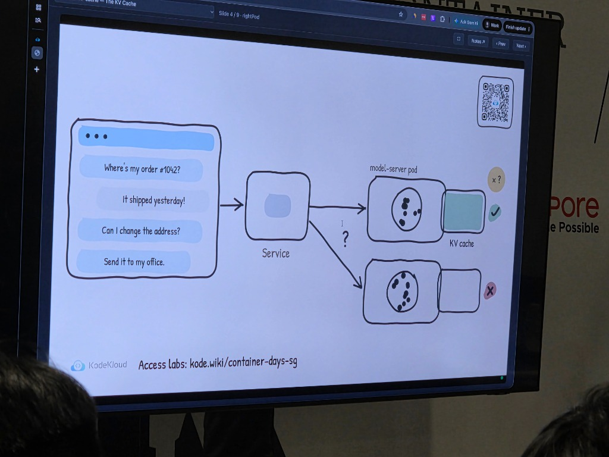

> **The KV Cache Routing Problem (`The KV Cache` · Slide 4/9)**: When a standard Kubernetes `Service` acts as the load balancer, multi-turn conversational requests are routed blindly across pods. If Turn 2 lands on a different pod, the system suffers a 100% cache miss (`❌`), forcing expensive prefill recomputation.

### The Naive Load Balancing Trap
Standard Kubernetes Services (kube-proxy / Ingress controllers) perform round-robin, random, or least-connections Layer 4/Layer 7 routing:
1. **Turn 1**:
   - Sam sends Turn 1 to `Service` $\to$ routed to `pod-1`.
   - `pod-1` executes prefill and populates its local **KV Cache** (the green box).
2. **Turn 2**:
   - Sam sends Turn 2 to `Service`.
   - **Scenario A (Top Path - Cache Hit)**: Routed back to `pod-1`. `pod-1` reuses the existing KV cache (`✅`). Prefill is bypassed; generation starts immediately.
   - **Scenario B (Bottom Path - Cache Miss)**: Routed to `pod-2`. `pod-2` has an empty KV cache (`❌`). `pod-2` must recompute prefill over the entire accumulated chat history from scratch, causing massive TTFT latency spikes and burning precious GPU compute.

---

## 🛡️ Meet llm-d: Intelligent KV Cache Affinity Routing

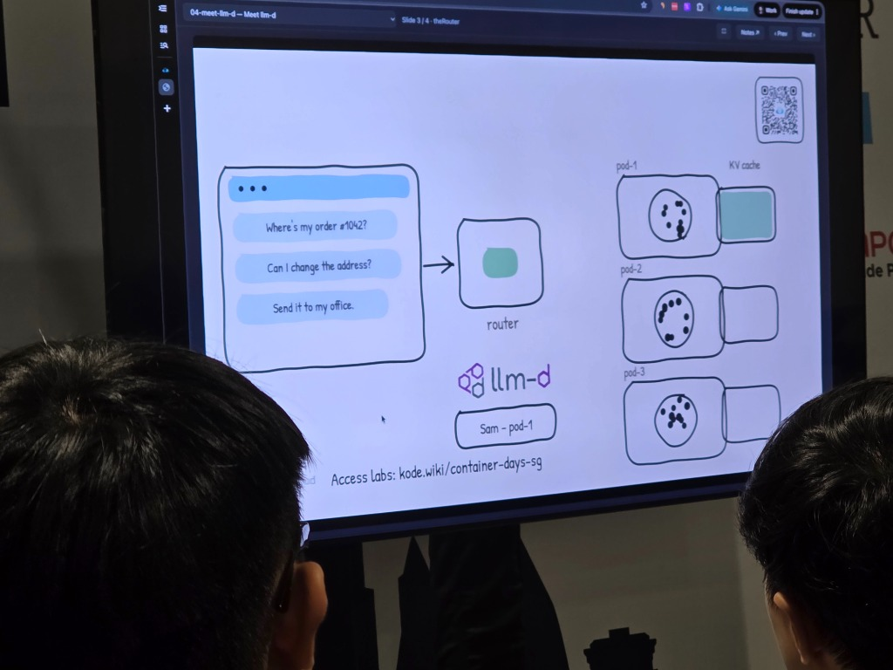

> **Meet llm-d (`04-meet-llm-d` · Slide 3/4)**: Introducing `llm-d`, a specialized LLM gateway and intelligent router that replaces naive Kubernetes Services with **KV Cache affinity routing**.

### How llm-d Solves the Routing Problem
Instead of treating LLM pods as interchangeable stateless microservices, `llm-d` understands conversation context and cache state:
- **Session Stickiness & Affinity**: Tracks active sessions (`Sam -> pod-1`). Subsequent requests from Sam are deterministically pinned to `pod-1` where his KV Cache already resides.
- **Prefix Caching Awareness**: Knows which pod holds which system prompts, tool schemas, or document prefixes, routing shared prefix traffic to warm pods.
- **Health & Load Rebalancing**: If `pod-1` is saturated or crashes, `llm-d` gracefully redirects traffic to `pod-2` or `pod-3` while managing queue backpressure.

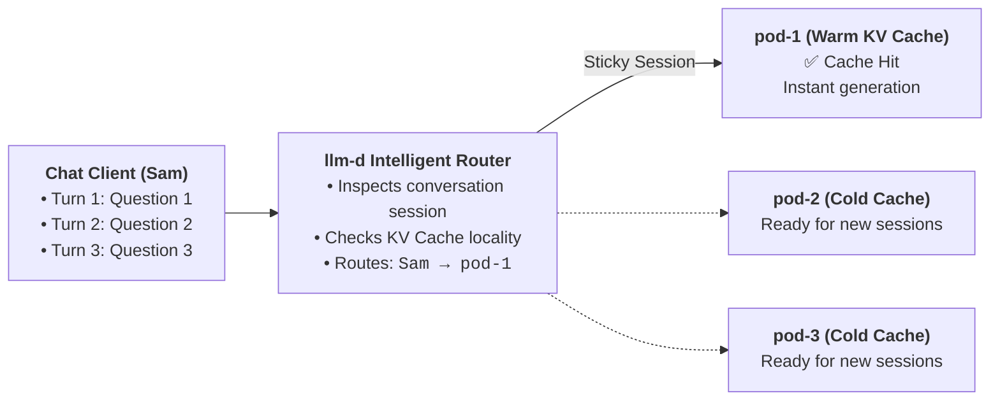

---

## 📚 What to Learn Next: Production LLM-d Deep Dive

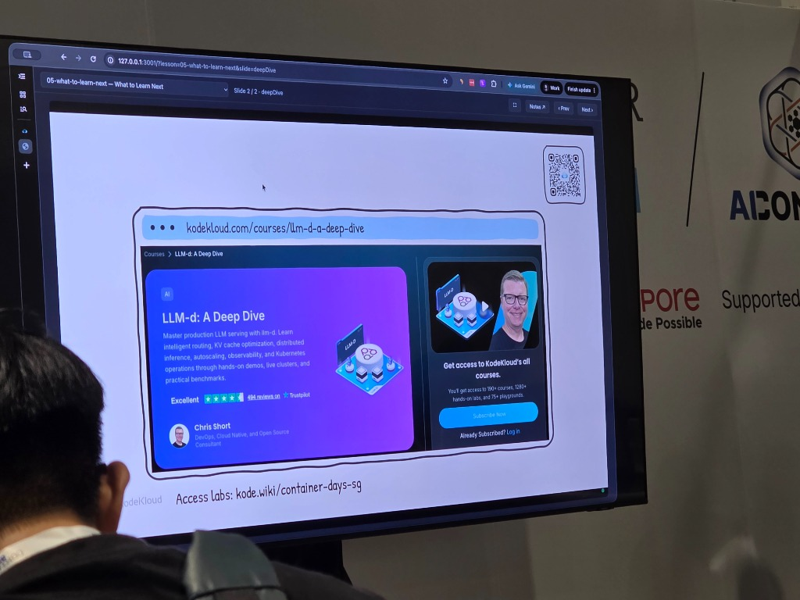

> **Next Steps (`05-what-to-learn-next` · Slide 2/2)**: KodeKloud official learning path: [kodekloud.com/courses/llm-d-a-deep-dive](https://kodekloud.com/courses/llm-d-a-deep-dive) — *"LLM-d: A Deep Dive"* by **Chris Short** (DevOps, Cloud Native, and Open Source Consultant).

### Course Curriculum & Mastery
- **Intelligent Routing**: Implementing prefix-aware and session-sticky routing with `llm-d`.
- **KV Cache Optimization**: PagedAttention, RadixAttention, chunked prefill, and cache eviction algorithms.
- **Distributed Inference**: Multi-GPU tensor parallelism and pipeline parallelism on Kubernetes.
- **Autoscaling & Queue Management**: Overcoming cold-start delays using KEDA, Prometheus queue metrics, and pre-warmed pod pools.
- **Production Benchmarks & Observability**: Real-time TTFT, ITL, and throughput telemetry in live clusters.

---

## 🔗 Related Notes & Cross-References

- 🌟 [ContainerDays Singapore 2026](ContainerDays%20Singapore%202026.md) — Master conference schedule and session index
- 🚦 [Lessons from Operating an Internal LLM Gateway for Production Agentic Applications (Zhong Liang Ong & Yek Khan)](Lessons%20from%20Operating%20an%20Internal%20LLM%20Gateway%20for%20Production%20Agentic%20Applications%20(Zhong%20Liang%20Ong%20&%20Yek%20Khan).md) — Production model routing, failover discipline, and Loge gateway
- ⚡ *The Memory-Bandwidth Wall - Min-Maxing LLM Serving with vLLM (Marcel Wysocki)* — Upcoming Day 2 deep-dive on vLLM internals
- 🛡️ [Governing the Agentic Stack on Kubernetes - MCP, A2A, and LLM Traffic (Robin Cher)](Governing%20the%20Agentic%20Stack%20on%20Kubernetes%20-%20MCP,%20A2A,%20and%20LLM%20Traffic%20(Robin%20Cher).md) — Kubernetes-native AI gateway architecture and traffic governance
- 🏭 [When Tokens Stop Being the Bottleneck - Operating Agentic Software Factories (Carl Ross)](When%20Tokens%20Stop%20Being%20the%20Bottleneck%20-%20Operating%20Agentic%20Software%20Factories%20(Carl%20Ross).md) — High-velocity token consumption
