# When Tokens Stop Being the Bottleneck: Operating Agentic Software Factories

> **Speaker**: Carl Ross ([OpenAI](https://openai.com))  
> **Event**: [ContainerDays Singapore 2026](ContainerDays%20Singapore%202026.md)  
> **Date & Time**: Tuesday, October 27, 2026 · 12:50 PM – 1:25 PM SGT  
> **Room**: AIC Theatre  
> **Core Topics**: Autonomous Software Factories · Asymptotic Token Economics · State Coordination · Deterministic Verification Harnesses · CI/CD Bottlenecks · Multi-Agent Engineering Systems  
> **Vault Connections**: [ContainerDays Singapore 2026](ContainerDays%20Singapore%202026.md) • [Lessons from Operating an Internal LLM Gateway for Production Agentic Applications (Zhong Liang Ong & Yek Khan)](Lessons%20from%20Operating%20an%20Internal%20LLM%20Gateway%20for%20Production%20Agentic%20Applications%20(Zhong%20Liang%20Ong%20&%20Yek%20Khan).md) • [Taming Agent Sprawl - How We Scale Evals to Keep Up with Agents (Timothy Lin)](Taming%20Agent%20Sprawl%20-%20How%20We%20Scale%20Evals%20to%20Keep%20Up%20with%20Agents%20(Timothy%20Lin).md) • [Securing AI Coding Agents with Kubernetes Sandboxes (Ryan Djurovich)](Securing%20AI%20Coding%20Agents%20with%20Kubernetes%20Sandboxes%20(Ryan%20Djurovich).md) • [Confessions of a Portal Assistant (Yashod Perera)](Confessions%20of%20a%20Portal%20Assistant%20(Yashod%20Perera).md) • *The Road Under the Harness (Ng Shangru)* • *AI Agent Engineering* • *Designing Agent Fleets*

---

## ⚡ TL;DR (Key Takeaways in 60 Seconds)

- **The Paradox**: Reasoning models write brilliant snippets but fail to rewrite entire software systems without an external execution and verification harness.
- **Asymptotic Token Economics**: When token costs trend toward zero ($	ext{Cost} 	o 0$), burning millions of tokens to continuously rewrite, refactor, and test code becomes viable. Code itself becomes cheap and disposable.
- **The Actor Pattern for Agents**: Agents operate as globally addressable WASM actors running on OCI registries (Zot + ORAS), communicating via asynchronous NATS JetStream mailboxes, and accessing POSIX virtual storage via JuiceFS/RustFS.
- **Single Problem Optimization (SPO)**: Background worker swarms continuously generate candidate code proposals evaluated deterministically by Grader actors against real CI/CD and production signals, replacing long-lived branches with trunk-based continuous landing.
- **The 3 Pillars of Non-Regrettable Work**:
  1. *Hermetic Local Environments* (Bazel toolchains with zero cloud deps bootable in $<2$ minutes).
  2. *Constrained Solution Spaces* (verifiable, incremental candidates).
  3. *Radically Fast CI* (the ultimate rate limiter of autonomous software factories).

---

## 📸 Presentation & Slides

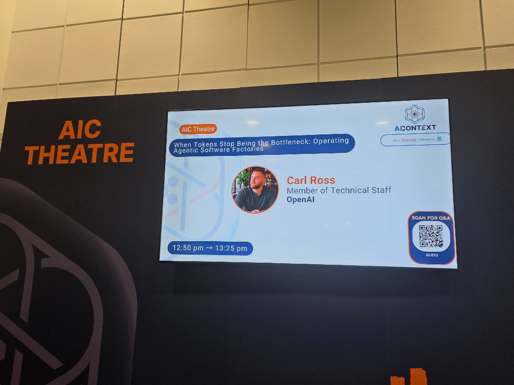

> **Stage Display (~12:40 SGT)**: *When Tokens Stop Being the Bottleneck: Operating Agentic Software Factories* presented by **Carl Ross** (Member of Technical Staff @ [OpenAI](https://openai.com)) in the AIC Theatre (12:50 PM – 1:25 PM SGT). Slido Q&A active.


> **Speaker Deck Title Slide (~12:51 SGT)**: *When Tokens Stop Being the Bottleneck: Operating Agentic Software Factories* — Carl Ross (Member of Technical Staff, OpenAI). Official presentation kickoff.

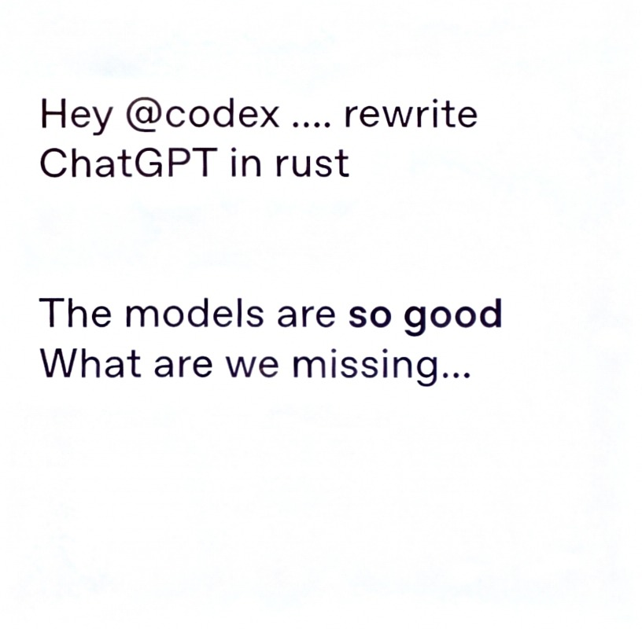

> **The Big Question (~12:52 SGT)**: *"Hey @codex .... rewrite ChatGPT in rust" — "The models are so good. What are we missing..."* The core paradox: Frontier reasoning models are undeniably capable of writing brilliant code snippets, yet dropping an agent into a repository and asking for a ground-up rewrite fails. What is missing between frontier models and production software factories?

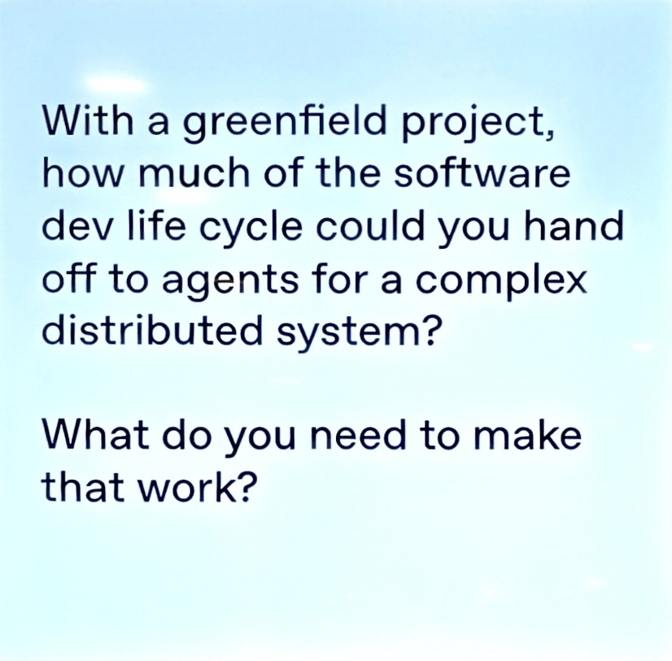

> **The Research Question (~12:52 SGT)**: *With a greenfield project, how much of the software dev life cycle could you hand off to agents for a complex distributed system? What do you need to make that work?* The operational experiment: pushing agent autonomy to its theoretical limits across the entire software engineering lifecycle.

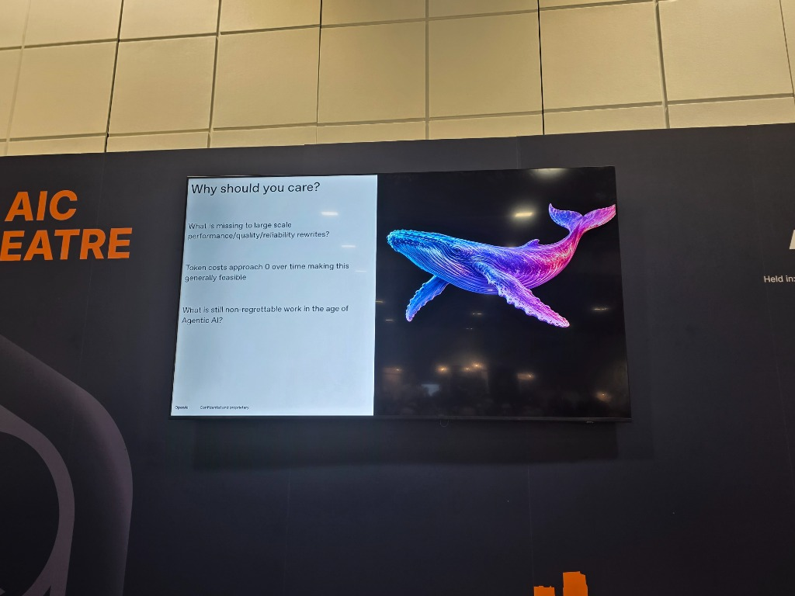

> **Why Should You Care? (~12:53 SGT)**: *What is missing to large scale performance/quality/reliability rewrites? Token costs approach 0 over time making this generally feasible. What is still non regrettable work in the age of Agentic AI?* When token inference costs trend toward zero, complete codebase rewrites become economically viable. The primary question shifts to identifying what engineering work remains durable and "non-regrettable" (specifications, verifiers, architectural boundaries).

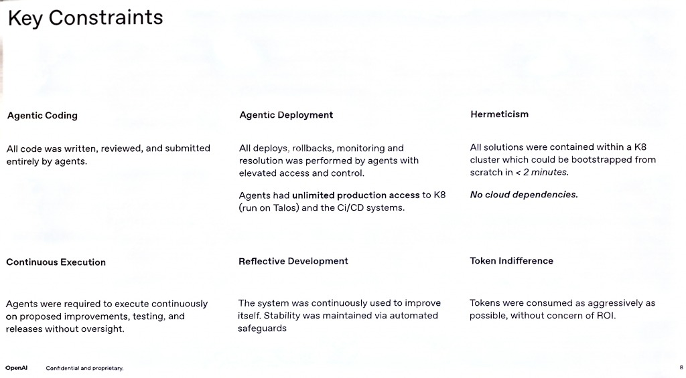

> **The Six Operating Constraints (~12:54 SGT)**: *Key Constraints of OpenAI's Software Factory Experiment.* 1. **Agentic Coding** (100% written, reviewed, and submitted by agents), 2. **Agentic Deployment** (All deploys/rollbacks/incident response by agents; unlimited prod access to K8s on Talos Linux), 3. **Hermeticism** (K8s cluster bootstrapped from scratch in < 2 mins; *no cloud dependencies*), 4. **Continuous Execution** (24/7 continuous autonomous loops without human oversight), 5. **Reflective Development** (System continuously self-improves with automated safeguards), 6. **Token Indifference** (Burn tokens as aggressively as possible, ignoring ROI).

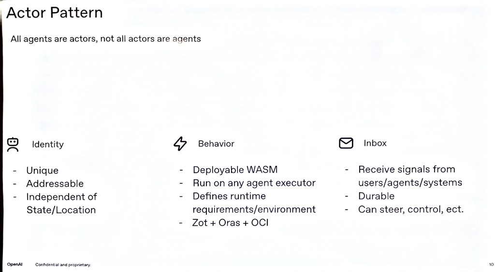

> **The Actor Pattern for Agents (~12:56 SGT)**: *Actor Pattern: All agents are actors, not all actors are agents.* Carl breaks agent architecture into three foundational actor primitives:
> 1. **Identity**: Unique, addressable, and independent of physical node or state location.
> 2. **Behavior**: Packaged as deployable **WASM (WebAssembly)** modules distributed via OCI registries (**Zot + ORAS + OCI**), running on any agent executor with self-declared runtime requirements.
> 3. **Inbox**: Durable message queue receiving asynchronous signals from users, peer agents, and system events to dynamically steer and control agent execution.

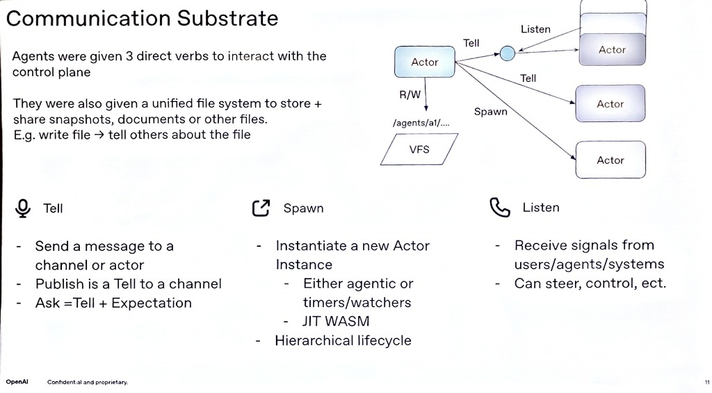

> **Communication Substrate & Control Plane Verbs (~12:56 SGT)**: *Communication Substrate: Agents interact with the control plane through 3 direct verbs and a unified virtual file system (VFS).*
> 1. **Tell**: Send a message to an actor or pub/sub channel (`Publish` = `Tell` to channel; `Ask` = `Tell` + Expectation/promise).
> 2. **Spawn**: Instantiate a new Actor Instance via JIT WASM (agentic or deterministic watchers/timers) with hierarchical supervision trees.
> 3. **Listen**: Receive signals from users/agents/systems for steering and control.
> - **Unified VFS**: Storage layer mounted at `/agents/a1/...` for snapshots and documents: *Write file $\to$ tell others about the file by reference*, preventing token context bloat.

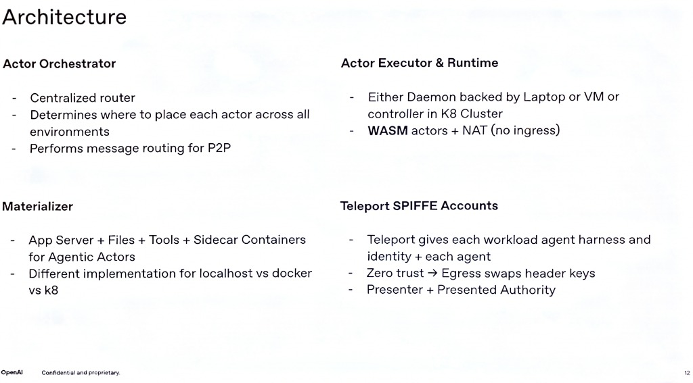

> **Software Factory System Architecture (~12:57 SGT)**: *Four-Quadrant System Architecture: Actor Orchestrator, Actor Executor & Runtime, Materializer, and Teleport SPIFFE Accounts.*
> 1. **Actor Orchestrator**: Centralized router deciding placement across environments and routing P2P messages.
> 2. **Actor Executor & Runtime**: Daemon (laptop/VM) or K8s controller running **WASM actors + NAT (zero ingress)**.
> 3. **Materializer**: Assembles App Server + Files + Tools + Sidecars across localhost, Docker, and K8s.
> 4. **Teleport SPIFFE Accounts**: Issues SPIFFE identities to agent harnesses and agents; zero-trust egress proxy swaps header keys; cryptographically distinguishes **Presenter vs Presented Authority**.

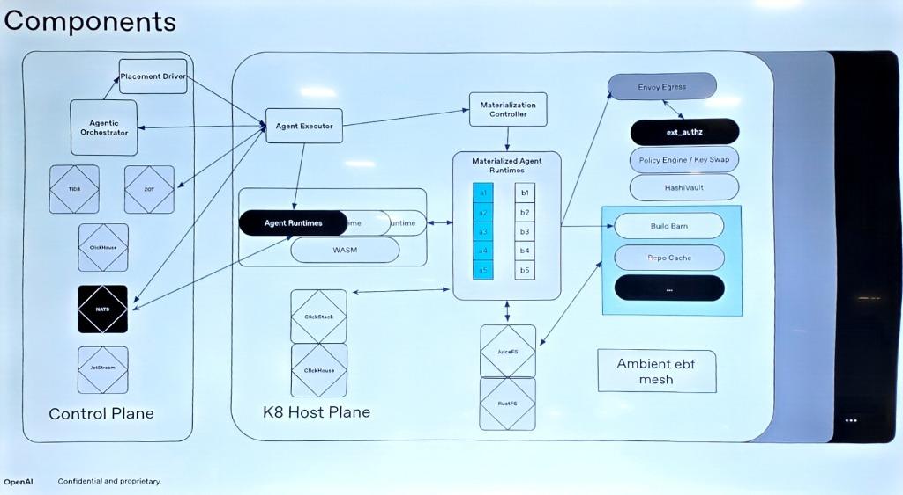

> **Detailed Components Blueprint (~12:58 SGT)**: *End-to-End Component Architecture of OpenAI's Autonomous Software Factory.*
> - **Control Plane**: Agentic Orchestrator, Placement Driver, **TiDB** (distributed state), **Zot** (OCI WASM registry), **ClickHouse** (analytics), and **NATS + JetStream** (durable messaging).
> - **Kubernetes Host Plane**: Agent Executor driving JIT WASM runtimes, coordinated by a Materialization Controller managing materialized agent runtimes (`a1..a5`, `b1..b5`).
> - **VFS Distributed Storage**: Backed by **JuiceFS + RustFS** for high-throughput artifact sharing.
> - **Build Acceleration**: **BuildBarn** remote execution & caching cluster + Repo Cache for instant feedback.
> - **Zero-Trust Egress**: **Envoy Egress** with `ext_authz`, dynamic Policy Engine / Key Swap, and **HashiCorp Vault**.
> - **Network Mesh**: Sidecarless **Ambient eBPF mesh**.

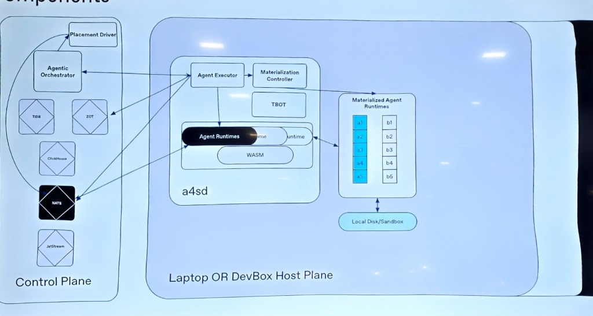

> **Components: Laptop / DevBox Host Plane (~13:00 SGT)**: *Polymorphic Host Planes: Running the Software Factory locally on a Laptop or DevBox.* The identical Control Plane (Orchestrator, Placement Driver, NATS, TiDB, Zot) seamlessly targets a local developer environment. The local host plane runs **`a4sd`** (Agent for Software Development daemon), embedding the Agent Executor, Materialization Controller, **`tbot`** (Teleport Bot Machine ID daemon), and local WASM runtimes bound to `Local Disk / Sandbox`. Demonstrates complete portability from single laptop to full K8s cluster.

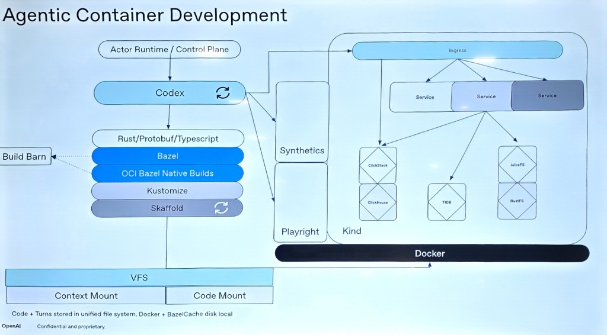

> **Agentic Container Development Pipeline (~13:01 SGT)**: *The Autonomous Inner Loop: How Codex builds, packages, deploys, and verifies containers.*
> - **Languages & Build**: Rust, Protobuf, TypeScript built with **Bazel** and accelerated via **BuildBarn** remote execution cache.
> - **Packaging & Ephemeral Deployment**: OCI Bazel Native Builds (`rules_oci`) packaged with **Kustomize** and continuously synced via **Skaffold** into an ephemeral **Kind (Kubernetes-in-Docker)** cluster.
> - **Full Distributed Stack inside Kind**: Microservices, ClickHouse, TiDB, and JuiceFS/RustFS running hermetically on Docker.
> - **Verification Harness**: Synthetic end-to-end tests driven by **Playwright** exercising ingress routes.
> - **VFS Separation**: Partitioned into `Context Mount` (agent conversation turns and trajectory) and `Code Mount` (repository files and diffs).

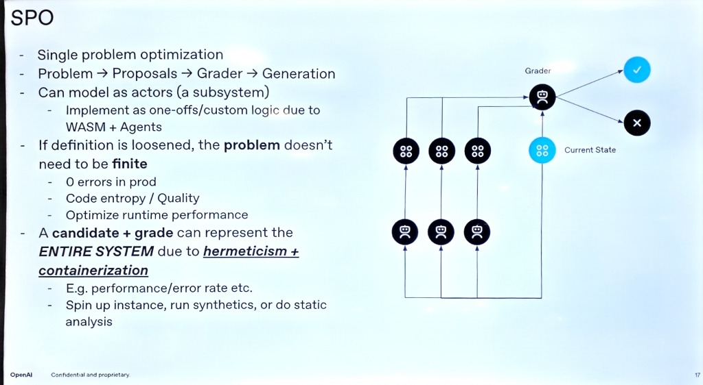

> **SPO: Single Problem Optimization (~13:03 SGT)**: *The Optimization Subsystem: Problem $\to$ Proposals $\to$ Grader $\to$ Generation.* Carl models optimization as an actor subsystem.
> - **WASM + Agents**: Custom optimization and grading logic packaged as lightweight WASM modules.
> - **Infinite Problems**: If definition is loosened, the problem doesn't need to be finite (e.g., 0 errors in prod, code entropy / quality, runtime performance).
> - **Entire System Grading**: A candidate + grade can represent the *ENTIRE SYSTEM* due to hermeticism + containerization (spin up ephemeral instance, execute synthetics, or run static analysis).

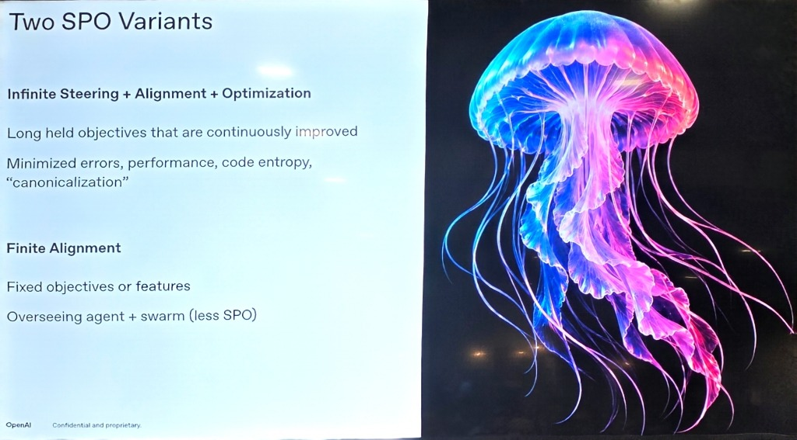

> **Two SPO Variants (~13:05 SGT)**: *Infinite Steering + Alignment + Optimization vs. Finite Alignment.*
> - **Infinite Steering + Alignment + Optimization**: Long-held objectives continuously improved over time (e.g., minimized errors, runtime performance, code entropy, "canonicalization").
> - **Finite Alignment**: Fixed objectives or discrete features driven by an overseeing agent + swarm (less pure SPO).

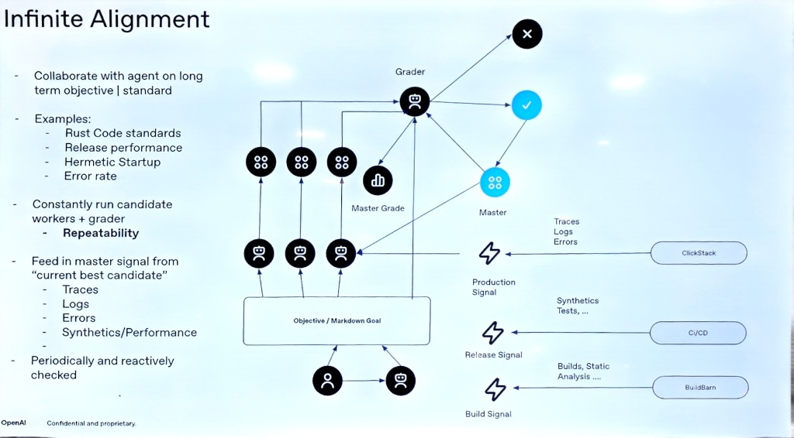

> **Infinite Alignment Architecture (~13:06 SGT)**: *Continuous Evolutionary Loop Driven by Environmental Feedback.*
> - Human engineer collaborates with an agent on a long-term objective / markdown goal (e.g. Rust code standards, release performance, hermetic startup speed, error rate).
> - Candidate workers continuously run in parallel generating proposals evaluated by a **Grader** actor for **repeatability** against a **Master Grade** and the current **Master** state.
> - Candidate generators feed on real production and development signals:
>   - **ClickStack** $\to$ Production Signals (traces, logs, errors).
>   - **CI/CD** $\to$ Release Signals (synthetics, tests).
>   - **BuildBarn** $\to$ Build Signals (builds, static analysis).
> - Better candidates become the new Master; inferior ones are rejected. The loop runs periodically and reactively 24/7.

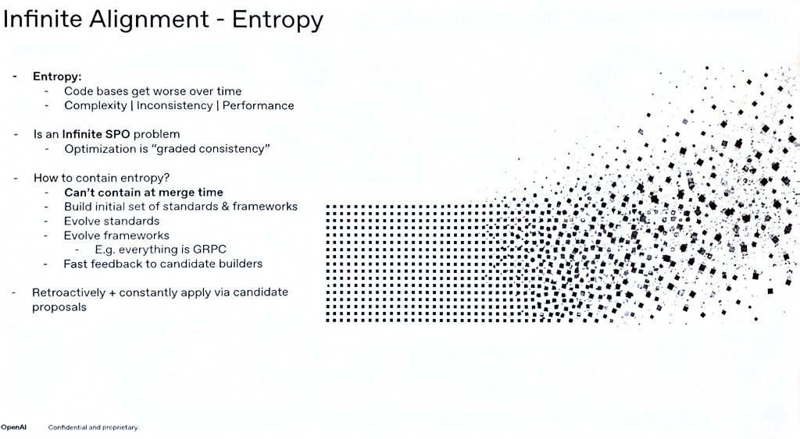

> **Infinite Alignment & Code Entropy (~13:07 SGT)**: *Combating Codebase Decay with Graded Consistency.*
> - **The Nature of Entropy**: Codebases naturally degrade over time in complexity, inconsistency, and performance.
> - **Infinite SPO Problem**: Entropy optimization is defined as "graded consistency".
> - **Containing Entropy**: *Cannot contain entropy at merge time!* Instead, build initial standards & frameworks, evolve them (e.g., "everything is gRPC"), provide fast feedback to candidate builders, and retroactively + constantly apply standards via candidate proposals.

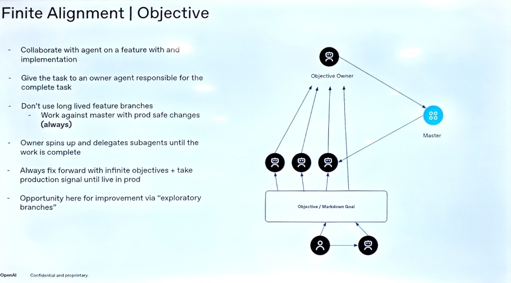

> **Finite Alignment: Objective Owners & No Feature Branches (~13:08 SGT)**: *Feature Shipping in an Autonomous Factory.*
> - Collaborate with agent on a feature definition and implementation plan.
> - Assign task to an **Objective Owner** agent responsible for the complete task.
> - **Zero Long-Lived Feature Branches**: *Always work directly against master with production-safe changes.*
> - Objective Owner spins up and delegates to subagents until the work is complete.
> - Always fix forward with infinite objectives + consume production signals until live in production.

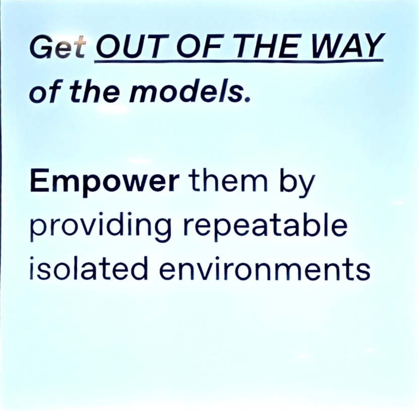

> **The Closing Credo (~13:12 SGT)**:
> > # *Get OUT OF THE WAY of the models.*
> > # *Empower them by providing repeatable isolated environments.*
> 
> The ultimate thesis of Carl Ross's talk: stop micro-managing prompt verbiage or artificially constraining agent capabilities. Build hermetic, reproducible, isolated runtime sandboxes, provide deterministic verification harnesses, and let frontier reasoning models run 24/7.

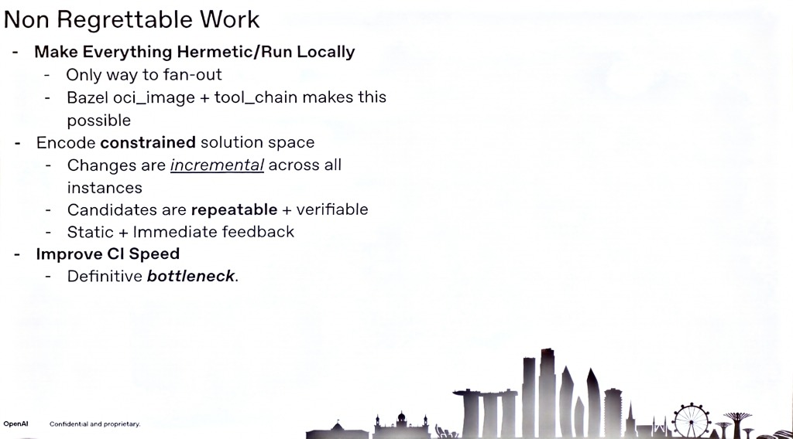

> **The Definition of Non-Regrettable Work (~13:15 SGT)**: *The Final Operational Framework of OpenAI's Factory Experiment.*
> 1. **Make Everything Hermetic / Run Locally**: The *only* way to fan-out agent execution. Enabled by Bazel `oci_image` + hermetic `tool_chain`.
> 2. **Encode Constrained Solution Spaces**: Keep changes *incremental* across all instances; ensure candidates are **repeatable + verifiable** with static and immediate feedback.
> 3. **Improve CI Speed**: The definitive **bottleneck** of modern AI agent platforms.

---

## 📝 Live Notes & Core Architecture

### 🏭 The Core Paradox: "The Models Are So Good. What Are We Missing?"
- **The Naive Expectation**: Developers see models acing LeetCode hard problems and assume they can simply prompt:
  ```text
  Hey @codex .... rewrite ChatGPT in rust
  ```
- **The Reality**: The model immediately stumbles, hallucinates missing repository dependencies, runs out of memory/context, or generates syntactically valid code that fails integration tests.
- **The Missing Layer**:
  - The model itself is not the bottleneck anymore.
  - What is missing is the **system wrapper**: deterministic test harnesses, sandboxed execution runtimes, environment feedback loops, continuous verification, and multi-agent state coordination.

---

### 🔬 The Research Experiment: Greenfield Full-SDLC Hand-Off
OpenAI set out to empirically answer two fundamental questions on greenfield distributed systems:
1. **Scope of Delegation**: *"How much of the software development life cycle (SDLC) can you realistically hand off to autonomous agents for a complex distributed system?"*
2. **System Requirements**: *"What architectural infrastructure do you actually need to build to make that autonomous hand-off work without collapsing?"*

---

### 🐋 Asymptotic Token Economics & "Non-Regrettable Work"
- **Token Costs Approach Zero ($\text{Cost} \to 0$)**:
  - Over a multi-year horizon, inference token costs are dropping exponentially.
  - When tokens are virtually free, burning millions of tokens to rewrite, refactor, benchmark, and optimize a large distributed subsystem becomes economically practical.
- **Large-Scale Rewrites Become Feasible**:
  - Historically, major rewrites (e.g. migrating Python to Rust, breaking monoliths into microservices, upgrading RPC protocols) were avoided because human engineering hours were the scarce resource.
  - In an agentic factory, large-scale rewrites for performance, quality, and reliability become regular operational tasks.
- **The Concept of "Non-Regrettable Work"**:
  - If agents can generate, refactor, and discard boilerplate code in minutes, what engineering effort remains **non-regrettable**?
  - **OpenAI's 3 Concrete Definitions of Non-Regrettable Work**:
    1. **Make Everything Hermetic / Run Locally**:
       - Hermetic local execution is the **only way to fan-out** agent swarms without exhausting cloud quota or introducing latency.
       - Built on **Bazel `oci_image` + hermetic toolchains** that construct byte-for-byte reproducible containers without external network access.
    2. **Encode Constrained Solution Spaces**:
       - Keep changes strictly **incremental** across all instances.
       - Guarantee that all candidate proposals are **repeatable + verifiable** with instant, static compiler/linter feedback.
    3. **Radically Improve CI Speed**:
       - CI test execution latency is the **definitive bottleneck** in production agentic engineering.
       - A factory where agents generate 100 diffs an hour collapses if CI takes 20 minutes per run; CI must execute in seconds via distributed caches (BuildBarn) and ephemeral clusters (Kind).

---

### 📐 The Six Extreme Operating Constraints of the OpenAI Software Factory
To truly test the outer boundaries of autonomous software engineering, OpenAI established six strict operational guardrails for the experiment:

| # | Constraint | Experimental Rule | What This Proves in Production |
| :-: | :--- | :--- | :--- |
| **01** | **Agentic Coding** | **All code was written, reviewed, and submitted entirely by agents.** | Zero human lines of code in the PR loop; agents act as both author and peer-reviewer. |
| **02** | **Agentic Deployment** | **All deploys, rollbacks, monitoring, and incident resolution performed by agents.** | Agents had **unlimited production access** to Kubernetes (running on **Talos Linux**) and CI/CD pipelines. |
| **03** | **Hermeticism** | **All solutions contained within a K8s cluster bootstrappable from scratch in $<2$ minutes.** | ***No cloud dependencies.*** Proves reproducibility and eliminates external SaaS friction. |
| **04** | **Continuous Execution** | **Agents required to execute continuously on proposed improvements, testing, and releases without oversight.** | 24/7 non-blocking autonomous loops rather than human-interrupted turns. |
| **05** | **Reflective Development** | **The system was continuously used to improve itself.** | Stability was maintained via automated programmatic safeguards rather than manual intervention. |
| **06** | **Token Indifference** | **Tokens were consumed as aggressively as possible, without concern of ROI.** | Simulates the asymptotic future where inference cost is essentially free ($\text{Cost} \approx 0$). |

---

### 🎭 The Actor Pattern for Autonomous Software Factories
> *"All agents are actors, not all actors are agents."*

To scale beyond fragile monolithic agent scripts, OpenAI structures the software factory using distributed **Actor Model** primitives:

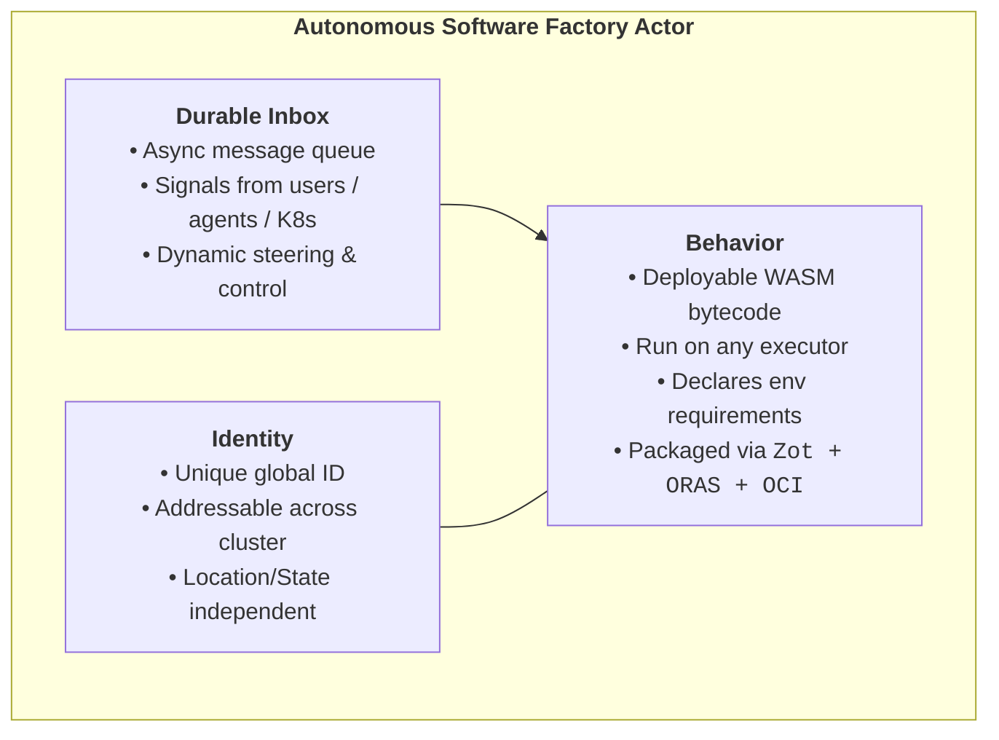

| Component | Architecture Mechanism | Engineering Significance in Factory Loop |
| :--- | :--- | :--- |
| **Identity** | Unique, globally addressable, decoupled from physical node or container location. | Allows agents to be scheduled, suspended, relocated, and checkpointed across the cluster without losing addressability. |
| **Behavior** | Packaged as **deployable WebAssembly (WASM)** modules. Distributed through **Zot** (OCI registry) via **ORAS** (OCI Registry As Storage). | **Instant start times (< 5ms)**, sandboxed isolation, and universal execution across any agent runner without heavy container images. |
| **Inbox** | Durable, persistent message mailbox receiving event signals from engineers, peer agents, and Kubernetes watcher streams. | Decouples caller from agent loop; allows steering, cancelling, and interrupting long-running agent tasks without corrupting state. |

---

### 📡 The Communication Substrate: 3 Direct Verbs & Unified VFS
Rather than inventing complex RPC frameworks or shoving megabytes of context into chat prompts, OpenAI equips every agent with a minimalist, Unix-like control plane substrate:

```mermaid
flowchart TD
    subgraph ControlPlane["<b>Actor Control Plane Verbs</b>"]
        A["<b>Actor</b>"]
        
        A -->|<b>Tell</b><br/>(Async message)| T["<b>Channel / Peer Actor</b><br/>• Publish = Tell to channel<br/>• Ask = Tell + Expectation"]
        A -->|<b>Spawn</b><br/>(JIT WASM)| S["<b>Child Actor</b><br/>• Agentic or deterministic timer<br/>• Hierarchical supervision tree"]
        L["<b>Listen</b>"] -->|Receive signals / events| A
    end

    subgraph StorageSubstrate["<b>Unified Virtual File System (VFS)</b>"]
        VFS["<b>VFS Mount: <code>/agents/a1/...</code></b><br/>Shared disk substrate for snapshots & artifacts"]
        A <-->|R/W| VFS
    end
```

#### 1. The Three Control Plane Verbs
- **`Tell` (Asynchronous Messaging)**:
  - Dispatches an asynchronous signal or message payload to a target actor ID or pub/sub channel.
  - **Publish**: A `Tell` broadcast to a channel topic.
  - **Ask**: A `Tell` paired with an expectation / return promise (`future`), enabling coordinated request-response without thread blocking.
- **`Spawn` (Dynamic JIT Instantiation)**:
  - Instantiates a new actor on the fly from pre-compiled **JIT WASM** bytecode.
  - Actors can be LLM-driven agents or deterministic system workers (cron timers, GitHub webhook watchers, file synchronizers).
  - Enforces a **hierarchical supervision lifecycle** (parent actors supervise child health and can terminate children cleanly on task completion or timeout).
- **`Listen` (Event Subscriptions & Steering)**:
  - Blocks or registers callbacks to consume events from durable mailboxes.
  - Allows human engineers or supervisor agents to steer, reprioritize, or cancel running loops mid-flight.

#### 2. The Unified Virtual File System (VFS)
- **The Core Pattern**:
  $$\text{Write File to VFS} \longrightarrow \text{Tell Others About the File Path}$$
- **Eliminating Token Bloat**:
  - In a multi-agent system, passing full codebases, git diffs, build logs, and test traces through JSON prompt schemas rapidly blows past context windows and wastes millions of tokens.
  - Instead, agents read and write directly to a shared distributed VFS mounted at `/agents/<actor_id>/...`.
  - When an agent finishes a code change or test run, it writes the artifact to VFS and simply sends a lightweight `Tell` containing the file path pointer.

---

### 🏛️ The Four Architectural Quadrants of the OpenAI Software Factory
OpenAI structures the factory infrastructure across four distinct decoupling layers:

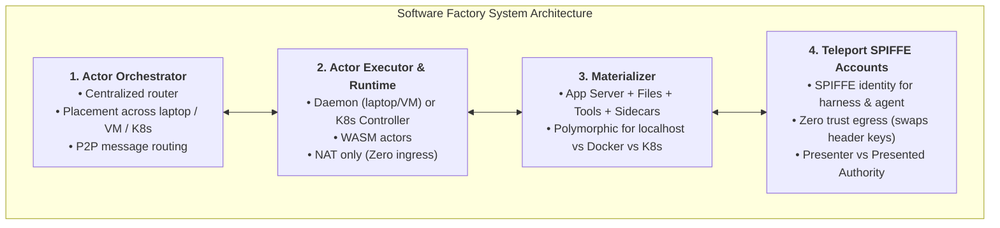

| Quadrant | Mechanism | Technical Role in Autonomous Factory |
| :--- | :--- | :--- |
| **Actor Orchestrator** | Centralized router & scheduler | Dynamically decides where to place actors across local workstations, cloud VMs, and Kubernetes clusters, and routes peer-to-peer (P2P) agent messages. |
| **Actor Executor & Runtime** | Host daemon or Kubernetes controller running WASM runtimes | Runs WebAssembly actors under strict outbound NAT with **zero ingress ports**, preventing external inbound network exploits. |
| **Materializer** | Workspace environment synthesizer | Packages the complete workspace context: app server, repository files, LSP/lint tools, and sidecar containers across localhost, Docker, or K8s. |
| **Teleport SPIFFE Accounts** | Cryptographic workload identity & egress proxy | Issues SPIFFE IDs to every agent harness. The egress proxy intercepts outbound API calls and swaps authorization keys dynamically, enforcing **Presenter + Presented Authority** separation. |

---

### 🧩 Deep Dive: The OpenAI Software Factory Component Blueprint
OpenAI's slide reveals the exact open-source, cloud-native stack assembled to run an autonomous factory without cloud provider vendor lock-in:

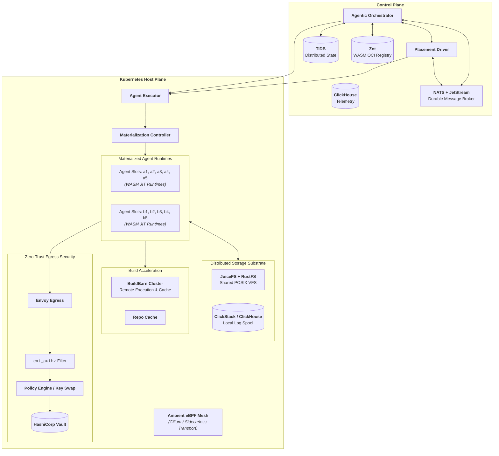

#### Detailed Breakdown by Subsystem

| Subsystem | Technologies Used | Architectural Function |
| :--- | :--- | :--- |
| **Control Plane & Messaging** | **NATS + JetStream**, **TiDB** | NATS JetStream acts as the durable message bus backing every actor's inbox, while TiDB maintains global actor state, lifecycle metadata, and placement tables across nodes. |
| **WASM Artifact Registry** | **Zot + ORAS** | Open-source, lightweight OCI registry dedicated to storing and serving pre-compiled WebAssembly actor binaries with sub-second pull times. |
| **Agent Execution** | **Agent Executor + Materialization Controller** | Manages materialized agent pools (`a1..a5`, `b1..b5`), instantiating WASM sandboxes on demand without the heavy virtualization overhead of full containers. |
| **High-Throughput VFS Storage** | **JuiceFS + RustFS** | Distributed POSIX filesystem that allows actors to read and write repository workspaces, logs, and artifacts at local SSD speeds, passing file pointers instead of bloating token context. |
| **Deterministic Build Acceleration** | **BuildBarn + Repo Cache** | Running compilation and tests within the agent loop is typically the #1 bottleneck. BuildBarn provides distributed remote build caching (Bazel/BuildBarn) so test suites execute in seconds. |
| **Zero-Trust Egress Security** | **Envoy Egress + `ext_authz` + HashiCorp Vault** | Agents run in isolated network namespaces with **zero ingress**. When an agent makes an external API call, Envoy's `ext_authz` filter queries HashiCorp Vault, injects the real provider token, and swaps headers, ensuring credentials never touch agent memory. |
| **Network Fabric** | **Ambient eBPF Mesh** | Replaces heavy per-pod sidecars with kernel-level eBPF routing (Cilium / Istio Ambient), maximizing network throughput between agents. |

#### 💻 Polymorphic Host Planes: Kubernetes vs. Laptop/DevBox (`a4sd`)
The core power of this design is that the **Control Plane is completely decoupled from the execution target**:

| Host Plane Architecture | Primary Daemon / Controller | Storage Substrate | Build & Egress Security | Target Use Case |
| :--- | :--- | :--- | :--- | :--- |
| **Kubernetes Host Plane** | In-cluster `Agent Executor` + `Materialization Controller` pods. | Distributed **JuiceFS + RustFS** POSIX mount. | **BuildBarn** distributed remote execution cluster; **Envoy Egress** + **HashiCorp Vault**; **Ambient eBPF mesh**. | **Autonomous Production Factory**: Large multi-repo distributed systems running 24/7 loops across the cluster. |
| **Laptop / DevBox Host Plane** | **`a4sd`** (*Agent for Software Development*) host daemon. | `Local Disk / Sandbox` on workstation SSD. | Embedded **`tbot`** (Teleport Bot Machine ID daemon) for cryptographic identity; local toolchain. | **Interactive Local Development**: Engineer developing and running agent loops locally on a laptop without cluster overhead. |

---

### 🔄 The Agentic Inner Loop: Bazel, Skaffold, Kind & Playwright Synthetics
A critical failure of standard coding agents is that they generate code in a vacuum without running it against real dependencies. OpenAI's architecture connects Codex directly to a full-stack hermetic execution loop:

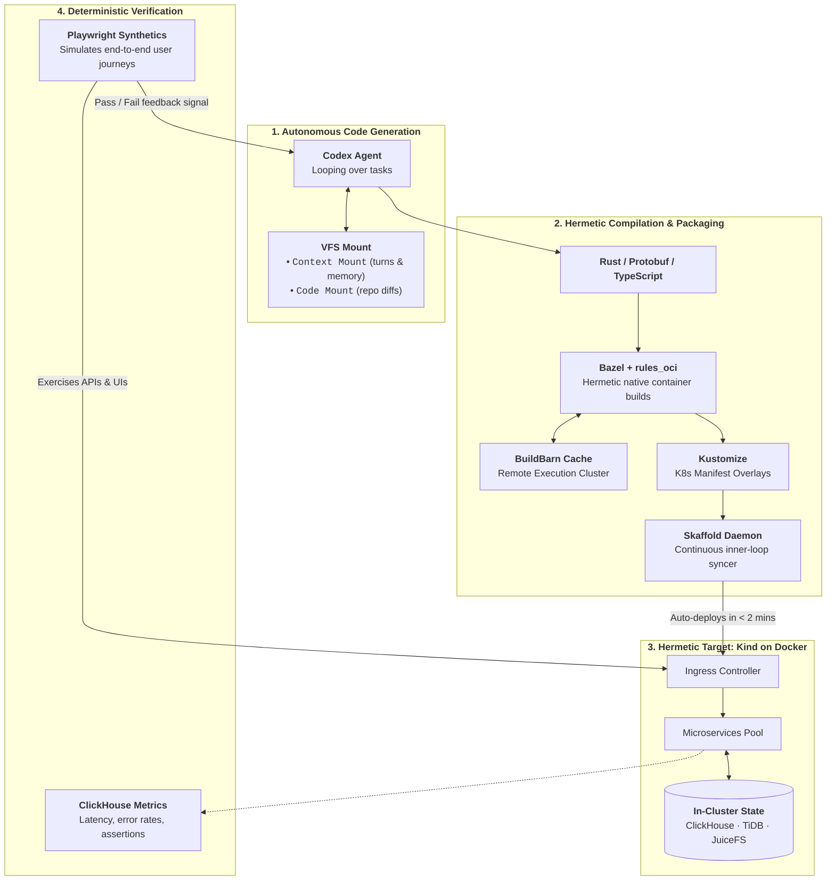

#### Key Engineering Primitives of the Inner Loop

| Component | Technical Role | Why It Is Essential for Agentic Engineering |
| :--- | :--- | :--- |
| **Bazel + BuildBarn** | Hermetic, reproducible build graph with remote distributed caching. | Prevents non-deterministic compiler failures and slashes build times from minutes to seconds, giving the agent immediate compile-time feedback. |
| **Skaffold + Kustomize** | Continuously monitors file changes and live-syncs container patches into the running cluster. | Eliminates manual `docker build` / `kubectl apply` boilerplate. The agent writes code, and Skaffold instantly hot-reloads the pod. |
| **Kind (K8s-in-Docker)** | Fully contained ephemeral Kubernetes cluster running on the host machine. | Hermeticism in action: the entire distributed microservice topology (including TiDB and ClickHouse) runs without cloud credentials or internet connectivity. |
| **Playwright Synthetics** | Headless browser and API test harness driven programmatically. | Bridges the gap between static unit tests and real integration testing; verifies whether the generated services actually serve valid responses through Ingress. |
| **VFS Mount Partitioning** | Dual-partition virtual filesystem: `Context Mount` vs `Code Mount`. | Isolates the agent's internal thought trajectories and memory from the clean Git repository working directory. |

---

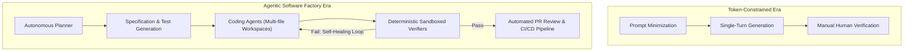

---

### 🧬 SPO (Single Problem Optimization) & Infinite Alignment: Continuous System Evolution

The centerpiece of OpenAI's software factory is the **SPO (Single Problem Optimization)** engine—a continuous feedback loop modeled as an Actor subsystem:

3812470\text{Problem} \longrightarrow \text{Proposals (Candidates)} \longrightarrow \text{Grader} \longrightarrow \text{Generation (Master)}3812470

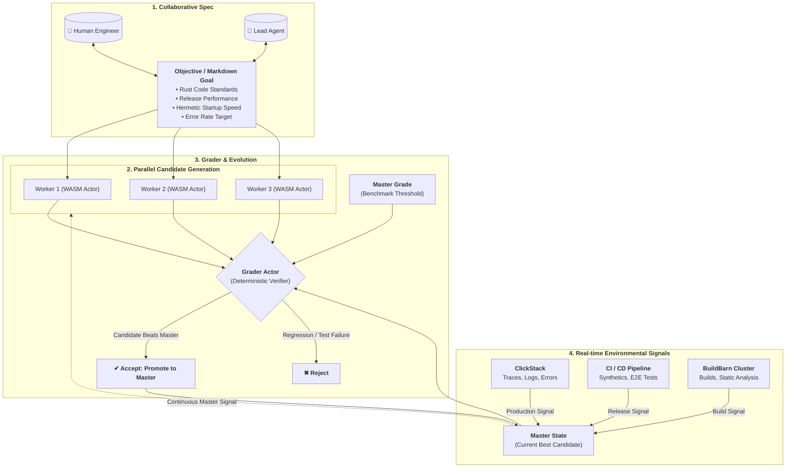

#### Why Hermeticism + Containerization Makes SPO Feasible
- **The Whole System as a Test Unit**: Because the entire distributed architecture can be spun up in an ephemeral Kind cluster in $<2$ minutes, a candidate change doesn't merely run unit tests—**a candidate + grade evaluates the behavior of the ENTIRE SYSTEM**.
- **WASM Extensibility**: Graders and proposal generators are implemented as lightweight WASM actors. Adding a new performance benchmark, security audit check, or formatting standard simply involves deploying a WASM actor into the Zot registry.

---

### ⚖️ The Two SPO Variants: Infinite vs. Finite Alignment

Carl Ross contrasts two operating paradigms for agent-driven engineering:

| Dimension | Infinite Steering + Alignment + Optimization | Finite Alignment (Discrete Objectives) |
| :--- | :--- | :--- |
| **Problem Horizon** | **Non-finite / Perpetual**: Runs continuously 24/7 without termination. | **Finite / Bounded**: Concludes when a discrete feature or fix is verified. |
| **Target Metrics** | Minimizing runtime latency, zero production errors, code entropy reduction, architectural canonicalization. | Shipping a specific feature, adding an API endpoint, migrating a single database table. |
| **Agent Topology** | Continuous candidate generation workers + deterministic **Grader** actors. | **Objective Owner** lead agent delegating subtasks to a temporary worker swarm. |
| **Master Promotion** | Promoted only when candidates provably exceed the **Master Grade** across all telemetry benchmarks. | Committed directly into master once acceptance criteria and synthetic tests pass. |

---

### 🌪️ Codebase Entropy: Why You Cannot Contain Entropy at Merge Time
One of the most profound insights from Carl Ross's talk is how agentic factories manage software decay:

- **The Law of Software Entropy**:
  - Over time, all growing codebases suffer from creeping complexity, stylistic inconsistency, duplicated logic, and performance regressions.
  - In a human development workflow, engineers attempt to contain entropy at **PR review / merge time** (blocking PRs for nitpicks, lint rules, or minor pattern deviations).
- **The Factory Reality: Merge-Time Gating Fails**:
  - In a software factory generating dozens of PRs an hour, gating entropy at merge time creates massive pipeline gridlock and slows down velocity.
- **The Solution: Continuous Asynchronous "Graded Consistency"**:
  1. **Build Initial Standards & Evolving Frameworks**: Start with clear architectural baselines (e.g. *"all inter-service RPCs must strictly use gRPC & Protobuf"*).
  2. **Evolve Standards Iteratively**: As architecture matures, update the objective spec.
  3. **Retroactive Continuous Application**: Do not burden feature PRs with sweeping refactors. Instead, let background **Infinite SPO workers** continuously sweep the codebase, submitting optimization proposals that canonicalize code against the updated standards.

---

### 🚀 Finite Alignment: Feature Delivery Without Feature Branches
When delivering discrete features, OpenAI rejects the traditional Git flow of long-lived feature branches:

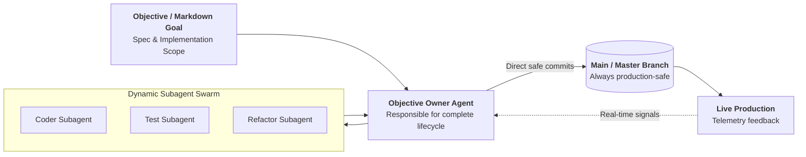

- **The Objective Owner**: A single responsible agent owns the entire feature lifecycle from spec breakdown to production verification.
- **No Long-Lived Feature Branches**:
  - Long-lived branches lead to merge conflicts, stale assumptions, and integration nightmares.
  - Agents make **small, incremental, production-safe changes directly against master** protected by feature flags and hermetic Kind verification tests.
- **Always Fix-Forward**:
  - If a production signal indicates an issue, the Objective Owner spins up fix-forward candidate workers rather than rolling back the entire trunk.

---

### ⚙️ The New Bottlenecks in Production Agentic Factories
1. **Deterministic Verifiers & Feedback Speed**:
   - In a software factory, agents can output hundreds of diffs per hour.
   - Without instant, deterministic feedback (typecheckers, linters, fast unit tests, sandboxed test execution), the factory produces unmaintainable hallucinations.
2. **State Coordination & Multi-Agent Consistency**:
   - Multiple agents modifying the same repository require strict workspace isolation, git branch partitioning, or lockless merging.
3. **Continuous Integration Pipeline Latency**:
   - Traditional CI pipelines built for human pull-request velocity (10–30 min runtimes) choke when bombarded with agent pull requests.

---

## 💡 Key Takeaways
1. **Asymptotic Token Economics ($\text{Cost} \to 0$) Inverts Software Engineering**:
   - When inference becomes effectively free, burning millions of tokens to continuously rewrite, refactor, benchmark, and optimize software subsystems becomes standard operational procedure.
   - Code generation is no longer the bottleneck; the bottleneck is deterministic verification and state coordination.
2. **Invest in "Non-Regrettable Work"**:
   - In an agentic factory where code can be generated and discarded in minutes, writing raw code is "regrettable" work.
   - The only durable, non-regrettable human engineering contributions are:
     1. **Clear Domain Specifications & Boundary Models**
     2. **Hermetic Test Harnesses & Synthetic Verifiers**
     3. **Production Telemetry, Metrics, and SLO Probes**
3. **The Actor Model is the Right Primitive for Agentic Fleets**:
   - Model agents as distributed actors with:
     - **Identity**: Globally addressable, decoupled from compute location.
     - **Behavior**: Compiled **WASM bytecode** distributed via OCI registries (**Zot + ORAS**) for sub-second, sandboxed invocation.
     - **Inbox**: Durable message mailboxes (**NATS JetStream**) enabling async steering and event-driven supervision.
4. **VFS Pointers Beat Prompt Context Windows**:
   - Passing code diffs, logs, and artifacts directly inside prompt context windows causes rapid token blowout and hallucination.
   - Agents mount a unified POSIX VFS (**JuiceFS + RustFS**), write artifacts to disk, and pass lightweight file references via `Tell`.
5. **Hermetic Full-Stack Verification in $<2$ Minutes**:
   - Software factories cannot depend on external cloud infrastructure or 20-minute CI queues.
   - Running Bazel + BuildBarn caching, Skaffold live syncing, and Kind ephemeral clusters allows Codex to compile, package, deploy, and verify microservices via Playwright end-to-end synthetics in seconds.
6. **Stop Trying to Contain Code Entropy at Merge Time**:
   - Gating code entropy (style, conventions, performance) at PR merge time chokes factory throughput.
   - Instead, adopt **Infinite SPO (Single Problem Optimization)**: let background candidate workers continuously generate proposals that are graded against real-time signals (**ClickStack**, **CI/CD**, **BuildBarn**) and promoted to master asynchronously.
7. **Trunk-Based Feature Delivery Without Feature Branches**:
   - Eliminate long-lived feature branches. Assign features to an **Objective Owner** agent who delegates to a swarm, commits small production-safe increments directly to master, and uses continuous fix-forward loops.

---

## 🔗 Related Notes & References
- [ContainerDays Singapore 2026](ContainerDays%20Singapore%202026.md) — Conference master agenda and session tracking
- [Lessons from Operating an Internal LLM Gateway for Production Agentic Applications (Zhong Liang Ong & Yek Khan)](Lessons%20from%20Operating%20an%20Internal%20LLM%20Gateway%20for%20Production%20Agentic%20Applications%20(Zhong%20Liang%20Ong%20&%20Yek%20Khan).md) — Loge LLM Gateway architecture at Liftoff Mobile
- [Taming Agent Sprawl - How We Scale Evals to Keep Up with Agents (Timothy Lin)](Taming%20Agent%20Sprawl%20-%20How%20We%20Scale%20Evals%20to%20Keep%20Up%20with%20Agents%20(Timothy%20Lin).md) — Resaro 5-layer evaluation harness
- [Securing AI Coding Agents with Kubernetes Sandboxes (Ryan Djurovich)](Securing%20AI%20Coding%20Agents%20with%20Kubernetes%20Sandboxes%20(Ryan%20Djurovich).md) — Kubernetes Sandboxes and ephemeral execution environments
- *The Road Under the Harness (Ng Shangru)* — Harness engineering and autonomous testing loops
